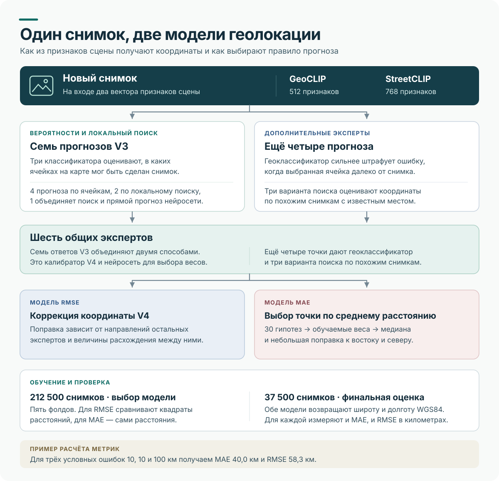

# Геолокация по эмбеддингам изображений

Проект предсказывает координаты снимка по 512 признакам GeoCLIP и 768 признакам StreetCLIP. Каждый вектор нормируется независимо, затем они объединяются. Два ансамбля специализируются на разных критериях географической ошибки.

## Две финальные модели: MAE и MSE/RMSE



| Критерий выбора | CV MAE, км | CV RMSE, км | Тест MAE, км | Тест RMSE, км | Тест MSE, км² |
|---|---:|---:|---:|---:|---:|
| V4 · историческая модель | 280,93 | 999,67 | 266,62 | 975,24 | 951 088,58 |
| RMSE/MSE · шесть экспертов | 282,93 | 973,49 | 271,85 | 952,52 | 907 303,85 |
| MAE · новый поиск | **225,30** | 1 031,85 | **214,30** | 1 026,23 | 1 053 149,07 |

MAE новой модели снизилась на 57,55 км (21,17%) по сравнению с RMSE-моделью и на 52,33 км (19,63%) к V4. Её RMSE выше прежнего RMSE-победителя на 73,71 км. Медианная ошибка снизилась с 66,80 до 18,55 км; для 77,03% тестовых снимков новый MAE-прогноз оказался ближе к правильной точке. Это два отдельных правила принятия решения с общими базовыми экспертами, обученными на 85% данных. [Сравнение распределений ошибок](docs/test-error-profile.svg).

**[Понятное объяснение без знания статей, с картинками и числовыми примерами](docs/how-models-work.md).**

- Минимизация MAE: [новый ноутбук](train250k_mae.ipynb) · [Открыть в Colab](https://colab.research.google.com/github/DenisChistov/geovec/blob/main/train250k_mae.ipynb) · [полный отчёт по 405 конфигурациям](docs/report-mae.md) · [CSV](docs/mae-cv-results.csv) · [схема победителя](docs/mae-winner.svg) · [граница Парето](docs/mae-pareto.svg).
- Минимизация RMSE/MSE: [предыдущий ноутбук](train250k_final500.ipynb) · [Открыть в Colab](https://colab.research.google.com/github/DenisChistov/geovec/blob/main/train250k_final500.ipynb) · [прежний отчёт](docs/report-500.md) · [схема победителя](docs/winner-architecture.svg).

Изменение целевой метрики не заменяет прежние результаты или модель. Прогноз с минимизацией MAE:

```bash
python src/screen/predict_mae.py --input embeddings.npy --output coordinates-mae.csv --reference /content/train250k-cv
```

Прогноз с минимизацией MSE/RMSE:

```bash
python src/screen/predict_final.py --input embeddings.npy --output coordinates-rmse.csv --reference /content/train250k-cv
```

Исходные вектора и координаты, а также обученные веса не включены в публичный репозиторий. Для воспроизведения необходим доступ к исходным данным. Обе финальные оценки сделаны на одном историческом тесте, который не использовался при подборе новых гиперпараметров; независимое подтверждение требует нового закрытого теста.

## Эксперимент RMSE/MSE · сохранённая модель

[Открыть итоговый ноутбук в Google Colab](https://colab.research.google.com/github/DenisChistov/geovec/blob/main/train250k_final500.ipynb) — для повторного обучения необходим отдельный доступ к исходному набору данных.

Новый эксперимент: [train250k_final500.ipynb](train250k_final500.ipynb). Он воспроизводит скрининг 500 конфигураций, проверку идей из статей, пятифолдовое сравнение финалистов, отбор дополняющих моделей и детальную настройку ансамбля. Все измеренные конфигурации описаны в [Markdown-отчёте](docs/report-500.md) и [CSV](docs/results-500.csv); [техническое описание архитектуры](docs/architecture-final.md), [схема обучения](docs/workflow-final500.svg), [источники идей](docs/literature-notes.md). Сводные JSON с метриками находятся в `artifacts/`, исходные эмбеддинги и координаты не включены.

<!-- FINAL_METRICS:BEGIN -->
Победитель по пяти фолдам: `tuned:all/shared/expert/a0.01/tail0/cap20000`.

| Метод | CV MAE, км | CV RMSE, км | Тест MAE, км | Тест RMSE, км |
|---|---:|---:|---:|---:|
| Историческая V4 | 280,93 | 999,67 | 266,62 | 975,24 |
| Итоговая модель | 282,93 | 973,49 | **271,85** | **952,52** |

Изменение тестового RMSE к V4: -22.71 км (-2.33%). Изменение MAE: +5.22 км. Победитель зафиксирован до открытия тестовых координат. Внешняя проверка использует исторический holdout, поэтому для независимого подтверждения потребуется новый закрытый набор.

Отдельный минимум MAE среди финальных кандидатов именно прежней RMSE-серии: `meta/experts/mlp_gate` — 274,67 км (RMSE 1 012,45 км). Его не проверяли на тесте в рамках этой серии: критерий отбора — RMSE. Новый отдельный поиск по MAE описан выше.
<!-- FINAL_METRICS:END -->

Прогноз для новых эмбеддингов после обучения:

```bash
python src/screen/predict_final.py --input embeddings.npy --output coordinates.csv \
  --reference /content/train250k-cv
```

Вход — матрица `n × 1280`, GeoCLIP (512) затем StreetCLIP (768). Для поиска и базового ансамбля V3 нужна исходная подготовленная **обучающая** база. Тестовые метки для прогноза не требуются. Параметры и контрольные суммы победителя находятся в `full500/final-provenance.json` рабочего каталога Colab.

## V4 · предыдущий этап

[train250k_v4.ipynb](train250k_v4.ipynb), [схема](docs/workflow-v4.svg), [отчёт по 50 вариантам](docs/report-v4.md). Калибратор взаимодействий получил MAE 266,62 км и RMSE 975,24 км на 37 500 отложенных снимках после выбора на пяти фолдах. Он обучен на 212 500 OOF-прогнозах.

Применение итогового калибратора к новым эмбеддингам:

```bash
python src/predict_v4.py --input embeddings.npy --output coordinates.csv \
  --reference /content/train250k-cv --models /content/train250k-cv/v4 \
  --base-models /content/train250k-cv/v3
```

## V3

Откройте [train250k_v3.ipynb](train250k_v3.ipynb) для третьего эксперимента. [Схема V3](docs/workflow-v3.svg) показывает сбор вероятностных и географических признаков, вложенное обучение CatBoost и отдельный финальный тест.

V3 сравнивает разные температуры softmax, ансамбль нескольких независимых кластерных моделей на 512 и 1 024 ячейки, уточнение по похожим снимкам с учётом плотности, адаптивные веса и локальную поправку CatBoost. Вероятности и координаты центров подаются по рангу, так как независимые K-means не гарантируют одинаковые идентификаторы ячеек. Признаки второго уровня дополнены 32 компонентами PCA, обученными внутри внешнего фолда.

После переобучения сохранённые параметры можно применять к новым эмбеддингам без повторного обучения. Вход — NumPy-массив из 1 280 компонент на снимок (512 GeoCLIP, затем 768 StreetCLIP). Для поиска соседей нужны подготовленные файлы `dev_x.npy` и `dev_y.npy`, восстановить которые можно через подготовку данных на исходном фиксированном разбиении. Тестовые метки для прогноза не требуются.

```bash
python src/predict_v3.py --input embeddings.npy --output coordinates.csv \
  --models /content/train250k-cv/v3 --reference /content/train250k-cv
```

## Предыдущие эксперименты

Откройте [train250k_final.ipynb](train250k_final.ipynb) для прогона второго эксперимента. [Схема обучения](docs/workflow.svg) показывает внешний пятифолдовый цикл, подготовку внутренних предсказаний для CatBoost и отдельную итоговую оценку. В ноутбуке три шага: подготовка данных, выбор по CV, переобучение победителя и тест.

В новом эксперименте сравниваются поиск соседей, две нейросети, смешивание с фиксированным и адаптивным весом и три варианта CatBoost второго уровня. Отдельная ветка сравнивает частотный baseline с нейросетевой классификацией по 512 и 1 024 сферическим кластерам. Центры и частоты определяются только по тренировочным точкам каждого фолда. Признаки второго уровня включают координаты прогнозов, сходство эмбеддингов, географический разброс и согласие соседей из двух пространств признаков, а также 32 компоненты PCA. Все обучаемые преобразования при валидации строятся внутри внешней обучающей части.

Итоговый прогон использует то же историческое тестовое разбиение. Его прежние агрегированные метрики уже известны. Новые кандидаты выбираются по пяти фолдам, а на тесте оценивается только заранее зафиксированный победитель. Для независимого подтверждения качества нужен новый закрытый тест.

Каталог `notebooks/` и инструкции ниже описывают первый эксперимент.

## Как запустить первый эксперимент в Colab

1. Создайте среду с GPU. В эксперименте использовалась Tesla T4.
2. Получите доступ к этому репозиторию и поместите его копию в среду Colab. Откройте ноутбуки из папки `notebooks/` по порядку. Все шаги выполняются в одной среде или в средах с доступом к той же папке артефактов.
3. В ноутбуке подготовки подключите Диск и задайте путь к папке с `train_manifest.parquet`. Подготовка проверяет 89 пар `*_metadata.parquet` и `*_features.safetensors`, включая соответствие идентификаторов и порядка строк.
4. Ноутбуки моделей сохраняют предсказания и метрики валидации. Финальный ноутбук дообучает выбранные конфигурации на всех 212 500 записях и считает метрики на 37 500 отложенных записях.

Входные файлы, результаты предсказаний и обученные веса хранятся вне репозитория. По умолчанию промежуточные файлы находятся в `/content/train250k-cv`. Задайте `GEO_CV_ROOT`, если нужно использовать другой каталог. При сбросе среды Colab файлы в `/content` пропадут.

## Разбиение и метрики

Из 250 000 записей выделяются 37 500 для финального теста. Остальные 212 500 распределяются между пятью стратифицированными по стране фолдами по 42 500 записей. Страна используется только для разбиения. В каждом прогоне модель учится на 170 000 записях. Начальное зерно — `417359`.

Цели представлены направлениями ECEF на эллипсоиде WGS84, поэтому прогноз непрерывен у меридиана ±180°. Метрика — длина кратчайшей геодезической на WGS84 от истинной точки до прогноза. MAE — среднее расстояние в км. RMSE — корень из среднего квадрата расстояния в км. Конфигурации отбираются по суммарному MSE на всех валидационных фолдах.

## Методы

- **CatBoost** обучает многомерную регрессию `MultiRMSE` на GPU. Проверяются глубины 6, 7 и 8 и размеры ансамбля от 260 до 1 000 деревьев.
- **Прямая нейросеть** предсказывает трёхмерное направление. При обучении минимизируется квадратичная ошибка в этом представлении.
- **Сиамская модель** учит скалярное произведение выходов по парам снимков. Цель — косинус точного попарного расстояния WGS84, делённого на средний радиус Земли. Совмещение выходов с географией через ортогональное преобразование оценивается только по тренировочной части.
- **Поиск соседей и гибрид** выбирает соседей по среднему косинусному сходству двух эмбеддингов и прогнозирует взвешенное сферическое среднее координат. Кросс-валидация выбирает также вес смешивания с прямой нейросетью.

Стратифицированное случайное разбиение оценивает качество на новых снимках из того же распределения. Для оценки переноса на новые районы нужен отдельный эксперимент с географическими блоками.

## Запуск из терминала Colab

После установки зависимостей и подключения Диска из корня репозитория:

```bash
export TRAIN_250K_DIR=/content/drive/MyDrive/train_250k
python src/prepare.py
python src/pipeline.py catboost dnn siamese neighbors final
```

Итоговые метрики сохраняются в `$GEO_CV_ROOT/results.json` (по умолчанию `/content/train250k-cv/results.json`).
