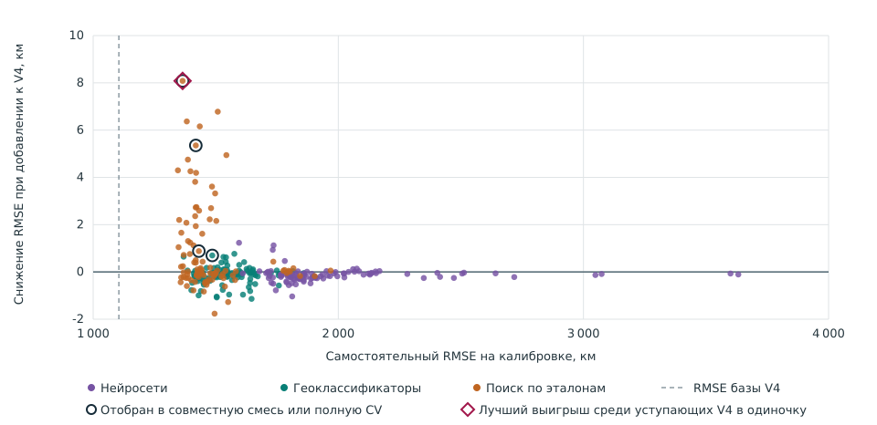

# Какие модели дополняют V4

Из 500 конфигураций исходного скрининга здесь рассмотрены 300 базовых моделей. Лучший измеренный выигрыш от отдельного добавления на калибровке дал `retrieval/shrink_whiten/ret_learned_kernel`: 8,08 км относительно V4 с RMSE 1 104,63 км. При самостоятельном применении эта модель дала 1 364,80 км.

Для V4 использовали калибратор, обученный на 60 000 строках скрининга. На отдельных 20 000 строках оценивали вес каждого базового прогноза относительно V4. Каждая из четырёх частей калибровки получила прогноз с весом, найденным по трём остальным. Отбор среди 300 вариантов всё равно использует эту калибровку. В столбце выигрыша положительное число означает снижение RMSE WGS84.

Базовые прогнозы V3 для каждой обучающей и калибровочной строки построены вне обучения на самой строке. Её метка при этом могла участвовать в обучении V3-моделей, подготовивших признаки других строк калибровки или обучения V4. Строгий вложенный протокол полной CV проверяет комбинацию на внешних фолдах отдельно.

У 103 моделей самостоятельный RMSE выше базового, но добавление со знаковым коэффициентом улучшает калибровочный результат. Ромб отмечает `retrieval/shrink_whiten/ret_learned_kernel`.

## Калибровка и выбор состава

Коэффициент со знаком допускает экстраполяцию от прогноза модели. Положительная смесь допускает только движение V4 к её прогнозу. Корреляции ошибок измеряются от истинной точки к обоим прогнозам в общей локальной системе восток–север. Совпадение длин промахов и совпадение направлений описывают разные свойства. Выигрыш в километрах проверяет, уменьшила ли ошибка смеси фактический RMSE.

| Кандидат | Самостоятельный RMSE, км | Выигрыш со знаком, км | Выигрыш при весе ≥ 0, км | Корреляция направленных ошибок |
| --- | --- | --- | --- | --- |
| `retrieval/shrink_whiten/ret_learned_kernel` | 1 364,80 | 8,08 | 8,08 | 0,628 |
| `retrieval/shrink_whiten/ret_kernel_mode` | 1 508,21 | 6,78 | 6,78 | 0,533 |
| `retrieval/shrink_whiten/ret_huber` | 1 381,92 | 6,37 | 6,37 | 0,631 |
| `retrieval/shrink_whiten/ret_support_medoid` | 1 434,80 | 6,16 | 6,16 | 0,596 |
| `retrieval/shrink_whiten/ret_hubness` | 1 418,68 | 5,35 | 5,35 | 0,621 |
| `retrieval/canonical_pair/ret_frechet` | 1 431,07 | 0,88 | 0,88 | 0,636 |
| `geo/geo_projection/geo_local_offsets` | 1 485,87 | 0,70 | 0,00 | 0,717 |

Совместная смесь включает 4 моделей после пошагового отбора. Приём каждой следующей модели требует снижения перекрёстно оценённого RMSE не менее чем на 0,05 км. Для полной пятифолдовой проверки направлено 2 дополнений с учётом уже доступных моделей и бюджета новых обучений.

| Шаг | Кандидат | Выигрыш к предыдущему шагу, км | Принят |
| --- | --- | --- | --- |
| 1 | `retrieval/shrink_whiten/ret_learned_kernel` | 8,08 | да |
| 2 | `retrieval/canonical_pair/ret_frechet` | 3,40 | да |
| 3 | `retrieval/shrink_whiten/ret_hubness` | 1,76 | да |
| 4 | `geo/geo_projection/geo_local_offsets` | 1,57 | да |

Дополнения для полной CV — `retrieval/shrink_whiten/ret_learned_kernel`, `retrieval/canonical_pair/ret_frechet`.

Все 300 строк, коэффициенты, показатели по востоку и северу, длинам ошибок и худшему децилю V4 доступны в [CSV](diversity-results.csv).

У `retrieval/shrink_whiten/ret_kernel_mode` самостоятельный RMSE составил 1 508,21 км, 117-е место среди 300. Корреляция направленных ошибок с V4 равна 0,533. Добавление этого прогноза по отдельности снизило калибровочный RMSE на 6,78 км.

## Проверка после фиксации выбора

Веса переобучены на всей калибровке и применены к 12 500 строкам первого внешнего фолда. Эти строки ранее участвовали в ранжировании исходных 500 конфигураций. У V4 RMSE 927,31 км и MAE 272,14 км. У зафиксированной совместной смеси RMSE 924,62 км и MAE 285,43 км.

| Кандидат | Самостоятельный RMSE, км | RMSE смеси со знаком, км | Выигрыш, км |
| --- | --- | --- | --- |
| `retrieval/shrink_whiten/ret_learned_kernel` | 1 310,99 | 927,68 | -0,37 |
| `retrieval/canonical_pair/ret_frechet` | 1 398,67 | 927,88 | -0,57 |
| `retrieval/shrink_whiten/ret_hubness` | 1 389,39 | 926,85 | 0,46 |
| `geo/geo_projection/geo_local_offsets` | 1 417,75 | 927,49 | -0,18 |

Для разности «совместная смесь минус V4» парный бутстрэп по 12 500 строкам с 1 500 повторными выборками дал 95%-й интервал ΔRMSE от -14,37 до 8,37 км и ΔMAE от 11,06 до 15,82 км. Отрицательная разность означает улучшение. Ресэмплинг учитывает парность двух прогнозов на одном снимке. Неопределённость переноса на новые географические блоки требует независимой проверки с разбиением по территориям.

## Дополнительная диагностика

После фиксации выбора сравнивали доступные прогнозы на тех же 12 500 строках. У каждой группы использован её сохранённый контроль. Числа ниже показывают объём доступных сравнений.

| Источник | Сравнений | Состояние |
| --- | --- | --- |
| Сохранённые правила группы decorrelated | 10 | сохранено |
| Прогнозы полного внешнего фолда | 22 | готово |
| Варианты по публикациям | 10 | готово |
| Повторно рассчитанные ансамбли скрининга | 100 | готово |

## Фиксированная доля кандидата после отбора

Для каждого кандидата точку V4 сдвинули на 25 % геодезического расстояния к его прогнозу. Таблица показывает лучший результат каждой завершённой группы на повторно использованной подвыборке из 12 500 снимков. Это исследовательское сравнение после фиксации участников полной CV.

Для базовых моделей и метамоделей контроль V4 обучен на 60 000 строках. Для кандидатов V4 использован контроль, обученный на 170 000 строках внешнего фолда. Выигрыш отсчитывается от контроля своей группы.

| Группа | Проверено | С улучшением | RMSE контроля, км | Лучшая добавка | RMSE смеси, км | Выигрыш, км | Корреляция векторов ошибок |
| --- | --- | --- | --- | --- | --- | --- | --- |
| Базовые модели | 300 | 0 | 927,31 | `retrieval/fourier_rbf/ret_learned_kernel` | 941,43 | -14,12 | 0,647 |
| Метамодели | 100 | 5 | 927,31 | `meta/rank_shape/mlp_gate` | 925,97 | 1,34 | 0,922 |
| Кандидаты V4 | 50 | 24 | 926,97 | `stack_disagreement_frame` | 924,18 | 2,79 | 0,971 |

Для каждой конфигурации опубликованы контроль, самостоятельные показатели, результат смеси и показатели согласия ошибок. [Все измерения после фиксации выбора](diversity-extended-results.csv)

Для 100 повторно рассчитанных ансамблей испытана та же доля 25 %. На этой подвыборке наименьший RMSE смеси получил `ensemble/best_mae/simplex` — 925,36 км, выигрыш относительно его контроля 1,95 км. [Все строки, включая ансамбли](diversity-extended-results.csv)

В CSV представлены все 500 первоначальных конфигураций скрининга: 300 базовых моделей, 100 метамоделей и 100 ансамблей с идентификатором фазы `ensemble`. Отдельная фаза `v4`, если доступна, относится к предыдущему эксперименту.

## Пять внешних фолдов

В полный рейтинг вошли варианты с дополнительными экспертами. Итог по фолдам получен объединением ошибок всех строк перед извлечением квадратного корня.

| Правило | MAE, км | RMSE, км |
| --- | --- | --- |
| `diverse:context` | 288,97 | 978,56 |
| `diverse:signed` | 289,42 | 979,49 |
| `diverse:convex` | 295,11 | 981,88 |
| `diverse:tailguard` | 290,37 | 985,86 |

Для 212 500 строк каждый контроль обучен заново на четырёх основных экспертах. В таблице выигрыш равен RMSE контроля минус RMSE расширенного набора. Доля улучшений считает строки, на которых расширенный набор дал меньшую ошибку.

| Правило | Четыре эксперта, км | Расширенный набор, км | Выигрыш, км | Доля улучшений |
| --- | --- | --- | --- | --- |
| `diverse:context` | 988,53 | 978,56 | 9,97 | 58,0 % |
| `diverse:signed` | 988,53 | 979,49 | 9,04 | 58,2 % |
| `diverse:convex` | 988,62 | 981,88 | 6,74 | 56,0 % |
| `diverse:tailguard` | 990,15 | 985,86 | 4,30 | 49,7 % |
