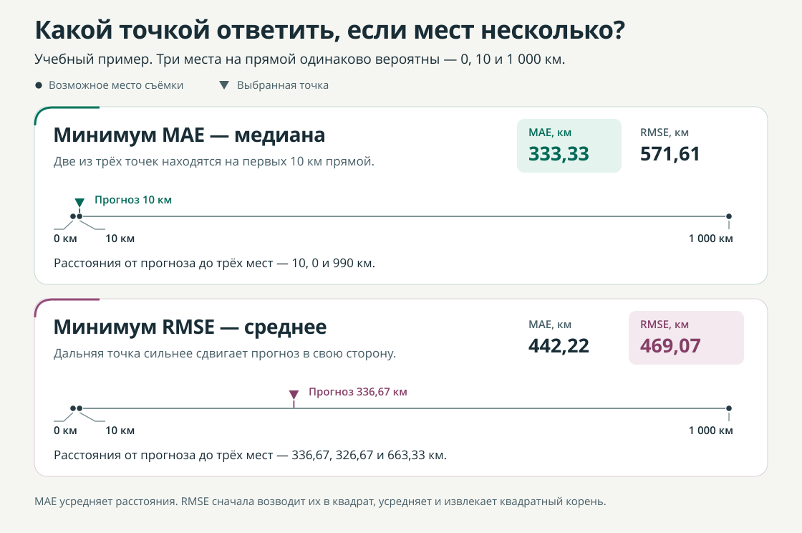
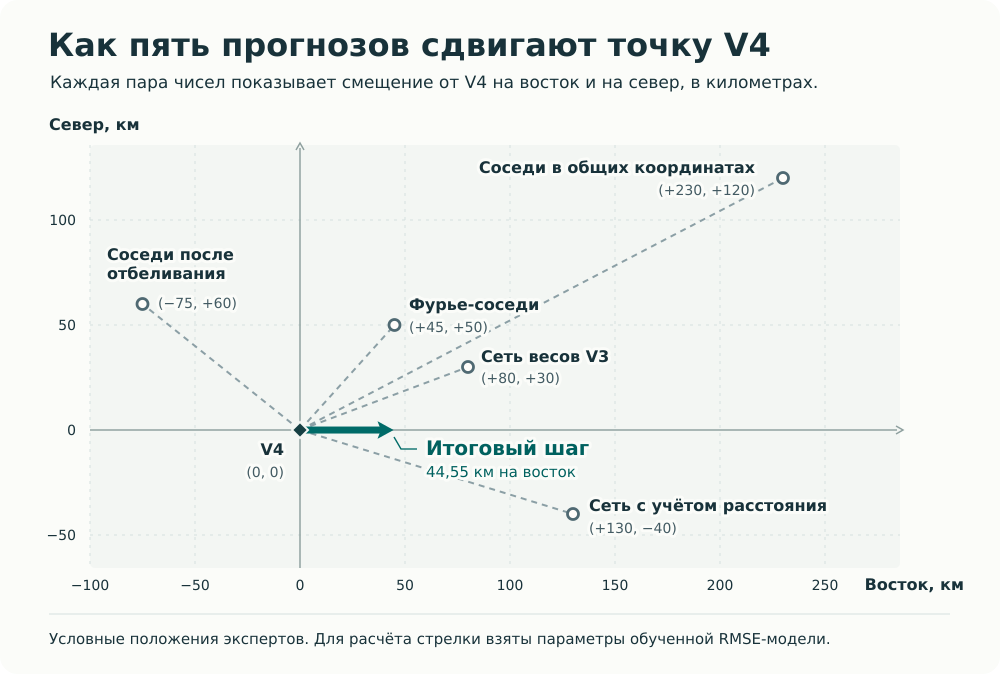
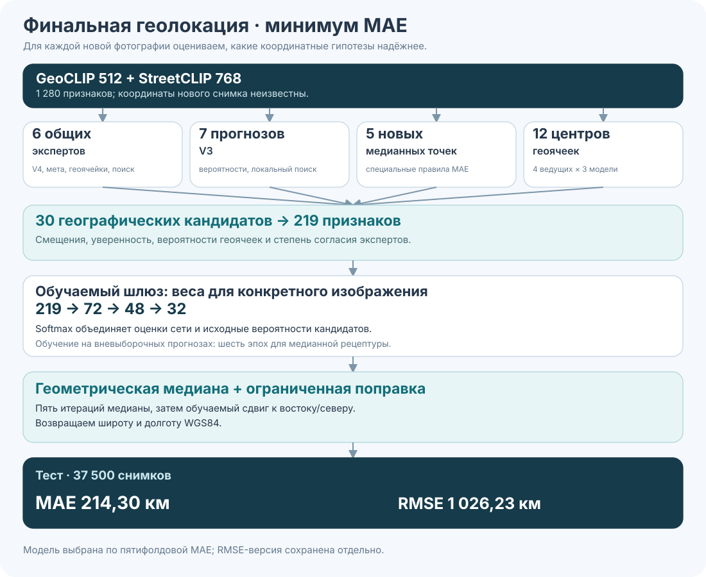
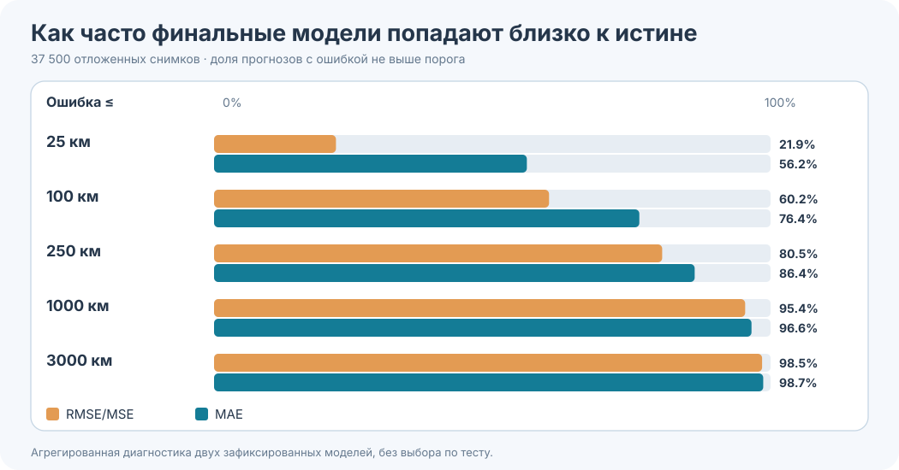

# Как по фотографии выбрать одну точку на Земле

Представьте фотографию горной дороги. По обочинам и форме склонов это могут быть Альпы. Похожие дороги есть и за океаном. Человек мог бы отметить на карте несколько мест, но от модели требуется **одна пара чисел — широта и долгота**. Что ей выбрать, если две версии выглядят правдоподобно?

Здесь построены две модели для двух способов считать цену промаха. У первой цена быстро растёт с расстоянием, поэтому на результат сильно влияют ошибки в тысячи километров. У второй каждый лишний километр стоит одинаково. Чтобы понять, почему даже при одних и тех же данных получаются разные точки, начнём с карты, на которой можно посчитать всё вручную. [Общая схема двух моделей](models-overview.svg)

## Один снимок, три возможных места

Пусть есть прямая дорога с тремя одинаково вероятными местами съёмки — на отметках **0, 10 и 1 000 км**. Модель должна назвать одну отметку. После этого для каждого возможного места мы можем измерить расстояние от ответа до истины. Это выдуманный учебный пример.

| Ответ на дороге | Ошибки для трёх возможных мест, км | MAE, км | RMSE, км |
|---|---|---:|---:|
| 10 км | 10, 0, 990 | **333,33** | 571,61 |
| 336,67 км | 336,67, 326,67, 663,33 | 442,22 | **469,07** |

**MAE** — среднее расстояние до правильного места. Для первого ответа сумма трёх ошибок равна 1 000 км. Попробуйте сдвинуть точку с 10-го километра на 11-й. Два ближних исхода теперь дальше на километр каждый, дальний стал ближе на километр. Сумма выросла. На прямой её минимум достигается в медиане, то есть в середине упорядоченного списка мест. На поверхности Земли та же постановка приводит к *геометрической медиане* — точке, для которой сумма расстояний до возможных мест минимальна.

**MSE** сначала возводит каждую ошибку в квадрат, затем берёт среднее. **RMSE** извлекает из результата квадратный корень и возвращает ответ в километры. Когда ошибка сокращается с 990 до 980 км, её квадрат уменьшается на 19 700 км². Когда она растёт с 10 до 20 км, квадрат увеличивается всего на 300 км². Критерию выгодно сместиться к далёкому варианту. На прямой его минимум здесь приходится на арифметическое среднее трёх отметок, 336,67 км. Корень сохраняет порядок вариантов, поэтому минимумы MSE и RMSE совпадают. Тот же расчёт для двух районов с вероятностями 80% и 20% показан на отдельной схеме. [Пример с двумя районами](mean-vs-median-example.svg)

## Что приходит на вход

Для каждой фотографии уже вычислены два набора чисел, **512 из GeoCLIP и 768 из StreetCLIP**. Такой набор называется *эмбеддингом*. Это результат работы сети, которая превращает изображение в точку многомерного пространства. Схожесть двух снимков можно оценить по направлению их векторов. Отдельная компонента обычно не имеет простого смысла вроде «высота горы». Для данного эксперимента доступны готовые эмбеддинги и координаты обучающих фотографий. Для новой фотографии достаточно её двух эмбеддингов. [Подготовка входных данных](../src/prepare.py) · [Исследование GeoCLIP](https://proceedings.neurips.cc/paper_files/paper/2023/hash/1b57aaddf85ab01a2445a79c9edc1f4b-Abstract.html)

Каждый из двух векторов приводится к единичной длине, затем они записываются подряд в строку из 1 280 чисел. При поиске похожих фотографий можно отдельно спросить, насколько близки первые 512 чисел, и насколько близки оставшиеся 768. Иногда оба сравнения дают почти одинаковый набор соседей. Иногда один набор ведёт к одному скоплению точек, другой — к совсем другому. Это расхождение само становится источником информации для модели.

Координаты внутри программы часто записаны тремя числами **X, Y, Z**. Представьте стрелку из центра Земли к месту съёмки. Для такой стрелки точки по разные стороны меридиана 180° остаются рядом. Простое усреднение долгот 179° и −179° дало бы 0°, на противоположной стороне Земли. Выход переводится обратно в обычные широту и долготу. Для официальной ошибки используется WGS84 — модель слегка сплюснутой Земли. Измеряется длина кратчайшего пути по её поверхности между предсказанной и истинной точками. [Преобразование координат и оценка](../src/experiment.py)

## Как появляются первые семь версий

Сначала обучающие места съёмки группируют по географической близости. Каждая точка относится к ближайшему центру. Получившиеся области называют *геоячейками*. Это удобный способ превратить вопрос «где именно?» в вопрос «к какой из сотен областей относится снимок?». Свои центры строятся на данных, выделенных для обучения. Система V3 обучает три отдельных классификатора — два на разбиениях с 512 центрами и один с 1 024. Более мелкие области дают шанс уточнить район. Два независимых разбиения на 512 областей по-разному проводят их границы. [Построение ячеек](../src/cell_v2.py) · [Классификаторы V3](../src/posterior_v3.py)

Каждая сеть выдаёт распределение по областям. Например, условный ответ «0,45 одному району, 0,35 соседнему и 0,20 остальным» описывает несколько возможностей. Такое распределение после получения признаков снимка называют *апостериорным распределением* или *posterior*. По нему можно получить точку, усреднив направления к центрам с их вероятностями. Можно усилить влияние лидирующих ячеек или сгладить отрыв лидеров. Если разбиения построены независимо, одинаковые номера ячеек могут обозначать разные места. Поэтому следующему уровню передают вероятности и координаты лучших центров в порядке их ранга.

Второй источник версий — архив фотографий с известными координатами. Для запроса ищутся визуально похожие архивные строки. Представьте, что у дороги нашлось несколько похожих кадров, снятых поблизости друг от друга, и один очень похожий кадр на другом континенте. Имеет смысл учесть как сходство изображений, так и плотность группы на карте. V3 умеет дополнительно давать больший вес соседям, рядом с которыми классификатор ожидает увидеть снимок. Карта областей и поиск похожих фотографий используют разные свидетельства. [Поиск и географическое уточнение](../src/refine_v3.py)

Так получаются **семь экспертов V3**. Здесь «эксперт» означает алгоритм, выдающий одну точку.

| Эксперт V3 | Как он выбирает место |
|---|---|
| 1. Первая сетка из 512 ячеек | Усредняет направления к её центрам с предсказанными вероятностями. |
| 2. Три сетки | Объединяет обычные ответы двух сеток на 512 и одной на 1 024 ячейки. |
| 3. Три сетки с усилением лидеров | Делает распределения более острыми, затем объединяет три ответа. |
| 4. Три сетки со сглаживанием | Даёт больше влияния альтернативным районам и объединяет ответы. |
| 5. Среднее по соседям | Взвешивает найденные места по визуальному сходству и поддержке со стороны геоячеек. |
| 6. Центр плотной группы | Находит географически согласованную группу соседей и уточняет точку внутри неё. |
| 7. Прямая сеть и поиск | Объединяет ответ сети, предсказывающей направление непосредственно по эмбеддингам, с ответом поиска похожих фотографий. |

У двух снимков могут совпасть итоговые координаты и при этом сильно различаться основания для ответа. У первого почти все ячейки и ближайшие соседи согласны, у второго два удалённых скопления случайно дали ту же среднюю точку. Поэтому вместе с семью координатами V3 сохраняет информацию о разбросе, концентрации вероятности и согласии экспертов. [Сборка семи прогнозов и их признаков](../src/run_v3.py)

## Первая поправка на карте — V4

V4 начинает с ответа эксперта № 2. Для каждого из остальных шести она вычисляет, в каком направлении и на сколько километров нужно идти от начальной точки до предложенного экспертом места. Из азимута и длины пути получаются две компоненты смещения, к востоку и к северу. Сдвиг на запад записывается отрицательной восточной компонентой.

При обучении известна ещё одна стрелка — от начального прогноза до настоящего места. Система учится воспроизводить её с помощью шести доступных стрелок. Коэффициенты зависят от семи характеристик, среди которых разброс экспертов, выраженность наиболее вероятной ячейки и концентрация соседей. Например, поправка по локальной группе может быть разной, когда вероятности собраны в одном районе и когда разбросаны по миру. В варианте `cal_interaction` шесть стрелок умножаются на константу и семь характеристик. Это даёт 48 обучаемых коэффициентов. Применив найденное смещение к исходной точке по геодезической WGS84, получаем прогноз V4. [Калибратор V4](../src/calibration_ideas.py)

## Как итоговая модель RMSE соединяет шесть прогнозов

На следующем уровне начальной точкой служит уже **V4**. Пять дополнительных специалистов предлагают, куда от неё сдвинуться. Семь экспертов V3 и шесть прогнозов на этом уровне — два последовательных этапа. Первый из шести, V4, сам использует результаты семёрки. [Архитектура и измеренные результаты](architecture-final.md)

| Прогноз финального ансамбля | Откуда берётся его точка |
|---|---|
| V4 | Начальная точка после первой геодезической поправки. |
| Нейросеть по семи экспертам | Получает семь направлений и их попарное согласие. Возвращает для данного снимка веса семи ответов и смешивает их. |
| Сеть со штрафом за дальнюю ошибку | Оценивает 512 геоячеек. На обучении соседние с истиной ячейки получают часть целевой вероятности, а за вероятность на очень далёких местах действует дополнительный штраф. |
| Соседи по признакам Фурье | Нелинейное преобразование признаков задаёт свой способ измерять сходство фотографий. Для 64 найденных соседей обученное правило учитывает визуальное сходство, ранг и географическую поддержку. |
| Соседи после выравнивания масштаба признаков | Выделяет главные направления изменения каждого эмбеддинга и ослабляет перевес самых изменчивых. Список из 64 соседей может измениться. Правило их взвешивания обучено для такого поиска. |
| Соседи по согласованным признакам | Находит направления, в которых два эмбеддинга меняются согласованно. По 64 соседям приближает среднее Фреше — точку с минимальной взвешенной суммой квадратов расстояний по сфере. |

У сети со штрафом за дальние ошибки есть понятный прообраз. Если правильное место у границы двух ячеек, ответ в соседней заслуживает большего доверия, чем ответ за океаном. В работе PIGEON это реализовано географическим сглаживанием целевых вероятностей. Здесь к этой идее добавлен штраф за ожидаемый квадрат расстояния. Во время обучения сети расстояния приближаются сферическими дугами. Финальное сравнение всех моделей считает геодезические WGS84. [PIGEON, CVPR 2024](https://openaccess.thecvf.com/content/CVPR2024/html/Haas_PIGEON_Predicting_Image_Geolocations_CVPR_2024_paper.html) · [Реализация целевой функции](../src/literature.py) · [Способы поиска соседей](../src/screen/features.py)

Последний шаг называется *ridge-регрессией*. Её задача — подобрать коэффициенты пяти стрелок так, чтобы на обучающих примерах их сумма попадала ближе к истине. При слишком больших отклонениях коэффициентов от заданного консервативного набора растёт штраф. Это помогает, когда несколько стрелок обычно показывают почти в одну сторону и можно получить похожий обучающий результат при самых разных весах. Для конкретного снимка коэффициенты меняются в зависимости от того, насколько расходятся его эксперты. Победившая версия использует одинаковый коэффициент данного эксперта для восточной и северной компоненты, силу регуляризации 0,01 и девять характеристик расхождения. [Расчёт характеристик и коэффициентов](../src/screen/tune_rules.py)

### Полный расчёт для одного условного снимка

Поставим V4 в начало локальной карты. Допустим, остальные пять точек дают смещения из таблицы. Они придуманы для иллюстрации. Коэффициенты рассчитаны настоящей сохранённой моделью для этих смещений. Более далёкий кандидат может получить маленький вес, если при таком сочетании расхождений модель редко извлекала пользу из его поправки. [Коэффициенты обученного ансамбля](../artifacts/full500/winner-parameters.json)

| Источник | Смещение на восток и север, км | Вес для этого примера | Вклад на восток и север, км |
|---|---:|---:|---:|
| Нейросеть по семи экспертам | (+80, +30) | 0,18825 | (+15,06, +5,65) |
| Сеть со штрафом за дальний промах | (+130, −40) | 0,21662 | (+28,16, −8,66) |
| Признаки Фурье | (+45, +50) | 0,02314 | (+1,04, +1,16) |
| Выравнивание масштаба | (−75, +60) | 0,01722 | (−1,29, +1,03) |
| Согласованные признаки | (+230, +120) | 0,00687 | (+1,58, +0,82) |

До округления суммарный сдвиг равен **44,55 км на восток и 2,4 м на юг**. Северные составляющие почти погасили друг друга. Веса применяются к смещениям от первоначальной точки, поэтому их сумма может отличаться от единицы. Программа откладывает итоговую длину по вычисленному азимуту на эллипсоиде. Так получается одна широта и одна долгота.

На общей выборке из 212 500 вневыборочных прогнозов этот вариант получил **RMSE 973,49 км и MAE 282,93 км**. На историческом контроле из 37 500 строк — **952,52 и 271,85 км** соответственно. Для V4 на том же контроле значения равны **975,24 и 266,62 км**. Новая поправка уменьшила RMSE на 22,71 км, при этом среднее расстояние до правильного места увеличилось на 5,22 км. Это измеренный пример того же различия между критериями, которое мы видели на учебной дороге. [Записанные результаты](../artifacts/full500/results.json)

## Как выбирается ответ при равной цене каждого километра

Здесь снова полезно вернуться к нескольким правдоподобным местам. Когда модель указывает на два соседних района и один удалённый, среднее по трём положениям может заметно отойти от обоих соседних районов. Правила для MAE могут, например, искать геометрическую медиану с весами по вероятностям, выбрать наиболее поддержанный район или оценить ожидаемое расстояние для каждого кандидата и вернуть кандидата с наименьшей оценкой. Выбирать между такими способами можно по измеренному среднему расстоянию на примерах, координаты которых были скрыты при построении каждого прогноза.

Проверяются несколько семейств. Одни берут центры наиболее вероятных ячеек и вероятности трёх сеток V3, иногда добавляя центр локальной группы фотографий. Другие учат, как сочетать координаты экспертов при разных уровнях согласия. Нейросетевым вариантам доступны шесть финальных специалистов, семь координат V3, пять готовых способов обобщить геоячейки и по четыре ведущих центра каждой из трёх сеток — до 30 кандидатных направлений. Некоторые правила затем выбирают готовую точку, другие могут вернуть промежуточную. Победителя определяет наименьшая MAE на пяти фолдах. [Схема эксперимента](workflow-mae.svg) · [Ноутбук для MAE](../train250k_mae.ipynb)

### Как нейросеть учится выбирать медиану

Для одного из проверяемых способов можно проследить весь расчёт. Сначала программа рисует локальную карту вокруг прогноза V4 и отмечает на ней 30 кандидатов. По этой карте и показателям уверенности она формирует **219 чисел**. Три задают положение V4 на земном шаре. Ещё 60 — пары восточных и северных составляющих для всех 30 точек. Две группы по 30 чисел описывают, насколько точки удалены от V4 и от устойчивого центра группы. Оставшиеся 96 описывают вероятности геоячеек и согласие соседей. Так сеть получает одновременно сами гипотезы и сведения об их надёжности.

Небольшая сеть сужает эти 219 признаков до 72, затем до 48 и выдаёт 30 оценок. В первом скрытом слое нормировка LayerNorm удерживает числа в сопоставимом масштабе. После обоих скрытых слоёв гладкая нелинейная функция SiLU позволяет оценке зависеть от сочетания признаков. У каждого кандидата уже есть начальный вес. Восемнадцать готовых прогнозов делят между собой 67%, а оставшиеся 33% распределяются между двенадцатью центрами с учётом вероятностей их ячеек. Сеть меняет эти исходные предпочтения для данного снимка. Преобразование softmax даёт положительные веса с суммой один.

Остаётся получить из весов координату. Начав со взвешенного среднего на локальной карте, алгоритм пять раз пересчитывает центр. На каждом шаге близкие к текущему центру точки приобретают больше влияния. Небольшое сглаживание позволяет выполнять расчёт и при совпадении точек. Это итерации Вайсфельда для приближённой взвешенной геометрической медианы на этой карте. В соседнем варианте сеть выдаёт ещё два числа, всего 32, и после медианы делает ограниченную дополнительную поправку к востоку и северу. При обучении этих правил уменьшают средний угол между направлениями к ответу и истине с учётом геодезической широты. Для окончательного выбора среднее расстояние заново измеряют на эллипсоиде WGS84. [Ноутбук с реализацией](../train250k_mae.ipynb)

<!-- MAE_WINNER:BEGIN -->
**Победитель по MAE — `gate:mae_gate:residual`.** Проверено 405 конфигураций на пяти фолдах (всего 2025 сравнений).

В финальном варианте для каждого изображения формируются 30 возможных направлений: шесть общих экспертов, семь исходных прогнозов V3, пять специальных медианных/локальных предложений и по четыре самых вероятных центра трёх классификаторов (ещё 12). Никаких истинных координат этого изображения на вход модели не подаётся.

Из направлений строятся 219 признаков: положение опорной точки, локальные смещения и расстояния кандидатов, степень взаимного согласия, ведущие вероятности, статистика распределения и поиска. Это численный способ сообщить сети, согласны ли эксперты, есть ли один сильный центр и насколько широк разброс.

Сеть: 219 входов → 72 нейрона (LayerNorm и SiLU) → 48 нейронов (SiLU) → 32 выходов. Для медианной/остаточной рецептуры используется 6 эпох, AdamW, исходный LR 0,0035, weight decay 0,012, batch 2048. Обучается на 212 500 вневыборочных прогнозах, а общие базовые модели уже обучены на тех же 85% снимков.

Медиана смеси с ограниченной обучаемой поправкой по востоку и северу.

Пример, не настоящий тестовый снимок: пусть почти все доверенные эксперты указывают на один район, а несколько оставшихся — на другую страну. Softmax превращает логиты в веса. Сначала берётся взвешенное среднее локальных смещений. Затем пять итераций сдвигают эту точку к взвешенной геометрической медиане: вклад каждого направления пропорционален его весу, делённому на сглаженное расстояние до текущего центра. Это позволяет сохранить точку в плотном скоплении вместо компромисса далеко от обеих гипотез.

После медианы два дополнительных выхода позволяют сделать ограниченную поправку восток/север, если из диагностик видно, что медиану нужно немного сдвинуть.

Потери этой нейросети основаны на угловом приближении геодезической MAE. Выбор конфигурации и окончательная оценка производятся по точному геодезическому расстоянию WGS84.

| Критерий выбора | CV MAE, км | CV RMSE, км | Тест MAE, км | Тест RMSE, км | Тест MSE, км² |
|---|---:|---:|---:|---:|---:|
| V4 · историческая модель | 280,93 | 999,67 | 266,62 | 975,24 | 951 088,58 |
| RMSE/MSE · шесть экспертов | 282,93 | 973,49 | 271,85 | 952,52 | 907 303,85 |
| MAE · новый поиск | **225,30** | 1 031,85 | **214,30** | 1 026,23 | 1 053 149,07 |

MAE новой модели изменилась на -57.55 км (-21.17%) по сравнению с RMSE-моделью и на -52.33 км (-19.63%) к V4. Её RMSE отличается от прежнего RMSE-победителя на +73.71 км. Это две отдельные конфигурации с разными правилами выбора; они используют общие базовые эксперты, обученные на 85% данных.

[Таблица всех вариантов и гиперпараметров](report-mae.md) · [Граница Парето](mae-pareto.svg) · [Ноутбук](../train250k_mae.ipynb)

### Насколько часто прогноз действительно близок?

После фиксации обеих моделей сравнили их ошибки для одних и тех же 37 500 снимков. MAE-модель оказалась ближе к истине в 77.03% случаев; RMSE-модель — в 22.97% (остальные — совпадения). Это диагностика уже выбранных моделей, а не новый подбор.

| Граница ошибки | RMSE-модель | MAE-модель |
|---|---:|---:|
| ≤ 25 км | 21.91% | 56.21% |
| ≤ 100 км | 60.19% | 76.42% |
| ≤ 250 км | 80.52% | 86.36% |
| ≤ 1000 км | 95.43% | 96.57% |
| ≤ 3000 км | 98.48% | 98.68% |

Медиана расстояния: 66,80 км у RMSE-модели и 18,55 км у MAE-модели. 95-й процентиль: 911,14 и 686,58 км соответственно.

<!-- MAE_WINNER:END -->

## Где модель видела правильный ответ

Из 250 000 строк 212 500 использованы для разработки. Их разбили на пять частей по 42 500, сохраняя соотношение стран. Каждая часть один раз выступила экзаменом для моделей, обученных на остальных четырёх. При обучении ансамбля внутри этих четырёх частей нужно дополнительно получить прогнозы для примеров, которых соответствующий базовый алгоритм не видел при обучении. Иначе ансамбль мог бы переоценить специалиста, просто запомнившего обучающие места. Такой прогноз называют *вневыборочным* или *out-of-fold*, сокращённо OOF. [Подготовка разбиения](../src/prepare.py) · [Обучение по вложенным разбиениям](../src/screen/diversity_cv.py)

Для окончательной модели выбирают правило по пяти фолдам и заново оценивают его параметры по доступным прогнозам разработки. Затем предсказывают координаты оставшихся 37 500 строк и сверяют их с ответами. Пять фолдов использовались также для выбора из многих конфигураций, поэтому их результат включает эффект отбора победителя. Контроль из 37 500 строк исторический — его сводные результаты уже были известны по прошлым экспериментам. Географически соседние снимки могли попасть в разные фолды. Поэтому приведённые числа описывают качество на выбранном разбиении, а вопрос о новом регионе, целиком исключённом из обучения, требует отдельного измерения. [Эксперимент по RMSE](../train250k_final500.ipynb) · [Таблицы результатов](report-500.md)
