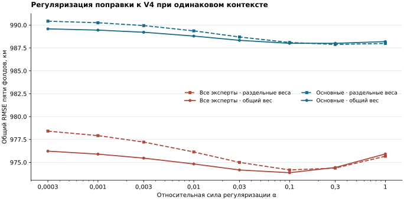

# Геолокация по двум эмбеддингам — скрининг и полная проверка

## Результаты

По пяти фолдам выбрана конфигурация `tuned:all/shared/expert/a0.01/tail0/cap20000`. На историческом тесте из 37 500 изображений она получила **RMSE 952,52 км** и **MAE 271,85 км**.

На 12 500 изображениях скрининга минимальный RMSE среди 500 измеренных конфигураций получила `ensemble/best_rmse/simplex` — **940,86 км**. Её MAE составила 296,95 км.

V4 на этих же изображениях получил RMSE 926,97 км и MAE 275,00 км. У лидера скрининга Δ RMSE к V4 составила +13,89 км. Число конфигураций с меньшим RMSE, чем у V4, — 0 из 500.

На полном CV у выбранной конфигурации RMSE 973,49 км и MAE 282,93 км. Относительно контроля V4 на этом этапе Δ RMSE равна -26,18 км и Δ MAE равна +1,99 км.

В проверке идей из публикаций лучший результат по RMSE показала `distance_risk_plus_v4`. Относительно V4 на тех же пяти фолдах её Δ RMSE составила -3,88 км, Δ MAE — +12,67 км.

Все измеренные конфигурации с описаниями и численными результатами доступны в [CSV](results-500.csv). Самостоятельные исследовательские предложения собраны в [каталоге гипотез](ideas-500.json).

## Данные, метрики и выбор модели

Каждое из 250 000 изображений представлено 512 компонентами GeoCLIP и 768 компонентами StreetCLIP. Историческое стратифицированное разбиение выделяет 212 500 изображений для разработки и 37 500 для теста. Пять внешних фолдов разработки содержат по 42 500 контрольных и 170 000 обучающих строк. Стратификация по стране сохраняет доли стран, и близкие географические точки могут попасть в разные фолды.

Для каждого примера единичный вектор ECEF переводится в геодезические широту и долготу. Расстояние до истинных координат вычисляется обратной геодезической задачей на эллипсоиде WGS84. MAE — среднее расстояние в километрах. RMSE — квадратный корень из среднего квадрата расстояний. Большие промахи влияют на выбор по RMSE сильнее. Общий RMSE пяти фолдов рассчитывается по всем квадратам ошибок с учётом размера фолдов. Внутренние функции обучения могут использовать сферические приближения.

Скрининг использует внешний фолд № 1, в коде `fold=0`, и зерно `904317`. Из обучающей части случайно выбраны непересекающиеся 60 000 строк для базовых моделей и 20 000 для калибровки. Из контрольной части случайно выбраны 12 500 для общего рейтинга. Метапризнаки V3 для обучающих строк получены вне соответствующего внутреннего фолда. Для контрольных строк их базовые модели обучены в пределах внешней обучающей части. В ансамблях состав группы и веса выбираются по 20 000 калибровочным примерам. Поиск и нейросетевые операции используют GPU; часть предобработки, геодезических расчётов и объединения прогнозов выполняется на CPU.

Финалисты отбираются как объединение общего топ-5 скрининга и лидеров каждого из пяти семейств. Повторяющиеся кандидаты учитываются один раз. Их повторно сравнивают на полных пяти фолдах. В эти фолды входят изображения, участвовавшие в отборе при скрининге, поэтому оценка финалистов характеризует внутренний выбор модели. Исторические тестовые агрегаты прошлых версий были известны до этой серии экспериментов. Это ограничивает независимость повторной оценки на тех же 37 500 изображениях.

## Исторический тест


| Версия | Выбранный метод | Строк | MAE, км | RMSE, км | Δ RMSE к V4, км |
|---|---|---|---|---|---|
| V4 | `cal_interaction` | 37 500 | 266,62 | 975,24 | контроль |
| Новый поиск | `tuned:all/shared/expert/a0.01/tail0/cap20000` | 37 500 | 271,85 | 952,52 | -22,71 |

Контрольная сумма SHA-256 файла тестовых прогнозов — `a8c52e93346515a89a83e9a7349ad1c894bdca66681b668b81051afd22d4f0fc`.

Контрольная сумма зафиксированного решения CV — `4604c08fdca3e58ef9b5d4805995f7362c444b52aa96c9289eea1ff6609d9ae4`.

## Пять фолдов финалистов

Для совместных правил базовые специалисты прямой регрессии, ячеек, поиска и модели из публикаций дают прогнозы на трёх вложенных разбиениях для обучения весов. В совместном прогнозе их совокупная номинальная доля составляет 1/2. Метаэксперт и контрольный V4 добавляются последовательной сферической интерполяцией с номинальными долями 1/6 и 1/3. У отдельных кандидатов `blend:` доля финалиста в интерполяции с V4 составляет 0,33. Δ в этом разделе считается к повторно оценённому V4.

Отобранные конфигурации — `neural/signed_sqrt/bilinear`, `geo/shrink_whiten/geo_ellipsoid_risk`, `retrieval/fourier_rbf/ret_learned_kernel`, `meta/experts/mlp_gate`, `ensemble/best_rmse/simplex`, `ensemble/tail_safe/soft_risk`, `ensemble/tail_safe/simplex`, `ensemble/near_precision/simplex`.

Компоненты совместных правил — `prior/prior/v4`, `neural/signed_sqrt/bilinear`, `geo/shrink_whiten/geo_ellipsoid_risk`, `retrieval/fourier_rbf/ret_learned_kernel`, `meta/experts/mlp_gate`, `paper/distance_risk`.

Усиленные ансамбли — `prior/prior/v4`, `meta/experts/mlp_gate`, `paper/distance_risk`, `retrieval/fourier_rbf/ret_learned_kernel`.

Ансамбли с дополнительными специалистами — `prior/prior/v4`, `meta/experts/mlp_gate`, `paper/distance_risk`, `retrieval/fourier_rbf/ret_learned_kernel`, `retrieval/shrink_whiten/ret_learned_kernel`, `retrieval/canonical_pair/ret_frechet`.


| № | Конфигурация | Что проверено | MAE, км | RMSE, км | Δ RMSE, км | RMSE фолдов 1–5, км |
|---|---|---|---|---|---|---|
| 94 | `diverse:context` | Поправка дополнительных экспертов зависит от согласия с соседями и величины отклонения от основной смеси. | 288,97 | 978,56 | -21,10 | 946,1 · 993,3 · 1 014,6 · 987,5 · 949,6 |
| 103 | `diverse:signed` | Остаточные направления дополнительных экспертов после учёта четырёх основных, с усиленной регуляризацией. | 289,42 | 979,49 | -20,18 | 947,4 · 993,5 · 1 016,0 · 987,8 · 951,1 |
| 113 | `diverse:convex` | Выпуклая смесь с ограничением суммарного веса дополнительных экспертов и уточнением по геодезическому риску WGS84. | 295,11 | 981,88 | -17,79 | 950,2 · 996,4 · 1 020,0 · 989,0 · 952,0 |
| 118 | `diverse:tailguard` | Согласованная поправка дополнительных экспертов, усиление которой зависит от прогнозируемого риска крупного промаха. | 290,37 | 985,86 | -13,81 | 955,3 · 999,1 · 1 021,6 · 991,7 · 960,0 |
| 158 | `strong:anisotropic` | Раздельные веса экспертов для восточной и северной составляющих смещения. | 289,78 | 988,59 | -11,08 | 961,2 · 998,5 · 1 025,5 · 994,0 · 962,3 |
| 168 | `strong:signed` | Регуляризованная линейная комбинация геодезических смещений с весами обоих знаков. | 290,36 | 988,73 | -10,94 | 961,6 · 998,4 · 1 026,1 · 994,3 · 961,7 |
| 171 | `strong:disagreement` | Выпуклые веса сглаживаются между обученными уровнями расхождения экспертов. | 288,84 | 988,73 | -10,94 | 961,8 · 998,5 · 1 026,4 · 994,3 · 961,2 |
| 172 | `strong:convex` | Неотрицательные веса четырёх экспертов с уточнением по квадрату точной геодезической WGS84. | 292,15 | 988,75 | -10,92 | 960,3 · 998,2 · 1 027,4 · 994,1 · 962,1 |
| 173 | `strong:regional` | Выпуклые веса зависят от региона прогноза V4 и приближаются к общему решению в редких регионах. | 288,95 | 988,75 | -10,91 | 963,6 · 997,0 · 1 026,2 · 994,2 · 961,3 |
| 225 | `strong:shrink` | Поправка двух специалистов к V4 ослабляется при расхождении направлений; усиление оценивается на обучении. | 280,56 | 991,76 | -7,91 | 966,6 · 1 002,2 · 1 026,1 · 997,5 · 965,0 |
| 226 | `strong:fixed_v4` | Фиксированная смесь V4, метамодели и модели риска с весами 0,55 / 0,30 / 0,15. | 282,15 | 991,86 | -7,81 | 966,5 · 1 001,8 · 1 027,4 · 997,0 · 965,1 |
| 247 | `strong:balanced` | Равные веса V4, метамодели и модели географического риска в плоскости WGS84. | 291,65 | 995,63 | -4,04 | 968,5 · 1 001,9 · 1 039,0 · 997,4 · 969,6 |
| 248 | `literature:distance_risk_plus_v4` | Классификатор ячеек со штрафом за ожидаемый квадрат сферического расстояния между классами. Новый прогноз получает 0,33 веса при смешивании с V4. | 293,61 | 995,79 | -3,88 | 975,0 · 996,9 · 1 036,2 · 1 006,2 · 963,1 |
| 254 | `blend:ensemble/near_precision/simplex` | Сферическая интерполяция от V4 к финалисту с долей финалиста 0,33. Лучшие по доле малых ошибок. Выпуклая комбинация экспертов, оптимизированная по квадратичной ошибке. | 294,13 | 997,53 | -2,14 | 968,2 · 1 017,3 · 1 033,6 · 1 006,0 · 960,5 |
| 255 | `blend:meta/experts/mlp_gate` | Сферическая интерполяция от V4 к финалисту с долей финалиста 0,33. Координаты семи экспертов и их попарное согласие. Нейросетевой шлюз для семи экспертов. | 277,32 | 998,38 | -1,29 | 974,7 · 1 011,1 · 1 027,3 · 1 006,1 · 971,4 |
| 256 | `joint:signed_wgs84` | Совместное правило по специалистам. Регуляризованная регрессия смещений восток/север. Затем добавлены метамодель и V4 с фиксированными долями. | 309,12 | 998,83 | -0,84 | 972,5 · 1 005,7 · 1 040,5 · 1 002,0 · 971,8 |
| 259 | `reference_v4` | Повторно обученная контрольная конфигурация V4. | 280,93 | 999,67 | 0,00 | 979,5 · 1 011,0 · 1 028,6 · 1 009,0 · 969,1 |
| 260 | `literature:distance_smoothing_plus_v4` | Географическое сглаживание целевой вероятности ячеек в духе PIGEON. Новый прогноз получает 0,33 веса при смешивании с V4. | 288,69 | 999,78 | +0,11 | 981,3 · 1 004,6 · 1 035,9 · 1 007,4 · 968,3 |
| 262 | `joint:simplex` | Совместное правило по специалистам. Выпуклая комбинация экспертов, оптимизированная по квадратичной ошибке. Затем добавлены метамодель и V4 с фиксированными долями. | 308,99 | 999,88 | +0,21 | 974,4 · 1 007,7 · 1 039,9 · 1 003,5 · 972,4 |
| 264 | `blend:ensemble/best_rmse/simplex` | Сферическая интерполяция от V4 к финалисту с долей финалиста 0,33. Восемь лучших по RMSE. Выпуклая комбинация экспертов, оптимизированная по квадратичной ошибке. | 303,56 | 1 000,11 | +0,44 | 974,3 · 1 016,8 · 1 033,3 · 1 008,3 · 966,1 |
| 268 | `literature:candidate_ranker_plus_v4` | Переранжирование координатных гипотез по прогнозируемой географической близости, по мотивам GeoRanker. Новый прогноз получает 0,33 веса при смешивании с V4. | 280,78 | 1 000,87 | +1,20 | 973,0 · 1 016,6 · 1 031,8 · 1 012,8 · 968,5 |
| 271 | `joint:context_gate` | Совместное правило по специалистам. Ridge-прогноз риска по географии и расхождению экспертных ответов. Затем добавлены метамодель и V4 с фиксированными долями. | 312,28 | 1 004,07 | +4,40 | 978,5 · 1 006,0 · 1 050,4 · 1 006,0 · 977,7 |
| 274 | `blend:ensemble/tail_safe/simplex` | Сферическая интерполяция от V4 к финалисту с долей финалиста 0,33. Лучшие по 95-му перцентилю ошибок. Выпуклая комбинация экспертов, оптимизированная по квадратичной ошибке. | 291,88 | 1 004,75 | +5,09 | 974,8 · 1 022,1 · 1 041,7 · 1 010,1 · 973,4 |
| 275 | `blend:ensemble/tail_safe/soft_risk` | Сферическая интерполяция от V4 к финалисту с долей финалиста 0,33. Лучшие по 95-му перцентилю ошибок. Экспоненциальные веса калибровочного риска. | 291,72 | 1 006,74 | +7,07 | 976,9 · 1 023,2 · 1 043,4 · 1 012,1 · 976,4 |
| 281 | `joint:regional_risk` | Совместное правило по специалистам. Локальный риск экспертов по похожим географическим калибровочным прогнозам. Затем добавлены метамодель и V4 с фиксированными долями. | 325,83 | 1 009,20 | +9,53 | 982,6 · 1 015,2 · 1 051,6 · 1 012,0 · 983,1 |
| 285 | `joint:inverse_risk` | Совместное правило по специалистам. Веса, обратные квадрату RMSE. Затем добавлены метамодель и V4 с фиксированными долями. | 328,96 | 1 010,28 | +10,61 | 984,6 · 1 016,0 · 1 052,9 · 1 013,2 · 983,1 |
| 286 | `literature:fourier_location_plus_v4` | Сопоставление вектора изображения с многомасштабными признаками Фурье координат центров, по мотивам GeoCLIP. Новый прогноз получает 0,33 веса при смешивании с V4. | 295,71 | 1 011,81 | +12,14 | 991,4 · 1 022,1 · 1 050,0 · 1 013,9 · 980,1 |
| 287 | `blend:retrieval/fourier_rbf/ret_learned_kernel` | Сферическая интерполяция от V4 к финалисту с долей финалиста 0,33. Случайные признаки Фурье радиального ядра с шириной по обучающим расстояниям для каждого энкодера. Обученное на поиске с исключением самого примера ядро визуального и географического согласия. | 305,84 | 1 012,01 | +12,34 | 981,3 · 1 026,5 · 1 044,2 · 1 023,0 · 983,6 |
| 288 | `meta/experts/mlp_gate` | Координаты семи экспертов и их попарное согласие. Нейросетевой шлюз для семи экспертов. | 274,67 | 1 012,45 | +12,78 | 980,6 · 1 029,5 · 1 041,3 · 1 015,7 · 994,0 |
| 289 | `literature:hierarchical_cells_plus_v4` | Совместное предсказание грубого и тонкого географических классов по обучающему иерархическому разбиению. Новый прогноз получает 0,33 веса при смешивании с V4. | 301,51 | 1 013,00 | +13,33 | 992,9 · 1 019,7 · 1 053,7 · 1 018,5 · 978,5 |
| 301 | `blend:geo/shrink_whiten/geo_ellipsoid_risk` | Сферическая интерполяция от V4 к финалисту с долей финалиста 0,33. Раздельные главные компоненты с регуляризованным отбеливанием и нормировкой. Кросс-энтропия классов с дополнительным ожидаемым квадратом расстояния между опорами WGS84. | 312,67 | 1 028,44 | +28,77 | 1 012,1 · 1 035,8 · 1 064,5 · 1 036,1 · 992,3 |
| 303 | `literature:candidate_ranker` | Переранжирование координатных гипотез по прогнозируемой географической близости, по мотивам GeoRanker. | 295,11 | 1 032,60 | +32,93 | 986,9 · 1 054,7 · 1 069,9 · 1 046,0 · 1 003,0 |
| 311 | `blend:neural/signed_sqrt/bilinear` | Сферическая интерполяция от V4 к финалисту с долей финалиста 0,33. Квадратный корень из модуля каждой координаты с сохранением знака и раздельной нормировкой. Низкоранговое мультипликативное объединение. | 395,63 | 1 053,13 | +53,46 | 1 030,2 · 1 054,9 · 1 099,5 · 1 054,9 · 1 024,6 |
| 319 | `literature:distance_smoothing` | Географическое сглаживание целевой вероятности ячеек в духе PIGEON. | 323,61 | 1 100,03 | +100,37 | 1 085,3 · 1 091,5 · 1 149,3 · 1 097,5 · 1 075,1 |
| 320 | `literature:distance_risk` | Классификатор ячеек со штрафом за ожидаемый квадрат сферического расстояния между классами. | 345,06 | 1 107,58 | +107,91 | 1 090,6 · 1 087,1 · 1 166,3 · 1 106,7 · 1 085,1 |
| 321 | `ensemble/near_precision/simplex` | Лучшие по доле малых ошибок. Выпуклая комбинация экспертов, оптимизированная по квадратичной ошибке. | 340,80 | 1 114,68 | +115,02 | 1 069,8 · 1 148,8 · 1 160,2 · 1 117,0 · 1 074,6 |
| 322 | `ensemble/best_rmse/simplex` | Восемь лучших по RMSE. Выпуклая комбинация экспертов, оптимизированная по квадратичной ошибке. | 372,14 | 1 115,15 | +115,48 | 1 080,7 · 1 135,3 · 1 155,3 · 1 114,6 · 1 088,1 |
| 323 | `ensemble/tail_safe/simplex` | Лучшие по 95-му перцентилю ошибок. Выпуклая комбинация экспертов, оптимизированная по квадратичной ошибке. | 334,23 | 1 147,49 | +147,82 | 1 098,4 · 1 176,9 · 1 191,7 · 1 137,0 · 1 131,0 |
| 324 | `ensemble/tail_safe/soft_risk` | Лучшие по 95-му перцентилю ошибок. Экспоненциальные веса калибровочного риска. | 333,43 | 1 153,54 | +153,87 | 1 102,4 · 1 178,8 · 1 201,3 · 1 144,1 · 1 138,5 |
| 325 | `literature:fourier_location` | Сопоставление вектора изображения с многомасштабными признаками Фурье координат центров, по мотивам GeoCLIP. | 350,08 | 1 180,29 | +180,62 | 1 162,2 · 1 184,4 · 1 230,6 · 1 169,2 · 1 153,5 |
| 326 | `literature:hierarchical_cells` | Совместное предсказание грубого и тонкого географических классов по обучающему иерархическому разбиению. | 369,87 | 1 203,87 | +204,21 | 1 187,2 · 1 216,0 · 1 260,0 · 1 186,4 · 1 167,5 |
| 327 | `retrieval/fourier_rbf/ret_learned_kernel` | Случайные признаки Фурье радиального ядра с шириной по обучающим расстояниям для каждого энкодера. Обученное на поиске с исключением самого примера ядро визуального и географического согласия. | 386,36 | 1 221,16 | +221,50 | 1 171,0 · 1 250,5 · 1 260,1 · 1 229,7 · 1 192,2 |
| 328 | `geo/shrink_whiten/geo_ellipsoid_risk` | Раздельные главные компоненты с регуляризованным отбеливанием и нормировкой. Кросс-энтропия классов с дополнительным ожидаемым квадратом расстояния между опорами WGS84. | 402,56 | 1 250,83 | +251,17 | 1 240,3 · 1 251,2 · 1 295,1 · 1 256,5 · 1 209,6 |
| 329 | `neural/signed_sqrt/bilinear` | Квадратный корень из модуля каждой координаты с сохранением знака и раздельной нормировкой. Низкоранговое мультипликативное объединение. | 700,18 | 1 414,02 | +414,35 | 1 406,4 · 1 392,2 · 1 490,3 · 1 382,2 · 1 396,2 |

## Детальный подбор параметров ансамбля

Измерено 285 дополнительных конфигураций, каждая на всех пяти внешних фолдах. Лучший вариант этой сетки — `tuned:all/shared/expert/a0.01/tail0/cap20000`, его RMSE 973,49 км и MAE 282,93 км. Номер строки в таблице показывает место в общем рейтинге полной CV.

У лучшей конфигурации очередной сетки Δ RMSE к предыдущему лидеру полной CV `diverse:context` составляет -5,07 км. Эта разница измерена на фолдах, участвовавших в подборе.

Опорная точка — V4. Геодезические смещения остальных моделей вычисляются на эллипсоиде WGS84. Обозначение core соответствует V4, метамодели, модели со штрафом расстояния и поисковому специалисту; all добавляет отобранных дополнительных специалистов. Коэффициенты Ridge могут быть общими для двух координат или отдельными для востока и севера. α задаёт относительную силу притяжения к исходным весам с учётом масштаба матрицы признаков. Параметр хвоста усиливает обучающие строки с большими ошибками V4. Предел шага обрезает длину поправки перед переносом на эллипсоид. При оценке все примеры имеют равный вес.

Члены полного набора — `prior/prior/v4`, `meta/experts/mlp_gate`, `paper/distance_risk`, `retrieval/fourier_rbf/ret_learned_kernel`, `retrieval/shrink_whiten/ret_learned_kernel`, `retrieval/canonical_pair/ret_frechet`.



На графике фиксированы географический контекст и расхождение экспертов, нулевое усиление хвоста и предел шага 20 000 км. Каждая линия меняет только α.


| № | Конфигурация | Что проверено | MAE, км | RMSE, км | Δ RMSE, км | RMSE фолдов 1–5, км |
|---|---|---|---|---|---|---|
| 1 | `tuned:all/shared/expert/a0.01/tail0/cap20000` | Ridge, основные и дополнительные эксперты, общие веса для востока и севера. Контекст — общий разброс и расхождение каждого эксперта с V4. Регуляризация α = 0,01, усиление хвоста 0, предел шага 20000 км. | 282,93 | 973,49 | -26,18 | 937,1 · 996,5 · 1 006,3 · 979,8 · 945,8 |
| 2 | `tuned:all/shared/expert/a0.03/tail0/cap20000` | Ridge, основные и дополнительные эксперты, общие веса для востока и севера. Контекст — общий разброс и расхождение каждого эксперта с V4. Регуляризация α = 0,03, усиление хвоста 0, предел шага 20000 км. | 284,02 | 973,53 | -26,14 | 936,8 · 996,2 · 1 006,2 · 980,4 · 946,1 |
| 3 | `tuned:all/separate/expert/a0.03/tail0/cap20000` | Ridge, основные и дополнительные эксперты, раздельные веса для востока и севера. Контекст — общий разброс и расхождение каждого эксперта с V4. Регуляризация α = 0,03, усиление хвоста 0, предел шага 20000 км. | 284,07 | 973,54 | -26,12 | 936,5 · 996,2 · 1 006,5 · 980,0 · 946,6 |
| 4 | `tuned:all/shared/expert/a0.003/tail0/cap20000` | Ridge, основные и дополнительные эксперты, общие веса для востока и севера. Контекст — общий разброс и расхождение каждого эксперта с V4. Регуляризация α = 0,003, усиление хвоста 0, предел шага 20000 км. | 280,93 | 973,58 | -26,09 | 937,7 · 996,5 · 1 006,5 · 979,5 · 945,7 |
| 5 | `tuned:all/separate/expert/a0.01/tail0/cap20000` | Ridge, основные и дополнительные эксперты, раздельные веса для востока и севера. Контекст — общий разброс и расхождение каждого эксперта с V4. Регуляризация α = 0,01, усиление хвоста 0, предел шага 20000 км. | 283,05 | 973,61 | -26,06 | 936,8 · 996,5 · 1 006,9 · 979,5 · 946,4 |
| 6 | `tuned:all/shared/expert/a0.001/tail0/cap20000` | Ridge, основные и дополнительные эксперты, общие веса для востока и севера. Контекст — общий разброс и расхождение каждого эксперта с V4. Регуляризация α = 0,001, усиление хвоста 0, предел шага 20000 км. | 279,26 | 973,72 | -25,94 | 938,1 · 996,5 · 1 006,8 · 979,6 · 945,7 |
| 7 | `tuned:all/separate/expert/a0.003/tail0/cap20000` | Ridge, основные и дополнительные эксперты, раздельные веса для востока и севера. Контекст — общий разброс и расхождение каждого эксперта с V4. Регуляризация α = 0,003, усиление хвоста 0, предел шага 20000 км. | 281,16 | 973,82 | -25,85 | 937,4 · 996,6 · 1 007,4 · 979,3 · 946,4 |
| 8 | `tuned:all/shared/spread/a0.001/tail0/cap20000` | Ridge, основные и дополнительные эксперты, общие веса для востока и севера. Контекст — общее расхождение прогнозов. Регуляризация α = 0,001, усиление хвоста 0, предел шага 20000 км. | 279,87 | 973,84 | -25,83 | 938,2 · 996,8 · 1 004,8 · 982,1 · 945,4 |
| 9 | `tuned:all/shared/spread/a0.0003/tail0/cap20000` | Ridge, основные и дополнительные эксперты, общие веса для востока и севера. Контекст — общее расхождение прогнозов. Регуляризация α = 0,0003, усиление хвоста 0, предел шага 20000 км. | 279,09 | 973,86 | -25,81 | 938,5 · 996,7 · 1 004,7 · 982,1 · 945,4 |
| 10 | `tuned:all/shared/geo_expert/a0.1/tail0/cap20000` | Ridge, основные и дополнительные эксперты, общие веса для востока и севера. Контекст — положение V4, общий разброс и расхождение каждого эксперта с V4. Регуляризация α = 0,1, усиление хвоста 0, предел шага 20000 км. | 285,24 | 973,87 | -25,80 | 936,0 · 995,8 · 1 006,6 · 979,8 · 949,3 |
| 11 | `tuned:all/shared/expert/a0.0003/tail0/cap20000` | Ridge, основные и дополнительные эксперты, общие веса для востока и севера. Контекст — общий разброс и расхождение каждого эксперта с V4. Регуляризация α = 0,0003, усиление хвоста 0, предел шага 20000 км. | 278,36 | 973,94 | -25,72 | 938,5 · 996,6 · 1 007,2 · 979,7 · 945,8 |
| 12 | `tuned:all/shared/spread/a0.003/tail0/cap20000` | Ridge, основные и дополнительные эксперты, общие веса для востока и севера. Контекст — общее расхождение прогнозов. Регуляризация α = 0,003, усиление хвоста 0, предел шага 20000 км. | 281,58 | 973,97 | -25,70 | 938,1 · 997,0 · 1 005,0 · 982,3 · 945,6 |
| 13 | `tuned:all/separate/expert/a0.1/tail0/cap20000` | Ridge, основные и дополнительные эксперты, раздельные веса для востока и севера. Контекст — общий разброс и расхождение каждого эксперта с V4. Регуляризация α = 0,1, усиление хвоста 0, предел шага 20000 км. | 285,17 | 973,98 | -25,68 | 937,0 · 995,7 · 1 007,0 · 981,2 · 947,2 |
| 14 | `tuned:all/separate/spread/a0.001/tail0/cap20000` | Ridge, основные и дополнительные эксперты, раздельные веса для востока и севера. Контекст — общее расхождение прогнозов. Регуляризация α = 0,001, усиление хвоста 0, предел шага 20000 км. | 280,01 | 974,02 | -25,65 | 938,1 · 997,3 · 1 005,3 · 981,7 · 945,9 |
| 15 | `tuned:all/shared/expert/a0.1/tail0/cap20000` | Ridge, основные и дополнительные эксперты, общие веса для востока и севера. Контекст — общий разброс и расхождение каждого эксперта с V4. Регуляризация α = 0,1, усиление хвоста 0, предел шага 20000 км. | 285,19 | 974,07 | -25,60 | 937,3 · 995,9 · 1 006,8 · 981,6 · 946,9 |
| 16 | `tuned:all/separate/expert/a0.001/tail0/cap20000` | Ridge, основные и дополнительные эксперты, раздельные веса для востока и севера. Контекст — общий разброс и расхождение каждого эксперта с V4. Регуляризация α = 0,001, усиление хвоста 0, предел шага 20000 км. | 279,59 | 974,08 | -25,59 | 937,9 · 996,8 · 1 007,9 · 979,4 · 946,5 |
| 17 | `tuned:all/separate/spread/a0.0003/tail0/cap20000` | Ridge, основные и дополнительные эксперты, раздельные веса для востока и севера. Контекст — общее расхождение прогнозов. Регуляризация α = 0,0003, усиление хвоста 0, предел шага 20000 км. | 279,30 | 974,09 | -25,58 | 938,3 · 997,3 · 1 005,4 · 981,8 · 945,8 |
| 18 | `tuned:all/separate/spread/a0.003/tail0/cap20000` | Ridge, основные и дополнительные эксперты, раздельные веса для востока и севера. Контекст — общее расхождение прогнозов. Регуляризация α = 0,003, усиление хвоста 0, предел шага 20000 км. | 281,64 | 974,10 | -25,57 | 937,9 · 997,4 · 1 005,4 · 981,9 · 946,0 |
| 19 | `tuned:all/shared/geo_expert/a0.03/tail0/cap8000` | Ridge, основные и дополнительные эксперты, общие веса для востока и севера. Контекст — положение V4, общий разброс и расхождение каждого эксперта с V4. Регуляризация α = 0,03, усиление хвоста 0, предел шага 8000 км. | 284,42 | 974,15 | -25,52 | 937,0 · 996,8 · 1 007,0 · 978,9 · 949,2 |
| 20 | `tuned:all/shared/geo_expert/a0.03/tail0/cap20000` | Ridge, основные и дополнительные эксперты, общие веса для востока и севера. Контекст — положение V4, общий разброс и расхождение каждого эксперта с V4. Регуляризация α = 0,03, усиление хвоста 0, предел шага 20000 км. | 284,41 | 974,17 | -25,50 | 936,8 · 996,8 · 1 006,8 · 978,9 · 949,6 |
| 21 | `tuned:all/separate/geo_expert/a0.1/tail0/cap20000` | Ridge, основные и дополнительные эксперты, раздельные веса для востока и севера. Контекст — положение V4, общий разброс и расхождение каждого эксперта с V4. Регуляризация α = 0,1, усиление хвоста 0, предел шага 20000 км. | 285,55 | 974,17 | -25,50 | 937,1 · 996,4 · 1 006,8 · 979,0 · 949,6 |
| 22 | `tuned:all/separate/geo_expert/a0.3/tail0/cap8000` | Ridge, основные и дополнительные эксперты, раздельные веса для востока и севера. Контекст — положение V4, общий разброс и расхождение каждого эксперта с V4. Регуляризация α = 0,3, усиление хвоста 0, предел шага 8000 км. | 286,72 | 974,22 | -25,45 | 937,2 · 995,0 · 1 007,3 · 980,8 · 949,0 |
| 23 | `tuned:all/shared/geo_expert/a0.3/tail0/cap8000` | Ridge, основные и дополнительные эксперты, общие веса для востока и севера. Контекст — положение V4, общий разброс и расхождение каждого эксперта с V4. Регуляризация α = 0,3, усиление хвоста 0, предел шага 8000 км. | 286,60 | 974,33 | -25,34 | 936,9 · 995,0 · 1 007,3 · 981,5 · 949,1 |
| 24 | `tuned:all/shared/spread/a0.01/tail0/cap20000` | Ridge, основные и дополнительные эксперты, общие веса для востока и севера. Контекст — общее расхождение прогнозов. Регуляризация α = 0,01, усиление хвоста 0, предел шага 20000 км. | 284,28 | 974,34 | -25,32 | 938,2 · 997,1 · 1 005,5 · 982,9 · 946,1 |
| 25 | `tuned:all/separate/geo_expert/a0.3/tail0/cap20000` | Ridge, основные и дополнительные эксперты, раздельные веса для востока и севера. Контекст — положение V4, общий разброс и расхождение каждого эксперта с V4. Регуляризация α = 0,3, усиление хвоста 0, предел шага 20000 км. | 286,74 | 974,37 | -25,29 | 937,2 · 995,4 · 1 007,3 · 980,8 · 949,3 |
| 26 | `tuned:all/separate/expert/a0.0003/tail0/cap20000` | Ridge, основные и дополнительные эксперты, раздельные веса для востока и севера. Контекст — общий разброс и расхождение каждого эксперта с V4. Регуляризация α = 0,0003, усиление хвоста 0, предел шага 20000 км. | 278,79 | 974,40 | -25,26 | 938,3 · 997,1 · 1 008,4 · 979,7 · 946,6 |
| 27 | `tuned:all/separate/spread/a0.01/tail0/cap20000` | Ridge, основные и дополнительные эксперты, раздельные веса для востока и севера. Контекст — общее расхождение прогнозов. Регуляризация α = 0,01, усиление хвоста 0, предел шага 20000 км. | 284,27 | 974,41 | -25,26 | 938,0 · 997,4 · 1 005,8 · 982,5 · 946,5 |
| 28 | `tuned:all/shared/geo_expert/a0.3/tail0/cap20000` | Ridge, основные и дополнительные эксперты, общие веса для востока и севера. Контекст — положение V4, общий разброс и расхождение каждого эксперта с V4. Регуляризация α = 0,3, усиление хвоста 0, предел шага 20000 км. | 286,62 | 974,44 | -25,23 | 936,9 · 995,3 · 1 007,3 · 981,5 · 949,2 |
| 29 | `tuned:all/shared/geo_expert/a0.03/tail0/cap4000` | Ridge, основные и дополнительные эксперты, общие веса для востока и севера. Контекст — положение V4, общий разброс и расхождение каждого эксперта с V4. Регуляризация α = 0,03, усиление хвоста 0, предел шага 4000 км. | 284,48 | 974,48 | -25,19 | 938,1 · 994,2 · 1 008,5 · 980,9 · 948,8 |
| 30 | `tuned:all/separate/geo_expert/a0.3/tail0/cap4000` | Ridge, основные и дополнительные эксперты, раздельные веса для востока и севера. Контекст — положение V4, общий разброс и расхождение каждого эксперта с V4. Регуляризация α = 0,3, усиление хвоста 0, предел шага 4000 км. | 286,74 | 974,55 | -25,11 | 938,2 · 993,1 · 1 008,8 · 982,3 · 948,4 |
| 31 | `tuned:all/shared/geo_expert/a0.3/tail0/cap4000` | Ridge, основные и дополнительные эксперты, общие веса для востока и севера. Контекст — положение V4, общий разброс и расхождение каждого эксперта с V4. Регуляризация α = 0,3, усиление хвоста 0, предел шага 4000 км. | 286,62 | 974,58 | -25,09 | 937,7 · 993,2 · 1 008,9 · 982,9 · 948,4 |
| 32 | `tuned:all/shared/spread/a0.03/tail0/cap20000` | Ridge, основные и дополнительные эксперты, общие веса для востока и севера. Контекст — общее расхождение прогнозов. Регуляризация α = 0,03, усиление хвоста 0, предел шага 20000 км. | 286,35 | 974,78 | -24,88 | 938,5 · 996,8 · 1 006,3 · 983,7 · 946,7 |
| 33 | `tuned:all/separate/spread/a0.03/tail0/cap20000` | Ridge, основные и дополнительные эксперты, раздельные веса для востока и севера. Контекст — общее расхождение прогнозов. Регуляризация α = 0,03, усиление хвоста 0, предел шага 20000 км. | 286,32 | 974,81 | -24,86 | 938,2 · 996,9 · 1 006,6 · 983,4 · 947,1 |
| 34 | `tuned:all/separate/geo_expert/a0.03/tail0/cap8000` | Ridge, основные и дополнительные эксперты, раздельные веса для востока и севера. Контекст — положение V4, общий разброс и расхождение каждого эксперта с V4. Регуляризация α = 0,03, усиление хвоста 0, предел шага 8000 км. | 285,03 | 974,82 | -24,85 | 938,9 · 997,7 · 1 007,7 · 978,2 · 949,8 |
| 35 | `tuned:all/shared/geo_expert/a0.01/tail0/cap20000` | Ridge, основные и дополнительные эксперты, общие веса для востока и севера. Контекст — положение V4, общий разброс и расхождение каждого эксперта с V4. Регуляризация α = 0,01, усиление хвоста 0, предел шага 20000 км. | 283,32 | 974,83 | -24,84 | 938,1 · 997,9 · 1 007,5 · 978,8 · 950,1 |
| 36 | `tuned:all/separate/geo_expert/a0.03/tail0/cap20000` | Ridge, основные и дополнительные эксперты, раздельные веса для востока и севера. Контекст — положение V4, общий разброс и расхождение каждого эксперта с V4. Регуляризация α = 0,03, усиление хвоста 0, предел шага 20000 км. | 285,04 | 975,00 | -24,67 | 938,7 · 998,2 · 1 007,6 · 978,2 · 950,6 |
| 37 | `tuned:all/separate/expert/a0.3/tail0/cap20000` | Ridge, основные и дополнительные эксперты, раздельные веса для востока и севера. Контекст — общий разброс и расхождение каждого эксперта с V4. Регуляризация α = 0,3, усиление хвоста 0, предел шага 20000 км. | 286,89 | 975,04 | -24,63 | 938,5 · 995,4 · 1 008,4 · 982,9 · 948,1 |
| 38 | `tuned:all/shared/expert/a0.3/tail0/cap20000` | Ridge, основные и дополнительные эксперты, общие веса для востока и севера. Контекст — общий разброс и расхождение каждого эксперта с V4. Регуляризация α = 0,3, усиление хвоста 0, предел шага 20000 км. | 286,93 | 975,17 | -24,50 | 938,8 · 995,7 · 1 008,4 · 983,2 · 947,9 |
| 39 | `tuned:all/separate/geo_expert/a0.03/tail0/cap4000` | Ridge, основные и дополнительные эксперты, раздельные веса для востока и севера. Контекст — положение V4, общий разброс и расхождение каждого эксперта с V4. Регуляризация α = 0,03, усиление хвоста 0, предел шага 4000 км. | 285,10 | 975,25 | -24,42 | 940,2 · 995,3 · 1 009,0 · 980,3 · 949,7 |
| 40 | `tuned:all/shared/geo_spread/a0.03/tail0/cap20000` | Ridge, основные и дополнительные эксперты, общие веса для востока и севера. Контекст — положение V4 и общий разброс. Регуляризация α = 0,03, усиление хвоста 0, предел шага 20000 км. | 285,94 | 975,31 | -24,35 | 937,7 · 998,0 · 1 006,9 · 981,8 · 950,3 |
| 41 | `tuned:all/shared/geo_spread/a0.1/tail0/cap20000` | Ridge, основные и дополнительные эксперты, общие веса для востока и севера. Контекст — положение V4 и общий разброс. Регуляризация α = 0,1, усиление хвоста 0, предел шага 20000 км. | 287,66 | 975,32 | -24,35 | 937,6 · 996,7 · 1 007,4 · 982,9 · 950,1 |
| 42 | `tuned:all/shared/geo_expert/a0.003/tail0/cap8000` | Ridge, основные и дополнительные эксперты, общие веса для востока и севера. Контекст — положение V4, общий разброс и расхождение каждого эксперта с V4. Регуляризация α = 0,003, усиление хвоста 0, предел шага 8000 км. | 281,57 | 975,37 | -24,30 | 939,4 · 998,1 · 1 008,3 · 979,0 · 950,1 |
| 43 | `tuned:all/shared/geo_expert/a0.003/tail0/cap20000` | Ridge, основные и дополнительные эксперты, общие веса для востока и севера. Контекст — положение V4, общий разброс и расхождение каждого эксперта с V4. Регуляризация α = 0,003, усиление хвоста 0, предел шага 20000 км. | 281,57 | 975,46 | -24,20 | 939,2 · 998,6 · 1 008,2 · 979,0 · 950,5 |
| 44 | `tuned:all/shared/geo_spread/a0.01/tail0/cap20000` | Ridge, основные и дополнительные эксперты, общие веса для востока и севера. Контекст — положение V4 и общий разброс. Регуляризация α = 0,01, усиление хвоста 0, предел шага 20000 км. | 283,79 | 975,48 | -24,19 | 937,9 · 998,8 · 1 007,0 · 981,3 · 950,5 |
| 45 | `tuned:all/separate/spread/a0.1/tail0/cap20000` | Ridge, основные и дополнительные эксперты, раздельные веса для востока и севера. Контекст — общее расхождение прогнозов. Регуляризация α = 0,1, усиление хвоста 0, предел шага 20000 км. | 288,03 | 975,54 | -24,13 | 939,0 · 996,1 · 1 008,1 · 984,6 · 948,0 |
| 46 | `tuned:all/shared/spread/a0.1/tail0/cap20000` | Ridge, основные и дополнительные эксперты, общие веса для востока и севера. Контекст — общее расхождение прогнозов. Регуляризация α = 0,1, усиление хвоста 0, предел шага 20000 км. | 288,05 | 975,56 | -24,11 | 939,3 · 996,2 · 1 007,8 · 984,9 · 947,7 |
| 47 | `tuned:all/shared/geo_spread/a0.003/tail0/cap20000` | Ridge, основные и дополнительные эксперты, общие веса для востока и севера. Контекст — положение V4 и общий разброс. Регуляризация α = 0,003, усиление хвоста 0, предел шага 20000 км. | 281,70 | 975,64 | -24,03 | 938,2 · 999,2 · 1 007,3 · 981,1 · 950,5 |
| 48 | `tuned:all/separate/geo_expert/a1/tail0/cap20000` | Ridge, основные и дополнительные эксперты, раздельные веса для востока и севера. Контекст — положение V4, общий разброс и расхождение каждого эксперта с V4. Регуляризация α = 1, усиление хвоста 0, предел шага 20000 км. | 288,41 | 975,67 | -24,00 | 939,3 · 994,9 · 1 009,3 · 983,3 · 949,7 |
| 49 | `tuned:all/shared/geo_spread/a0.001/tail0/cap20000` | Ridge, основные и дополнительные эксперты, общие веса для востока и севера. Контекст — положение V4 и общий разброс. Регуляризация α = 0,001, усиление хвоста 0, предел шага 20000 км. | 280,75 | 975,79 | -23,88 | 938,5 · 999,5 · 1 007,4 · 981,2 · 950,6 |
| 50 | `tuned:all/shared/geo_expert/a0.003/tail0/cap4000` | Ridge, основные и дополнительные эксперты, общие веса для востока и севера. Контекст — положение V4, общий разброс и расхождение каждого эксперта с V4. Регуляризация α = 0,003, усиление хвоста 0, предел шага 4000 км. | 281,67 | 975,80 | -23,87 | 940,6 · 995,7 · 1 009,3 · 981,4 · 950,2 |
| 51 | `tuned:all/separate/geo_spread/a0.1/tail0/cap20000` | Ridge, основные и дополнительные эксперты, раздельные веса для востока и севера. Контекст — положение V4 и общий разброс. Регуляризация α = 0,1, усиление хвоста 0, предел шага 20000 км. | 287,99 | 975,81 | -23,86 | 938,8 · 997,7 · 1 008,0 · 982,2 · 950,5 |
| 52 | `tuned:all/shared/geo_spread/a0.3/tail0/cap20000` | Ridge, основные и дополнительные эксперты, общие веса для востока и севера. Контекст — положение V4 и общий разброс. Регуляризация α = 0,3, усиление хвоста 0, предел шага 20000 км. | 288,95 | 975,86 | -23,81 | 938,7 · 995,8 · 1 008,6 · 984,3 · 950,1 |
| 53 | `tuned:all/shared/geo_expert/a0.001/tail0/cap20000` | Ridge, основные и дополнительные эксперты, общие веса для востока и севера. Контекст — положение V4, общий разброс и расхождение каждого эксперта с V4. Регуляризация α = 0,001, усиление хвоста 0, предел шага 20000 км. | 280,39 | 975,90 | -23,77 | 939,7 · 999,0 · 1 008,8 · 979,4 · 950,7 |
| 54 | `tuned:all/shared/geo_spread/a0.0003/tail0/cap20000` | Ridge, основные и дополнительные эксперты, общие веса для востока и севера. Контекст — положение V4 и общий разброс. Регуляризация α = 0,0003, усиление хвоста 0, предел шага 20000 км. | 280,40 | 975,91 | -23,76 | 938,7 · 999,6 · 1 007,5 · 981,3 · 950,6 |
| 55 | `tuned:all/shared/geo_expert/a1/tail0/cap20000` | Ridge, основные и дополнительные эксперты, общие веса для востока и севера. Контекст — положение V4, общий разброс и расхождение каждого эксперта с V4. Регуляризация α = 1, усиление хвоста 0, предел шага 20000 км. | 288,40 | 975,92 | -23,75 | 939,6 · 995,2 · 1 009,5 · 983,9 · 949,6 |
| 56 | `tuned:all/separate/geo_spread/a0.3/tail0/cap20000` | Ridge, основные и дополнительные эксперты, раздельные веса для востока и севера. Контекст — положение V4 и общий разброс. Регуляризация α = 0,3, усиление хвоста 0, предел шага 20000 км. | 289,10 | 975,94 | -23,73 | 939,1 · 996,1 · 1 008,9 · 983,7 · 950,2 |
| 57 | `tuned:all/separate/geo_expert/a0.01/tail0/cap20000` | Ridge, основные и дополнительные эксперты, раздельные веса для востока и севера. Контекст — положение V4, общий разброс и расхождение каждого эксперта с V4. Регуляризация α = 0,01, усиление хвоста 0, предел шага 20000 км. | 284,26 | 976,14 | -23,53 | 940,6 · 999,6 · 1 008,9 · 978,2 · 951,6 |
| 58 | `tuned:all/shared/geo_expert/a0.0003/tail0/cap20000` | Ridge, основные и дополнительные эксперты, общие веса для востока и севера. Контекст — положение V4, общий разброс и расхождение каждого эксперта с V4. Регуляризация α = 0,0003, усиление хвоста 0, предел шага 20000 км. | 279,84 | 976,23 | -23,44 | 940,0 · 999,5 · 1 009,3 · 979,7 · 950,8 |
| 59 | `tuned:all/separate/geo_spread/a0.03/tail0/cap20000` | Ridge, основные и дополнительные эксперты, раздельные веса для востока и севера. Контекст — положение V4 и общий разброс. Регуляризация α = 0,03, усиление хвоста 0, предел шага 20000 км. | 286,54 | 976,32 | -23,34 | 939,8 · 999,6 · 1 007,9 · 981,1 · 951,4 |
| 60 | `tuned:all/separate/spread/a0.3/tail0/cap20000` | Ridge, основные и дополнительные эксперты, раздельные веса для востока и севера. Контекст — общее расхождение прогнозов. Регуляризация α = 0,3, усиление хвоста 0, предел шага 20000 км. | 289,18 | 976,55 | -23,11 | 940,7 · 995,3 · 1 010,1 · 985,7 · 949,0 |
| 61 | `tuned:all/shared/spread/a0.3/tail0/cap20000` | Ridge, основные и дополнительные эксперты, общие веса для востока и севера. Контекст — общее расхождение прогнозов. Регуляризация α = 0,3, усиление хвоста 0, предел шага 20000 км. | 289,19 | 976,63 | -23,04 | 941,0 · 995,6 · 1 009,9 · 986,0 · 948,8 |
| 62 | `tuned:all/shared/geo_expert/a0.03/tail0/cap2000` | Ridge, основные и дополнительные эксперты, общие веса для востока и севера. Контекст — положение V4, общий разброс и расхождение каждого эксперта с V4. Регуляризация α = 0,03, усиление хвоста 0, предел шага 2000 км. | 284,80 | 976,66 | -23,01 | 943,2 · 993,6 · 1 011,3 · 984,5 · 949,0 |
| 63 | `tuned:all/separate/expert/a1/tail0/cap20000` | Ridge, основные и дополнительные эксперты, раздельные веса для востока и севера. Контекст — общий разброс и расхождение каждого эксперта с V4. Регуляризация α = 1, усиление хвоста 0, предел шага 20000 км. | 288,71 | 976,78 | -22,89 | 941,5 · 994,9 · 1 011,3 · 984,9 · 949,5 |
| 64 | `tuned:all/separate/geo_expert/a0.003/tail0/cap8000` | Ridge, основные и дополнительные эксперты, раздельные веса для востока и севера. Контекст — положение V4, общий разброс и расхождение каждого эксперта с V4. Регуляризация α = 0,003, усиление хвоста 0, предел шага 8000 км. | 282,79 | 976,82 | -22,85 | 942,5 · 999,9 · 1 009,6 · 978,6 · 951,7 |
| 65 | `tuned:all/separate/geo_spread/a0.01/tail0/cap20000` | Ridge, основные и дополнительные эксперты, раздельные веса для востока и севера. Контекст — положение V4 и общий разброс. Регуляризация α = 0,01, усиление хвоста 0, предел шага 20000 км. | 284,71 | 976,93 | -22,74 | 940,8 · 1 000,8 · 1 008,5 · 980,7 · 952,1 |
| 66 | `tuned:all/shared/expert/a1/tail0/cap20000` | Ridge, основные и дополнительные эксперты, общие веса для востока и севера. Контекст — общий разброс и расхождение каждого эксперта с V4. Регуляризация α = 1, усиление хвоста 0, предел шага 20000 км. | 288,74 | 976,93 | -22,73 | 941,8 · 995,3 · 1 011,2 · 985,1 · 949,4 |
| 67 | `tuned:all/separate/geo_spread/a1/tail0/cap20000` | Ridge, основные и дополнительные эксперты, раздельные веса для востока и севера. Контекст — положение V4 и общий разброс. Регуляризация α = 1, усиление хвоста 0, предел шага 20000 км. | 289,98 | 976,95 | -22,71 | 941,3 · 995,0 · 1 010,9 · 985,4 · 950,4 |
| 68 | `tuned:all/shared/geo_expert/a0.3/tail0/cap2000` | Ridge, основные и дополнительные эксперты, общие веса для востока и севера. Контекст — положение V4, общий разброс и расхождение каждого эксперта с V4. Регуляризация α = 0,3, усиление хвоста 0, предел шага 2000 км. | 286,84 | 976,95 | -22,71 | 942,3 · 993,1 · 1 011,5 · 986,4 · 949,8 |
| 69 | `tuned:all/separate/constant/a0.01/tail0/cap20000` | Ridge, основные и дополнительные эксперты, раздельные веса для востока и севера. Контекст — постоянные коэффициенты. Регуляризация α = 0,01, усиление хвоста 0, предел шага 20000 км. | 289,66 | 976,97 | -22,70 | 940,4 · 995,1 · 1 011,4 · 986,5 · 949,5 |
| 70 | `tuned:all/separate/constant/a0.003/tail0/cap20000` | Ridge, основные и дополнительные эксперты, раздельные веса для востока и севера. Контекст — постоянные коэффициенты. Регуляризация α = 0,003, усиление хвоста 0, предел шага 20000 км. | 289,77 | 976,98 | -22,68 | 940,3 · 995,3 · 1 011,4 · 986,5 · 949,5 |
| 71 | `tuned:all/separate/constant/a0.001/tail0/cap20000` | Ridge, основные и дополнительные эксперты, раздельные веса для востока и севера. Контекст — постоянные коэффициенты. Регуляризация α = 0,001, усиление хвоста 0, предел шага 20000 км. | 289,80 | 976,99 | -22,68 | 940,3 · 995,4 · 1 011,4 · 986,5 · 949,5 |
| 72 | `tuned:all/separate/constant/a0.03/tail0/cap20000` | Ridge, основные и дополнительные эксперты, раздельные веса для востока и севера. Контекст — постоянные коэффициенты. Регуляризация α = 0,03, усиление хвоста 0, предел шага 20000 км. | 289,44 | 976,99 | -22,68 | 940,8 · 994,6 · 1 011,6 · 986,6 · 949,5 |
| 73 | `tuned:all/separate/constant/a0.0003/tail0/cap20000` | Ridge, основные и дополнительные эксперты, раздельные веса для востока и севера. Контекст — постоянные коэффициенты. Регуляризация α = 0,0003, усиление хвоста 0, предел шага 20000 км. | 289,82 | 976,99 | -22,68 | 940,3 · 995,5 · 1 011,4 · 986,5 · 949,5 |
| 74 | `tuned:all/separate/geo_expert/a0.3/tail0/cap2000` | Ridge, основные и дополнительные эксперты, раздельные веса для востока и севера. Контекст — положение V4, общий разброс и расхождение каждого эксперта с V4. Регуляризация α = 0,3, усиление хвоста 0, предел шага 2000 км. | 286,98 | 976,99 | -22,67 | 942,8 · 993,2 · 1 011,0 · 986,4 · 949,7 |
| 75 | `tuned:all/shared/constant/a0.01/tail0/cap20000` | Ridge, основные и дополнительные эксперты, общие веса для востока и севера. Контекст — постоянные коэффициенты. Регуляризация α = 0,01, усиление хвоста 0, предел шага 20000 км. | 289,64 | 977,13 | -22,54 | 940,8 · 995,5 · 1 011,3 · 986,8 · 949,4 |
| 76 | `tuned:all/shared/constant/a0.003/tail0/cap20000` | Ridge, основные и дополнительные эксперты, общие веса для востока и севера. Контекст — постоянные коэффициенты. Регуляризация α = 0,003, усиление хвоста 0, предел шага 20000 км. | 289,74 | 977,14 | -22,53 | 940,7 · 995,7 · 1 011,2 · 986,8 · 949,3 |
| 77 | `tuned:all/shared/constant/a0.001/tail0/cap20000` | Ridge, основные и дополнительные эксперты, общие веса для востока и севера. Контекст — постоянные коэффициенты. Регуляризация α = 0,001, усиление хвоста 0, предел шага 20000 км. | 289,77 | 977,15 | -22,52 | 940,7 · 995,7 · 1 011,2 · 986,8 · 949,3 |
| 78 | `tuned:all/shared/constant/a0.0003/tail0/cap20000` | Ridge, основные и дополнительные эксперты, общие веса для востока и севера. Контекст — постоянные коэффициенты. Регуляризация α = 0,0003, усиление хвоста 0, предел шага 20000 км. | 289,79 | 977,15 | -22,52 | 940,6 · 995,8 · 1 011,2 · 986,8 · 949,3 |
| 79 | `tuned:all/shared/geo_spread/a1/tail0/cap20000` | Ridge, основные и дополнительные эксперты, общие веса для востока и севера. Контекст — положение V4 и общий разброс. Регуляризация α = 1, усиление хвоста 0, предел шага 20000 км. | 289,96 | 977,15 | -22,52 | 941,4 · 995,2 · 1 011,0 · 985,9 · 950,4 |
| 80 | `tuned:all/shared/constant/a0.03/tail0/cap20000` | Ridge, основные и дополнительные эксперты, общие веса для востока и севера. Контекст — постоянные коэффициенты. Регуляризация α = 0,03, усиление хвоста 0, предел шага 20000 км. | 289,42 | 977,16 | -22,51 | 941,2 · 994,9 · 1 011,5 · 986,9 · 949,4 |
| 81 | `tuned:all/separate/geo_expert/a0.003/tail0/cap4000` | Ridge, основные и дополнительные эксперты, раздельные веса для востока и севера. Контекст — положение V4, общий разброс и расхождение каждого эксперта с V4. Регуляризация α = 0,003, усиление хвоста 0, предел шага 4000 км. | 282,86 | 977,17 | -22,50 | 943,7 · 997,4 · 1 010,2 · 980,8 · 952,1 |
| 82 | `tuned:all/separate/geo_expert/a0.003/tail0/cap20000` | Ridge, основные и дополнительные эксперты, раздельные веса для востока и севера. Контекст — положение V4, общий разброс и расхождение каждого эксперта с V4. Регуляризация α = 0,003, усиление хвоста 0, предел шага 20000 км. | 282,81 | 977,22 | -22,45 | 942,2 · 1 000,7 · 1 010,3 · 978,6 · 952,5 |
| 83 | `tuned:all/separate/geo_expert/a0.03/tail0/cap2000` | Ridge, основные и дополнительные эксперты, раздельные веса для востока и севера. Контекст — положение V4, общий разброс и расхождение каждого эксперта с V4. Регуляризация α = 0,03, усиление хвоста 0, предел шага 2000 км. | 285,41 | 977,23 | -22,43 | 944,9 · 994,7 · 1 011,0 · 984,1 · 949,7 |
| 84 | `tuned:all/shared/geo_expert/a0.003/tail0/cap2000` | Ridge, основные и дополнительные эксперты, общие веса для востока и севера. Контекст — положение V4, общий разброс и расхождение каждого эксперта с V4. Регуляризация α = 0,003, усиление хвоста 0, предел шага 2000 км. | 281,99 | 977,40 | -22,27 | 945,0 · 994,7 · 1 011,4 · 984,7 · 949,6 |
| 85 | `tuned:all/separate/geo_spread/a0.003/tail0/cap20000` | Ridge, основные и дополнительные эксперты, раздельные веса для востока и севера. Контекст — положение V4 и общий разброс. Регуляризация α = 0,003, усиление хвоста 0, предел шага 20000 км. | 282,87 | 977,44 | -22,22 | 941,6 · 1 001,4 · 1 009,1 · 980,7 · 952,6 |
| 86 | `tuned:all/separate/constant/a0.1/tail0/cap20000` | Ridge, основные и дополнительные эксперты, раздельные веса для востока и севера. Контекст — постоянные коэффициенты. Регуляризация α = 0,1, усиление хвоста 0, предел шага 20000 км. | 289,24 | 977,45 | -22,21 | 942,3 · 993,7 · 1 012,7 · 986,8 · 949,9 |
| 87 | `tuned:all/shared/constant/a0.1/tail0/cap20000` | Ridge, основные и дополнительные эксперты, общие веса для востока и севера. Контекст — постоянные коэффициенты. Регуляризация α = 0,1, усиление хвоста 0, предел шага 20000 км. | 289,24 | 977,62 | -22,05 | 942,7 · 994,1 · 1 012,6 · 987,0 · 949,8 |
| 88 | `tuned:all/separate/geo_spread/a0.001/tail0/cap20000` | Ridge, основные и дополнительные эксперты, раздельные веса для востока и севера. Контекст — положение V4 и общий разброс. Регуляризация α = 0,001, усиление хвоста 0, предел шага 20000 км. | 282,06 | 977,76 | -21,91 | 942,1 · 1 001,8 · 1 009,5 · 980,8 · 952,8 |
| 89 | `tuned:all/separate/geo_expert/a0.001/tail0/cap20000` | Ridge, основные и дополнительные эксперты, раздельные веса для востока и севера. Контекст — положение V4, общий разброс и расхождение каждого эксперта с V4. Регуляризация α = 0,001, усиление хвоста 0, предел шага 20000 км. | 281,84 | 977,92 | -21,74 | 943,0 · 1 001,5 · 1 011,3 · 979,1 · 953,0 |
| 90 | `tuned:all/separate/geo_spread/a0.0003/tail0/cap20000` | Ridge, основные и дополнительные эксперты, раздельные веса для востока и севера. Контекст — положение V4 и общий разброс. Регуляризация α = 0,0003, усиление хвоста 0, предел шага 20000 км. | 281,78 | 977,96 | -21,71 | 942,3 · 1 001,9 · 1 009,9 · 981,0 · 952,9 |
| 91 | `tuned:all/separate/geo_expert/a0.003/tail0/cap2000` | Ridge, основные и дополнительные эксперты, раздельные веса для востока и севера. Контекст — положение V4, общий разброс и расхождение каждого эксперта с V4. Регуляризация α = 0,003, усиление хвоста 0, предел шага 2000 км. | 283,13 | 978,40 | -21,27 | 947,0 · 996,1 · 1 011,8 · 984,7 · 950,7 |
| 92 | `tuned:all/separate/geo_expert/a0.0003/tail0/cap20000` | Ridge, основные и дополнительные эксперты, раздельные веса для востока и севера. Контекст — положение V4, общий разброс и расхождение каждого эксперта с V4. Регуляризация α = 0,0003, усиление хвоста 0, предел шага 20000 км. | 281,42 | 978,41 | -21,26 | 943,4 · 1 002,2 · 1 012,0 · 979,5 · 953,2 |
| 93 | `tuned:all/separate/spread/a1/tail0/cap20000` | Ridge, основные и дополнительные эксперты, раздельные веса для востока и севера. Контекст — общее расхождение прогнозов. Регуляризация α = 1, усиление хвоста 0, предел шага 20000 км. | 290,22 | 978,52 | -21,14 | 944,6 · 994,8 · 1 013,7 · 987,0 · 950,7 |
| 95 | `tuned:all/shared/spread/a1/tail0/cap20000` | Ridge, основные и дополнительные эксперты, общие веса для востока и севера. Контекст — общее расхождение прогнозов. Регуляризация α = 1, усиление хвоста 0, предел шага 20000 км. | 290,24 | 978,63 | -21,04 | 944,9 · 995,2 · 1 013,5 · 987,2 · 950,6 |
| 96 | `tuned:all/shared/geo/a0.03/tail0/cap20000` | Ridge, основные и дополнительные эксперты, общие веса для востока и севера. Контекст — положение V4 на сфере. Регуляризация α = 0,03, усиление хвоста 0, предел шага 20000 км. | 290,13 | 978,98 | -20,69 | 942,2 · 996,8 · 1 014,6 · 985,8 · 953,6 |
| 97 | `tuned:all/shared/geo/a0.01/tail0/cap20000` | Ridge, основные и дополнительные эксперты, общие веса для востока и севера. Контекст — положение V4 на сфере. Регуляризация α = 0,01, усиление хвоста 0, предел шага 20000 км. | 290,29 | 979,12 | -20,54 | 941,5 · 998,0 · 1 014,4 · 985,7 · 954,1 |
| 98 | `tuned:all/separate/constant/a0.3/tail0/cap20000` | Ridge, основные и дополнительные эксперты, раздельные веса для востока и севера. Контекст — постоянные коэффициенты. Регуляризация α = 0,3, усиление хвоста 0, предел шага 20000 км. | 290,03 | 979,23 | -20,44 | 946,2 · 993,7 · 1 015,8 · 987,5 · 951,3 |
| 99 | `tuned:all/shared/geo/a0.003/tail0/cap20000` | Ridge, основные и дополнительные эксперты, общие веса для востока и севера. Контекст — положение V4 на сфере. Регуляризация α = 0,003, усиление хвоста 0, предел шага 20000 км. | 290,47 | 979,29 | -20,37 | 941,4 · 998,7 · 1 014,5 · 985,7 · 954,3 |
| 100 | `tuned:all/shared/geo/a0.001/tail0/cap20000` | Ridge, основные и дополнительные эксперты, общие веса для востока и севера. Контекст — положение V4 на сфере. Регуляризация α = 0,001, усиление хвоста 0, предел шага 20000 км. | 290,54 | 979,36 | -20,31 | 941,3 · 999,0 · 1 014,5 · 985,7 · 954,4 |
| 101 | `tuned:all/shared/constant/a0.3/tail0/cap20000` | Ridge, основные и дополнительные эксперты, общие веса для востока и севера. Контекст — постоянные коэффициенты. Регуляризация α = 0,3, усиление хвоста 0, предел шага 20000 км. | 290,04 | 979,38 | -20,29 | 946,5 · 994,1 · 1 015,6 · 987,7 · 951,3 |
| 102 | `tuned:all/shared/geo/a0.0003/tail0/cap20000` | Ridge, основные и дополнительные эксперты, общие веса для востока и севера. Контекст — положение V4 на сфере. Регуляризация α = 0,0003, усиление хвоста 0, предел шага 20000 км. | 290,56 | 979,39 | -20,28 | 941,3 · 999,1 · 1 014,5 · 985,7 · 954,4 |
| 104 | `tuned:all/shared/geo/a0.1/tail0/cap20000` | Ridge, основные и дополнительные эксперты, общие веса для востока и севера. Контекст — положение V4 на сфере. Регуляризация α = 0,1, усиление хвоста 0, предел шага 20000 км. | 290,67 | 979,54 | -20,13 | 944,5 · 995,7 · 1 016,1 · 986,3 · 953,3 |
| 105 | `tuned:all/separate/geo/a0.03/tail0/cap20000` | Ridge, основные и дополнительные эксперты, раздельные веса для востока и севера. Контекст — положение V4 на сфере. Регуляризация α = 0,03, усиление хвоста 0, предел шага 20000 км. | 290,69 | 980,02 | -19,64 | 944,7 · 997,9 · 1 015,8 · 985,4 · 954,5 |
| 106 | `tuned:all/separate/geo/a0.1/tail0/cap20000` | Ridge, основные и дополнительные эксперты, раздельные веса для востока и севера. Контекст — положение V4 на сфере. Регуляризация α = 0,1, усиление хвоста 0, предел шага 20000 км. | 291,06 | 980,13 | -19,54 | 946,2 · 996,4 · 1 016,8 · 985,8 · 953,6 |
| 107 | `tuned:all/separate/geo/a0.01/tail0/cap20000` | Ridge, основные и дополнительные эксперты, раздельные веса для востока и севера. Контекст — положение V4 на сфере. Регуляризация α = 0,01, усиление хвоста 0, предел шага 20000 км. | 290,93 | 980,49 | -19,18 | 944,6 · 999,4 · 1 015,9 · 985,4 · 955,4 |
| 108 | `tuned:all/separate/geo/a0.003/tail0/cap20000` | Ridge, основные и дополнительные эксперты, раздельные веса для востока и севера. Контекст — положение V4 на сфере. Регуляризация α = 0,003, усиление хвоста 0, предел шага 20000 км. | 291,15 | 980,83 | -18,84 | 944,8 · 1 000,2 · 1 016,1 · 985,4 · 955,8 |
| 109 | `tuned:all/separate/geo/a0.001/tail0/cap20000` | Ridge, основные и дополнительные эксперты, раздельные веса для востока и севера. Контекст — положение V4 на сфере. Регуляризация α = 0,001, усиление хвоста 0, предел шага 20000 км. | 291,23 | 980,96 | -18,71 | 944,8 · 1 000,5 · 1 016,2 · 985,4 · 956,0 |
| 110 | `tuned:all/separate/geo/a0.0003/tail0/cap20000` | Ridge, основные и дополнительные эксперты, раздельные веса для востока и севера. Контекст — положение V4 на сфере. Регуляризация α = 0,0003, усиление хвоста 0, предел шага 20000 км. | 291,26 | 981,00 | -18,66 | 944,8 · 1 000,6 · 1 016,3 · 985,5 · 956,0 |
| 111 | `tuned:all/shared/geo/a0.3/tail0/cap20000` | Ridge, основные и дополнительные эксперты, общие веса для востока и севера. Контекст — положение V4 на сфере. Регуляризация α = 0,3, усиление хвоста 0, предел шага 20000 км. | 292,01 | 981,35 | -18,31 | 948,6 · 995,8 · 1 019,1 · 987,6 · 953,9 |
| 112 | `tuned:all/separate/geo/a0.3/tail0/cap20000` | Ridge, основные и дополнительные эксперты, раздельные веса для востока и севера. Контекст — положение V4 на сфере. Регуляризация α = 0,3, усиление хвоста 0, предел шага 20000 км. | 292,22 | 981,52 | -18,15 | 949,6 · 996,1 · 1 019,2 · 986,9 · 953,9 |
| 114 | `tuned:all/separate/constant/a1/tail0/cap20000` | Ridge, основные и дополнительные эксперты, раздельные веса для востока и севера. Контекст — постоянные коэффициенты. Регуляризация α = 1, усиление хвоста 0, предел шага 20000 км. | 291,90 | 982,72 | -16,95 | 952,3 · 994,8 · 1 020,9 · 989,1 · 954,8 |
| 115 | `tuned:all/shared/constant/a1/tail0/cap20000` | Ridge, основные и дополнительные эксперты, общие веса для востока и севера. Контекст — постоянные коэффициенты. Регуляризация α = 1, усиление хвоста 0, предел шага 20000 км. | 291,93 | 982,81 | -16,85 | 952,5 · 995,1 · 1 020,8 · 989,2 · 954,8 |
| 116 | `tuned:all/separate/geo/a1/tail0/cap20000` | Ridge, основные и дополнительные эксперты, раздельные веса для востока и севера. Контекст — положение V4 на сфере. Регуляризация α = 1, усиление хвоста 0, предел шага 20000 км. | 292,41 | 983,92 | -15,75 | 954,2 · 996,3 · 1 022,7 · 988,9 · 955,8 |
| 117 | `tuned:all/shared/geo/a1/tail0/cap20000` | Ridge, основные и дополнительные эксперты, общие веса для востока и севера. Контекст — положение V4 на сфере. Регуляризация α = 1, усиление хвоста 0, предел шага 20000 км. | 292,33 | 984,12 | -15,55 | 954,0 · 996,4 · 1 023,1 · 989,5 · 955,9 |
| 119 | `tuned:core/separate/geo_expert/a0.3/tail0/cap20000` | Ridge, четыре основных эксперта, раздельные веса для востока и севера. Контекст — положение V4, общий разброс и расхождение каждого эксперта с V4. Регуляризация α = 0,3, усиление хвоста 0, предел шага 20000 км. | 289,32 | 987,88 | -11,78 | 961,4 · 998,3 · 1 025,4 · 991,8 · 960,9 |
| 120 | `tuned:core/separate/expert/a0.03/tail0/cap20000` | Ridge, четыре основных эксперта, раздельные веса для востока и севера. Контекст — общий разброс и расхождение каждого эксперта с V4. Регуляризация α = 0,03, усиление хвоста 0, предел шага 20000 км. | 287,95 | 987,94 | -11,73 | 961,6 · 998,4 · 1 025,5 · 992,6 · 960,1 |
| 121 | `tuned:core/separate/expert/a0.1/tail0/cap20000` | Ridge, четыре основных эксперта, раздельные веса для востока и севера. Контекст — общий разброс и расхождение каждого эксперта с V4. Регуляризация α = 0,1, усиление хвоста 0, предел шага 20000 км. | 288,79 | 987,94 | -11,72 | 961,5 · 998,5 · 1 025,3 · 992,7 · 960,2 |
| 122 | `tuned:core/separate/geo_expert/a1/tail0/cap20000` | Ridge, четыре основных эксперта, раздельные веса для востока и севера. Контекст — положение V4, общий разброс и расхождение каждого эксперта с V4. Регуляризация α = 1, усиление хвоста 0, предел шага 20000 км. | 290,16 | 987,99 | -11,67 | 961,3 · 998,2 · 1 025,3 · 992,6 · 961,0 |
| 123 | `tuned:core/shared/geo_expert/a0.3/tail0/cap20000` | Ridge, четыре основных эксперта, общие веса для востока и севера. Контекст — положение V4, общий разброс и расхождение каждого эксперта с V4. Регуляризация α = 0,3, усиление хвоста 0, предел шага 20000 км. | 289,27 | 988,01 | -11,66 | 961,1 · 998,3 · 1 025,8 · 992,5 · 960,8 |
| 124 | `tuned:core/shared/geo_expert/a0.1/tail0/cap20000` | Ridge, четыре основных эксперта, общие веса для востока и севера. Контекст — положение V4, общий разброс и расхождение каждого эксперта с V4. Регуляризация α = 0,1, усиление хвоста 0, предел шага 20000 км. | 288,41 | 988,01 | -11,66 | 961,1 · 998,3 · 1 026,1 · 991,9 · 961,1 |
| 125 | `tuned:core/separate/expert/a0.01/tail0/cap20000` | Ridge, четыре основных эксперта, раздельные веса для востока и севера. Контекст — общий разброс и расхождение каждого эксперта с V4. Регуляризация α = 0,01, усиление хвоста 0, предел шага 20000 км. | 287,17 | 988,06 | -11,60 | 961,8 · 998,4 · 1 025,8 · 992,7 · 960,0 |
| 126 | `tuned:core/shared/expert/a0.03/tail0/cap20000` | Ridge, четыре основных эксперта, общие веса для востока и севера. Контекст — общий разброс и расхождение каждого эксперта с V4. Регуляризация α = 0,03, усиление хвоста 0, предел шага 20000 км. | 287,96 | 988,08 | -11,59 | 961,6 · 998,4 · 1 025,9 · 993,0 · 960,0 |
| 127 | `tuned:core/shared/expert/a0.1/tail0/cap20000` | Ridge, четыре основных эксперта, общие веса для востока и севера. Контекст — общий разброс и расхождение каждого эксперта с V4. Регуляризация α = 0,1, усиление хвоста 0, предел шага 20000 км. | 288,81 | 988,08 | -11,59 | 961,6 · 998,5 · 1 025,8 · 993,0 · 960,1 |
| 128 | `tuned:core/separate/geo_expert/a0.1/tail0/cap20000` | Ridge, четыре основных эксперта, раздельные веса для востока и севера. Контекст — положение V4, общий разброс и расхождение каждого эксперта с V4. Регуляризация α = 0,1, усиление хвоста 0, предел шага 20000 км. | 288,60 | 988,10 | -11,57 | 961,8 · 998,8 · 1 025,8 · 991,3 · 961,3 |
| 129 | `tuned:core/separate/expert/a0.3/tail0/cap20000` | Ridge, четыре основных эксперта, раздельные веса для востока и севера. Контекст — общий разброс и расхождение каждого эксперта с V4. Регуляризация α = 0,3, усиление хвоста 0, предел шага 20000 км. | 289,72 | 988,10 | -11,56 | 961,6 · 998,6 · 1 025,2 · 993,0 · 960,6 |
| 130 | `tuned:core/shared/expert/a0.01/tail0/cap20000` | Ridge, четыре основных эксперта, общие веса для востока и севера. Контекст — общий разброс и расхождение каждого эксперта с V4. Регуляризация α = 0,01, усиление хвоста 0, предел шага 20000 км. | 287,15 | 988,18 | -11,49 | 961,8 · 998,4 · 1 025,9 · 993,3 · 959,9 |
| 131 | `tuned:core/shared/geo_expert/a1/tail0/cap20000` | Ridge, четыре основных эксперта, общие веса для востока и севера. Контекст — положение V4, общий разброс и расхождение каждого эксперта с V4. Регуляризация α = 1, усиление хвоста 0, предел шага 20000 км. | 290,19 | 988,19 | -11,47 | 961,3 · 998,4 · 1 025,7 · 993,2 · 961,0 |
| 132 | `tuned:core/separate/geo_spread/a1/tail0/cap20000` | Ridge, четыре основных эксперта, раздельные веса для востока и севера. Контекст — положение V4 и общий разброс. Регуляризация α = 1, усиление хвоста 0, предел шага 20000 км. | 290,83 | 988,21 | -11,46 | 961,3 · 998,1 · 1 025,4 · 993,4 · 961,4 |
| 133 | `tuned:core/shared/expert/a0.3/tail0/cap20000` | Ridge, четыре основных эксперта, общие веса для востока и севера. Контекст — общий разброс и расхождение каждого эксперта с V4. Регуляризация α = 0,3, усиление хвоста 0, предел шага 20000 км. | 289,75 | 988,22 | -11,44 | 961,7 · 998,5 · 1 025,7 · 993,3 · 960,4 |
| 134 | `tuned:core/separate/expert/a0.003/tail0/cap20000` | Ridge, четыре основных эксперта, раздельные веса для востока и севера. Контекст — общий разброс и расхождение каждого эксперта с V4. Регуляризация α = 0,003, усиление хвоста 0, предел шага 20000 км. | 286,05 | 988,25 | -11,42 | 962,3 · 998,3 · 1 026,0 · 993,1 · 960,0 |
| 135 | `tuned:core/separate/expert/a1/tail0/cap20000` | Ridge, четыре основных эксперта, раздельные веса для востока и севера. Контекст — общий разброс и расхождение каждого эксперта с V4. Регуляризация α = 1, усиление хвоста 0, предел шага 20000 км. | 290,51 | 988,30 | -11,37 | 961,7 · 998,5 · 1 025,4 · 993,4 · 961,1 |
| 136 | `tuned:core/shared/expert/a0.003/tail0/cap20000` | Ridge, четыре основных эксперта, общие веса для востока и севера. Контекст — общий разброс и расхождение каждого эксперта с V4. Регуляризация α = 0,003, усиление хвоста 0, предел шага 20000 км. | 285,99 | 988,31 | -11,36 | 962,1 · 998,3 · 1 025,9 · 993,8 · 960,0 |
| 137 | `tuned:core/shared/geo_expert/a0.03/tail0/cap20000` | Ridge, четыре основных эксперта, общие веса для востока и севера. Контекст — положение V4, общий разброс и расхождение каждого эксперта с V4. Регуляризация α = 0,03, усиление хвоста 0, предел шага 20000 км. | 287,60 | 988,33 | -11,34 | 961,6 · 998,7 · 1 026,5 · 991,8 · 961,5 |
| 138 | `tuned:core/shared/geo_spread/a1/tail0/cap20000` | Ridge, четыре основных эксперта, общие веса для востока и севера. Контекст — положение V4 и общий разброс. Регуляризация α = 1, усиление хвоста 0, предел шага 20000 км. | 290,86 | 988,37 | -11,30 | 961,2 · 998,3 · 1 025,6 · 993,9 · 961,4 |
| 139 | `tuned:core/shared/expert/a1/tail0/cap20000` | Ridge, четыре основных эксперта, общие веса для востока и севера. Контекст — общий разброс и расхождение каждого эксперта с V4. Регуляризация α = 1, усиление хвоста 0, предел шага 20000 км. | 290,53 | 988,39 | -11,28 | 961,7 · 998,4 · 1 025,7 · 993,6 · 961,0 |
| 140 | `tuned:core/separate/spread/a1/tail0/cap20000` | Ridge, четыре основных эксперта, раздельные веса для востока и севера. Контекст — общее расхождение прогнозов. Регуляризация α = 1, усиление хвоста 0, предел шага 20000 км. | 290,91 | 988,42 | -11,25 | 961,6 · 998,2 · 1 025,4 · 993,9 · 961,4 |
| 141 | `tuned:core/separate/expert/a0.001/tail0/cap20000` | Ridge, четыре основных эксперта, раздельные веса для востока и севера. Контекст — общий разброс и расхождение каждого эксперта с V4. Регуляризация α = 0,001, усиление хвоста 0, предел шага 20000 км. | 285,19 | 988,42 | -11,24 | 962,7 · 998,3 · 1 026,1 · 993,4 · 960,1 |
| 142 | `tuned:core/separate/geo_spread/a0.3/tail0/cap20000` | Ridge, четыре основных эксперта, раздельные веса для востока и севера. Контекст — положение V4 и общий разброс. Регуляризация α = 0,3, усиление хвоста 0, предел шага 20000 км. | 290,59 | 988,42 | -11,24 | 961,5 · 998,7 · 1 025,7 · 993,0 · 961,7 |
| 143 | `tuned:core/shared/expert/a0.001/tail0/cap20000` | Ridge, четыре основных эксперта, общие веса для востока и севера. Контекст — общий разброс и расхождение каждого эксперта с V4. Регуляризация α = 0,001, усиление хвоста 0, предел шага 20000 км. | 285,09 | 988,43 | -11,24 | 962,3 · 998,2 · 1 025,9 · 994,1 · 960,1 |
| 144 | `tuned:core/separate/spread/a0.3/tail0/cap20000` | Ridge, четыре основных эксперта, раздельные веса для востока и севера. Контекст — общее расхождение прогнозов. Регуляризация α = 0,3, усиление хвоста 0, предел шага 20000 км. | 290,81 | 988,45 | -11,22 | 961,6 · 998,6 · 1 025,3 · 994,0 · 961,2 |
| 145 | `tuned:core/shared/geo_spread/a0.3/tail0/cap20000` | Ridge, четыре основных эксперта, общие веса для востока и севера. Контекст — положение V4 и общий разброс. Регуляризация α = 0,3, усиление хвоста 0, предел шага 20000 км. | 290,53 | 988,47 | -11,20 | 961,1 · 998,7 · 1 025,8 · 993,7 · 961,5 |
| 146 | `tuned:core/shared/spread/a1/tail0/cap20000` | Ridge, четыре основных эксперта, общие веса для востока и севера. Контекст — общее расхождение прогнозов. Регуляризация α = 1, усиление хвоста 0, предел шага 20000 км. | 290,93 | 988,47 | -11,20 | 961,6 · 998,2 · 1 025,7 · 994,1 · 961,2 |
| 147 | `tuned:core/separate/spread/a0.1/tail0/cap20000` | Ridge, четыре основных эксперта, раздельные веса для востока и севера. Контекст — общее расхождение прогнозов. Регуляризация α = 0,1, усиление хвоста 0, предел шага 20000 км. | 290,35 | 988,48 | -11,19 | 961,6 · 998,9 · 1 025,3 · 994,1 · 961,0 |
| 148 | `tuned:core/separate/spread/a0.03/tail0/cap20000` | Ridge, четыре основных эксперта, раздельные веса для востока и севера. Контекст — общее расхождение прогнозов. Регуляризация α = 0,03, усиление хвоста 0, предел шага 20000 км. | 289,48 | 988,50 | -11,17 | 961,6 · 999,2 · 1 025,4 · 994,0 · 960,8 |
| 149 | `tuned:core/shared/spread/a0.3/tail0/cap20000` | Ridge, четыре основных эксперта, общие веса для востока и севера. Контекст — общее расхождение прогнозов. Регуляризация α = 0,3, усиление хвоста 0, предел шага 20000 км. | 290,82 | 988,51 | -11,16 | 961,6 · 998,6 · 1 025,6 · 994,3 · 960,9 |
| 150 | `tuned:core/separate/spread/a0.01/tail0/cap20000` | Ridge, четыре основных эксперта, раздельные веса для востока и севера. Контекст — общее расхождение прогнозов. Регуляризация α = 0,01, усиление хвоста 0, предел шага 20000 км. | 288,35 | 988,53 | -11,14 | 961,6 · 999,3 · 1 025,5 · 994,1 · 960,6 |
| 151 | `tuned:core/separate/constant/a0.3/tail0/cap20000` | Ridge, четыре основных эксперта, раздельные веса для востока и севера. Контекст — постоянные коэффициенты. Регуляризация α = 0,3, усиление хвоста 0, предел шага 20000 км. | 290,20 | 988,53 | -11,14 | 961,7 · 997,9 · 1 026,1 · 993,9 · 961,6 |
| 152 | `tuned:core/shared/spread/a0.1/tail0/cap20000` | Ridge, четыре основных эксперта, общие веса для востока и севера. Контекст — общее расхождение прогнозов. Регуляризация α = 0,1, усиление хвоста 0, предел шага 20000 км. | 290,35 | 988,54 | -11,13 | 961,6 · 998,9 · 1 025,7 · 994,3 · 960,7 |
| 153 | `tuned:core/shared/expert/a0.0003/tail0/cap20000` | Ridge, четыре основных эксперта, общие веса для востока и севера. Контекст — общий разброс и расхождение каждого эксперта с V4. Регуляризация α = 0,0003, усиление хвоста 0, предел шага 20000 км. | 284,58 | 988,55 | -11,12 | 962,5 · 998,2 · 1 025,9 · 994,4 · 960,3 |
| 154 | `tuned:core/separate/spread/a0.003/tail0/cap20000` | Ridge, четыре основных эксперта, раздельные веса для востока и севера. Контекст — общее расхождение прогнозов. Регуляризация α = 0,003, усиление хвоста 0, предел шага 20000 км. | 286,94 | 988,57 | -11,10 | 961,8 · 999,3 · 1 025,7 · 994,2 · 960,4 |
| 155 | `tuned:core/shared/spread/a0.03/tail0/cap20000` | Ridge, четыре основных эксперта, общие веса для востока и севера. Контекст — общее расхождение прогнозов. Регуляризация α = 0,03, усиление хвоста 0, предел шага 20000 км. | 289,49 | 988,57 | -11,10 | 961,6 · 999,1 · 1 025,8 · 994,3 · 960,5 |
| 156 | `tuned:core/shared/constant/a0.3/tail0/cap20000` | Ridge, четыре основных эксперта, общие веса для востока и севера. Контекст — постоянные коэффициенты. Регуляризация α = 0,3, усиление хвоста 0, предел шага 20000 км. | 290,18 | 988,58 | -11,09 | 961,7 · 997,9 · 1 026,2 · 994,1 · 961,5 |
| 157 | `tuned:core/separate/expert/a0.0003/tail0/cap20000` | Ridge, четыре основных эксперта, раздельные веса для востока и севера. Контекст — общий разброс и расхождение каждого эксперта с V4. Регуляризация α = 0,0003, усиление хвоста 0, предел шага 20000 км. | 284,72 | 988,59 | -11,08 | 963,0 · 998,3 · 1 026,2 · 993,7 · 960,2 |
| 159 | `tuned:core/separate/constant/a0.1/tail0/cap20000` | Ridge, четыре основных эксперта, раздельные веса для востока и севера. Контекст — постоянные коэффициенты. Регуляризация α = 0,1, усиление хвоста 0, предел шага 20000 км. | 290,41 | 988,61 | -11,06 | 961,7 · 998,2 · 1 025,9 · 994,1 · 961,7 |
| 160 | `tuned:core/shared/spread/a0.01/tail0/cap20000` | Ridge, четыре основных эксперта, общие веса для востока и севера. Контекст — общее расхождение прогнозов. Регуляризация α = 0,01, усиление хвоста 0, предел шага 20000 км. | 288,35 | 988,61 | -11,06 | 961,6 · 999,2 · 1 025,9 · 994,4 · 960,4 |
| 161 | `tuned:core/separate/spread/a0.001/tail0/cap20000` | Ridge, четыре основных эксперта, раздельные веса для востока и севера. Контекст — общее расхождение прогнозов. Регуляризация α = 0,001, усиление хвоста 0, предел шага 20000 км. | 285,99 | 988,62 | -11,05 | 962,1 · 999,2 · 1 025,8 · 994,3 · 960,2 |
| 162 | `tuned:core/shared/spread/a0.003/tail0/cap20000` | Ridge, четыре основных эксперта, общие веса для востока и севера. Контекст — общее расхождение прогнозов. Регуляризация α = 0,003, усиление хвоста 0, предел шага 20000 км. | 286,92 | 988,65 | -11,02 | 961,7 · 999,2 · 1 025,9 · 994,6 · 960,2 |
| 163 | `tuned:core/shared/constant/a0.1/tail0/cap20000` | Ridge, четыре основных эксперта, общие веса для востока и севера. Контекст — постоянные коэффициенты. Регуляризация α = 0,1, усиление хвоста 0, предел шага 20000 км. | 290,39 | 988,65 | -11,02 | 961,7 · 998,2 · 1 026,1 · 994,3 · 961,5 |
| 164 | `tuned:core/shared/geo_spread/a0.1/tail0/cap20000` | Ridge, четыре основных эксперта, общие веса для востока и севера. Контекст — положение V4 и общий разброс. Регуляризация α = 0,1, усиление хвоста 0, предел шага 20000 км. | 289,92 | 988,67 | -11,00 | 961,3 · 999,1 · 1 026,2 · 993,4 · 961,9 |
| 165 | `tuned:core/separate/spread/a0.0003/tail0/cap20000` | Ridge, четыре основных эксперта, раздельные веса для востока и севера. Контекст — общее расхождение прогнозов. Регуляризация α = 0,0003, усиление хвоста 0, предел шага 20000 км. | 285,49 | 988,69 | -10,98 | 962,5 · 999,2 · 1 025,9 · 994,3 · 960,0 |
| 166 | `tuned:core/shared/spread/a0.001/tail0/cap20000` | Ridge, четыре основных эксперта, общие веса для востока и севера. Контекст — общее расхождение прогнозов. Регуляризация α = 0,001, усиление хвоста 0, предел шага 20000 км. | 285,93 | 988,69 | -10,98 | 961,8 · 999,2 · 1 025,9 · 994,8 · 960,2 |
| 167 | `tuned:core/separate/geo_expert/a0.03/tail0/cap20000` | Ridge, четыре основных эксперта, раздельные веса для востока и севера. Контекст — положение V4, общий разброс и расхождение каждого эксперта с V4. Регуляризация α = 0,03, усиление хвоста 0, предел шага 20000 км. | 287,96 | 988,70 | -10,97 | 962,7 · 999,7 · 1 026,4 · 991,3 · 962,0 |
| 169 | `tuned:core/separate/constant/a0.03/tail0/cap20000` | Ridge, четыре основных эксперта, раздельные веса для востока и севера. Контекст — постоянные коэффициенты. Регуляризация α = 0,03, усиление хвоста 0, предел шага 20000 км. | 290,61 | 988,73 | -10,94 | 961,7 · 998,5 · 1 026,1 · 994,2 · 961,7 |
| 170 | `tuned:core/separate/constant/a1/tail0/cap20000` | Ridge, четыре основных эксперта, раздельные веса для востока и севера. Контекст — постоянные коэффициенты. Регуляризация α = 1, усиление хвоста 0, предел шага 20000 км. | 290,00 | 988,73 | -10,94 | 962,1 · 997,5 · 1 027,0 · 993,8 · 961,7 |
| 174 | `tuned:core/shared/spread/a0.0003/tail0/cap20000` | Ridge, четыре основных эксперта, общие веса для востока и севера. Контекст — общее расхождение прогнозов. Регуляризация α = 0,0003, усиление хвоста 0, предел шага 20000 км. | 285,39 | 988,75 | -10,91 | 962,1 · 999,2 · 1 025,9 · 994,9 · 960,2 |
| 175 | `tuned:core/shared/constant/a0.03/tail0/cap20000` | Ridge, четыре основных эксперта, общие веса для востока и севера. Контекст — постоянные коэффициенты. Регуляризация α = 0,03, усиление хвоста 0, предел шага 20000 км. | 290,59 | 988,76 | -10,91 | 961,7 · 998,4 · 1 026,3 · 994,4 · 961,5 |
| 176 | `tuned:core/shared/constant/a1/tail0/cap20000` | Ridge, четыре основных эксперта, общие веса для востока и севера. Контекст — постоянные коэффициенты. Регуляризация α = 1, усиление хвоста 0, предел шага 20000 км. | 289,99 | 988,77 | -10,90 | 962,1 · 997,6 · 1 027,1 · 993,9 · 961,7 |
| 177 | `tuned:core/separate/constant/a0.01/tail0/cap20000` | Ridge, четыре основных эксперта, раздельные веса для востока и севера. Контекст — постоянные коэффициенты. Регуляризация α = 0,01, усиление хвоста 0, предел шага 20000 км. | 290,69 | 988,79 | -10,88 | 961,7 · 998,6 · 1 026,2 · 994,2 · 961,7 |
| 178 | `tuned:core/shared/geo_expert/a0.01/tail0/cap20000` | Ridge, четыре основных эксперта, общие веса для востока и севера. Контекст — положение V4, общий разброс и расхождение каждого эксперта с V4. Регуляризация α = 0,01, усиление хвоста 0, предел шага 20000 км. | 286,69 | 988,80 | -10,87 | 962,3 · 999,1 · 1 026,8 · 992,3 · 961,9 |
| 179 | `tuned:core/separate/constant/a0.003/tail0/cap20000` | Ridge, четыре основных эксперта, раздельные веса для востока и севера. Контекст — постоянные коэффициенты. Регуляризация α = 0,003, усиление хвоста 0, предел шага 20000 км. | 290,73 | 988,81 | -10,85 | 961,8 · 998,7 · 1 026,2 · 994,2 · 961,7 |
| 180 | `tuned:core/shared/constant/a0.01/tail0/cap20000` | Ridge, четыре основных эксперта, общие веса для востока и севера. Контекст — постоянные коэффициенты. Регуляризация α = 0,01, усиление хвоста 0, предел шага 20000 км. | 290,67 | 988,82 | -10,85 | 961,8 · 998,5 · 1 026,4 · 994,4 · 961,5 |
| 181 | `tuned:core/separate/constant/a0.001/tail0/cap20000` | Ridge, четыре основных эксперта, раздельные веса для востока и севера. Контекст — постоянные коэффициенты. Регуляризация α = 0,001, усиление хвоста 0, предел шага 20000 км. | 290,74 | 988,82 | -10,85 | 961,8 · 998,7 · 1 026,2 · 994,2 · 961,7 |
| 182 | `tuned:core/separate/constant/a0.0003/tail0/cap20000` | Ridge, четыре основных эксперта, раздельные веса для востока и севера. Контекст — постоянные коэффициенты. Регуляризация α = 0,0003, усиление хвоста 0, предел шага 20000 км. | 290,74 | 988,82 | -10,84 | 961,8 · 998,7 · 1 026,2 · 994,2 · 961,7 |
| 183 | `tuned:core/shared/constant/a0.003/tail0/cap20000` | Ridge, четыре основных эксперта, общие веса для востока и севера. Контекст — постоянные коэффициенты. Регуляризация α = 0,003, усиление хвоста 0, предел шага 20000 км. | 290,71 | 988,84 | -10,83 | 961,8 · 998,5 · 1 026,5 · 994,4 · 961,5 |
| 184 | `tuned:core/shared/constant/a0.001/tail0/cap20000` | Ridge, четыре основных эксперта, общие веса для востока и севера. Контекст — постоянные коэффициенты. Регуляризация α = 0,001, усиление хвоста 0, предел шага 20000 км. | 290,72 | 988,85 | -10,82 | 961,8 · 998,6 · 1 026,5 · 994,4 · 961,4 |
| 185 | `tuned:core/shared/constant/a0.0003/tail0/cap20000` | Ridge, четыре основных эксперта, общие веса для востока и севера. Контекст — постоянные коэффициенты. Регуляризация α = 0,0003, усиление хвоста 0, предел шага 20000 км. | 290,72 | 988,85 | -10,82 | 961,8 · 998,6 · 1 026,5 · 994,5 · 961,4 |
| 186 | `tuned:core/separate/geo_spread/a0.1/tail0/cap20000` | Ridge, четыре основных эксперта, раздельные веса для востока и севера. Контекст — положение V4 и общий разброс. Регуляризация α = 0,1, усиление хвоста 0, предел шага 20000 км. | 290,09 | 988,85 | -10,81 | 962,0 · 999,6 · 1 026,1 · 992,8 · 962,2 |
| 187 | `tuned:core/shared/geo_spread/a0.03/tail0/cap20000` | Ridge, четыре основных эксперта, общие веса для востока и севера. Контекст — положение V4 и общий разброс. Регуляризация α = 0,03, усиление хвоста 0, предел шага 20000 км. | 288,85 | 989,03 | -10,64 | 961,7 · 999,8 · 1 026,7 · 993,2 · 962,3 |
| 188 | `tuned:core/shared/geo/a0.3/tail0/cap20000` | Ridge, четыре основных эксперта, общие веса для востока и севера. Контекст — положение V4 на сфере. Регуляризация α = 0,3, усиление хвоста 0, предел шага 20000 км. | 290,10 | 989,04 | -10,63 | 961,9 · 998,0 · 1 027,5 · 993,2 · 963,0 |
| 189 | `tuned:core/separate/geo/a1/tail0/cap20000` | Ridge, четыре основных эксперта, раздельные веса для востока и севера. Контекст — положение V4 на сфере. Регуляризация α = 1, усиление хвоста 0, предел шага 20000 км. | 290,04 | 989,08 | -10,59 | 962,7 · 997,4 · 1 028,1 · 993,0 · 962,7 |
| 190 | `tuned:core/shared/geo/a1/tail0/cap20000` | Ridge, четыре основных эксперта, общие веса для востока и севера. Контекст — положение V4 на сфере. Регуляризация α = 1, усиление хвоста 0, предел шага 20000 км. | 289,97 | 989,19 | -10,48 | 962,3 · 997,6 · 1 028,2 · 993,5 · 962,8 |
| 191 | `tuned:core/separate/geo/a0.3/tail0/cap20000` | Ridge, четыре основных эксперта, раздельные веса для востока и севера. Контекст — положение V4 на сфере. Регуляризация α = 0,3, усиление хвоста 0, предел шага 20000 км. | 290,27 | 989,21 | -10,46 | 962,8 · 998,2 · 1 027,6 · 992,7 · 963,3 |
| 192 | `tuned:core/shared/geo_expert/a0.003/tail0/cap20000` | Ridge, четыре основных эксперта, общие веса для востока и севера. Контекст — положение V4, общий разброс и расхождение каждого эксперта с V4. Регуляризация α = 0,003, усиление хвоста 0, предел шага 20000 км. | 285,60 | 989,22 | -10,45 | 962,9 · 999,4 · 1 027,0 · 993,1 · 962,1 |
| 193 | `tuned:core/shared/geo/a0.1/tail0/cap20000` | Ridge, четыре основных эксперта, общие веса для востока и севера. Контекст — положение V4 на сфере. Регуляризация α = 0,1, усиление хвоста 0, предел шага 20000 км. | 290,20 | 989,32 | -10,35 | 962,1 · 998,7 · 1 027,4 · 993,4 · 963,4 |
| 194 | `tuned:core/shared/geo_spread/a0.01/tail0/cap20000` | Ridge, четыре основных эксперта, общие веса для востока и севера. Контекст — положение V4 и общий разброс. Регуляризация α = 0,01, усиление хвоста 0, предел шага 20000 км. | 287,57 | 989,36 | -10,30 | 962,1 · 1 000,2 · 1 027,1 · 993,5 · 962,4 |
| 195 | `tuned:core/separate/geo_expert/a0.01/tail0/cap20000` | Ridge, четыре основных эксперта, раздельные веса для востока и севера. Контекст — положение V4, общий разброс и расхождение каждого эксперта с V4. Регуляризация α = 0,01, усиление хвоста 0, предел шага 20000 км. | 287,18 | 989,37 | -10,30 | 963,5 · 1 000,5 · 1 026,9 · 991,9 · 962,5 |
| 196 | `tuned:core/shared/geo_expert/a0.001/tail0/cap20000` | Ridge, четыре основных эксперта, общие веса для востока и севера. Контекст — положение V4, общий разброс и расхождение каждого эксперта с V4. Регуляризация α = 0,001, усиление хвоста 0, предел шага 20000 км. | 284,95 | 989,45 | -10,22 | 963,2 · 999,5 · 1 027,1 · 993,7 · 962,3 |
| 197 | `tuned:core/separate/geo_spread/a0.03/tail0/cap20000` | Ridge, четыре основных эксперта, раздельные веса для востока и севера. Контекст — положение V4 и общий разброс. Регуляризация α = 0,03, усиление хвоста 0, предел шага 20000 км. | 289,15 | 989,47 | -10,20 | 962,7 · 1 000,7 · 1 026,7 · 992,8 · 962,8 |
| 198 | `tuned:core/shared/geo_expert/a0.0003/tail0/cap20000` | Ridge, четыре основных эксперта, общие веса для востока и севера. Контекст — положение V4, общий разброс и расхождение каждого эксперта с V4. Регуляризация α = 0,0003, усиление хвоста 0, предел шага 20000 км. | 284,62 | 989,58 | -10,09 | 963,3 · 999,7 · 1 027,1 · 993,9 · 962,3 |
| 199 | `tuned:core/shared/geo_spread/a0.003/tail0/cap20000` | Ridge, четыре основных эксперта, общие веса для востока и севера. Контекст — положение V4 и общий разброс. Регуляризация α = 0,003, усиление хвоста 0, предел шага 20000 км. | 286,32 | 989,59 | -10,08 | 962,5 · 1 000,4 · 1 027,2 · 993,8 · 962,4 |
| 200 | `tuned:core/shared/geo/a0.03/tail0/cap20000` | Ridge, четыре основных эксперта, общие веса для востока и севера. Контекст — положение V4 на сфере. Регуляризация α = 0,03, усиление хвоста 0, предел шага 20000 км. | 290,39 | 989,70 | -9,97 | 962,6 · 999,4 · 1 027,5 · 993,7 · 963,8 |
| 201 | `tuned:core/shared/geo_spread/a0.001/tail0/cap20000` | Ridge, четыре основных эксперта, общие веса для востока и севера. Контекст — положение V4 и общий разброс. Регуляризация α = 0,001, усиление хвоста 0, предел шага 20000 км. | 285,68 | 989,71 | -9,96 | 962,8 · 1 000,5 · 1 027,3 · 994,1 · 962,4 |
| 202 | `tuned:core/separate/geo/a0.1/tail0/cap20000` | Ridge, четыре основных эксперта, раздельные веса для востока и севера. Контекст — положение V4 на сфере. Регуляризация α = 0,1, усиление хвоста 0, предел шага 20000 км. | 290,44 | 989,77 | -9,90 | 963,4 · 999,4 · 1 027,6 · 993,1 · 964,0 |
| 203 | `tuned:core/shared/geo_spread/a0.0003/tail0/cap20000` | Ridge, четыре основных эксперта, общие веса для востока и севера. Контекст — положение V4 и общий разброс. Регуляризация α = 0,0003, усиление хвоста 0, предел шага 20000 км. | 285,40 | 989,78 | -9,88 | 963,0 · 1 000,5 · 1 027,3 · 994,2 · 962,4 |
| 204 | `tuned:core/shared/geo/a0.01/tail0/cap20000` | Ridge, четыре основных эксперта, общие веса для востока и севера. Контекст — положение V4 на сфере. Регуляризация α = 0,01, усиление хвоста 0, предел шага 20000 км. | 290,54 | 989,92 | -9,74 | 962,8 · 999,8 · 1 027,7 · 993,9 · 963,9 |
| 205 | `tuned:core/separate/geo_expert/a0.003/tail0/cap20000` | Ridge, четыре основных эксперта, раздельные веса для востока и севера. Контекст — положение V4, общий разброс и расхождение каждого эксперта с V4. Регуляризация α = 0,003, усиление хвоста 0, предел шага 20000 км. | 286,19 | 989,94 | -9,72 | 964,3 · 1 001,1 · 1 027,2 · 992,8 · 962,9 |
| 206 | `tuned:core/separate/geo_spread/a0.01/tail0/cap20000` | Ridge, четыре основных эксперта, раздельные веса для востока и севера. Контекст — положение V4 и общий разброс. Регуляризация α = 0,01, усиление хвоста 0, предел шага 20000 км. | 287,97 | 989,96 | -9,70 | 963,4 · 1 001,5 · 1 027,2 · 993,2 · 963,1 |
| 207 | `tuned:core/shared/geo/a0.003/tail0/cap20000` | Ridge, четыре основных эксперта, общие веса для востока и севера. Контекст — положение V4 на сфере. Регуляризация α = 0,003, усиление хвоста 0, предел шага 20000 км. | 290,62 | 990,03 | -9,64 | 962,9 · 1 000,0 · 1 027,7 · 994,0 · 964,0 |
| 208 | `tuned:core/shared/geo/a0.001/tail0/cap20000` | Ridge, четыре основных эксперта, общие веса для востока и севера. Контекст — положение V4 на сфере. Регуляризация α = 0,001, усиление хвоста 0, предел шага 20000 км. | 290,65 | 990,07 | -9,60 | 962,9 · 1 000,0 · 1 027,8 · 994,1 · 964,1 |
| 209 | `tuned:core/shared/geo/a0.0003/tail0/cap20000` | Ridge, четыре основных эксперта, общие веса для востока и севера. Контекст — положение V4 на сфере. Регуляризация α = 0,0003, усиление хвоста 0, предел шага 20000 км. | 290,66 | 990,08 | -9,59 | 962,9 · 1 000,1 · 1 027,8 · 994,1 · 964,1 |
| 210 | `tuned:core/separate/geo_expert/a0.001/tail0/cap20000` | Ridge, четыре основных эксперта, раздельные веса для востока и севера. Контекст — положение V4, общий разброс и расхождение каждого эксперта с V4. Регуляризация α = 0,001, усиление хвоста 0, предел шага 20000 км. | 285,60 | 990,25 | -9,41 | 964,7 · 1 001,4 · 1 027,3 · 993,4 · 963,1 |
| 211 | `tuned:core/separate/geo_spread/a0.003/tail0/cap20000` | Ridge, четыре основных эксперта, раздельные веса для востока и севера. Контекст — положение V4 и общий разброс. Регуляризация α = 0,003, усиление хвоста 0, предел шага 20000 км. | 286,81 | 990,28 | -9,39 | 963,9 · 1 001,8 · 1 027,4 · 993,7 · 963,1 |
| 212 | `tuned:core/separate/geo/a0.03/tail0/cap20000` | Ridge, четыре основных эксперта, раздельные веса для востока и севера. Контекст — положение V4 на сфере. Регуляризация α = 0,03, усиление хвоста 0, предел шага 20000 км. | 290,67 | 990,40 | -9,27 | 964,0 · 1 000,5 · 1 027,8 · 993,7 · 964,6 |
| 213 | `tuned:core/separate/geo_spread/a0.001/tail0/cap20000` | Ridge, четыре основных эксперта, раздельные веса для востока и севера. Контекст — положение V4 и общий разброс. Регуляризация α = 0,001, усиление хвоста 0, предел шага 20000 км. | 286,22 | 990,42 | -9,25 | 964,3 · 1 001,9 · 1 027,5 · 993,9 · 963,0 |
| 214 | `tuned:core/separate/geo_expert/a0.0003/tail0/cap20000` | Ridge, четыре основных эксперта, раздельные веса для востока и севера. Контекст — положение V4, общий разброс и расхождение каждого эксперта с V4. Регуляризация α = 0,0003, усиление хвоста 0, предел шага 20000 км. | 285,30 | 990,42 | -9,24 | 964,9 · 1 001,5 · 1 027,4 · 993,7 · 963,1 |
| 215 | `tuned:core/separate/geo_spread/a0.0003/tail0/cap20000` | Ridge, четыре основных эксперта, раздельные веса для востока и севера. Контекст — положение V4 и общий разброс. Регуляризация α = 0,0003, усиление хвоста 0, предел шага 20000 км. | 285,97 | 990,49 | -9,17 | 964,6 · 1 001,9 · 1 027,6 · 994,0 · 962,9 |
| 216 | `tuned:core/separate/geo/a0.01/tail0/cap20000` | Ridge, четыре основных эксперта, раздельные веса для востока и севера. Контекст — положение V4 на сфере. Регуляризация α = 0,01, усиление хвоста 0, предел шага 20000 км. | 290,83 | 990,76 | -8,91 | 964,3 · 1 001,1 · 1 027,9 · 994,0 · 965,0 |
| 217 | `tuned:core/separate/geo/a0.003/tail0/cap20000` | Ridge, четыре основных эксперта, раздельные веса для востока и севера. Контекст — положение V4 на сфере. Регуляризация α = 0,003, усиление хвоста 0, предел шага 20000 км. | 290,92 | 990,93 | -8,73 | 964,5 · 1 001,4 · 1 028,0 · 994,2 · 965,1 |
| 218 | `tuned:core/separate/geo/a0.001/tail0/cap20000` | Ridge, четыре основных эксперта, раздельные веса для востока и севера. Контекст — положение V4 на сфере. Регуляризация α = 0,001, усиление хвоста 0, предел шага 20000 км. | 290,95 | 990,99 | -8,68 | 964,5 · 1 001,5 · 1 028,0 · 994,3 · 965,2 |
| 219 | `tuned:core/separate/geo/a0.0003/tail0/cap20000` | Ridge, четыре основных эксперта, раздельные веса для востока и севера. Контекст — положение V4 на сфере. Регуляризация α = 0,0003, усиление хвоста 0, предел шага 20000 км. | 290,96 | 991,01 | -8,66 | 964,5 · 1 001,6 · 1 028,0 · 994,3 · 965,2 |
| 220 | `tuned:all/shared/spread/a0.3/tail0.5/cap20000` | Ridge, основные и дополнительные эксперты, общие веса для востока и севера. Контекст — общее расхождение прогнозов. Регуляризация α = 0,3, усиление хвоста 0,5, предел шага 20000 км. | 303,36 | 991,10 | -8,57 | 947,1 · 1 017,4 · 1 026,6 · 999,9 · 962,1 |
| 221 | `tuned:fixed/meta0.20/paper0.20` | Фиксированная касательная смесь от V4. Доля метамодели 0,2, модели со штрафом расстояния 0,2, остаточная доля V4 0,6. | 285,15 | 991,25 | -8,42 | 966,5 · 999,7 · 1 029,0 · 996,1 · 963,4 |
| 222 | `tuned:all/separate/spread/a0.3/tail0.5/cap20000` | Ridge, основные и дополнительные эксперты, раздельные веса для востока и севера. Контекст — общее расхождение прогнозов. Регуляризация α = 0,3, усиление хвоста 0,5, предел шага 20000 км. | 303,41 | 991,26 | -8,41 | 946,8 · 1 017,3 · 1 027,3 · 999,6 · 962,9 |
| 223 | `tuned:fixed/meta0.10/paper0.20` | Фиксированная касательная смесь от V4. Доля метамодели 0,1, модели со штрафом расстояния 0,2, остаточная доля V4 0,7. | 285,94 | 991,49 | -8,18 | 967,8 · 999,5 · 1 029,3 · 996,9 · 962,5 |
| 224 | `tuned:fixed/meta0.30/paper0.20` | Фиксированная касательная смесь от V4. Доля метамодели 0,3, модели со штрафом расстояния 0,2, остаточная доля V4 0,5. | 284,48 | 991,55 | -8,12 | 965,7 · 1 000,5 · 1 029,3 · 995,9 · 964,9 |
| 227 | `tuned:fixed/paper0.20` | Фиксированная касательная смесь от V4. Доля метамодели 0, модели со штрафом расстояния 0,2, остаточная доля V4 0,8. | 286,86 | 992,27 | -7,40 | 969,7 · 1 000,0 · 1 030,0 · 998,1 · 962,1 |
| 228 | `tuned:fixed/meta0.40/paper0.20` | Фиксированная касательная смесь от V4. Доля метамодели 0,4, модели со штрафом расстояния 0,2, остаточная доля V4 0,4. | 283,94 | 992,38 | -7,28 | 965,4 · 1 002,0 · 1 030,1 · 996,1 · 966,9 |
| 229 | `tuned:fixed/paper0.15` | Фиксированная касательная смесь от V4. Доля метамодели 0, модели со штрафом расстояния 0,15, остаточная доля V4 0,85. | 284,70 | 992,72 | -6,95 | 970,6 · 1 001,4 · 1 028,3 · 999,4 · 962,5 |
| 230 | `tuned:fixed/paper0.25` | Фиксированная касательная смесь от V4. Доля метамодели 0, модели со штрафом расстояния 0,25, остаточная доля V4 0,75. | 289,29 | 992,76 | -6,91 | 969,7 · 999,5 · 1 032,6 · 997,7 · 962,7 |
| 231 | `tuned:fixed/meta0.20/paper0.10` | Фиксированная касательная смесь от V4. Доля метамодели 0,2, модели со штрафом расстояния 0,1, остаточная доля V4 0,7. | 280,92 | 992,89 | -6,78 | 969,3 · 1 003,3 · 1 026,3 · 999,5 · 964,8 |
| 232 | `tuned:fixed/meta0.30/paper0.10` | Фиксированная касательная смесь от V4. Доля метамодели 0,3, модели со штрафом расстояния 0,1, остаточная доля V4 0,6. | 280,14 | 993,08 | -6,58 | 968,3 · 1 004,0 · 1 026,5 · 999,2 · 966,1 |
| 233 | `tuned:fixed/meta0.10/paper0.10` | Фиксированная касательная смесь от V4. Доля метамодели 0,1, модели со штрафом расстояния 0,1, остаточная доля V4 0,8. | 281,84 | 993,23 | -6,44 | 970,7 · 1 003,2 · 1 026,6 · 1 000,3 · 964,0 |
| 234 | `tuned:fixed/meta0.20/paper0.30` | Фиксированная касательная смесь от V4. Доля метамодели 0,2, модели со штрафом расстояния 0,3, остаточная доля V4 0,5. | 290,42 | 993,38 | -6,28 | 967,9 · 999,7 · 1 035,4 · 996,5 · 965,7 |
| 235 | `tuned:all/shared/spread/a0.03/tail0.5/cap20000` | Ridge, основные и дополнительные эксперты, общие веса для востока и севера. Контекст — общее расхождение прогнозов. Регуляризация α = 0,03, усиление хвоста 0,5, предел шага 20000 км. | 305,96 | 993,47 | -6,20 | 947,9 · 1 021,9 · 1 029,6 · 1 002,0 · 963,3 |
| 236 | `tuned:fixed/meta0.10/paper0.30` | Фиксированная касательная смесь от V4. Доля метамодели 0,1, модели со штрафом расстояния 0,3, остаточная доля V4 0,6. | 291,12 | 993,53 | -6,14 | 969,1 · 999,5 · 1 035,5 · 997,2 · 964,7 |
| 237 | `tuned:all/shared/geo_expert/a0.3/tail0.5/cap20000` | Ridge, основные и дополнительные эксперты, общие веса для востока и севера. Контекст — положение V4, общий разброс и расхождение каждого эксперта с V4. Регуляризация α = 0,3, усиление хвоста 0,5, предел шага 20000 км. | 306,24 | 993,59 | -6,08 | 948,1 · 1 019,5 · 1 026,8 · 1 001,3 · 970,0 |
| 238 | `tuned:fixed/meta0.50/paper0.20` | Фиксированная касательная смесь от V4. Доля метамодели 0,5, модели со штрафом расстояния 0,2, остаточная доля V4 0,3. | 283,51 | 993,72 | -5,94 | 965,6 · 1 004,0 · 1 031,4 · 996,8 · 969,4 |
| 239 | `tuned:fixed/meta0.30/paper0.30` | Фиксированная касательная смесь от V4. Доля метамодели 0,3, модели со штрафом расстояния 0,3, остаточная доля V4 0,4. | 289,84 | 993,78 | -5,89 | 967,2 · 1 000,6 · 1 035,8 · 996,4 · 967,3 |
| 240 | `tuned:fixed/meta0.40/paper0.10` | Фиксированная касательная смесь от V4. Доля метамодели 0,4, модели со штрафом расстояния 0,1, остаточная доля V4 0,5. | 279,47 | 993,78 | -5,88 | 967,9 · 1 005,3 · 1 027,2 · 999,3 · 968,0 |
| 241 | `tuned:all/separate/spread/a0.03/tail0.5/cap20000` | Ridge, основные и дополнительные эксперты, раздельные веса для востока и севера. Контекст — общее расхождение прогнозов. Регуляризация α = 0,03, усиление хвоста 0,5, предел шага 20000 км. | 306,04 | 993,86 | -5,81 | 947,8 · 1 022,4 · 1 030,6 · 1 001,6 · 964,2 |
| 242 | `tuned:fixed/paper0.10` | Фиксированная касательная смесь от V4. Доля метамодели 0, модели со штрафом расстояния 0,1, остаточная доля V4 0,9. | 282,88 | 994,11 | -5,56 | 972,6 · 1 003,7 · 1 027,5 · 1 001,7 · 963,8 |
| 243 | `tuned:fixed/paper0.30` | Фиксированная касательная смесь от V4. Доля метамодели 0, модели со штрафом расстояния 0,3, остаточная доля V4 0,7. | 291,94 | 994,21 | -5,45 | 970,8 · 999,9 · 1 036,2 · 998,3 · 964,2 |
| 244 | `tuned:all/separate/geo_expert/a0.3/tail0.5/cap20000` | Ridge, основные и дополнительные эксперты, раздельные веса для востока и севера. Контекст — положение V4, общий разброс и расхождение каждого эксперта с V4. Регуляризация α = 0,3, усиление хвоста 0,5, предел шага 20000 км. | 306,65 | 994,23 | -5,44 | 948,7 · 1 020,8 · 1 027,6 · 1 001,4 · 970,3 |
| 245 | `tuned:fixed/meta0.40/paper0.30` | Фиксированная касательная смесь от V4. Доля метамодели 0,4, модели со штрафом расстояния 0,3, остаточная доля V4 0,3. | 289,39 | 994,71 | -4,96 | 967,0 · 1 002,2 · 1 036,7 · 996,7 · 969,4 |
| 246 | `tuned:fixed/meta0.50/paper0.10` | Фиксированная касательная смесь от V4. Доля метамодели 0,5, модели со штрафом расстояния 0,1, остаточная доля V4 0,4. | 278,94 | 994,99 | -4,68 | 968,0 · 1 007,0 · 1 028,4 · 999,9 · 970,4 |
| 249 | `tuned:all/shared/spread/a0.003/tail0.5/cap20000` | Ridge, основные и дополнительные эксперты, общие веса для востока и севера. Контекст — общее расхождение прогнозов. Регуляризация α = 0,003, усиление хвоста 0,5, предел шага 20000 км. | 308,92 | 995,88 | -3,79 | 951,7 · 1 023,9 · 1 031,7 · 1 004,5 · 965,0 |
| 250 | `tuned:fixed/meta0.50/paper0.30` | Фиксированная касательная смесь от V4. Доля метамодели 0,5, модели со штрафом расстояния 0,3, остаточная доля V4 0,2. | 289,05 | 996,15 | -3,52 | 967,3 · 1 004,3 · 1 038,0 · 997,4 · 972,1 |
| 251 | `tuned:fixed/paper0.05` | Фиксированная касательная смесь от V4. Доля метамодели 0, модели со штрафом расстояния 0,05, остаточная доля V4 0,95. | 281,55 | 996,42 | -3,24 | 975,5 · 1 006,9 · 1 027,6 · 1 004,9 · 965,9 |
| 252 | `tuned:all/separate/spread/a0.003/tail0.5/cap20000` | Ridge, основные и дополнительные эксперты, раздельные веса для востока и севера. Контекст — общее расхождение прогнозов. Регуляризация α = 0,003, усиление хвоста 0,5, предел шага 20000 км. | 309,30 | 996,60 | -3,07 | 952,0 · 1 025,1 · 1 033,1 · 1 004,2 · 966,0 |
| 253 | `tuned:fixed/paper0.35` | Фиксированная касательная смесь от V4. Доля метамодели 0, модели со штрафом расстояния 0,35, остаточная доля V4 0,65. | 294,78 | 996,63 | -3,04 | 973,0 · 1 001,2 · 1 040,7 · 999,8 · 966,8 |
| 257 | `tuned:fixed/meta0.20/paper0.40` | Фиксированная касательная смесь от V4. Доля метамодели 0,2, модели со штрафом расстояния 0,4, остаточная доля V4 0,4. | 296,44 | 999,36 | -0,31 | 973,4 · 1 003,4 · 1 045,5 · 1 000,7 · 972,1 |
| 258 | `tuned:fixed/meta0.10/paper0.40` | Фиксированная касательная смесь от V4. Доля метамодели 0,1, модели со штрафом расстояния 0,4, остаточная доля V4 0,5. | 297,06 | 999,42 | -0,25 | 974,5 · 1 003,1 · 1 045,5 · 1 001,2 · 971,0 |
| 261 | `tuned:fixed/meta0.30/paper0.40` | Фиксированная касательная смесь от V4. Доля метамодели 0,3, модели со штрафом расстояния 0,4, остаточная доля V4 0,3. | 295,95 | 999,84 | +0,17 | 972,8 · 1 004,4 · 1 046,0 · 1 000,6 · 973,7 |
| 263 | `tuned:fixed/paper0.40` | Фиксированная касательная смесь от V4. Доля метамодели 0, модели со штрафом расстояния 0,4, остаточная доля V4 0,6. | 297,79 | 1 000,01 | +0,34 | 976,1 · 1 003,4 · 1 046,1 · 1 002,3 · 970,4 |
| 265 | `tuned:all/shared/spread/a0.3/tail1/cap20000` | Ridge, основные и дополнительные эксперты, общие веса для востока и севера. Контекст — общее расхождение прогнозов. Регуляризация α = 0,3, усиление хвоста 1, предел шага 20000 км. | 309,09 | 1 000,44 | +0,77 | 953,4 · 1 029,3 · 1 036,6 · 1 009,2 · 971,1 |
| 266 | `tuned:all/separate/spread/a0.3/tail1/cap20000` | Ridge, основные и дополнительные эксперты, раздельные веса для востока и севера. Контекст — общее расхождение прогнозов. Регуляризация α = 0,3, усиление хвоста 1, предел шага 20000 км. | 309,16 | 1 000,72 | +1,06 | 953,2 · 1 029,3 · 1 037,5 · 1 008,8 · 972,1 |
| 267 | `tuned:fixed/meta0.40/paper0.40` | Фиксированная касательная смесь от V4. Доля метамодели 0,4, модели со штрафом расстояния 0,4, остаточная доля V4 0,2. | 295,57 | 1 000,84 | +1,17 | 972,6 · 1 006,0 · 1 047,0 · 1 001,0 · 975,9 |
| 269 | `tuned:all/shared/geo_expert/a0.03/tail0.5/cap20000` | Ridge, основные и дополнительные эксперты, общие веса для востока и севера. Контекст — положение V4, общий разброс и расхождение каждого эксперта с V4. Регуляризация α = 0,03, усиление хвоста 0,5, предел шага 20000 км. | 310,92 | 1 001,23 | +1,56 | 958,4 · 1 027,9 · 1 034,8 · 1 004,1 · 978,8 |
| 270 | `tuned:fixed/meta0.50/paper0.40` | Фиксированная касательная смесь от V4. Доля метамодели 0,5, модели со штрафом расстояния 0,4, остаточная доля V4 0,1. | 295,33 | 1 002,36 | +2,69 | 973,0 · 1 008,2 · 1 048,4 · 1 001,8 · 978,6 |
| 272 | `tuned:all/separate/geo_expert/a0.03/tail0.5/cap20000` | Ridge, основные и дополнительные эксперты, раздельные веса для востока и севера. Контекст — положение V4, общий разброс и расхождение каждого эксперта с V4. Регуляризация α = 0,03, усиление хвоста 0,5, предел шага 20000 км. | 312,68 | 1 004,20 | +4,53 | 961,9 · 1 031,7 · 1 038,9 · 1 004,9 · 981,5 |
| 273 | `tuned:fixed/paper0.45` | Фиксированная касательная смесь от V4. Доля метамодели 0, модели со штрафом расстояния 0,45, остаточная доля V4 0,55. | 300,97 | 1 004,35 | +4,68 | 980,3 · 1 006,5 · 1 052,4 · 1 005,7 · 975,1 |
| 276 | `tuned:all/shared/spread/a0.03/tail1/cap20000` | Ridge, основные и дополнительные эксперты, общие веса для востока и севера. Контекст — общее расхождение прогнозов. Регуляризация α = 0,03, усиление хвоста 1, предел шага 20000 км. | 315,01 | 1 007,09 | +7,43 | 957,5 · 1 038,1 · 1 044,9 · 1 015,7 · 976,3 |
| 277 | `tuned:all/separate/spread/a0.03/tail1/cap20000` | Ridge, основные и дополнительные эксперты, раздельные веса для востока и севера. Контекст — общее расхождение прогнозов. Регуляризация α = 0,03, усиление хвоста 1, предел шага 20000 км. | 315,17 | 1 007,71 | +8,04 | 957,6 · 1 038,7 · 1 046,3 · 1 015,3 · 977,7 |
| 278 | `tuned:all/shared/geo_expert/a0.3/tail1/cap20000` | Ridge, основные и дополнительные эксперты, общие веса для востока и севера. Контекст — положение V4, общий разброс и расхождение каждого эксперта с V4. Регуляризация α = 0,3, усиление хвоста 1, предел шага 20000 км. | 315,65 | 1 008,13 | +8,46 | 959,1 · 1 036,2 · 1 040,6 · 1 017,6 · 984,7 |
| 279 | `tuned:all/shared/geo_expert/a0.003/tail0.5/cap20000` | Ridge, основные и дополнительные эксперты, общие веса для востока и севера. Контекст — положение V4, общий разброс и расхождение каждого эксперта с V4. Регуляризация α = 0,003, усиление хвоста 0,5, предел шага 20000 км. | 312,53 | 1 008,52 | +8,85 | 969,9 · 1 034,8 · 1 043,1 · 1 009,0 · 983,7 |
| 280 | `tuned:all/separate/geo_expert/a0.3/tail1/cap20000` | Ridge, основные и дополнительные эксперты, раздельные веса для востока и севера. Контекст — положение V4, общий разброс и расхождение каждого эксперта с V4. Регуляризация α = 0,3, усиление хвоста 1, предел шага 20000 км. | 316,11 | 1 009,02 | +9,35 | 959,6 · 1 037,9 · 1 041,9 · 1 017,9 · 985,3 |
| 282 | `tuned:all/shared/spread/a0.3/tail2/cap20000` | Ridge, основные и дополнительные эксперты, общие веса для востока и севера. Контекст — общее расхождение прогнозов. Регуляризация α = 0,3, усиление хвоста 2, предел шага 20000 км. | 314,09 | 1 009,55 | +9,88 | 959,7 · 1 040,8 · 1 046,4 · 1 018,0 · 979,9 |
| 283 | `tuned:fixed/paper0.50` | Фиксированная касательная смесь от V4. Доля метамодели 0, модели со штрафом расстояния 0,5, остаточная доля V4 0,5. | 304,29 | 1 009,63 | +9,96 | 985,4 · 1 010,4 · 1 059,6 · 1 010,0 · 980,8 |
| 284 | `tuned:all/separate/spread/a0.3/tail2/cap20000` | Ridge, основные и дополнительные эксперты, раздельные веса для востока и севера. Контекст — общее расхождение прогнозов. Регуляризация α = 0,3, усиление хвоста 2, предел шага 20000 км. | 314,19 | 1 009,96 | +10,29 | 959,7 · 1 040,9 · 1 047,5 · 1 017,7 · 981,2 |
| 290 | `tuned:all/shared/spread/a0.003/tail1/cap20000` | Ridge, основные и дополнительные эксперты, общие веса для востока и севера. Контекст — общее расхождение прогнозов. Регуляризация α = 0,003, усиление хвоста 1, предел шага 20000 км. | 325,41 | 1 013,40 | +13,74 | 966,2 · 1 043,7 · 1 050,9 · 1 022,2 · 981,3 |
| 291 | `tuned:all/separate/geo_expert/a0.003/tail0.5/cap20000` | Ridge, основные и дополнительные эксперты, раздельные веса для востока и севера. Контекст — положение V4, общий разброс и расхождение каждого эксперта с V4. Регуляризация α = 0,003, усиление хвоста 0,5, предел шага 20000 км. | 316,09 | 1 014,10 | +14,43 | 976,6 · 1 041,1 · 1 050,8 · 1 010,5 · 989,5 |
| 292 | `tuned:all/separate/spread/a0.003/tail1/cap20000` | Ridge, основные и дополнительные эксперты, раздельные веса для востока и севера. Контекст — общее расхождение прогнозов. Регуляризация α = 0,003, усиление хвоста 1, предел шага 20000 км. | 325,96 | 1 014,51 | +14,85 | 967,0 · 1 045,3 · 1 052,8 · 1 021,9 · 982,8 |
| 293 | `tuned:fixed/paper0.55` | Фиксированная касательная смесь от V4. Доля метамодели 0, модели со штрафом расстояния 0,55, остаточная доля V4 0,45. | 307,74 | 1 015,84 | +16,18 | 991,6 · 1 015,3 · 1 067,6 · 1 015,2 · 987,4 |
| 294 | `tuned:all/shared/spread/a0.03/tail2/cap20000` | Ridge, основные и дополнительные эксперты, общие веса для востока и севера. Контекст — общее расхождение прогнозов. Регуляризация α = 0,03, усиление хвоста 2, предел шага 20000 км. | 323,89 | 1 022,34 | +22,67 | 968,6 · 1 056,2 · 1 061,7 · 1 030,5 · 991,4 |
| 295 | `tuned:fixed/paper0.60` | Фиксированная касательная смесь от V4. Доля метамодели 0, модели со штрафом расстояния 0,6, остаточная доля V4 0,4. | 311,33 | 1 022,98 | +23,31 | 998,7 · 1 021,0 · 1 076,6 · 1 021,4 · 995,1 |
| 296 | `tuned:all/separate/spread/a0.03/tail2/cap20000` | Ridge, основные и дополнительные эксперты, раздельные веса для востока и севера. Контекст — общее расхождение прогнозов. Регуляризация α = 0,03, усиление хвоста 2, предел шага 20000 км. | 324,13 | 1 023,27 | +23,60 | 969,0 · 1 056,9 · 1 063,7 · 1 030,1 · 993,4 |
| 297 | `tuned:all/shared/geo_expert/a0.03/tail1/cap20000` | Ridge, основные и дополнительные эксперты, общие веса для востока и севера. Контекст — положение V4, общий разброс и расхождение каждого эксперта с V4. Регуляризация α = 0,03, усиление хвоста 1, предел шага 20000 км. | 325,56 | 1 023,77 | +24,10 | 978,2 · 1 053,0 · 1 055,9 · 1 027,8 · 1 001,6 |
| 298 | `tuned:all/shared/geo_expert/a0.3/tail2/cap20000` | Ridge, основные и дополнительные эксперты, общие веса для востока и севера. Контекст — положение V4, общий разброс и расхождение каждого эксперта с V4. Регуляризация α = 0,3, усиление хвоста 2, предел шага 20000 км. | 324,91 | 1 024,89 | +25,23 | 972,2 · 1 056,1 · 1 056,8 · 1 035,6 · 1 001,2 |
| 299 | `tuned:all/separate/geo_expert/a0.3/tail2/cap20000` | Ridge, основные и дополнительные эксперты, раздельные веса для востока и севера. Контекст — положение V4, общий разброс и расхождение каждого эксперта с V4. Регуляризация α = 0,3, усиление хвоста 2, предел шага 20000 км. | 325,39 | 1 026,02 | +26,36 | 972,6 · 1 058,0 · 1 058,6 · 1 035,9 · 1 002,2 |
| 300 | `tuned:all/separate/geo_expert/a0.03/tail1/cap20000` | Ridge, основные и дополнительные эксперты, раздельные веса для востока и севера. Контекст — положение V4, общий разброс и расхождение каждого эксперта с V4. Регуляризация α = 0,03, усиление хвоста 1, предел шага 20000 км. | 327,56 | 1 027,52 | +27,85 | 982,1 · 1 057,7 · 1 061,4 · 1 028,9 · 1 005,3 |
| 302 | `tuned:fixed/paper0.65` | Фиксированная касательная смесь от V4. Доля метамодели 0, модели со штрафом расстояния 0,65, остаточная доля V4 0,35. | 315,05 | 1 031,00 | +31,34 | 1 006,7 · 1 027,6 · 1 086,3 · 1 028,4 · 1 003,8 |
| 304 | `tuned:all/shared/spread/a0.003/tail2/cap20000` | Ridge, основные и дополнительные эксперты, общие веса для востока и севера. Контекст — общее расхождение прогнозов. Регуляризация α = 0,003, усиление хвоста 2, предел шага 20000 км. | 344,90 | 1 034,73 | +35,06 | 984,1 · 1 068,5 · 1 073,6 · 1 042,8 · 1 001,6 |
| 305 | `tuned:all/shared/geo_expert/a0.003/tail1/cap20000` | Ridge, основные и дополнительные эксперты, общие веса для востока и севера. Контекст — положение V4, общий разброс и расхождение каждого эксперта с V4. Регуляризация α = 0,003, усиление хвоста 1, предел шага 20000 км. | 332,03 | 1 035,77 | +36,10 | 996,4 · 1 064,9 · 1 068,4 · 1 037,0 · 1 010,1 |
| 306 | `tuned:all/separate/spread/a0.003/tail2/cap20000` | Ridge, основные и дополнительные эксперты, раздельные веса для востока и севера. Контекст — общее расхождение прогнозов. Регуляризация α = 0,003, усиление хвоста 2, предел шага 20000 км. | 345,64 | 1 036,36 | +36,69 | 985,7 · 1 070,4 · 1 076,1 · 1 042,5 · 1 004,0 |
| 307 | `tuned:fixed/paper0.70` | Фиксированная касательная смесь от V4. Доля метамодели 0, модели со штрафом расстояния 0,7, остаточная доля V4 0,3. | 318,90 | 1 039,90 | +40,24 | 1 015,7 · 1 035,1 · 1 096,9 · 1 036,2 · 1 013,4 |
| 308 | `tuned:all/separate/geo_expert/a0.003/tail1/cap20000` | Ridge, основные и дополнительные эксперты, раздельные веса для востока и севера. Контекст — положение V4, общий разброс и расхождение каждого эксперта с V4. Регуляризация α = 0,003, усиление хвоста 1, предел шага 20000 км. | 336,23 | 1 042,89 | +43,22 | 1 004,2 · 1 073,0 · 1 078,5 · 1 039,0 · 1 017,7 |
| 309 | `tuned:fixed/paper0.75` | Фиксированная касательная смесь от V4. Доля метамодели 0, модели со штрафом расстояния 0,75, остаточная доля V4 0,25. | 322,88 | 1 049,64 | +49,98 | 1 025,6 · 1 043,3 · 1 108,2 · 1 044,9 · 1 023,9 |
| 310 | `tuned:all/shared/geo_expert/a0.03/tail2/cap20000` | Ridge, основные и дополнительные эксперты, общие веса для востока и севера. Контекст — положение V4, общий разброс и расхождение каждого эксперта с V4. Регуляризация α = 0,03, усиление хвоста 2, предел шага 20000 км. | 341,56 | 1 052,61 | +52,94 | 1 003,9 · 1 086,7 · 1 082,5 · 1 057,7 · 1 029,9 |
| 312 | `tuned:all/separate/geo_expert/a0.03/tail2/cap20000` | Ridge, основные и дополнительные эксперты, раздельные веса для востока и севера. Контекст — положение V4, общий разброс и расхождение каждого эксперта с V4. Регуляризация α = 0,03, усиление хвоста 2, предел шага 20000 км. | 343,69 | 1 057,04 | +57,37 | 1 008,0 · 1 091,9 · 1 089,5 · 1 058,7 · 1 034,5 |
| 313 | `tuned:fixed/paper0.80` | Фиксированная касательная смесь от V4. Доля метамодели 0, модели со штрафом расстояния 0,8, остаточная доля V4 0,2. | 327,00 | 1 060,12 | +60,45 | 1 036,3 · 1 052,3 · 1 120,0 · 1 054,3 · 1 035,4 |
| 314 | `tuned:fixed/paper0.85` | Фиксированная касательная смесь от V4. Доля метамодели 0, модели со штрафом расстояния 0,85, остаточная доля V4 0,15. | 331,27 | 1 071,32 | +71,66 | 1 047,9 · 1 062,2 · 1 132,2 · 1 064,4 · 1 047,6 |
| 315 | `tuned:all/shared/geo_expert/a0.003/tail2/cap20000` | Ridge, основные и дополнительные эксперты, общие веса для востока и севера. Контекст — положение V4, общий разброс и расхождение каждого эксперта с V4. Регуляризация α = 0,003, усиление хвоста 2, предел шага 20000 км. | 356,14 | 1 072,03 | +72,36 | 1 031,9 · 1 107,7 · 1 100,6 · 1 073,7 · 1 044,1 |
| 316 | `tuned:all/separate/geo_expert/a0.003/tail2/cap20000` | Ridge, основные и дополнительные эксперты, раздельные веса для востока и севера. Контекст — положение V4, общий разброс и расхождение каждого эксперта с V4. Регуляризация α = 0,003, усиление хвоста 2, предел шага 20000 км. | 360,75 | 1 080,64 | +80,97 | 1 040,8 · 1 117,5 · 1 113,4 · 1 075,9 · 1 053,4 |
| 317 | `tuned:fixed/paper0.90` | Фиксированная касательная смесь от V4. Доля метамодели 0, модели со штрафом расстояния 0,9, остаточная доля V4 0,1. | 335,70 | 1 083,29 | +83,62 | 1 060,3 · 1 072,7 · 1 145,2 · 1 075,2 · 1 060,7 |
| 318 | `tuned:fixed/paper0.95` | Фиксированная касательная смесь от V4. Доля метамодели 0, модели со штрафом расстояния 0,95, остаточная доля V4 0,05. | 340,32 | 1 095,99 | +96,32 | 1 073,4 · 1 084,0 · 1 158,8 · 1 086,7 · 1 074,6 |

## Дополняющие ошибки специалистов

На 20 000 калибровочных строках по вкладу в прогноз V4 ранжированы 300 базовых конфигураций. Жадный отбор сохранил 4 специалистов. На 12 500 контрольных строках после фиксации весов ансамбль получил RMSE 924,62 км, а его соответствующий исходный V4 — 927,31 км. MAE изменилась с 272,14 до 285,43 км. Поисковая модель `retrieval/shrink_whiten/ret_kernel_mode` заняла 117-е место самостоятельно с RMSE 1 508,21 км. При добавлении к V4 она снизила калибровочный RMSE на 6,78 км. Корреляция её направленных ошибок с V4 составила 0,533.

У каждой строки калибровки признаки V3 получены вне её собственного внутреннего фолда. Базовые модели, создавшие признаки для других строк, могли видеть её метку. В отдельной пятифолдовой проверке усиленных и дополненных ансамблей для обучения правил объединения используются прогнозы специалистов на вложенных контрольных блоках.

По каждому из 300 исходных специалистов доступны корреляции знаковых ошибок, индивидуальный результат и прирост от смешивания с V4. [Подробный анализ](diversity-analysis.md) · [Числа в CSV](diversity-results.csv).

## Проверка идей из публикаций

Пять адаптаций обучены на готовых визуальных эмбеддингах. Для каждой оценены самостоятельный прогноз и фиксированная сферическая смесь с V4. Δ рассчитана к V4 на тех же пяти фолдах. Географическое сглаживание и штраф расстояния относятся к разным целям обучения. Ранжировщик оценивает кандидатов по диагностическим признакам и расстояниям обучающих строк. Источники и различия реализации описаны в [обзоре публикаций](literature-notes.md).


| № | Конфигурация | Что проверено | MAE, км | RMSE, км | Δ RMSE, км | RMSE фолдов 1–5, км |
|---|---|---|---|---|---|---|
| 1 | `distance_risk_plus_v4` | Классификатор ячеек со штрафом за ожидаемый квадрат сферического расстояния между классами. Новый прогноз получает 0,33 веса при смешивании с V4. | 293,61 | 995,79 | -3,88 | 975,0 · 996,9 · 1 036,2 · 1 006,2 · 963,1 |
| 2 | `reference_v4` | Контроль V4 на том же разбиении. | 280,93 | 999,67 | 0,00 | 979,5 · 1 011,0 · 1 028,6 · 1 009,0 · 969,1 |
| 3 | `distance_smoothing_plus_v4` | Географическое сглаживание целевой вероятности ячеек в духе PIGEON. Новый прогноз получает 0,33 веса при смешивании с V4. | 288,69 | 999,78 | +0,11 | 981,3 · 1 004,6 · 1 035,9 · 1 007,4 · 968,3 |
| 4 | `candidate_ranker_plus_v4` | Переранжирование координатных гипотез по прогнозируемой географической близости, по мотивам GeoRanker. Новый прогноз получает 0,33 веса при смешивании с V4. | 280,78 | 1 000,87 | +1,20 | 973,0 · 1 016,6 · 1 031,8 · 1 012,8 · 968,5 |
| 5 | `fourier_location_plus_v4` | Сопоставление вектора изображения с многомасштабными признаками Фурье координат центров, по мотивам GeoCLIP. Новый прогноз получает 0,33 веса при смешивании с V4. | 295,71 | 1 011,81 | +12,14 | 991,4 · 1 022,1 · 1 050,0 · 1 013,9 · 980,1 |
| 6 | `hierarchical_cells_plus_v4` | Совместное предсказание грубого и тонкого географических классов по обучающему иерархическому разбиению. Новый прогноз получает 0,33 веса при смешивании с V4. | 301,51 | 1 013,00 | +13,33 | 992,9 · 1 019,7 · 1 053,7 · 1 018,5 · 978,5 |
| 7 | `candidate_ranker` | Переранжирование координатных гипотез по прогнозируемой географической близости, по мотивам GeoRanker. | 295,11 | 1 032,60 | +32,93 | 986,9 · 1 054,7 · 1 069,9 · 1 046,0 · 1 003,0 |
| 8 | `distance_smoothing` | Географическое сглаживание целевой вероятности ячеек в духе PIGEON. | 323,61 | 1 100,03 | +100,37 | 1 085,3 · 1 091,5 · 1 149,3 · 1 097,5 · 1 075,1 |
| 9 | `distance_risk` | Классификатор ячеек со штрафом за ожидаемый квадрат сферического расстояния между классами. | 345,06 | 1 107,58 | +107,91 | 1 090,6 · 1 087,1 · 1 166,3 · 1 106,7 · 1 085,1 |
| 10 | `fourier_location` | Сопоставление вектора изображения с многомасштабными признаками Фурье координат центров, по мотивам GeoCLIP. | 350,08 | 1 180,29 | +180,62 | 1 162,2 · 1 184,4 · 1 230,6 · 1 169,2 · 1 153,5 |
| 11 | `hierarchical_cells` | Совместное предсказание грубого и тонкого географических классов по обучающему иерархическому разбиению. | 369,87 | 1 203,87 | +204,21 | 1 187,2 · 1 216,0 · 1 260,0 · 1 186,4 · 1 167,5 |

## Скрининг конфигураций

Каждая строка задаётся семейством, представлением входа или набором экспертов и способом построения ответа. В заголовке каждой таблицы указано общее представление, в строках — конкретный метод. Номер показывает место среди всех загруженных конфигураций скрининга.

Контрольный V4 на тех же 12 500 изображениях получил MAE 275,00 км и RMSE 926,97 км. Δ в таблицах равна RMSE конфигурации минус RMSE этого контроля.

Прямые модели обучены на 60 000 примерах. Метамодели и ансамбли используют отдельные 20 000 калибровочных строк. Признаки V3 получены из ранее обученных моделей внешнего фолда, а контрольный V4 использует все 170 000 обучающих строк фолда.

| Семейство | Измерено | Лидер по RMSE | Лучший RMSE, км | Медианный RMSE, км | Лучше V4 |
|---|---|---|---|---|---|
| Прямая регрессия по эмбеддингам | 100 | `neural/signed_sqrt/bilinear` | 1 565,66 | 1 854,18 | 0 |
| Географические модели и вероятностные ячейки | 100 | `geo/shrink_whiten/geo_ellipsoid_risk` | 1 285,80 | 1 504,28 | 0 |
| Поиск по геопривязанным изображениям | 100 | `retrieval/fourier_rbf/ret_learned_kernel` | 1 274,31 | 1 400,82 | 0 |
| Метаобучение по прогнозам экспертов V3 | 100 | `meta/experts/mlp_gate` | 943,64 | 983,93 | 0 |
| Ансамбли прогнозов и правила смешивания | 100 | `ensemble/best_rmse/simplex` | 940,86 | 1 203,86 | 0 |

Время приведено в секундах как его записал исполнитель. Для поиска общая длительность десяти декодеров разделена на десять. Время ансамбля охватывает объединение уже готовых прогнозов. Подготовка признаков, прежнее обучение V3 и часть общих расчётов вынесены за пределы этих замеров.

### Прямая регрессия по эмбеддингам

#### neural/balanced_pca

Отдельное центрирование и одинаковое число главных компонент для двух энкодеров.

| № | Метод | Механизм | MAE, км | RMSE, км | Δ RMSE, км | Время, с |
|---|---|---|---|---|---|---|
| 375 | `residual_angle` | Остаточные блоки и квадрат центрального угла. | 989,10 | 1 708,51 | +781,54 | 0,45 |
| 382 | `bilinear` | Низкоранговое мультипликативное объединение. | 1 077,15 | 1 730,92 | +803,95 | 0,31 |
| 390 | `regional_heads` | Восемь географических голов с вероятностным маршрутизатором. | 1 003,92 | 1 744,84 | +817,87 | 0,47 |
| 410 | `expert_mixture` | Четыре независимые локальные головы и обучаемые веса. | 1 100,75 | 1 807,30 | +880,33 | 0,39 |
| 421 | `vmf_mixture` | Смесь трёх направлений фон Мизеса–Фишера. | 1 012,33 | 1 826,76 | +899,79 | 0,48 |
| 439 | `shallow_mlp` | Один скрытый слой, квадратичная ошибка координат. | 1 206,45 | 1 882,51 | +955,55 | 0,30 |
| 457 | `token_attention` | Самовнимание по токенам групп признаков. | 1 206,00 | 2 062,50 | +1 135,54 | 1,96 |
| 463 | `group_gate` | Две группы входных признаков с обучаемым покомпонентным шлюзом. | 1 414,58 | 2 125,00 | +1 198,03 | 0,35 |
| 464 | `robust_mlp` | Регрессия с устойчивой ошибкой Huber и дополнительным угловым штрафом. | 1 270,80 | 2 135,00 | +1 208,03 | 0,36 |
| 488 | `random_kernel` | Регуляризованная регрессия случайных Fourier-признаков. | 2 769,57 | 3 618,33 | +2 691,36 | 0,05 |

#### neural/canonical_pair

Согласованные пары координат двух энкодеров из регуляризованного канонического корреляционного анализа.

| № | Метод | Механизм | MAE, км | RMSE, км | Δ RMSE, км | Время, с |
|---|---|---|---|---|---|---|
| 397 | `vmf_mixture` | Смесь трёх направлений фон Мизеса–Фишера. | 971,03 | 1 773,70 | +846,74 | 0,50 |
| 402 | `regional_heads` | Восемь географических голов с вероятностным маршрутизатором. | 1 016,52 | 1 794,14 | +867,17 | 0,46 |
| 408 | `residual_angle` | Остаточные блоки и квадрат центрального угла. | 1 056,64 | 1 803,57 | +876,61 | 0,46 |
| 414 | `bilinear` | Низкоранговое мультипликативное объединение. | 1 138,13 | 1 813,78 | +886,81 | 0,31 |
| 444 | `expert_mixture` | Четыре независимые локальные головы и обучаемые веса. | 1 166,84 | 1 908,18 | +981,22 | 0,37 |
| 445 | `token_attention` | Самовнимание по токенам групп признаков. | 1 092,32 | 1 914,47 | +987,51 | 1,96 |
| 448 | `robust_mlp` | Регрессия с устойчивой ошибкой Huber и дополнительным угловым штрафом. | 1 150,48 | 1 946,98 | +1 020,01 | 0,35 |
| 449 | `shallow_mlp` | Один скрытый слой, квадратичная ошибка координат. | 1 274,02 | 1 961,88 | +1 034,91 | 0,27 |
| 454 | `group_gate` | Две группы входных признаков с обучаемым покомпонентным шлюзом. | 1 313,79 | 2 020,93 | +1 093,96 | 0,36 |
| 486 | `random_kernel` | Регуляризованная регрессия случайных Fourier-признаков. | 2 331,93 | 3 088,88 | +2 161,91 | 0,04 |

#### neural/cross_bilinear

Низкоранговые произведения двух независимых проекций модальностей вместе с их основными компонентами.

| № | Метод | Механизм | MAE, км | RMSE, км | Δ RMSE, км | Время, с |
|---|---|---|---|---|---|---|
| 380 | `bilinear` | Низкоранговое мультипликативное объединение. | 1 009,05 | 1 727,25 | +800,28 | 0,30 |
| 412 | `vmf_mixture` | Смесь трёх направлений фон Мизеса–Фишера. | 936,72 | 1 811,88 | +884,91 | 0,48 |
| 417 | `residual_angle` | Остаточные блоки и квадрат центрального угла. | 1 042,35 | 1 820,34 | +893,37 | 0,45 |
| 423 | `regional_heads` | Восемь географических голов с вероятностным маршрутизатором. | 1 000,14 | 1 830,56 | +903,60 | 0,47 |
| 428 | `robust_mlp` | Регрессия с устойчивой ошибкой Huber и дополнительным угловым штрафом. | 1 038,23 | 1 849,77 | +922,81 | 0,36 |
| 441 | `expert_mixture` | Четыре независимые локальные головы и обучаемые веса. | 1 117,84 | 1 887,37 | +960,41 | 0,39 |
| 452 | `group_gate` | Две группы входных признаков с обучаемым покомпонентным шлюзом. | 1 257,21 | 1 979,83 | +1 052,86 | 0,36 |
| 453 | `shallow_mlp` | Один скрытый слой, квадратичная ошибка координат. | 1 279,59 | 1 995,98 | +1 069,01 | 0,27 |
| 470 | `token_attention` | Самовнимание по токенам групп признаков. | 1 348,69 | 2 194,30 | +1 267,33 | 1,95 |
| 485 | `random_kernel` | Регуляризованная регрессия случайных Fourier-признаков. | 2 304,84 | 3 081,23 | +2 154,26 | 0,04 |

#### neural/fourier_rbf

Случайные признаки Фурье радиального ядра с шириной по обучающим расстояниям для каждого энкодера.

| № | Метод | Механизм | MAE, км | RMSE, км | Δ RMSE, км | Время, с |
|---|---|---|---|---|---|---|
| 391 | `bilinear` | Низкоранговое мультипликативное объединение. | 976,86 | 1 746,54 | +819,57 | 0,32 |
| 406 | `residual_angle` | Остаточные блоки и квадрат центрального угла. | 994,21 | 1 798,63 | +871,66 | 0,48 |
| 422 | `group_gate` | Две группы входных признаков с обучаемым покомпонентным шлюзом. | 1 020,79 | 1 828,09 | +901,12 | 0,36 |
| 425 | `expert_mixture` | Четыре независимые локальные головы и обучаемые веса. | 991,12 | 1 841,45 | +914,49 | 0,38 |
| 429 | `vmf_mixture` | Смесь трёх направлений фон Мизеса–Фишера. | 920,21 | 1 852,31 | +925,35 | 0,48 |
| 430 | `robust_mlp` | Регрессия с устойчивой ошибкой Huber и дополнительным угловым штрафом. | 965,35 | 1 853,67 | +926,71 | 0,36 |
| 433 | `regional_heads` | Восемь географических голов с вероятностным маршрутизатором. | 961,79 | 1 863,23 | +936,26 | 0,48 |
| 446 | `shallow_mlp` | Один скрытый слой, квадратичная ошибка координат. | 1 131,61 | 1 933,70 | +1 006,74 | 0,28 |
| 480 | `token_attention` | Самовнимание по токенам групп признаков. | 1 563,32 | 2 525,65 | +1 598,68 | 1,98 |
| 484 | `random_kernel` | Регуляризованная регрессия случайных Fourier-признаков. | 1 941,58 | 2 712,79 | +1 785,82 | 0,06 |

#### neural/geo_projection

Географически направленные проекции по связи с мягкими геоячейками плюс обычные компоненты каждого энкодера.

| № | Метод | Механизм | MAE, км | RMSE, км | Δ RMSE, км | Время, с |
|---|---|---|---|---|---|---|
| 371 | `bilinear` | Низкоранговое мультипликативное объединение. | 988,19 | 1 668,26 | +741,29 | 0,33 |
| 374 | `residual_angle` | Остаточные блоки и квадрат центрального угла. | 945,08 | 1 700,57 | +773,61 | 0,47 |
| 378 | `regional_heads` | Восемь географических голов с вероятностным маршрутизатором. | 908,25 | 1 721,91 | +794,95 | 0,47 |
| 394 | `vmf_mixture` | Смесь трёх направлений фон Мизеса–Фишера. | 912,31 | 1 760,67 | +833,71 | 0,48 |
| 407 | `expert_mixture` | Четыре независимые локальные головы и обучаемые веса. | 1 020,42 | 1 802,13 | +875,16 | 0,36 |
| 411 | `group_gate` | Две группы входных признаков с обучаемым покомпонентным шлюзом. | 1 082,50 | 1 810,99 | +884,03 | 0,34 |
| 420 | `robust_mlp` | Регрессия с устойчивой ошибкой Huber и дополнительным угловым штрафом. | 1 002,96 | 1 824,15 | +897,18 | 0,36 |
| 435 | `shallow_mlp` | Один скрытый слой, квадратичная ошибка координат. | 1 134,19 | 1 865,66 | +938,69 | 0,28 |
| 466 | `token_attention` | Самовнимание по токенам групп признаков. | 1 293,49 | 2 145,50 | +1 218,54 | 1,94 |
| 483 | `random_kernel` | Регуляризованная регрессия случайных Fourier-признаков. | 1 950,66 | 2 701,31 | +1 774,34 | 0,04 |

#### neural/prototype_metric

Стандартизованные угловые расстояния до прототипов двух отдельно обученных сферических кластеризаций.

| № | Метод | Механизм | MAE, км | RMSE, км | Δ RMSE, км | Время, с |
|---|---|---|---|---|---|---|
| 451 | `bilinear` | Низкоранговое мультипликативное объединение. | 1 119,29 | 1 975,27 | +1 048,30 | 0,30 |
| 455 | `token_attention` | Самовнимание по токенам групп признаков. | 1 068,12 | 2 026,61 | +1 099,65 | 1,94 |
| 456 | `residual_angle` | Остаточные блоки и квадрат центрального угла. | 1 119,25 | 2 036,17 | +1 109,20 | 0,44 |
| 458 | `group_gate` | Две группы входных признаков с обучаемым покомпонентным шлюзом. | 1 132,36 | 2 073,31 | +1 146,34 | 0,35 |
| 460 | `robust_mlp` | Регрессия с устойчивой ошибкой Huber и дополнительным угловым штрафом. | 1 132,74 | 2 109,07 | +1 182,10 | 0,34 |
| 461 | `expert_mixture` | Четыре независимые локальные головы и обучаемые веса. | 1 158,57 | 2 115,05 | +1 188,08 | 0,35 |
| 462 | `vmf_mixture` | Смесь трёх направлений фон Мизеса–Фишера. | 1 079,16 | 2 123,52 | +1 196,55 | 0,46 |
| 465 | `regional_heads` | Восемь географических голов с вероятностным маршрутизатором. | 1 123,73 | 2 138,61 | +1 211,65 | 0,44 |
| 469 | `random_kernel` | Регуляризованная регрессия случайных Fourier-признаков. | 1 320,85 | 2 192,95 | +1 265,98 | 0,03 |
| 471 | `shallow_mlp` | Один скрытый слой, квадратичная ошибка координат. | 1 275,08 | 2 202,45 | +1 275,49 | 0,25 |

#### neural/raw_blocks

Раздельная L2-нормировка исходных GeoCLIP и StreetCLIP.

| № | Метод | Механизм | MAE, км | RMSE, км | Δ RMSE, км | Время, с |
|---|---|---|---|---|---|---|
| 354 | `bilinear` | Низкоранговое мультипликативное объединение. | 864,21 | 1 597,80 | +670,84 | 0,45 |
| 370 | `group_gate` | Две группы входных признаков с обучаемым покомпонентным шлюзом. | 864,56 | 1 667,50 | +740,53 | 0,46 |
| 388 | `regional_heads` | Восемь географических голов с вероятностным маршрутизатором. | 883,70 | 1 742,47 | +815,50 | 0,74 |
| 389 | `vmf_mixture` | Смесь трёх направлений фон Мизеса–Фишера. | 860,96 | 1 743,57 | +816,61 | 0,58 |
| 398 | `expert_mixture` | Четыре независимые локальные головы и обучаемые веса. | 945,97 | 1 774,55 | +847,59 | 0,46 |
| 405 | `residual_angle` | Остаточные блоки и квадрат центрального угла. | 994,97 | 1 797,87 | +870,91 | 0,56 |
| 409 | `robust_mlp` | Регрессия с устойчивой ошибкой Huber и дополнительным угловым штрафом. | 913,63 | 1 804,66 | +877,69 | 0,56 |
| 437 | `shallow_mlp` | Один скрытый слой, квадратичная ошибка координат. | 1 071,13 | 1 870,48 | +943,52 | 1,82 |
| 475 | `random_kernel` | Регуляризованная регрессия случайных Fourier-признаков. | 1 690,44 | 2 445,91 | +1 518,94 | 0,19 |
| 476 | `token_attention` | Самовнимание по токенам групп признаков. | 1 522,37 | 2 451,12 | +1 524,15 | 3,91 |

#### neural/shrink_whiten

Раздельные главные компоненты с регуляризованным отбеливанием и нормировкой.

| № | Метод | Механизм | MAE, км | RMSE, км | Δ RMSE, км | Время, с |
|---|---|---|---|---|---|---|
| 376 | `residual_angle` | Остаточные блоки и квадрат центрального угла. | 992,60 | 1 714,11 | +787,14 | 0,51 |
| 386 | `bilinear` | Низкоранговое мультипликативное объединение. | 1 083,74 | 1 737,09 | +810,12 | 0,30 |
| 387 | `regional_heads` | Восемь географических голов с вероятностным маршрутизатором. | 1 006,39 | 1 741,80 | +814,83 | 0,46 |
| 415 | `expert_mixture` | Четыре независимые локальные головы и обучаемые веса. | 1 111,35 | 1 815,73 | +888,76 | 0,38 |
| 424 | `vmf_mixture` | Смесь трёх направлений фон Мизеса–Фишера. | 1 020,89 | 1 839,32 | +912,36 | 0,50 |
| 440 | `shallow_mlp` | Один скрытый слой, квадратичная ошибка координат. | 1 211,29 | 1 885,40 | +958,43 | 0,29 |
| 459 | `token_attention` | Самовнимание по токенам групп признаков. | 1 221,53 | 2 077,69 | +1 150,73 | 2,17 |
| 467 | `group_gate` | Две группы входных признаков с обучаемым покомпонентным шлюзом. | 1 434,15 | 2 158,24 | +1 231,27 | 0,35 |
| 468 | `robust_mlp` | Регрессия с устойчивой ошибкой Huber и дополнительным угловым штрафом. | 1 289,70 | 2 162,28 | +1 235,31 | 0,37 |
| 487 | `random_kernel` | Регуляризованная регрессия случайных Fourier-признаков. | 2 768,14 | 3 592,54 | +2 665,57 | 0,05 |

#### neural/signed_sqrt

Квадратный корень из модуля каждой координаты с сохранением знака и раздельной нормировкой.

| № | Метод | Механизм | MAE, км | RMSE, км | Δ RMSE, км | Время, с |
|---|---|---|---|---|---|---|
| 344 | `bilinear` | Низкоранговое мультипликативное объединение. | 855,53 | 1 565,66 | +638,69 | 0,41 |
| 369 | `group_gate` | Две группы входных признаков с обучаемым покомпонентным шлюзом. | 869,80 | 1 655,93 | +728,97 | 0,54 |
| 392 | `regional_heads` | Восемь географических голов с вероятностным маршрутизатором. | 894,11 | 1 748,98 | +822,02 | 0,57 |
| 395 | `expert_mixture` | Четыре независимые локальные головы и обучаемые веса. | 941,15 | 1 761,94 | +834,98 | 0,61 |
| 396 | `vmf_mixture` | Смесь трёх направлений фон Мизеса–Фишера. | 868,84 | 1 764,56 | +837,59 | 0,64 |
| 403 | `residual_angle` | Остаточные блоки и квадрат центрального угла. | 997,33 | 1 796,16 | +869,19 | 0,68 |
| 404 | `robust_mlp` | Регрессия с устойчивой ошибкой Huber и дополнительным угловым штрафом. | 912,53 | 1 796,64 | +869,68 | 0,44 |
| 438 | `shallow_mlp` | Один скрытый слой, квадратичная ошибка координат. | 1 077,40 | 1 871,43 | +944,46 | 0,43 |
| 478 | `random_kernel` | Регуляризованная регрессия случайных Fourier-признаков. | 1 760,52 | 2 506,41 | +1 579,44 | 0,15 |
| 479 | `token_attention` | Самовнимание по токенам групп признаков. | 1 573,30 | 2 513,42 | +1 586,45 | 3,61 |

#### neural/sparse_jl

Две независимые разреженные знаковые проекции Джонсона — Линденштраусса.

| № | Метод | Механизм | MAE, км | RMSE, км | Δ RMSE, км | Время, с |
|---|---|---|---|---|---|---|
| 372 | `bilinear` | Низкоранговое мультипликативное объединение. | 953,35 | 1 669,76 | +742,80 | 0,30 |
| 383 | `residual_angle` | Остаточные блоки и квадрат центрального угла. | 940,40 | 1 730,94 | +803,97 | 0,48 |
| 426 | `regional_heads` | Восемь географических голов с вероятностным маршрутизатором. | 967,34 | 1 846,54 | +919,57 | 0,47 |
| 427 | `expert_mixture` | Четыре независимые локальные головы и обучаемые веса. | 1 004,35 | 1 848,41 | +921,44 | 0,37 |
| 431 | `vmf_mixture` | Смесь трёх направлений фон Мизеса–Фишера. | 934,44 | 1 854,69 | +927,73 | 0,48 |
| 436 | `group_gate` | Две группы входных признаков с обучаемым покомпонентным шлюзом. | 1 043,64 | 1 867,75 | +940,78 | 0,37 |
| 442 | `robust_mlp` | Регрессия с устойчивой ошибкой Huber и дополнительным угловым штрафом. | 987,32 | 1 887,98 | +961,01 | 0,37 |
| 447 | `shallow_mlp` | Один скрытый слой, квадратичная ошибка координат. | 1 137,95 | 1 938,06 | +1 011,09 | 0,29 |
| 473 | `token_attention` | Самовнимание по токенам групп признаков. | 1 360,40 | 2 259,30 | +1 332,33 | 1,97 |
| 477 | `random_kernel` | Регуляризованная регрессия случайных Fourier-признаков. | 1 718,95 | 2 471,32 | +1 544,35 | 0,05 |

### Географические модели и вероятностные ячейки

#### geo/balanced_pca

Отдельное центрирование и одинаковое число главных компонент для двух энкодеров.

| № | Метод | Механизм | MAE, км | RMSE, км | Δ RMSE, км | Время, с |
|---|---|---|---|---|---|---|
| 173 | `geo_ellipsoid_risk` | Кросс-энтропия классов с дополнительным ожидаемым квадратом расстояния между опорами WGS84. | 460,95 | 1 301,94 | +374,98 | 0,53 |
| 202 | `geo_local_offsets` | Классификатор с отдельными предсказаниями касательных смещений внутри каждой ячейки. | 489,13 | 1 340,72 | +413,75 | 0,87 |
| 210 | `geo_distance_targets` | Мягкие целевые вероятности ближайших сферических кластеров по эллипсоидальному расстоянию WGS84. | 482,50 | 1 355,96 | +429,00 | 0,54 |
| 214 | `geo_triangle_targets` | Классификация географических опор по барицентрическим меткам вершин сферического треугольника. | 503,50 | 1 367,87 | +440,91 | 0,65 |
| 240 | `geo_fourier_similarity` | Два кодировщика сопоставляют изображение с координатами опор через многочастотное представление Фурье. | 510,67 | 1 396,34 | +469,37 | 0,81 |
| 275 | `geo_balanced_cells` | Классификатор ячеек равной численности, полученных медианными разрезами вдоль главных осей географии. | 574,91 | 1 448,67 | +521,71 | 0,49 |
| 309 | `geo_conditional_tree` | Отдельные головы для крупного региона и условного распределения по его дочерним ячейкам. | 599,47 | 1 507,84 | +580,87 | 0,54 |
| 322 | `geo_directional_mixture` | Условная смесь распределений фон Мизеса — Фишера с обучаемыми направлениями, концентрациями и массами. | 621,93 | 1 528,12 | +601,15 | 0,89 |
| 332 | `geo_graph_spectrum` | Регрессия собственных функций географического графа с вероятностным декодированием по спектральным кодам. | 645,17 | 1 539,26 | +612,30 | 0,71 |
| 352 | `geo_landmark_rings` | Модель предсказывает попадание в кольцевые пороги вокруг опор, затем согласует их с картой ячеек. | 772,40 | 1 594,24 | +667,28 | 0,59 |

#### geo/canonical_pair

Согласованные пары координат двух энкодеров из регуляризованного канонического корреляционного анализа.

| № | Метод | Механизм | MAE, км | RMSE, км | Δ RMSE, км | Время, с |
|---|---|---|---|---|---|---|
| 225 | `geo_distance_targets` | Мягкие целевые вероятности ближайших сферических кластеров по эллипсоидальному расстоянию WGS84. | 505,96 | 1 376,92 | +449,96 | 0,51 |
| 232 | `geo_ellipsoid_risk` | Кросс-энтропия классов с дополнительным ожидаемым квадратом расстояния между опорами WGS84. | 491,68 | 1 385,10 | +458,13 | 0,63 |
| 255 | `geo_triangle_targets` | Классификация географических опор по барицентрическим меткам вершин сферического треугольника. | 524,98 | 1 414,43 | +487,46 | 0,50 |
| 265 | `geo_local_offsets` | Классификатор с отдельными предсказаниями касательных смещений внутри каждой ячейки. | 519,11 | 1 425,03 | +498,07 | 0,85 |
| 268 | `geo_fourier_similarity` | Два кодировщика сопоставляют изображение с координатами опор через многочастотное представление Фурье. | 536,95 | 1 429,63 | +502,66 | 0,94 |
| 315 | `geo_balanced_cells` | Классификатор ячеек равной численности, полученных медианными разрезами вдоль главных осей географии. | 600,66 | 1 520,64 | +593,67 | 0,46 |
| 330 | `geo_conditional_tree` | Отдельные головы для крупного региона и условного распределения по его дочерним ячейкам. | 624,49 | 1 538,05 | +611,08 | 0,61 |
| 340 | `geo_directional_mixture` | Условная смесь распределений фон Мизеса — Фишера с обучаемыми направлениями, концентрациями и массами. | 639,72 | 1 556,92 | +629,95 | 0,73 |
| 349 | `geo_graph_spectrum` | Регрессия собственных функций географического графа с вероятностным декодированием по спектральным кодам. | 673,45 | 1 580,40 | +653,43 | 0,56 |
| 367 | `geo_landmark_rings` | Модель предсказывает попадание в кольцевые пороги вокруг опор, затем согласует их с картой ячеек. | 800,25 | 1 651,19 | +724,23 | 0,60 |

#### geo/cross_bilinear

Низкоранговые произведения двух независимых проекций модальностей вместе с их основными компонентами.

| № | Метод | Механизм | MAE, км | RMSE, км | Δ RMSE, км | Время, с |
|---|---|---|---|---|---|---|
| 238 | `geo_ellipsoid_risk` | Кросс-энтропия классов с дополнительным ожидаемым квадратом расстояния между опорами WGS84. | 498,72 | 1 396,11 | +469,14 | 0,69 |
| 266 | `geo_local_offsets` | Классификатор с отдельными предсказаниями касательных смещений внутри каждой ячейки. | 522,54 | 1 425,26 | +498,30 | 0,85 |
| 267 | `geo_distance_targets` | Мягкие целевые вероятности ближайших сферических кластеров по эллипсоидальному расстоянию WGS84. | 521,64 | 1 428,57 | +501,60 | 0,53 |
| 269 | `geo_triangle_targets` | Классификация географических опор по барицентрическим меткам вершин сферического треугольника. | 530,36 | 1 429,68 | +502,71 | 0,53 |
| 307 | `geo_balanced_cells` | Классификатор ячеек равной численности, полученных медианными разрезами вдоль главных осей географии. | 601,79 | 1 507,26 | +580,30 | 0,50 |
| 310 | `geo_fourier_similarity` | Два кодировщика сопоставляют изображение с координатами опор через многочастотное представление Фурье. | 559,32 | 1 508,12 | +581,16 | 1,02 |
| 338 | `geo_conditional_tree` | Отдельные головы для крупного региона и условного распределения по его дочерним ячейкам. | 631,74 | 1 550,62 | +623,66 | 0,55 |
| 343 | `geo_directional_mixture` | Условная смесь распределений фон Мизеса — Фишера с обучаемыми направлениями, концентрациями и массами. | 642,24 | 1 561,29 | +634,33 | 0,76 |
| 345 | `geo_graph_spectrum` | Регрессия собственных функций географического графа с вероятностным декодированием по спектральным кодам. | 673,43 | 1 568,62 | +641,66 | 0,66 |
| 361 | `geo_landmark_rings` | Модель предсказывает попадание в кольцевые пороги вокруг опор, затем согласует их с картой ячеек. | 794,14 | 1 620,54 | +693,57 | 0,66 |

#### geo/fourier_rbf

Случайные признаки Фурье радиального ядра с шириной по обучающим расстояниям для каждого энкодера.

| № | Метод | Механизм | MAE, км | RMSE, км | Δ RMSE, км | Время, с |
|---|---|---|---|---|---|---|
| 295 | `geo_distance_targets` | Мягкие целевые вероятности ближайших сферических кластеров по эллипсоидальному расстоянию WGS84. | 561,09 | 1 476,57 | +549,60 | 0,55 |
| 302 | `geo_ellipsoid_risk` | Кросс-энтропия классов с дополнительным ожидаемым квадратом расстояния между опорами WGS84. | 542,05 | 1 488,69 | +561,73 | 0,66 |
| 304 | `geo_triangle_targets` | Классификация географических опор по барицентрическим меткам вершин сферического треугольника. | 574,44 | 1 498,17 | +571,20 | 0,55 |
| 312 | `geo_local_offsets` | Классификатор с отдельными предсказаниями касательных смещений внутри каждой ячейки. | 568,00 | 1 510,35 | +583,38 | 0,83 |
| 342 | `geo_balanced_cells` | Классификатор ячеек равной численности, полученных медианными разрезами вдоль главных осей географии. | 634,79 | 1 560,61 | +633,65 | 0,49 |
| 356 | `geo_conditional_tree` | Отдельные головы для крупного региона и условного распределения по его дочерним ячейкам. | 663,03 | 1 609,64 | +682,68 | 0,56 |
| 358 | `geo_fourier_similarity` | Два кодировщика сопоставляют изображение с координатами опор через многочастотное представление Фурье. | 639,74 | 1 618,22 | +691,26 | 0,94 |
| 366 | `geo_graph_spectrum` | Регрессия собственных функций географического графа с вероятностным декодированием по спектральным кодам. | 705,71 | 1 645,45 | +718,48 | 0,76 |
| 373 | `geo_directional_mixture` | Условная смесь распределений фон Мизеса — Фишера с обучаемыми направлениями, концентрациями и массами. | 725,16 | 1 683,13 | +756,17 | 0,81 |
| 381 | `geo_landmark_rings` | Модель предсказывает попадание в кольцевые пороги вокруг опор, затем согласует их с картой ячеек. | 844,49 | 1 727,57 | +800,60 | 0,72 |

#### geo/geo_projection

Географически направленные проекции по связи с мягкими геоячейками плюс обычные компоненты каждого энкодера.

| № | Метод | Механизм | MAE, км | RMSE, км | Δ RMSE, км | Время, с |
|---|---|---|---|---|---|---|
| 218 | `geo_distance_targets` | Мягкие целевые вероятности ближайших сферических кластеров по эллипсоидальному расстоянию WGS84. | 510,35 | 1 369,80 | +442,83 | 0,52 |
| 219 | `geo_ellipsoid_risk` | Кросс-энтропия классов с дополнительным ожидаемым квадратом расстояния между опорами WGS84. | 492,00 | 1 370,47 | +443,50 | 0,65 |
| 239 | `geo_triangle_targets` | Классификация географических опор по барицентрическим меткам вершин сферического треугольника. | 527,54 | 1 396,23 | +469,27 | 0,52 |
| 242 | `geo_fourier_similarity` | Два кодировщика сопоставляют изображение с координатами опор через многочастотное представление Фурье. | 519,50 | 1 398,15 | +471,18 | 0,80 |
| 258 | `geo_local_offsets` | Классификатор с отдельными предсказаниями касательных смещений внутри каждой ячейки. | 522,65 | 1 417,75 | +490,78 | 0,87 |
| 291 | `geo_balanced_cells` | Классификатор ячеек равной численности, полученных медианными разрезами вдоль главных осей географии. | 595,23 | 1 474,24 | +547,28 | 0,47 |
| 325 | `geo_conditional_tree` | Отдельные головы для крупного региона и условного распределения по его дочерним ячейкам. | 620,07 | 1 531,12 | +604,15 | 0,53 |
| 337 | `geo_directional_mixture` | Условная смесь распределений фон Мизеса — Фишера с обучаемыми направлениями, концентрациями и массами. | 639,25 | 1 548,15 | +621,18 | 0,97 |
| 348 | `geo_graph_spectrum` | Регрессия собственных функций географического графа с вероятностным декодированием по спектральным кодам. | 669,64 | 1 579,83 | +652,86 | 0,64 |
| 363 | `geo_landmark_rings` | Модель предсказывает попадание в кольцевые пороги вокруг опор, затем согласует их с картой ячеек. | 799,50 | 1 633,56 | +706,59 | 0,66 |

#### geo/prototype_metric

Стандартизованные угловые расстояния до прототипов двух отдельно обученных сферических кластеризаций.

| № | Метод | Механизм | MAE, км | RMSE, км | Δ RMSE, км | Время, с |
|---|---|---|---|---|---|---|
| 346 | `geo_fourier_similarity` | Два кодировщика сопоставляют изображение с координатами опор через многочастотное представление Фурье. | 629,95 | 1 569,63 | +642,66 | 0,95 |
| 355 | `geo_ellipsoid_risk` | Кросс-энтропия классов с дополнительным ожидаемым квадратом расстояния между опорами WGS84. | 616,73 | 1 604,96 | +677,99 | 0,64 |
| 359 | `geo_triangle_targets` | Классификация географических опор по барицентрическим меткам вершин сферического треугольника. | 647,87 | 1 619,39 | +692,42 | 0,51 |
| 362 | `geo_distance_targets` | Мягкие целевые вероятности ближайших сферических кластеров по эллипсоидальному расстоянию WGS84. | 641,37 | 1 622,48 | +695,51 | 0,49 |
| 368 | `geo_local_offsets` | Классификатор с отдельными предсказаниями касательных смещений внутри каждой ячейки. | 649,98 | 1 651,74 | +724,77 | 0,79 |
| 377 | `geo_graph_spectrum` | Регрессия собственных функций географического графа с вероятностным декодированием по спектральным кодам. | 759,34 | 1 720,68 | +793,72 | 0,61 |
| 385 | `geo_balanced_cells` | Классификатор ячеек равной численности, полученных медианными разрезами вдоль главных осей географии. | 720,66 | 1 736,80 | +809,83 | 0,46 |
| 399 | `geo_conditional_tree` | Отдельные головы для крупного региона и условного распределения по его дочерним ячейкам. | 743,57 | 1 774,56 | +847,59 | 0,57 |
| 413 | `geo_directional_mixture` | Условная смесь распределений фон Мизеса — Фишера с обучаемыми направлениями, концентрациями и массами. | 802,66 | 1 812,62 | +885,66 | 0,74 |
| 432 | `geo_landmark_rings` | Модель предсказывает попадание в кольцевые пороги вокруг опор, затем согласует их с картой ячеек. | 915,42 | 1 861,66 | +934,69 | 0,62 |

#### geo/raw_blocks

Раздельная L2-нормировка исходных GeoCLIP и StreetCLIP.

| № | Метод | Механизм | MAE, км | RMSE, км | Δ RMSE, км | Время, с |
|---|---|---|---|---|---|---|
| 196 | `geo_ellipsoid_risk` | Кросс-энтропия классов с дополнительным ожидаемым квадратом расстояния между опорами WGS84. | 474,91 | 1 332,04 | +405,08 | 0,67 |
| 206 | `geo_distance_targets` | Мягкие целевые вероятности ближайших сферических кластеров по эллипсоидальному расстоянию WGS84. | 492,02 | 1 348,76 | +421,79 | 0,69 |
| 216 | `geo_local_offsets` | Классификатор с отдельными предсказаниями касательных смещений внутри каждой ячейки. | 499,85 | 1 369,56 | +442,60 | 0,81 |
| 226 | `geo_triangle_targets` | Классификация географических опор по барицентрическим меткам вершин сферического треугольника. | 508,30 | 1 377,62 | +450,65 | 0,66 |
| 252 | `geo_fourier_similarity` | Два кодировщика сопоставляют изображение с координатами опор через многочастотное представление Фурье. | 541,05 | 1 410,82 | +483,86 | 0,96 |
| 285 | `geo_balanced_cells` | Классификатор ячеек равной численности, полученных медианными разрезами вдоль главных осей географии. | 585,61 | 1 465,05 | +538,08 | 0,65 |
| 286 | `geo_conditional_tree` | Отдельные головы для крупного региона и условного распределения по его дочерним ячейкам. | 589,12 | 1 465,10 | +538,14 | 0,67 |
| 333 | `geo_directional_mixture` | Условная смесь распределений фон Мизеса — Фишера с обучаемыми направлениями, концентрациями и массами. | 643,33 | 1 541,39 | +614,42 | 0,91 |
| 339 | `geo_graph_spectrum` | Регрессия собственных функций географического графа с вероятностным декодированием по спектральным кодам. | 647,26 | 1 553,22 | +626,25 | 0,74 |
| 365 | `geo_landmark_rings` | Модель предсказывает попадание в кольцевые пороги вокруг опор, затем согласует их с картой ячеек. | 794,85 | 1 641,56 | +714,59 | 0,71 |

#### geo/shrink_whiten

Раздельные главные компоненты с регуляризованным отбеливанием и нормировкой.

| № | Метод | Механизм | MAE, км | RMSE, км | Δ RMSE, км | Время, с |
|---|---|---|---|---|---|---|
| 172 | `geo_ellipsoid_risk` | Кросс-энтропия классов с дополнительным ожидаемым квадратом расстояния между опорами WGS84. | 454,97 | 1 285,80 | +358,83 | 0,57 |
| 186 | `geo_distance_targets` | Мягкие целевые вероятности ближайших сферических кластеров по эллипсоидальному расстоянию WGS84. | 474,31 | 1 320,90 | +393,93 | 0,54 |
| 200 | `geo_local_offsets` | Классификатор с отдельными предсказаниями касательных смещений внутри каждой ячейки. | 487,69 | 1 336,87 | +409,90 | 0,86 |
| 224 | `geo_triangle_targets` | Классификация географических опор по барицентрическим меткам вершин сферического треугольника. | 502,71 | 1 375,29 | +448,33 | 0,61 |
| 280 | `geo_balanced_cells` | Классификатор ячеек равной численности, полученных медианными разрезами вдоль главных осей географии. | 579,20 | 1 458,04 | +531,08 | 0,51 |
| 294 | `geo_fourier_similarity` | Два кодировщика сопоставляют изображение с координатами опор через многочастотное представление Фурье. | 538,70 | 1 476,37 | +549,40 | 0,82 |
| 305 | `geo_directional_mixture` | Условная смесь распределений фон Мизеса — Фишера с обучаемыми направлениями, концентрациями и массами. | 619,05 | 1 501,30 | +574,33 | 0,92 |
| 327 | `geo_conditional_tree` | Отдельные головы для крупного региона и условного распределения по его дочерним ячейкам. | 608,12 | 1 532,05 | +605,08 | 0,56 |
| 334 | `geo_graph_spectrum` | Регрессия собственных функций географического графа с вероятностным декодированием по спектральным кодам. | 650,01 | 1 542,12 | +615,16 | 0,66 |
| 353 | `geo_landmark_rings` | Модель предсказывает попадание в кольцевые пороги вокруг опор, затем согласует их с картой ячеек. | 772,68 | 1 596,83 | +669,86 | 0,71 |

#### geo/signed_sqrt

Квадратный корень из модуля каждой координаты с сохранением знака и раздельной нормировкой.

| № | Метод | Механизм | MAE, км | RMSE, км | Δ RMSE, км | Время, с |
|---|---|---|---|---|---|---|
| 205 | `geo_distance_targets` | Мягкие целевые вероятности ближайших сферических кластеров по эллипсоидальному расстоянию WGS84. | 488,42 | 1 348,45 | +421,48 | 0,68 |
| 209 | `geo_ellipsoid_risk` | Кросс-энтропия классов с дополнительным ожидаемым квадратом расстояния между опорами WGS84. | 475,16 | 1 353,33 | +426,36 | 0,67 |
| 213 | `geo_local_offsets` | Классификатор с отдельными предсказаниями касательных смещений внутри каждой ячейки. | 495,31 | 1 363,11 | +436,14 | 0,84 |
| 222 | `geo_triangle_targets` | Классификация географических опор по барицентрическим меткам вершин сферического треугольника. | 504,32 | 1 374,60 | +447,63 | 0,80 |
| 251 | `geo_fourier_similarity` | Два кодировщика сопоставляют изображение с координатами опор через многочастотное представление Фурье. | 537,58 | 1 408,84 | +481,88 | 0,96 |
| 281 | `geo_balanced_cells` | Классификатор ячеек равной численности, полученных медианными разрезами вдоль главных осей географии. | 580,98 | 1 460,21 | +533,24 | 0,62 |
| 297 | `geo_conditional_tree` | Отдельные головы для крупного региона и условного распределения по его дочерним ячейкам. | 592,34 | 1 482,15 | +555,18 | 0,69 |
| 328 | `geo_directional_mixture` | Условная смесь распределений фон Мизеса — Фишера с обучаемыми направлениями, концентрациями и массами. | 643,36 | 1 532,08 | +605,11 | 1,11 |
| 335 | `geo_graph_spectrum` | Регрессия собственных функций географического графа с вероятностным декодированием по спектральным кодам. | 646,45 | 1 542,56 | +615,59 | 0,87 |
| 360 | `geo_landmark_rings` | Модель предсказывает попадание в кольцевые пороги вокруг опор, затем согласует их с картой ячеек. | 791,58 | 1 619,66 | +692,70 | 0,71 |

#### geo/sparse_jl

Две независимые разреженные знаковые проекции Джонсона — Линденштраусса.

| № | Метод | Механизм | MAE, км | RMSE, км | Δ RMSE, км | Время, с |
|---|---|---|---|---|---|---|
| 264 | `geo_ellipsoid_risk` | Кросс-энтропия классов с дополнительным ожидаемым квадратом расстояния между опорами WGS84. | 517,58 | 1 424,60 | +497,63 | 0,61 |
| 277 | `geo_triangle_targets` | Классификация географических опор по барицентрическим меткам вершин сферического треугольника. | 560,97 | 1 456,14 | +529,17 | 0,51 |
| 278 | `geo_fourier_similarity` | Два кодировщика сопоставляют изображение с координатами опор через многочастотное представление Фурье. | 570,02 | 1 457,24 | +530,27 | 0,97 |
| 283 | `geo_local_offsets` | Классификатор с отдельными предсказаниями касательных смещений внутри каждой ячейки. | 549,05 | 1 461,34 | +534,37 | 0,87 |
| 290 | `geo_distance_targets` | Мягкие целевые вероятности ближайших сферических кластеров по эллипсоидальному расстоянию WGS84. | 550,47 | 1 471,88 | +544,91 | 0,52 |
| 341 | `geo_balanced_cells` | Классификатор ячеек равной численности, полученных медианными разрезами вдоль главных осей географии. | 632,35 | 1 557,51 | +630,54 | 0,46 |
| 351 | `geo_conditional_tree` | Отдельные головы для крупного региона и условного распределения по его дочерним ячейкам. | 655,47 | 1 591,95 | +664,98 | 0,63 |
| 357 | `geo_directional_mixture` | Условная смесь распределений фон Мизеса — Фишера с обучаемыми направлениями, концентрациями и массами. | 676,13 | 1 615,87 | +688,91 | 0,74 |
| 364 | `geo_graph_spectrum` | Регрессия собственных функций географического графа с вероятностным декодированием по спектральным кодам. | 695,44 | 1 633,59 | +706,63 | 0,57 |
| 379 | `geo_landmark_rings` | Модель предсказывает попадание в кольцевые пороги вокруг опор, затем согласует их с картой ячеек. | 828,63 | 1 725,55 | +798,59 | 0,60 |

### Поиск по геопривязанным изображениям

#### retrieval/balanced_pca

Отдельное центрирование и одинаковое число главных компонент для двух энкодеров.

| № | Метод | Механизм | MAE, км | RMSE, км | Δ RMSE, км | Время, с |
|---|---|---|---|---|---|---|
| 176 | `ret_two_basin` | Две мягкие географические группы с отдельными центрами и уточнёнными массами. | 495,05 | 1 309,18 | +382,21 | 0,16 |
| 181 | `ret_hubness` | Коррекция визуального балла по близости референса к независимым пробам обучающей базы. | 522,41 | 1 314,44 | +387,47 | 0,16 |
| 182 | `ret_huber` | Устойчивая сферическая оценка положения с весами функции Хьюбера. | 432,27 | 1 315,37 | +388,41 | 0,16 |
| 184 | `ret_learned_kernel` | Обученное на поиске с исключением самого примера ядро визуального и географического согласия. | 423,43 | 1 317,14 | +390,18 | 0,16 |
| 185 | `ret_frechet` | Взвешенное внутреннее среднее на сфере с температурой по разбросу визуальных баллов. | 521,39 | 1 319,19 | +392,22 | 0,16 |
| 194 | `ret_barycentric` | Энтропийно регуляризованные барицентрические веса для восстановления визуального запроса соседями. | 540,33 | 1 329,47 | +402,50 | 0,16 |
| 207 | `ret_geo_prior` | Поправка визуальных весов на фоновую плотность обучающих мест в равновеликих ячейках. | 544,74 | 1 348,89 | +421,92 | 0,16 |
| 221 | `ret_local_ridge` | Локальная регуляризованная регрессия касательного смещения на визуальные разности. | 573,93 | 1 374,54 | +447,57 | 0,16 |
| 231 | `ret_kernel_mode` | Наиболее плотный географический бассейн и локальное среднее внутри него. | 396,55 | 1 383,33 | +456,37 | 0,16 |
| 249 | `ret_support_medoid` | Географический медоид из реальных соседей, минимизирующий взвешенную сумму квадратов углов. | 479,47 | 1 405,48 | +478,51 | 0,16 |

#### retrieval/canonical_pair

Согласованные пары координат двух энкодеров из регуляризованного канонического корреляционного анализа.

| № | Метод | Механизм | MAE, км | RMSE, км | Δ RMSE, км | Время, с |
|---|---|---|---|---|---|---|
| 197 | `ret_learned_kernel` | Обученное на поиске с исключением самого примера ядро визуального и географического согласия. | 457,98 | 1 332,71 | +405,74 | 0,14 |
| 208 | `ret_huber` | Устойчивая сферическая оценка положения с весами функции Хьюбера. | 450,41 | 1 353,08 | +426,12 | 0,14 |
| 223 | `ret_two_basin` | Две мягкие географические группы с отдельными центрами и уточнёнными массами. | 530,59 | 1 374,86 | +447,89 | 0,14 |
| 243 | `ret_frechet` | Взвешенное внутреннее среднее на сфере с температурой по разбросу визуальных баллов. | 568,13 | 1 398,67 | +471,70 | 0,14 |
| 247 | `ret_hubness` | Коррекция визуального балла по близости референса к независимым пробам обучающей базы. | 576,44 | 1 401,13 | +474,17 | 0,14 |
| 250 | `ret_barycentric` | Энтропийно регуляризованные барицентрические веса для восстановления визуального запроса соседями. | 589,87 | 1 406,09 | +479,13 | 0,14 |
| 260 | `ret_support_medoid` | Географический медоид из реальных соседей, минимизирующий взвешенную сумму квадратов углов. | 501,45 | 1 422,12 | +495,15 | 0,14 |
| 287 | `ret_kernel_mode` | Наиболее плотный географический бассейн и локальное среднее внутри него. | 413,90 | 1 466,19 | +539,23 | 0,14 |
| 289 | `ret_geo_prior` | Поправка визуальных весов на фоновую плотность обучающих мест в равновеликих ячейках. | 610,48 | 1 468,01 | +541,04 | 0,14 |
| 300 | `ret_local_ridge` | Локальная регуляризованная регрессия касательного смещения на визуальные разности. | 640,22 | 1 487,77 | +560,80 | 0,14 |

#### retrieval/cross_bilinear

Низкоранговые произведения двух независимых проекций модальностей вместе с их основными компонентами.

| № | Метод | Механизм | MAE, км | RMSE, км | Δ RMSE, км | Время, с |
|---|---|---|---|---|---|---|
| 198 | `ret_learned_kernel` | Обученное на поиске с исключением самого примера ядро визуального и географического согласия. | 505,13 | 1 332,88 | +405,91 | 0,14 |
| 217 | `ret_hubness` | Коррекция визуального балла по близости референса к независимым пробам обучающей базы. | 554,82 | 1 369,73 | +442,76 | 0,14 |
| 229 | `ret_two_basin` | Две мягкие географические группы с отдельными центрами и уточнёнными массами. | 527,80 | 1 380,98 | +454,01 | 0,14 |
| 235 | `ret_frechet` | Взвешенное внутреннее среднее на сфере с температурой по разбросу визуальных баллов. | 556,40 | 1 392,01 | +465,05 | 0,14 |
| 241 | `ret_huber` | Устойчивая сферическая оценка положения с весами функции Хьюбера. | 463,43 | 1 396,73 | +469,76 | 0,14 |
| 246 | `ret_barycentric` | Энтропийно регуляризованные барицентрические веса для восстановления визуального запроса соседями. | 572,58 | 1 401,09 | +474,12 | 0,14 |
| 253 | `ret_geo_prior` | Поправка визуальных весов на фоновую плотность обучающих мест в равновеликих ячейках. | 579,77 | 1 411,62 | +484,65 | 0,14 |
| 276 | `ret_local_ridge` | Локальная регуляризованная регрессия касательного смещения на визуальные разности. | 610,76 | 1 456,05 | +529,08 | 0,14 |
| 279 | `ret_support_medoid` | Географический медоид из реальных соседей, минимизирующий взвешенную сумму квадратов углов. | 507,38 | 1 457,95 | +530,99 | 0,14 |
| 308 | `ret_kernel_mode` | Наиболее плотный географический бассейн и локальное среднее внутри него. | 433,30 | 1 507,65 | +580,69 | 0,14 |

#### retrieval/fourier_rbf

Случайные признаки Фурье радиального ядра с шириной по обучающим расстояниям для каждого энкодера.

| № | Метод | Механизм | MAE, км | RMSE, км | Δ RMSE, км | Время, с |
|---|---|---|---|---|---|---|
| 168 | `ret_learned_kernel` | Обученное на поиске с исключением самого примера ядро визуального и географического согласия. | 431,09 | 1 274,31 | +347,34 | 0,14 |
| 199 | `ret_hubness` | Коррекция визуального балла по близости референса к независимым пробам обучающей базы. | 553,54 | 1 334,35 | +407,38 | 0,14 |
| 220 | `ret_geo_prior` | Поправка визуальных весов на фоновую плотность обучающих мест в равновеликих ячейках. | 579,99 | 1 371,03 | +444,06 | 0,14 |
| 236 | `ret_frechet` | Взвешенное внутреннее среднее на сфере с температурой по разбросу визуальных баллов. | 572,70 | 1 394,70 | +467,73 | 0,14 |
| 244 | `ret_two_basin` | Две мягкие географические группы с отдельными центрами и уточнёнными массами. | 547,59 | 1 399,59 | +472,62 | 0,14 |
| 248 | `ret_barycentric` | Энтропийно регуляризованные барицентрические веса для восстановления визуального запроса соседями. | 586,51 | 1 401,98 | +475,01 | 0,14 |
| 256 | `ret_huber` | Устойчивая сферическая оценка положения с весами функции Хьюбера. | 478,70 | 1 415,26 | +488,29 | 0,14 |
| 284 | `ret_support_medoid` | Географический медоид из реальных соседей, минимизирующий взвешенную сумму квадратов углов. | 519,46 | 1 464,28 | +537,32 | 0,14 |
| 288 | `ret_local_ridge` | Локальная регуляризованная регрессия касательного смещения на визуальные разности. | 627,52 | 1 466,79 | +539,83 | 0,14 |
| 303 | `ret_kernel_mode` | Наиболее плотный географический бассейн и локальное среднее внутри него. | 444,28 | 1 497,74 | +570,77 | 0,14 |

#### retrieval/geo_projection

Географически направленные проекции по связи с мягкими геоячейками плюс обычные компоненты каждого энкодера.

| № | Метод | Механизм | MAE, км | RMSE, км | Δ RMSE, км | Время, с |
|---|---|---|---|---|---|---|
| 175 | `ret_learned_kernel` | Обученное на поиске с исключением самого примера ядро визуального и географического согласия. | 471,19 | 1 304,50 | +377,54 | 0,14 |
| 187 | `ret_two_basin` | Две мягкие географические группы с отдельными центрами и уточнёнными массами. | 494,19 | 1 320,91 | +393,94 | 0,14 |
| 190 | `ret_hubness` | Коррекция визуального балла по близости референса к независимым пробам обучающей базы. | 520,97 | 1 324,80 | +397,83 | 0,14 |
| 193 | `ret_frechet` | Взвешенное внутреннее среднее на сфере с температурой по разбросу визуальных баллов. | 519,10 | 1 329,14 | +402,18 | 0,14 |
| 195 | `ret_barycentric` | Энтропийно регуляризованные барицентрические веса для восстановления визуального запроса соседями. | 532,79 | 1 330,23 | +403,26 | 0,14 |
| 203 | `ret_huber` | Устойчивая сферическая оценка положения с весами функции Хьюбера. | 437,96 | 1 342,41 | +415,44 | 0,14 |
| 212 | `ret_geo_prior` | Поправка визуальных весов на фоновую плотность обучающих мест в равновеликих ячейках. | 542,56 | 1 361,15 | +434,18 | 0,14 |
| 215 | `ret_local_ridge` | Локальная регуляризованная регрессия касательного смещения на визуальные разности. | 559,25 | 1 369,54 | +442,58 | 0,14 |
| 257 | `ret_support_medoid` | Географический медоид из реальных соседей, минимизирующий взвешенную сумму квадратов углов. | 479,36 | 1 415,68 | +488,72 | 0,14 |
| 273 | `ret_kernel_mode` | Наиболее плотный географический бассейн и локальное среднее внутри него. | 410,55 | 1 439,70 | +512,74 | 0,14 |

#### retrieval/prototype_metric

Стандартизованные угловые расстояния до прототипов двух отдельно обученных сферических кластеризаций.

| № | Метод | Механизм | MAE, км | RMSE, км | Δ RMSE, км | Время, с |
|---|---|---|---|---|---|---|
| 384 | `ret_learned_kernel` | Обученное на поиске с исключением самого примера ядро визуального и географического согласия. | 689,07 | 1 732,06 | +805,09 | 0,14 |
| 393 | `ret_hubness` | Коррекция визуального балла по близости референса к независимым пробам обучающей базы. | 760,18 | 1 754,82 | +827,85 | 0,14 |
| 400 | `ret_barycentric` | Энтропийно регуляризованные барицентрические веса для восстановления визуального запроса соседями. | 774,98 | 1 775,01 | +848,04 | 0,14 |
| 401 | `ret_local_ridge` | Локальная регуляризованная регрессия касательного смещения на визуальные разности. | 789,47 | 1 791,27 | +864,30 | 0,14 |
| 416 | `ret_frechet` | Взвешенное внутреннее среднее на сфере с температурой по разбросу визуальных баллов. | 776,21 | 1 819,42 | +892,46 | 0,14 |
| 418 | `ret_geo_prior` | Поправка визуальных весов на фоновую плотность обучающих мест в равновеликих ячейках. | 802,38 | 1 821,19 | +894,22 | 0,14 |
| 419 | `ret_two_basin` | Две мягкие географические группы с отдельными центрами и уточнёнными массами. | 750,59 | 1 822,10 | +895,13 | 0,14 |
| 434 | `ret_huber` | Устойчивая сферическая оценка положения с весами функции Хьюбера. | 687,88 | 1 864,13 | +937,16 | 0,14 |
| 443 | `ret_support_medoid` | Географический медоид из реальных соседей, минимизирующий взвешенную сумму квадратов углов. | 727,63 | 1 893,01 | +966,05 | 0,14 |
| 450 | `ret_kernel_mode` | Наиболее плотный географический бассейн и локальное среднее внутри него. | 649,99 | 1 966,97 | +1 040,01 | 0,14 |

#### retrieval/raw_blocks

Раздельная L2-нормировка исходных GeoCLIP и StreetCLIP.

| № | Метод | Механизм | MAE, км | RMSE, км | Δ RMSE, км | Время, с |
|---|---|---|---|---|---|---|
| 189 | `ret_learned_kernel` | Обученное на поиске с исключением самого примера ядро визуального и географического согласия. | 466,83 | 1 323,61 | +396,64 | 0,20 |
| 227 | `ret_hubness` | Коррекция визуального балла по близости референса к независимым пробам обучающей базы. | 565,26 | 1 380,04 | +453,07 | 0,20 |
| 254 | `ret_geo_prior` | Поправка визуальных весов на фоновую плотность обучающих мест в равновеликих ячейках. | 587,93 | 1 413,24 | +486,27 | 0,20 |
| 270 | `ret_barycentric` | Энтропийно регуляризованные барицентрические веса для восстановления визуального запроса соседями. | 594,63 | 1 430,51 | +503,54 | 0,20 |
| 271 | `ret_frechet` | Взвешенное внутреннее среднее на сфере с температурой по разбросу визуальных баллов. | 583,01 | 1 436,64 | +509,67 | 0,20 |
| 272 | `ret_two_basin` | Две мягкие географические группы с отдельными центрами и уточнёнными массами. | 558,74 | 1 436,81 | +509,84 | 0,20 |
| 292 | `ret_huber` | Устойчивая сферическая оценка положения с весами функции Хьюбера. | 496,86 | 1 474,40 | +547,43 | 0,20 |
| 298 | `ret_local_ridge` | Локальная регуляризованная регрессия касательного смещения на визуальные разности. | 634,62 | 1 483,90 | +556,93 | 0,20 |
| 326 | `ret_support_medoid` | Географический медоид из реальных соседей, минимизирующий взвешенную сумму квадратов углов. | 541,34 | 1 531,83 | +604,86 | 0,20 |
| 336 | `ret_kernel_mode` | Наиболее плотный географический бассейн и локальное среднее внутри него. | 458,57 | 1 544,78 | +617,82 | 0,20 |

#### retrieval/shrink_whiten

Раздельные главные компоненты с регуляризованным отбеливанием и нормировкой.

| № | Метод | Механизм | MAE, км | RMSE, км | Δ RMSE, км | Время, с |
|---|---|---|---|---|---|---|
| 177 | `ret_learned_kernel` | Обученное на поиске с исключением самого примера ядро визуального и географического согласия. | 445,39 | 1 310,99 | +384,02 | 0,14 |
| 201 | `ret_huber` | Устойчивая сферическая оценка положения с весами функции Хьюбера. | 444,07 | 1 338,83 | +411,86 | 0,14 |
| 211 | `ret_two_basin` | Две мягкие географические группы с отдельными центрами и уточнёнными массами. | 524,81 | 1 356,87 | +429,91 | 0,14 |
| 228 | `ret_frechet` | Взвешенное внутреннее среднее на сфере с температурой по разбросу визуальных баллов. | 563,14 | 1 380,39 | +453,43 | 0,14 |
| 234 | `ret_hubness` | Коррекция визуального балла по близости референса к независимым пробам обучающей базы. | 572,54 | 1 389,39 | +462,42 | 0,14 |
| 245 | `ret_barycentric` | Энтропийно регуляризованные барицентрические веса для восстановления визуального запроса соседями. | 588,93 | 1 400,56 | +473,59 | 0,14 |
| 259 | `ret_kernel_mode` | Наиболее плотный географический бассейн и локальное среднее внутри него. | 399,88 | 1 418,07 | +491,10 | 0,14 |
| 262 | `ret_support_medoid` | Географический медоид из реальных соседей, минимизирующий взвешенную сумму квадратов углов. | 501,06 | 1 423,55 | +496,58 | 0,14 |
| 274 | `ret_geo_prior` | Поправка визуальных весов на фоновую плотность обучающих мест в равновеликих ячейках. | 605,49 | 1 445,23 | +518,27 | 0,14 |
| 282 | `ret_local_ridge` | Локальная регуляризованная регрессия касательного смещения на визуальные разности. | 639,53 | 1 461,16 | +534,20 | 0,14 |

#### retrieval/signed_sqrt

Квадратный корень из модуля каждой координаты с сохранением знака и раздельной нормировкой.

| № | Метод | Механизм | MAE, км | RMSE, км | Δ RMSE, км | Время, с |
|---|---|---|---|---|---|---|
| 174 | `ret_learned_kernel` | Обученное на поиске с исключением самого примера ядро визуального и географического согласия. | 421,74 | 1 302,88 | +375,91 | 0,15 |
| 178 | `ret_hubness` | Коррекция визуального балла по близости референса к независимым пробам обучающей базы. | 525,38 | 1 311,11 | +384,15 | 0,15 |
| 179 | `ret_huber` | Устойчивая сферическая оценка положения с весами функции Хьюбера. | 441,20 | 1 313,36 | +386,40 | 0,15 |
| 180 | `ret_geo_prior` | Поправка визуальных весов на фоновую плотность обучающих мест в равновеликих ячейках. | 535,84 | 1 313,37 | +386,40 | 0,15 |
| 183 | `ret_two_basin` | Две мягкие географические группы с отдельными центрами и уточнёнными массами. | 505,49 | 1 316,86 | +389,90 | 0,15 |
| 188 | `ret_frechet` | Взвешенное внутреннее среднее на сфере с температурой по разбросу визуальных баллов. | 529,62 | 1 321,47 | +394,51 | 0,15 |
| 192 | `ret_barycentric` | Энтропийно регуляризованные барицентрические веса для восстановления визуального запроса соседями. | 544,26 | 1 327,37 | +400,41 | 0,15 |
| 204 | `ret_kernel_mode` | Наиболее плотный географический бассейн и локальное среднее внутри него. | 397,56 | 1 343,64 | +416,67 | 0,15 |
| 230 | `ret_local_ridge` | Локальная регуляризованная регрессия касательного смещения на визуальные разности. | 584,31 | 1 382,47 | +455,50 | 0,15 |
| 233 | `ret_support_medoid` | Географический медоид из реальных соседей, минимизирующий взвешенную сумму квадратов углов. | 483,28 | 1 386,23 | +459,27 | 0,15 |

#### retrieval/sparse_jl

Две независимые разреженные знаковые проекции Джонсона — Линденштраусса.

| № | Метод | Механизм | MAE, км | RMSE, км | Δ RMSE, км | Время, с |
|---|---|---|---|---|---|---|
| 237 | `ret_learned_kernel` | Обученное на поиске с исключением самого примера ядро визуального и географического согласия. | 517,49 | 1 394,80 | +467,83 | 0,14 |
| 263 | `ret_hubness` | Коррекция визуального балла по близости референса к независимым пробам обучающей базы. | 589,11 | 1 424,10 | +497,13 | 0,14 |
| 293 | `ret_geo_prior` | Поправка визуальных весов на фоновую плотность обучающих мест в равновеликих ячейках. | 617,91 | 1 475,33 | +548,36 | 0,14 |
| 296 | `ret_barycentric` | Энтропийно регуляризованные барицентрические веса для восстановления визуального запроса соседями. | 624,00 | 1 482,14 | +555,17 | 0,14 |
| 299 | `ret_frechet` | Взвешенное внутреннее среднее на сфере с температурой по разбросу визуальных баллов. | 608,01 | 1 486,93 | +559,96 | 0,14 |
| 301 | `ret_two_basin` | Две мягкие географические группы с отдельными центрами и уточнёнными массами. | 581,74 | 1 488,28 | +561,31 | 0,14 |
| 319 | `ret_local_ridge` | Локальная регуляризованная регрессия касательного смещения на визуальные разности. | 659,16 | 1 524,39 | +597,42 | 0,14 |
| 324 | `ret_huber` | Устойчивая сферическая оценка положения с весами функции Хьюбера. | 519,72 | 1 529,80 | +602,84 | 0,14 |
| 347 | `ret_support_medoid` | Географический медоид из реальных соседей, минимизирующий взвешенную сумму квадратов углов. | 564,51 | 1 575,70 | +648,74 | 0,14 |
| 350 | `ret_kernel_mode` | Наиболее плотный географический бассейн и локальное среднее внутри него. | 478,04 | 1 590,13 | +663,16 | 0,14 |

### Метаобучение по прогнозам экспертов V3

#### meta/all

Все сохранённые прогнозы, вероятности, диагностические признаки и PCA.

| № | Метод | Механизм | MAE, км | RMSE, км | Δ RMSE, км | Время, с |
|---|---|---|---|---|---|---|
| 21 | `mlp_gate` | Нейросетевой шлюз для семи экспертов. | 266,42 | 958,36 | +31,39 | 0,27 |
| 24 | `ridge_residual` | Ridge на остатке относительно ансамблевого направления. | 330,89 | 961,62 | +34,65 | 0,02 |
| 44 | `ridge_xyz` | Глобальная ridge-регрессия трёх координат. | 331,98 | 976,24 | +49,27 | 0,02 |
| 45 | `mlp_wgs84` | Нейросетевой регрессор геодезических остатков. | 344,71 | 976,58 | +49,62 | 0,23 |
| 63 | `cat_wgs84` | CatBoost MultiRMSE на геодезических остатках. | 318,25 | 983,19 | +56,22 | 3,17 |
| 74 | `cat_xyz` | CatBoost MultiRMSE, прямое предсказание координат. | 367,73 | 989,31 | +62,35 | 2,48 |
| 78 | `ridge_wgs84` | Линейная корректировка восток/север на WGS84. | 365,10 | 996,34 | +69,37 | 0,05 |
| 87 | `ridge_interaction` | Нелинейный признак взаимодействия с направлением ансамбля. | 360,58 | 1 013,49 | +86,53 | 0,05 |
| 96 | `mlp_xyz` | Нейросетевой регрессор трёх координат. | 555,41 | 1 079,36 | +152,40 | 0,32 |
| 306 | `kernel_ridge` | Случайные Fourier features и ridge. | 854,10 | 1 502,15 | +575,18 | 0,02 |

#### meta/compact

Ключевые вероятностные и географические признаки вместе с PCA.

| № | Метод | Механизм | MAE, км | RMSE, км | Δ RMSE, км | Время, с |
|---|---|---|---|---|---|---|
| 18 | `ridge_residual` | Ridge на остатке относительно ансамблевого направления. | 313,14 | 954,44 | +27,47 | 0,01 |
| 19 | `mlp_gate` | Нейросетевой шлюз для семи экспертов. | 266,86 | 954,86 | +27,89 | 0,21 |
| 29 | `ridge_xyz` | Глобальная ridge-регрессия трёх координат. | 318,54 | 964,57 | +37,61 | 0,01 |
| 37 | `ridge_wgs84` | Линейная корректировка восток/север на WGS84. | 329,55 | 971,25 | +44,28 | 0,05 |
| 40 | `ridge_interaction` | Нелинейный признак взаимодействия с направлением ансамбля. | 325,39 | 973,43 | +46,47 | 0,01 |
| 48 | `mlp_wgs84` | Нейросетевой регрессор геодезических остатков. | 349,21 | 978,14 | +51,17 | 0,22 |
| 62 | `cat_xyz` | CatBoost MultiRMSE, прямое предсказание координат. | 365,38 | 982,92 | +55,96 | 1,28 |
| 71 | `cat_wgs84` | CatBoost MultiRMSE на геодезических остатках. | 320,06 | 987,20 | +60,23 | 1,26 |
| 90 | `mlp_xyz` | Нейросетевой регрессор трёх координат. | 507,79 | 1 021,47 | +94,51 | 0,21 |
| 191 | `kernel_ridge` | Случайные Fourier features и ridge. | 729,87 | 1 325,51 | +398,54 | 0,01 |

#### meta/experts

Координаты семи экспертов и их попарное согласие.

| № | Метод | Механизм | MAE, км | RMSE, км | Δ RMSE, км | Время, с |
|---|---|---|---|---|---|---|
| 3 | `mlp_gate` | Нейросетевой шлюз для семи экспертов. | 275,39 | 943,64 | +16,67 | 0,20 |
| 16 | `ridge_residual` | Ridge на остатке относительно ансамблевого направления. | 304,98 | 952,98 | +26,02 | 0,01 |
| 27 | `ridge_xyz` | Глобальная ridge-регрессия трёх координат. | 314,93 | 963,36 | +36,39 | 0,01 |
| 32 | `mlp_wgs84` | Нейросетевой регрессор геодезических остатков. | 317,68 | 966,57 | +39,60 | 0,21 |
| 36 | `ridge_wgs84` | Линейная корректировка восток/север на WGS84. | 317,41 | 970,56 | +43,59 | 0,05 |
| 67 | `cat_wgs84` | CatBoost MultiRMSE на геодезических остатках. | 313,61 | 985,85 | +58,89 | 1,05 |
| 72 | `ridge_interaction` | Нелинейный признак взаимодействия с направлением ансамбля. | 308,49 | 987,20 | +60,24 | 0,01 |
| 80 | `cat_xyz` | CatBoost MultiRMSE, прямое предсказание координат. | 362,15 | 996,67 | +69,71 | 2,12 |
| 83 | `mlp_xyz` | Нейросетевой регрессор трёх координат. | 370,19 | 1 000,93 | +73,96 | 0,19 |
| 128 | `kernel_ridge` | Случайные Fourier features и ridge. | 357,95 | 1 203,31 | +276,34 | 0,01 |

#### meta/geometry

Координаты экспертов, их взаимные отклонения и уверенность.

| № | Метод | Механизм | MAE, км | RMSE, км | Δ RMSE, км | Время, с |
|---|---|---|---|---|---|---|
| 8 | `mlp_gate` | Нейросетевой шлюз для семи экспертов. | 271,71 | 947,33 | +20,37 | 0,20 |
| 23 | `ridge_residual` | Ridge на остатке относительно ансамблевого направления. | 309,88 | 958,38 | +31,42 | 0,01 |
| 35 | `ridge_xyz` | Глобальная ridge-регрессия трёх координат. | 312,63 | 969,85 | +42,88 | 0,01 |
| 46 | `mlp_wgs84` | Нейросетевой регрессор геодезических остатков. | 342,80 | 977,47 | +50,50 | 0,21 |
| 65 | `cat_xyz` | CatBoost MultiRMSE, прямое предсказание координат. | 367,77 | 983,99 | +57,03 | 1,19 |
| 66 | `ridge_wgs84` | Линейная корректировка восток/север на WGS84. | 324,91 | 984,12 | +57,15 | 0,05 |
| 73 | `cat_wgs84` | CatBoost MultiRMSE на геодезических остатках. | 313,75 | 988,64 | +61,67 | 1,25 |
| 86 | `ridge_interaction` | Нелинейный признак взаимодействия с направлением ансамбля. | 318,82 | 1 006,45 | +79,49 | 0,01 |
| 91 | `mlp_xyz` | Нейросетевой регрессор трёх координат. | 459,32 | 1 021,79 | +94,82 | 0,17 |
| 261 | `kernel_ridge` | Случайные Fourier features и ridge. | 539,02 | 1 423,11 | +496,14 | 0,01 |

#### meta/interactions

Произведения координат экспертов на признаки уверенности.

| № | Метод | Механизм | MAE, км | RMSE, км | Δ RMSE, км | Время, с |
|---|---|---|---|---|---|---|
| 10 | `ridge_interaction` | Нелинейный признак взаимодействия с направлением ансамбля. | 295,87 | 949,40 | +22,43 | 0,02 |
| 12 | `ridge_residual` | Ridge на остатке относительно ансамблевого направления. | 294,93 | 949,62 | +22,65 | 0,01 |
| 22 | `ridge_xyz` | Глобальная ridge-регрессия трёх координат. | 308,38 | 958,37 | +31,40 | 0,01 |
| 28 | `ridge_wgs84` | Линейная корректировка восток/север на WGS84. | 310,61 | 964,20 | +37,23 | 0,06 |
| 33 | `mlp_wgs84` | Нейросетевой регрессор геодезических остатков. | 330,17 | 966,65 | +39,69 | 0,28 |
| 34 | `kernel_ridge` | Случайные Fourier features и ridge. | 329,56 | 968,25 | +41,29 | 0,01 |
| 39 | `mlp_xyz` | Нейросетевой регрессор трёх координат. | 370,52 | 971,85 | +44,89 | 0,24 |
| 42 | `mlp_gate` | Нейросетевой шлюз для семи экспертов. | 288,70 | 974,70 | +47,73 | 0,26 |
| 50 | `cat_wgs84` | CatBoost MultiRMSE на геодезических остатках. | 318,19 | 978,54 | +51,58 | 3,07 |
| 61 | `cat_xyz` | CatBoost MultiRMSE, прямое предсказание координат. | 354,56 | 982,87 | +55,91 | 1,52 |

#### meta/posterior

Три блока распределений по географическим ячейкам.

| № | Метод | Механизм | MAE, км | RMSE, км | Δ RMSE, км | Время, с |
|---|---|---|---|---|---|---|
| 51 | `mlp_wgs84` | Нейросетевой регрессор геодезических остатков. | 341,87 | 979,56 | +52,59 | 0,22 |
| 75 | `ridge_residual` | Ridge на остатке относительно ансамблевого направления. | 342,65 | 989,86 | +62,89 | 0,01 |
| 76 | `ridge_wgs84` | Линейная корректировка восток/север на WGS84. | 358,39 | 991,95 | +64,99 | 0,06 |
| 77 | `cat_wgs84` | CatBoost MultiRMSE на геодезических остатках. | 320,94 | 995,45 | +68,48 | 1,44 |
| 88 | `ridge_interaction` | Нелинейный признак взаимодействия с направлением ансамбля. | 362,77 | 1 016,31 | +89,35 | 0,02 |
| 92 | `mlp_gate` | Нейросетевой шлюз для семи экспертов. | 279,20 | 1 031,36 | +104,39 | 0,21 |
| 93 | `ridge_xyz` | Глобальная ridge-регрессия трёх координат. | 353,00 | 1 042,52 | +115,56 | 0,01 |
| 95 | `cat_xyz` | CatBoost MultiRMSE, прямое предсказание координат. | 389,01 | 1 069,32 | +142,35 | 1,47 |
| 140 | `mlp_xyz` | Нейросетевой регрессор трёх координат. | 635,49 | 1 218,48 | +291,51 | 0,18 |
| 317 | `kernel_ridge` | Случайные Fourier features и ridge. | 880,58 | 1 523,68 | +596,72 | 0,02 |

#### meta/rank_shape

Ранги вероятностей и пространственное рассеяние центров.

| № | Метод | Механизм | MAE, км | RMSE, км | Δ RMSE, км | Время, с |
|---|---|---|---|---|---|---|
| 6 | `mlp_gate` | Нейросетевой шлюз для семи экспертов. | 270,06 | 946,80 | +19,84 | 0,21 |
| 41 | `ridge_residual` | Ridge на остатке относительно ансамблевого направления. | 316,40 | 973,81 | +46,84 | 0,01 |
| 43 | `mlp_wgs84` | Нейросетевой регрессор геодезических остатков. | 336,74 | 975,74 | +48,77 | 0,21 |
| 55 | `ridge_wgs84` | Линейная корректировка восток/север на WGS84. | 323,20 | 981,77 | +54,81 | 0,05 |
| 82 | `cat_wgs84` | CatBoost MultiRMSE на геодезических остатках. | 318,00 | 1 000,40 | +73,43 | 1,10 |
| 84 | `ridge_interaction` | Нелинейный признак взаимодействия с направлением ансамбля. | 320,33 | 1 003,04 | +76,07 | 0,01 |
| 492 | `cat_xyz` | CatBoost MultiRMSE, прямое предсказание координат. | 3 539,85 | 5 102,56 | +4 175,59 | 1,59 |
| 498 | `mlp_xyz` | Нейросетевой регрессор трёх координат. | 4 290,78 | 5 697,87 | +4 770,91 | 0,18 |
| 499 | `kernel_ridge` | Случайные Fourier features и ridge. | 4 252,74 | 5 712,92 | +4 785,96 | 0,01 |
| 500 | `ridge_xyz` | Глобальная ridge-регрессия трёх координат. | 4 336,79 | 5 726,32 | +4 799,35 | 0,01 |

#### meta/retrieval

Статистика поиска и оценки локальной плотности.

| № | Метод | Механизм | MAE, км | RMSE, км | Δ RMSE, км | Время, с |
|---|---|---|---|---|---|---|
| 31 | `mlp_gate` | Нейросетевой шлюз для семи экспертов. | 271,59 | 966,27 | +39,30 | 0,22 |
| 52 | `mlp_wgs84` | Нейросетевой регрессор геодезических остатков. | 345,57 | 980,00 | +53,03 | 0,22 |
| 54 | `ridge_residual` | Ridge на остатке относительно ансамблевого направления. | 321,20 | 981,00 | +54,03 | 0,01 |
| 58 | `ridge_interaction` | Нелинейный признак взаимодействия с направлением ансамбля. | 327,55 | 982,42 | +55,45 | 0,01 |
| 59 | `ridge_wgs84` | Линейная корректировка восток/север на WGS84. | 328,43 | 982,42 | +55,46 | 0,05 |
| 89 | `cat_wgs84` | CatBoost MultiRMSE на геодезических остатках. | 328,21 | 1 021,04 | +94,07 | 1,03 |
| 490 | `cat_xyz` | CatBoost MultiRMSE, прямое предсказание координат. | 3 421,74 | 4 756,70 | +3 829,74 | 0,98 |
| 495 | `mlp_xyz` | Нейросетевой регрессор трёх координат. | 3 848,05 | 5 283,79 | +4 356,82 | 0,19 |
| 496 | `kernel_ridge` | Случайные Fourier features и ridge. | 3 988,12 | 5 408,63 | +4 481,66 | 0,01 |
| 497 | `ridge_xyz` | Глобальная ridge-регрессия трёх координат. | 4 053,56 | 5 488,27 | +4 561,30 | 0,01 |

#### meta/uncertainty

Энтропии, массы и географический разброс.

| № | Метод | Механизм | MAE, км | RMSE, км | Δ RMSE, км | Время, с |
|---|---|---|---|---|---|---|
| 15 | `mlp_gate` | Нейросетевой шлюз для семи экспертов. | 263,65 | 952,55 | +25,58 | 0,20 |
| 56 | `ridge_residual` | Ridge на остатке относительно ансамблевого направления. | 319,16 | 981,90 | +54,93 | 0,01 |
| 60 | `mlp_wgs84` | Нейросетевой регрессор геодезических остатков. | 343,26 | 982,65 | +55,68 | 0,21 |
| 64 | `ridge_wgs84` | Линейная корректировка восток/север на WGS84. | 327,91 | 983,87 | +56,90 | 0,05 |
| 81 | `cat_wgs84` | CatBoost MultiRMSE на геодезических остатках. | 321,99 | 999,94 | +72,98 | 2,32 |
| 85 | `ridge_interaction` | Нелинейный признак взаимодействия с направлением ансамбля. | 328,72 | 1 005,77 | +78,80 | 0,01 |
| 489 | `cat_xyz` | CatBoost MultiRMSE, прямое предсказание координат. | 3 308,03 | 4 626,03 | +3 699,06 | 2,76 |
| 491 | `mlp_xyz` | Нейросетевой регрессор трёх координат. | 3 593,67 | 4 965,06 | +4 038,09 | 0,18 |
| 493 | `kernel_ridge` | Случайные Fourier features и ridge. | 3 780,47 | 5 154,16 | +4 227,19 | 0,01 |
| 494 | `ridge_xyz` | Глобальная ridge-регрессия трёх координат. | 3 855,96 | 5 236,66 | +4 309,69 | 0,01 |

#### meta/visual_pca

32 компоненты PCA исходных эмбеддингов.

| № | Метод | Механизм | MAE, км | RMSE, км | Δ RMSE, км | Время, с |
|---|---|---|---|---|---|---|
| 25 | `mlp_gate` | Нейросетевой шлюз для семи экспертов. | 287,28 | 962,22 | +35,25 | 0,20 |
| 47 | `ridge_interaction` | Нелинейный признак взаимодействия с направлением ансамбля. | 347,45 | 977,68 | +50,71 | 0,01 |
| 49 | `ridge_wgs84` | Линейная корректировка восток/север на WGS84. | 332,99 | 978,44 | +51,47 | 0,05 |
| 53 | `ridge_residual` | Ridge на остатке относительно ансамблевого направления. | 340,24 | 980,22 | +53,25 | 0,01 |
| 57 | `cat_wgs84` | CatBoost MultiRMSE на геодезических остатках. | 338,39 | 982,09 | +55,13 | 0,95 |
| 70 | `mlp_wgs84` | Нейросетевой регрессор геодезических остатков. | 382,92 | 987,18 | +60,21 | 0,21 |
| 472 | `mlp_xyz` | Нейросетевой регрессор трёх координат. | 1 396,89 | 2 246,19 | +1 319,22 | 0,18 |
| 474 | `cat_xyz` | CatBoost MultiRMSE, прямое предсказание координат. | 1 361,31 | 2 384,14 | +1 457,18 | 0,99 |
| 481 | `ridge_xyz` | Глобальная ridge-регрессия трёх координат. | 1 767,43 | 2 588,05 | +1 661,08 | 0,01 |
| 482 | `kernel_ridge` | Случайные Fourier features и ridge. | 1 779,66 | 2 611,87 | +1 684,90 | 0,01 |

### Ансамбли прогнозов и правила смешивания

#### ensemble/balanced_bases

Лучшие из нейросетей, геоклассификаторов и поиска.

Участники по калибровочной выборке — `neural/signed_sqrt/bilinear`, `neural/raw_blocks/bilinear`, `neural/geo_projection/bilinear`, `geo/balanced_pca/geo_ellipsoid_risk`, `geo/shrink_whiten/geo_ellipsoid_risk`, `geo/balanced_pca/geo_distance_targets`, `retrieval/signed_sqrt/ret_learned_kernel`, `retrieval/signed_sqrt/ret_two_basin`, `retrieval/signed_sqrt/ret_hubness`.

| № | Метод | Механизм | MAE, км | RMSE, км | Δ RMSE, км | Время, с |
|---|---|---|---|---|---|---|
| 121 | `signed_wgs84` | Регуляризованная регрессия смещений восток/север. | 446,91 | 1 173,92 | +246,95 | 0,69 |
| 122 | `simplex` | Выпуклая комбинация экспертов, оптимизированная по квадратичной ошибке. | 434,55 | 1 174,51 | +247,55 | 0,17 |
| 125 | `soft_risk` | Экспоненциальные веса калибровочного риска. | 456,87 | 1 185,58 | +258,61 | 0,05 |
| 132 | `context_gate` | Ridge-прогноз риска по географии и расхождению экспертных ответов. | 457,71 | 1 205,83 | +278,87 | 0,38 |
| 133 | `trim_consensus` | Подавление отличающихся от согласованной группы экспертов. | 462,25 | 1 208,00 | +281,03 | 0,10 |
| 136 | `median` | Геометрическая медиана на сфере. | 456,62 | 1 212,86 | +285,90 | 0,06 |
| 139 | `regional_risk` | Локальный риск экспертов по похожим географическим калибровочным прогнозам. | 503,23 | 1 216,34 | +289,38 | 0,61 |
| 141 | `inverse_risk` | Веса, обратные квадрату RMSE. | 512,61 | 1 219,82 | +292,86 | 0,04 |
| 152 | `medoid` | Взвешенный кандидат с наименьшим суммарным квадратом расстояния до экспертов. | 486,75 | 1 239,04 | +312,07 | 0,05 |
| 153 | `uniform` | Равные веса и сферическое среднее. | 536,85 | 1 239,58 | +312,61 | 0,04 |

#### ensemble/best_mae

Восемь лучших по MAE.

Участники по калибровочной выборке — `prior/prior/v4`, `retrieval/balanced_pca/ret_kernel_mode`, `retrieval/signed_sqrt/ret_kernel_mode`, `retrieval/shrink_whiten/ret_kernel_mode`, `retrieval/geo_projection/ret_kernel_mode`, `retrieval/signed_sqrt/ret_learned_kernel`, `retrieval/canonical_pair/ret_kernel_mode`, `retrieval/balanced_pca/ret_learned_kernel`.

| № | Метод | Механизм | MAE, км | RMSE, км | Δ RMSE, км | Время, с |
|---|---|---|---|---|---|---|
| 11 | `simplex` | Выпуклая комбинация экспертов, оптимизированная по квадратичной ошибке. | 300,41 | 949,61 | +22,64 | 0,11 |
| 13 | `soft_risk` | Экспоненциальные веса калибровочного риска. | 299,34 | 950,28 | +23,31 | 0,04 |
| 17 | `signed_wgs84` | Регуляризованная регрессия смещений восток/север. | 301,50 | 953,76 | +26,79 | 0,40 |
| 98 | `regional_risk` | Локальный риск экспертов по похожим географическим калибровочным прогнозам. | 361,43 | 1 113,41 | +186,44 | 0,36 |
| 101 | `inverse_risk` | Веса, обратные квадрату RMSE. | 363,20 | 1 123,68 | +196,72 | 0,04 |
| 104 | `context_gate` | Ridge-прогноз риска по географии и расхождению экспертных ответов. | 346,59 | 1 134,77 | +207,81 | 0,21 |
| 112 | `trim_consensus` | Подавление отличающихся от согласованной группы экспертов. | 351,33 | 1 149,40 | +222,44 | 0,08 |
| 116 | `medoid` | Взвешенный кандидат с наименьшим суммарным квадратом расстояния до экспертов. | 357,91 | 1 158,98 | +232,02 | 0,02 |
| 117 | `uniform` | Равные веса и сферическое среднее. | 373,52 | 1 159,39 | +232,42 | 0,04 |
| 119 | `median` | Геометрическая медиана на сфере. | 350,92 | 1 163,60 | +236,64 | 0,04 |

#### ensemble/best_rmse

Восемь лучших по RMSE.

Участники по калибровочной выборке — `prior/prior/v4`, `retrieval/signed_sqrt/ret_learned_kernel`, `retrieval/signed_sqrt/ret_two_basin`, `retrieval/signed_sqrt/ret_hubness`, `retrieval/balanced_pca/ret_two_basin`, `retrieval/signed_sqrt/ret_geo_prior`, `retrieval/signed_sqrt/ret_frechet`, `retrieval/balanced_pca/ret_hubness`.

| № | Метод | Механизм | MAE, км | RMSE, км | Δ RMSE, км | Время, с |
|---|---|---|---|---|---|---|
| 1 | `simplex` | Выпуклая комбинация экспертов, оптимизированная по квадратичной ошибке. | 296,95 | 940,86 | +13,89 | 0,12 |
| 30 | `signed_wgs84` | Регуляризованная регрессия смещений восток/север. | 323,32 | 964,90 | +37,93 | 0,40 |
| 68 | `soft_risk` | Экспоненциальные веса калибровочного риска. | 348,76 | 985,95 | +58,98 | 0,04 |
| 79 | `context_gate` | Ridge-прогноз риска по географии и расхождению экспертных ответов. | 387,22 | 996,67 | +69,71 | 0,22 |
| 114 | `regional_risk` | Локальный риск экспертов по похожим географическим калибровочным прогнозам. | 446,43 | 1 152,79 | +225,82 | 0,36 |
| 120 | `inverse_risk` | Веса, обратные квадрату RMSE. | 450,09 | 1 166,47 | +239,51 | 0,03 |
| 126 | `medoid` | Взвешенный кандидат с наименьшим суммарным квадратом расстояния до экспертов. | 457,51 | 1 187,85 | +260,89 | 0,02 |
| 127 | `uniform` | Равные веса и сферическое среднее. | 463,45 | 1 194,04 | +267,07 | 0,04 |
| 129 | `trim_consensus` | Подавление отличающихся от согласованной группы экспертов. | 460,11 | 1 203,62 | +276,65 | 0,08 |
| 130 | `median` | Геометрическая медиана на сфере. | 462,39 | 1 204,11 | +277,14 | 0,04 |

#### ensemble/decorrelated

Сильные модели со слабо согласованными ошибками.

Участники по калибровочной выборке — `prior/prior/v4`, `retrieval/signed_sqrt/ret_learned_kernel`, `geo/balanced_pca/geo_ellipsoid_risk`, `retrieval/signed_sqrt/ret_hubness`, `retrieval/signed_sqrt/ret_two_basin`, `retrieval/shrink_whiten/ret_learned_kernel`, `retrieval/balanced_pca/ret_hubness`, `retrieval/balanced_pca/ret_two_basin`.

| № | Метод | Механизм | MAE, км | RMSE, км | Δ RMSE, км | Время, с |
|---|---|---|---|---|---|---|
| 7 | `simplex` | Выпуклая комбинация экспертов, оптимизированная по квадратичной ошибке. | 307,82 | 946,83 | +19,86 | 0,12 |
| 26 | `signed_wgs84` | Регуляризованная регрессия смещений восток/север. | 323,51 | 962,33 | +35,36 | 0,38 |
| 38 | `soft_risk` | Экспоненциальные веса калибровочного риска. | 336,58 | 971,70 | +44,73 | 0,04 |
| 69 | `context_gate` | Ridge-прогноз риска по географии и расхождению экспертных ответов. | 373,39 | 987,07 | +60,11 | 0,21 |
| 97 | `regional_risk` | Локальный риск экспертов по похожим географическим калибровочным прогнозам. | 417,90 | 1 105,48 | +178,52 | 0,37 |
| 99 | `inverse_risk` | Веса, обратные квадрату RMSE. | 422,54 | 1 118,66 | +191,70 | 0,04 |
| 106 | `trim_consensus` | Подавление отличающихся от согласованной группы экспертов. | 418,22 | 1 136,21 | +209,24 | 0,08 |
| 108 | `uniform` | Равные веса и сферическое среднее. | 433,79 | 1 142,06 | +215,09 | 0,04 |
| 110 | `median` | Геометрическая медиана на сфере. | 421,03 | 1 146,83 | +219,86 | 0,04 |
| 111 | `medoid` | Взвешенный кандидат с наименьшим суммарным квадратом расстояния до экспертов. | 429,80 | 1 147,50 | +220,54 | 0,02 |

#### ensemble/feature_diverse

Лучшие для различных структур признаков.

Участники по калибровочной выборке — `retrieval/balanced_pca/ret_two_basin`, `retrieval/canonical_pair/ret_learned_kernel`, `retrieval/cross_bilinear/ret_learned_kernel`, `retrieval/fourier_rbf/ret_learned_kernel`, `retrieval/geo_projection/ret_two_basin`, `geo/prototype_metric/geo_distance_targets`, `retrieval/raw_blocks/ret_learned_kernel`, `retrieval/shrink_whiten/ret_learned_kernel`, `retrieval/signed_sqrt/ret_learned_kernel`, `retrieval/sparse_jl/ret_learned_kernel`.

| № | Метод | Механизм | MAE, км | RMSE, км | Δ RMSE, км | Время, с |
|---|---|---|---|---|---|---|
| 131 | `context_gate` | Ridge-прогноз риска по географии и расхождению экспертных ответов. | 437,50 | 1 205,16 | +278,20 | 0,25 |
| 134 | `signed_wgs84` | Регуляризованная регрессия смещений восток/север. | 447,14 | 1 208,46 | +281,49 | 0,46 |
| 135 | `simplex` | Выпуклая комбинация экспертов, оптимизированная по квадратичной ошибке. | 446,56 | 1 209,52 | +282,55 | 0,15 |
| 144 | `trim_consensus` | Подавление отличающихся от согласованной группы экспертов. | 441,53 | 1 222,17 | +295,21 | 0,09 |
| 145 | `median` | Геометрическая медиана на сфере. | 438,44 | 1 223,07 | +296,11 | 0,04 |
| 146 | `regional_risk` | Локальный риск экспертов по похожим географическим калибровочным прогнозам. | 456,16 | 1 223,72 | +296,75 | 0,39 |
| 147 | `soft_risk` | Экспоненциальные веса калибровочного риска. | 449,61 | 1 226,34 | +299,37 | 0,04 |
| 149 | `inverse_risk` | Веса, обратные квадрату RMSE. | 459,47 | 1 227,46 | +300,49 | 0,04 |
| 150 | `uniform` | Равные веса и сферическое среднее. | 463,41 | 1 228,84 | +301,87 | 0,05 |
| 151 | `medoid` | Взвешенный кандидат с наименьшим суммарным квадратом расстояния до экспертов. | 455,08 | 1 233,28 | +306,32 | 0,03 |

#### ensemble/geo

Лучшие вероятностные геомодели.

Участники по калибровочной выборке — `geo/balanced_pca/geo_ellipsoid_risk`, `geo/shrink_whiten/geo_ellipsoid_risk`, `geo/balanced_pca/geo_distance_targets`, `geo/shrink_whiten/geo_distance_targets`, `geo/signed_sqrt/geo_ellipsoid_risk`, `geo/balanced_pca/geo_triangle_targets`, `geo/raw_blocks/geo_ellipsoid_risk`, `geo/balanced_pca/geo_local_offsets`.

| № | Метод | Механизм | MAE, км | RMSE, км | Δ RMSE, км | Время, с |
|---|---|---|---|---|---|---|
| 161 | `signed_wgs84` | Регуляризованная регрессия смещений восток/север. | 457,09 | 1 262,23 | +335,26 | 0,37 |
| 162 | `simplex` | Выпуклая комбинация экспертов, оптимизированная по квадратичной ошибке. | 458,51 | 1 264,14 | +337,18 | 0,11 |
| 163 | `regional_risk` | Локальный риск экспертов по похожим географическим калибровочным прогнозам. | 462,55 | 1 271,29 | +344,32 | 0,35 |
| 164 | `soft_risk` | Экспоненциальные веса калибровочного риска. | 461,79 | 1 272,00 | +345,03 | 0,04 |
| 165 | `inverse_risk` | Веса, обратные квадрату RMSE. | 462,70 | 1 272,46 | +345,49 | 0,03 |
| 166 | `uniform` | Равные веса и сферическое среднее. | 462,86 | 1 272,56 | +345,59 | 0,04 |
| 167 | `context_gate` | Ridge-прогноз риска по географии и расхождению экспертных ответов. | 458,32 | 1 273,04 | +346,07 | 0,21 |
| 169 | `medoid` | Взвешенный кандидат с наименьшим суммарным квадратом расстояния до экспертов. | 462,14 | 1 276,16 | +349,19 | 0,02 |
| 170 | `trim_consensus` | Подавление отличающихся от согласованной группы экспертов. | 457,76 | 1 278,53 | +351,56 | 0,08 |
| 171 | `median` | Геометрическая медиана на сфере. | 456,67 | 1 279,59 | +352,63 | 0,03 |

#### ensemble/near_precision

Лучшие по доле малых ошибок.

Участники по калибровочной выборке — `prior/prior/v4`, `retrieval/balanced_pca/ret_learned_kernel`, `retrieval/signed_sqrt/ret_learned_kernel`, `retrieval/shrink_whiten/ret_kernel_mode`, `retrieval/canonical_pair/ret_kernel_mode`, `retrieval/balanced_pca/ret_kernel_mode`, `retrieval/balanced_pca/ret_support_medoid`, `retrieval/shrink_whiten/ret_support_medoid`.

| № | Метод | Механизм | MAE, км | RMSE, км | Δ RMSE, км | Время, с |
|---|---|---|---|---|---|---|
| 5 | `simplex` | Выпуклая комбинация экспертов, оптимизированная по квадратичной ошибке. | 298,59 | 945,95 | +18,98 | 0,11 |
| 14 | `soft_risk` | Экспоненциальные веса калибровочного риска. | 305,28 | 951,92 | +24,95 | 0,04 |
| 20 | `signed_wgs84` | Регуляризованная регрессия смещений восток/север. | 308,59 | 956,59 | +29,62 | 0,39 |
| 94 | `context_gate` | Ridge-прогноз риска по географии и расхождению экспертных ответов. | 345,52 | 1 068,52 | +141,55 | 0,22 |
| 102 | `regional_risk` | Локальный риск экспертов по похожим географическим калибровочным прогнозам. | 377,74 | 1 125,17 | +198,20 | 0,36 |
| 103 | `inverse_risk` | Веса, обратные квадрату RMSE. | 379,64 | 1 127,04 | +200,07 | 0,04 |
| 107 | `trim_consensus` | Подавление отличающихся от согласованной группы экспертов. | 360,69 | 1 138,75 | +211,79 | 0,08 |
| 109 | `median` | Геометрическая медиана на сфере. | 356,87 | 1 142,87 | +215,90 | 0,04 |
| 113 | `medoid` | Взвешенный кандидат с наименьшим суммарным квадратом расстояния до экспертов. | 370,96 | 1 151,36 | +224,40 | 0,02 |
| 118 | `uniform` | Равные веса и сферическое среднее. | 391,00 | 1 163,41 | +236,45 | 0,04 |

#### ensemble/neural

Лучшие прямые нейрорегрессоры.

Участники по калибровочной выборке — `neural/signed_sqrt/bilinear`, `neural/raw_blocks/bilinear`, `neural/geo_projection/bilinear`, `neural/signed_sqrt/group_gate`, `neural/raw_blocks/group_gate`, `neural/fourier_rbf/bilinear`, `neural/geo_projection/residual_angle`, `neural/geo_projection/regional_heads`.

| № | Метод | Механизм | MAE, км | RMSE, км | Δ RMSE, км | Время, с |
|---|---|---|---|---|---|---|
| 311 | `signed_wgs84` | Регуляризованная регрессия смещений восток/север. | 765,20 | 1 509,84 | +582,87 | 0,67 |
| 313 | `soft_risk` | Экспоненциальные веса калибровочного риска. | 760,96 | 1 512,30 | +585,34 | 0,05 |
| 314 | `simplex` | Выпуклая комбинация экспертов, оптимизированная по квадратичной ошибке. | 765,79 | 1 514,16 | +587,20 | 0,19 |
| 316 | `regional_risk` | Локальный риск экспертов по похожим географическим калибровочным прогнозам. | 761,97 | 1 521,24 | +594,27 | 0,56 |
| 318 | `inverse_risk` | Веса, обратные квадрату RMSE. | 764,23 | 1 524,03 | +597,06 | 0,05 |
| 320 | `uniform` | Равные веса и сферическое среднее. | 765,91 | 1 527,23 | +600,26 | 0,06 |
| 321 | `trim_consensus` | Подавление отличающихся от согласованной группы экспертов. | 761,33 | 1 527,78 | +600,81 | 0,08 |
| 323 | `context_gate` | Ridge-прогноз риска по географии и расхождению экспертных ответов. | 759,26 | 1 528,94 | +601,97 | 0,27 |
| 329 | `median` | Геометрическая медиана на сфере. | 763,53 | 1 532,66 | +605,70 | 0,06 |
| 331 | `medoid` | Взвешенный кандидат с наименьшим суммарным квадратом расстояния до экспертов. | 783,29 | 1 538,78 | +611,81 | 0,04 |

#### ensemble/retrieval

Лучшие модели поиска.

Участники по калибровочной выборке — `retrieval/signed_sqrt/ret_learned_kernel`, `retrieval/signed_sqrt/ret_two_basin`, `retrieval/signed_sqrt/ret_hubness`, `retrieval/balanced_pca/ret_two_basin`, `retrieval/signed_sqrt/ret_geo_prior`, `retrieval/signed_sqrt/ret_frechet`, `retrieval/balanced_pca/ret_hubness`, `retrieval/shrink_whiten/ret_learned_kernel`.

| № | Метод | Механизм | MAE, км | RMSE, км | Δ RMSE, км | Время, с |
|---|---|---|---|---|---|---|
| 142 | `simplex` | Выпуклая комбинация экспертов, оптимизированная по квадратичной ошибке. | 443,60 | 1 221,96 | +294,99 | 0,11 |
| 143 | `signed_wgs84` | Регуляризованная регрессия смещений восток/север. | 457,39 | 1 222,17 | +295,20 | 0,38 |
| 148 | `context_gate` | Ridge-прогноз риска по географии и расхождению экспертных ответов. | 460,36 | 1 226,88 | +299,91 | 0,23 |
| 154 | `regional_risk` | Локальный риск экспертов по похожим географическим калибровочным прогнозам. | 482,42 | 1 241,71 | +314,74 | 0,36 |
| 155 | `uniform` | Равные веса и сферическое среднее. | 485,17 | 1 244,85 | +317,89 | 0,04 |
| 156 | `inverse_risk` | Веса, обратные квадрату RMSE. | 485,12 | 1 244,94 | +317,98 | 0,03 |
| 157 | `soft_risk` | Экспоненциальные веса калибровочного риска. | 484,80 | 1 245,43 | +318,47 | 0,03 |
| 158 | `median` | Геометрическая медиана на сфере. | 483,68 | 1 246,87 | +319,91 | 0,04 |
| 159 | `medoid` | Взвешенный кандидат с наименьшим суммарным квадратом расстояния до экспертов. | 485,07 | 1 248,05 | +321,08 | 0,03 |
| 160 | `trim_consensus` | Подавление отличающихся от согласованной группы экспертов. | 483,99 | 1 248,57 | +321,60 | 0,08 |

#### ensemble/tail_safe

Лучшие по 95-му перцентилю ошибок.

Участники по калибровочной выборке — `retrieval/signed_sqrt/ret_kernel_mode`, `retrieval/balanced_pca/ret_kernel_mode`, `prior/prior/v4`, `retrieval/geo_projection/ret_kernel_mode`, `retrieval/shrink_whiten/ret_kernel_mode`, `retrieval/canonical_pair/ret_kernel_mode`, `retrieval/cross_bilinear/ret_kernel_mode`, `retrieval/fourier_rbf/ret_kernel_mode`.

| № | Метод | Механизм | MAE, км | RMSE, км | Δ RMSE, км | Время, с |
|---|---|---|---|---|---|---|
| 2 | `soft_risk` | Экспоненциальные веса калибровочного риска. | 290,96 | 943,27 | +16,31 | 0,03 |
| 4 | `simplex` | Выпуклая комбинация экспертов, оптимизированная по квадратичной ошибке. | 294,58 | 945,08 | +18,11 | 0,12 |
| 9 | `signed_wgs84` | Регуляризованная регрессия смещений восток/север. | 294,98 | 947,90 | +20,93 | 0,38 |
| 100 | `regional_risk` | Локальный риск экспертов по похожим географическим калибровочным прогнозам. | 362,95 | 1 122,41 | +195,45 | 0,35 |
| 105 | `inverse_risk` | Веса, обратные квадрату RMSE. | 365,56 | 1 134,95 | +207,99 | 0,04 |
| 115 | `context_gate` | Ridge-прогноз риска по географии и расхождению экспертных ответов. | 351,79 | 1 152,92 | +225,96 | 0,20 |
| 123 | `uniform` | Равные веса и сферическое среднее. | 379,01 | 1 178,46 | +251,50 | 0,04 |
| 124 | `trim_consensus` | Подавление отличающихся от согласованной группы экспертов. | 355,30 | 1 182,31 | +255,34 | 0,08 |
| 137 | `median` | Геометрическая медиана на сфере. | 356,61 | 1 213,10 | +286,14 | 0,04 |
| 138 | `medoid` | Взвешенный кандидат с наименьшим суммарным квадратом расстояния до экспертов. | 355,45 | 1 215,08 | +288,11 | 0,02 |

## Предыдущие 50 конфигураций V4

Все 50 новых вариантов V4 оценены на каждом из тех же пяти внешних фолдов. Отдельная контрольная строка показывает победителя V3. Δ в этой таблице рассчитана к V3. Выигравший `cal_interaction` оценивает смещения шести экспертов от многомасштабного прогноза и умножает их на признаки уверенности, разброса и согласия. Регуляризованная регрессия переносит итоговую поправку на WGS84. Подробности предыдущей серии приведены в [отчёте V4](report-v4.md).


| № | Конфигурация | Что проверено | MAE, км | RMSE, км | Δ RMSE, км | RMSE фолдов 1–5, км |
|---|---|---|---|---|---|---|
| 1 | `cal_interaction` | Обучает зависимость весов геодезических смещений экспертов от энтропии, разброса ячеек, качества поиска соседей и расхождения прогнозов. | 280,93 | 999,67 | -7,75 | 979,5 · 1 011,0 · 1 028,6 · 1 009,0 · 969,1 |
| 2 | `stack_pair_tournament` | Предсказывает исход 21 попарного сравнения семи экспертов и смешивает их координаты по ожидаемому числу побед. | 267,98 | 1 002,82 | -4,59 | 982,6 · 1 019,8 · 1 036,6 · 1 007,8 · 965,7 |
| 3 | `stack_angular_risk` | Оценивает для каждого эксперта прирост квадрата угловой ошибки относительно базовой модели и даёт больший вес экспертам с меньшим прогнозируемым риском. | 291,71 | 1 006,60 | -0,81 | 981,7 · 1 023,0 · 1 033,9 · 1 015,5 · 977,8 |
| 4 | `incumbent_v3` | Контрольный победитель V3. | 307,91 | 1 007,41 | 0,00 | 985,5 · 1 017,0 · 1 038,5 · 1 016,4 · 978,4 |
| 5 | `cal_posterior_rank` | Группирует десять ведущих ячеек по рангу и обучает поправки по их направлениям и вероятностям отдельно для сеток на 512 и 1 024 ячейки. | 297,49 | 1 007,49 | +0,08 | 984,3 · 1 015,5 · 1 035,2 · 1 020,9 · 980,5 |
| 6 | `stack_local_trust` | Обучает длину шага от глобального прогноза к локальной оценке по похожим изображениям, ограничивая шаг дугой между этими точками. | 294,82 | 1 007,80 | +0,38 | 982,0 · 1 018,3 · 1 037,1 · 1 021,4 · 978,9 |
| 7 | `cal_local_bias` | Ищет до 96 обучающих прогнозов с близкими координатами и уровнем неопределённости и по их ошибкам оценивает локальную поправку. | 297,63 | 1 008,32 | +0,91 | 982,4 · 1 019,0 · 1 036,4 · 1 020,7 · 981,9 |
| 8 | `cal_harmonics` | Оценивает плавную географическую поправку по сферическим гармоникам до второй степени и учитывает неопределённость исходного прогноза. | 301,46 | 1 008,39 | +0,97 | 983,1 · 1 018,4 · 1 035,9 · 1 021,5 · 981,9 |
| 9 | `cal_kernel` | Оценивает нелинейную поправку ядерной регрессией со случайными признаками Фурье по положению, неопределённости и главным компонентам визуальных признаков. | 308,10 | 1 008,41 | +1,00 | 982,7 · 1 018,5 · 1 036,3 · 1 020,5 · 982,8 |
| 10 | `cal_atlas_prior` | Строит по обучающим координатам карту плотности и обучает поправку вдоль её градиента на двух масштабах, зависящих от неопределённости прогноза. | 301,17 | 1 008,48 | +1,06 | 982,3 · 1 018,2 · 1 037,1 · 1 021,8 · 981,9 |
| 11 | `cal_rotation` | Итеративно решает взвешенную задачу Прокруста и применяет к объединённым прогнозам единый трёхмерный поворот. | 301,09 | 1 008,75 | +1,34 | 982,8 · 1 018,4 · 1 037,5 · 1 021,8 · 982,0 |
| 12 | `cal_robust` | Обучает веса смещений с адаптивным порогом Хьюбера и снижает влияние крупных промахов с учётом разброса ячеек и экспертов. | 300,51 | 1 008,76 | +1,34 | 982,8 · 1 018,4 · 1 037,4 · 1 021,8 · 982,0 |
| 13 | `cal_signed` | Складывает геодезические смещения экспертов от базового прогноза с обученными весами обоих знаков, допуская экстраполяцию. | 300,78 | 1 008,78 | +1,37 | 982,8 · 1 018,4 · 1 037,5 · 1 021,8 · 982,1 |
| 14 | `cal_compass` | Оценивает отдельные поправки на восток и север с постоянным смещением и перекрёстными коэффициентами для двух компонент каждого эксперта. | 302,09 | 1 009,15 | +1,74 | 982,1 · 1 018,8 · 1 038,0 · 1 023,0 · 982,6 |
| 15 | `stack_tail_mixture` | Обучает отдельные регрессии для обычных ошибок и промахов свыше 1 500 км, затем смешивает их по прогнозируемой вероятности крупного промаха. | 289,50 | 1 009,46 | +2,04 | 984,5 · 1 020,8 · 1 038,0 · 1 020,3 · 982,5 |
| 16 | `cal_spread_simplex` | Подбирает веса экспертов на семи квантилях разброса прогнозов и интерполирует их для наблюдаемого уровня расхождения. | 296,61 | 1 009,58 | +2,17 | 984,7 · 1 019,0 · 1 039,4 · 1 022,1 · 981,5 |
| 17 | `cal_regional_simplex` | Обучает веса экспертов для 24 географических центров, приближает их к общим весам и плавно смешивает результаты соседних центров. | 303,41 | 1 009,87 | +2,46 | 983,0 · 1 019,5 · 1 041,0 · 1 023,7 · 980,8 |
| 18 | `cal_global_simplex` | Подбирает единый набор неотрицательных весов семи экспертов по квадратичной ошибке смещений в касательной плоскости с поправкой на эллипсоид. | 302,94 | 1 010,17 | +2,76 | 985,4 · 1 019,8 · 1 039,6 · 1 022,7 · 982,1 |
| 19 | `stack_covariance_fusion` | Предсказывает попарные произведения ошибок экспертов и подбирает неотрицательные веса с суммой один, минимизируя оценку квадратичного риска. | 306,41 | 1 012,83 | +5,41 | 986,9 · 1 024,7 · 1 040,9 · 1 025,3 · 985,1 |
| 20 | `stack_ecef_residual` | Обучает регуляризованную регрессию на ошибке базового прогноза в геоцентрических декартовых координатах и возвращает исправленный вектор на единичную сферу. | 312,12 | 1 013,13 | +5,72 | 987,2 · 1 024,2 · 1 042,4 · 1 026,9 · 983,6 |
| 21 | `density_retrieval_likelihood` | Повышает вероятность ячеек рядом с прогнозом по похожим изображениям, учитывая компактность соседей и согласие двух визуальных признаков. | 280,11 | 1 014,18 | +6,77 | 989,3 · 1 022,5 · 1 048,2 · 1 028,6 · 980,7 |
| 22 | `posterior_local_adaptive` | Смешивает глобальный и локальный прогнозы с учётом расстояния между ними и вероятности ячеек в окрестности каждого. | 300,38 | 1 015,12 | +7,70 | 990,2 · 1 026,4 · 1 047,1 · 1 028,4 · 982,0 |
| 23 | `expert_consensus_reweight` | Усредняет прогнозы семи экспертов на сфере и увеличивает вес каждого по числу и близости согласующихся с ним прогнозов. | 308,21 | 1 016,89 | +9,47 | 995,2 · 1 025,2 · 1 048,1 · 1 030,3 · 984,3 |
| 24 | `stack_landmark_distances` | Предсказывает поправки к расстояниям до 16 ориентиров на сфере и по ним методом наименьших квадратов восстанавливает поправку к координатам. | 313,79 | 1 017,63 | +10,22 | 992,9 · 1 026,8 · 1 048,4 · 1 031,3 · 987,4 |
| 25 | `stack_disagreement_frame` | Предсказывает две составляющие ошибки в локальной системе координат, первая ось которой направлена от базового прогноза к гибриду нейросети и поиска соседей. | 326,24 | 1 017,94 | +10,53 | 989,8 · 1 026,0 · 1 050,6 · 1 034,4 · 987,4 |
| 26 | `expert_geometric_median` | Вычисляет геометрическую медиану семи прогнозов на сфере, придавая каждому эксперту одинаковый вес. | 307,50 | 1 020,21 | +12,79 | 999,1 · 1 028,4 · 1 053,9 · 1 032,2 · 986,0 |
| 27 | `stack_wgs84_tangent` | Предсказывает восточную и северную составляющие ошибки базовой модели и переносит прогноз по соответствующей геодезической на эллипсоиде WGS84. | 327,11 | 1 024,82 | +17,41 | 1 004,3 · 1 031,9 · 1 054,5 · 1 039,4 · 992,7 |
| 28 | `density_anisotropic_update` | Применяет шаг фильтра Калмана в касательной плоскости, учитывая направления разброса ячеек и неопределённость прогноза по соседям. | 325,92 | 1 026,12 | +18,71 | 1 003,5 · 1 027,2 · 1 063,9 · 1 040,4 · 994,1 |
| 29 | `density_modality_recovery` | По сохранённым скалярным произведениям восстанавливает направления прямого прогноза нейросети и поиска соседей и взвешивает их по вероятности окружающих ячеек. | 343,93 | 1 028,65 | +21,24 | 1 004,4 · 1 029,5 · 1 068,9 · 1 042,1 · 996,7 |
| 30 | `density_peer_kernel` | Повышает вес ведущих ячеек, в окрестности которых две другие сетки также сосредоточили вероятность, и сохраняет массу пропущенных ячеек. | 295,31 | 1 036,33 | +28,91 | 1 016,8 · 1 042,7 · 1 064,2 · 1 049,7 · 1 007,1 |
| 31 | `density_precision_fusion` | Смешивает прогноз классификаторов с гибридом нейросети и поиска соседей по разбросу обоих источников и согласию визуальных признаков. | 354,94 | 1 037,07 | +29,65 | 1 013,9 · 1 038,7 · 1 079,7 · 1 047,6 · 1 003,7 |
| 32 | `rank_entropy_weighted_mean` | Вычисляет сферическое среднее по десяти ведущим ячейкам каждой из трёх сеток, повышая вес сеток с низкой энтропией и компактным распределением. | 307,46 | 1 040,07 | +32,65 | 1 022,3 · 1 042,2 · 1 067,5 · 1 055,4 · 1 012,0 |
| 33 | `density_prior_temperature` | Выбирает степень заострения распределения по согласию ведущих ячеек трёх сеток и по частоте этих ячеек в обучающей выборке. | 298,97 | 1 041,28 | +33,86 | 1 015,7 · 1 051,5 · 1 070,6 · 1 056,1 · 1 011,2 |
| 34 | `rank_tail_completed_mean` | Добавляет к десяти ведущим ячейкам каждой сетки глобальный прогноз с весом, равным суммарной вероятности пропущенных ячеек, и вычисляет среднее Фреше. | 312,69 | 1 041,59 | +34,18 | 1 024,8 · 1 044,5 · 1 069,2 · 1 055,8 · 1 012,5 |
| 35 | `posterior_scored_expert` | Выбирает эксперта с минимальным ожидаемым квадратом угловой ошибки по объединённому распределению с учётом вероятности пропущенных ячеек. | 312,08 | 1 042,43 | +35,02 | 1 023,2 · 1 047,6 · 1 070,6 · 1 058,3 · 1 011,2 |
| 36 | `confident_scale_routing` | Сдвигает общий прогноз к ведущим ячейкам самой уверенной сетки пропорционально её преимуществу перед второй сеткой. | 321,15 | 1 046,17 | +38,76 | 1 026,6 · 1 048,7 · 1 077,3 · 1 061,2 · 1 015,9 |
| 37 | `density_tail_calibration` | Пересчитывает массу ячеек за пределами первой десятки по тому, подтверждают ли ведущую ячейку другие сетки и гибридный прогноз по соседям. | 320,03 | 1 046,43 | +39,01 | 1 025,3 · 1 050,3 · 1 076,7 · 1 061,4 · 1 017,2 |
| 38 | `density_regional_median` | Делит кандидатов на три географические группы и задаёт вес каждой смесью медианной и средней вероятностей по трём классификаторам. | 316,44 | 1 047,06 | +39,64 | 1 029,7 · 1 052,9 · 1 076,6 · 1 061,0 · 1 014,0 |
| 39 | `density_classifier_reliability` | Сравнивает пространственные распределения сеток с помощью ядерной меры расхождения и при усреднении повышает вес согласующихся сеток. | 324,05 | 1 048,34 | +40,92 | 1 027,5 · 1 054,0 · 1 080,8 · 1 062,3 · 1 015,8 |
| 40 | `density_pooled_frechet` | По полному сферическому среднему каждой сетки восстанавливает одну точку для пропущенной массы и объединяет три дополненных распределения средним Фреше. | 327,55 | 1 049,01 | +41,59 | 1 029,2 · 1 052,7 · 1 079,3 · 1 063,5 · 1 019,2 |
| 41 | `density_local_offset` | Сдвигает центры ближайших ячеек к локальной моде, найденной поиском похожих изображений, сохраняя исходные вероятности ячеек. | 326,13 | 1 049,02 | +41,61 | 1 029,1 · 1 052,7 · 1 079,1 · 1 063,5 · 1 019,5 |
| 42 | `density_coarse_fine_transport` | Сдвигает центры сеток на 512 ячеек к близким вероятным центрам сетки на 1 024 ячейки, сохраняя массы исходных ячеек. | 326,55 | 1 049,07 | +41,66 | 1 029,2 · 1 052,7 · 1 079,2 · 1 063,6 · 1 019,6 |
| 43 | `rank_trimmed_frechet` | Сохраняет ближайшие к прогнозу ансамбля ячейки, набирающие 82 % вероятности, и вычисляет по ним среднее Фреше. | 260,11 | 1 055,88 | +48,47 | 1 030,2 · 1 066,2 · 1 087,1 · 1 074,0 · 1 020,3 |
| 44 | `prior_odds_reference_shrinkage` | Сдвигает прогноз ансамбля к прогнозу при температуре 0,8, когда вероятность ведущей ячейки заметно превышает её частоту в обучении и энтропия мала. | 305,90 | 1 066,43 | +59,02 | 1 057,9 · 1 069,1 · 1 097,5 · 1 077,7 · 1 028,8 |
| 45 | `rank_spherical_median` | Находит на сфере точку с минимальной взвешенной суммой угловых расстояний до центров ведущих ячеек трёх сеток. | 246,76 | 1 085,66 | +78,25 | 1 061,0 · 1 092,4 · 1 118,4 · 1 103,7 · 1 051,2 |
| 46 | `rank_frechet_medoid` | Из центров ведущих ячеек выбирает тот, у которого минимален взвешенный средний квадрат углового расстояния до остальных центров. | 280,03 | 1 095,59 | +88,18 | 1 070,8 · 1 094,5 · 1 127,6 · 1 119,8 · 1 063,8 |
| 47 | `uncertainty_adaptive_temperature` | По энтропии прогноза на 512 ячейках выбирает температуру от 0,6 до 1,6 и интерполирует координаты между соседними температурными режимами. | 315,12 | 1 099,57 | +92,15 | 1 098,9 · 1 101,7 · 1 134,3 · 1 104,2 · 1 057,5 |
| 48 | `rank_minimax_consensus` | Для каждого центра вычисляет ожидаемый квадрат угловой ошибки по каждой сетке и выбирает центр с наименьшей из худших оценок. | 318,06 | 1 144,68 | +137,27 | 1 116,2 · 1 142,8 · 1 181,4 · 1 165,0 · 1 116,5 |
| 49 | `rank_connected_component` | Соединяет близкие ячейки в граф, находит центр с наибольшей вероятностью в его окрестности и усредняет всю его компоненту связности. | 255,60 | 1 151,35 | +143,94 | 1 115,9 · 1 162,6 · 1 179,6 · 1 164,0 · 1 133,6 |
| 50 | `rank_product_mode` | Перемножает оценки локальной плотности трёх сеток и уточняет координаты в окрестности максимума произведения. | 249,26 | 1 153,61 | +146,19 | 1 117,4 · 1 172,8 · 1 179,0 · 1 166,4 · 1 131,2 |
| 51 | `rank_spatial_mode` | Находит пик сглаженной пространственной плотности ведущих ячеек и усредняет центры в его окрестности. | 249,62 | 1 154,97 | +147,56 | 1 120,6 · 1 168,5 · 1 189,4 · 1 161,3 · 1 133,7 |

## Каталог исследовательских предложений

Каталог содержит 500 сформулированных гипотез. У каждого предложения есть идентификатор, механизм, ожидаемый эффект, необходимые входы и оценка бюджета. Метрики в этом отчёте привязаны к идентификаторам исполненных конфигураций. Например, поисковая гипотеза с префиксом `R` и строка рейтинга `retrieval/<представление>/<агрегатор>` принадлежат разным схемам идентификаторов.


| Направление | Идентификаторы | Предложений |
|---|---|---|
| Признаки | F001–F100 | 100 |
| Нейросети | N001–N100 | 100 |
| Географические модели | G001–G100 | 100 |
| Поиск | R001–R100 | 100 |
| Ансамбли и метаобучение | E001–E100 | 100 |

[Скачать каталог из 500 гипотез в JSON](ideas-500.json).

## Воспроизведение отчёта

Для сборки из экспортированных файлов нужен Python 3.10 или новее. График тонкой настройки строится при наличии Matplotlib. В каталог скрининга поместите `summary.json`, `registry.json` и, при наличии, `ensemble-components.json`. В каталог V4 поместите сводку CV, русские описания и исторический тест. Каталог исследований содержит пять JSON-каталогов гипотез и сводку проверки идей из публикаций. Для полного результата нужны `cv-summary.json` и `results.json` из каталога финалистов.

```bash
python src/report_500.py --screen-dir artifacts/screen500 --v4-dir artifacts/v4 \
  --research-dir artifacts/v5 --full-dir artifacts/full500 --diversity-dir artifacts/diversity500 --out-dir docs
```

Числа в Markdown округлены до двух знаков, значения по фолдам — до одного. CSV хранит численную точность исходных JSON. Пустые поля обозначают показатели, которые не были опубликованы на соответствующем этапе.

Процесс обучения, отбора и тестирования показан на [схеме эксперимента](workflow-final500.svg). Запуск доступен в [ноутбуке эксперимента](../train250k_final500.ipynb).

Компоненты ансамблей и тракт прогноза описаны в [разборе итоговой архитектуры](architecture-final.md).
