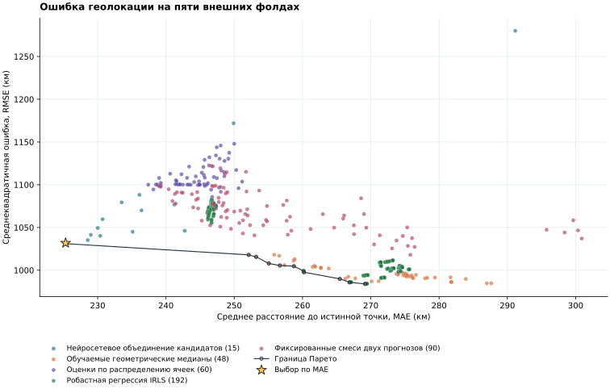

# Геолокация по эмбеддингам. Отбор по средней ошибке WGS84

Победитель по MAE — **`gate:mae_gate:residual`**. Среднее расстояние до истинной точки на внешних фолдах составило **225,30 км**, RMSE — **1 031,85 км**. На историческом тесте из 37 500 объектов средняя ошибка составила **214,30 км**, RMSE — **1 026,23 км**.

Сеть вычисляет взвешенную медиану и добавляет ограниченную двумерную поправку, размер которой зависит от разброса кандидатов.

Всего сравнено конфигураций — **405**, на границе Парето — **12**. Параметры и все измеренные ошибки доступны в [полной таблице CSV](mae-cv-results.csv).

## Объекты, обучение и отбор

Эксперимент использует 250 000 объектов и два вектора изображения, GeoCLIP размерности 512 и StreetCLIP размерности 768. На разработку выделено 212 500 строк, на исторический тест — 37 500. В каждом из пяти внешних фолдов 170 000 строк доступны для обучения и 42 500 служат для проверки. Каждая строка разработки получает один прогноз вне обучения.

Внутри каждого внешнего обучающего набора три разбиения дают прогнозы базовых моделей для обучения ансамбля. Обучаемые комбинации получают истинные координаты этих внутренних строк. Для объектов внешнего фолда доступны предсказания экспертов, вероятности географических ячеек и признаки уверенности. После выбора правила для обучаемого финального ансамбля используются прогнозы всех 212 500 объектов разработки, полученные вне их обучающих фолдов.

Пусть $d_i$ — длина кратчайшей геодезической WGS84 от прогноза до известной координаты, в километрах. Тогда $\mathrm{MAE}=\sum_i d_i/n$ и $\mathrm{RMSE}=\sqrt{\sum_i d_i^2/n}$. Например, промах на 1 000 км вносит в сумму расстояний в десять раз больше, чем промах на 100 км, а в сумму квадратов — в сто раз больше. Итоговую RMSE вычисляют из квадратов ошибок всех строк пяти фолдов.

Победителем становится вариант с минимальной общей MAE. При равенстве служат последовательными критериями общая RMSE и идентификатор конфигурации. Поскольку те же внешние фолды определяют выбор среди многих вариантов, CV победителя может быть оптимистичной. Различия в сотые доли километра сами по себе не устанавливают устойчивого преимущества.

## Какие комбинации сравнивались

Методы используют одни и те же базовые прогнозы. Несколько строк одной семьи могут отличаться степенью сглаживания, порогом расстояния или способом получения координаты из общих обученных весов. Поэтому число конфигураций характеризует объём поиска, а часть вычислений разделяется между вариантами.

| Семейство | Вариантов | Лидер семьи по MAE | CV MAE, км | CV RMSE, км |
| --- | --- | --- | --- | --- |
| Нейросетевое объединение кандидатов | 15 | `gate:mae_gate:residual` | 225,30 | 1 031,85 |
| Оценки по распределению ячеек | 60 | `posterior:maepost:localatom/trust/w0.45` | 237,40 | 1 099,99 |
| Фиксированные смеси двух прогнозов | 90 | `blend:maepost:localatom/sharp/w0.32/1/w0.05` | 239,11 | 1 098,41 |
| Робастная регрессия IRLS | 192 | `robust-median:mae:irls/all/separate/geo_spread/a0.015/d8/gain0.7` | 246,07 | 1 066,58 |
| Обучаемые геометрические медианы | 48 | `robust-median:mae:median/core/spread/p6/median` | 252,12 | 1 017,93 |

Геометрическая медиана приближает точку с наименьшей суммой расстояний до гипотез с учётом их весов. Для правил по распределениям гипотезами служат ведущие ячейки, а для обучаемых медиан — координаты экспертов. Методы IRLS подбирают поправку в двух горизонтальных направлениях. Шесть итераций взвешенной регрессии снижают влияние больших ошибок, параметр сглаживания задаёт переход от почти квадратичной потери к почти линейной.

Нейросетевые варианты выбирают одну координату или объединяют несколько. Например, модель CDF обучается вероятностям того, что ошибка каждой гипотезы превысит заданные расстояния. По этим вероятностям она оценивает среднюю ошибку кандидата для конкретного запроса. Сферические приближения при обучении проверяют общей метрикой на эллипсоиде WGS84.

В базовом наборе используются следующие сохранённые прогнозы, в порядке входа в ансамбль.

1. `prior/prior/v4`
2. `meta/experts/mlp_gate`
3. `paper/distance_risk`
4. `retrieval/fourier_rbf/ret_learned_kernel`
5. `retrieval/shrink_whiten/ret_learned_kernel`
6. `retrieval/canonical_pair/ret_frechet`

Набор с медианным якорем добавляет первым исторический сферический медианный прогноз V4. Шлюз также получает семь прогнозов V3, следующие варианты обработки распределений и первые четыре центра по вероятности каждого из трёх классификаторов ячеек.

- `maepost:v4_rank_spherical_median`
- `maepost:median/peer/p1.4`
- `maepost:basin/h225/w0.8`
- `maepost:localatom/sharp/w0.32`
- `maepost:localgate/h200/w0.6`

## Сравнение с предыдущими поисками

| Серия | Конфигурация | CV MAE, км | CV RMSE, км | Δ MAE¹, км | Δ RMSE¹, км |
| --- | --- | --- | --- | --- | --- |
| Победитель текущего отбора по MAE | `gate:mae_gate:residual` | 225,30 | 1 031,85 | +0,00 | +0,00 |
| Минимальная MAE среди прежних вариантов V4 | `rank_spherical_median` | 246,76 | 1 085,66 | −21,46 | −53,81 |
| Минимальная MAE в прежнем полном поиске | `meta/experts/mlp_gate` | 274,67 | 1 012,45 | −49,37 | +19,40 |
| Победитель прежнего полного отбора по RMSE | `tuned:all/shared/expert/a0.01/tail0/cap20000` | 282,93 | 973,49 | −57,62 | +58,36 |
| Исторический победитель V4 по RMSE | `cal_interaction` | 280,93 | 999,67 | −55,63 | +32,18 |

¹ Δ — ошибка нового победителя минус ошибка указанной модели на тех же фолдах. Исторический минимум MAE в V4 и исторический выбор V4 по RMSE относятся к двум отдельно обозначенным процедурам отбора.

## Тест на прежнем разделении

| Модель | Строк | Тестовая MAE, км | Тестовая RMSE, км | Δ MAE¹, км | Δ RMSE¹, км |
| --- | --- | --- | --- | --- | --- |
| Победитель текущего отбора по MAE | 37 500 | 214,30 | 1 026,23 | +0,00 | +0,00 |
| Победитель прежнего полного отбора по RMSE | 37 500 | 271,85 | 952,52 | −57,55 | +73,71 |
| V4 (`cal_interaction`) | 37 500 | 266,62 | 975,24 | −52,33 | +50,99 |

¹ В столбцах Δ указана ошибка нового победителя минус ошибка модели в той же строке. Отрицательное значение означает улучшение по соответствующей метрике.

Координаты тестовых объектов открываются для расчёта метрик после фиксации победителя и его прогнозов. Предыдущие отчёты уже содержали агрегаты этой же тестовой выборки. Она служит исторической контрольной выборкой, а полностью независимая оценка будущих версий потребует новых объектов.

## MAE и RMSE по конфигурациям

Каждая точка соответствует конфигурации. Движение влево означает уменьшение средней ошибки, вниз — уменьшение RMSE. На границе Парето другие варианты не превосходят данную пару одновременно по двум метрикам с хотя бы одним строгим улучшением. Совпадающие точки видны в CSV отдельными строками.

### Десять первых конфигураций по MAE

| Место | Конфигурация | CV MAE, км | CV RMSE, км | Параметры и способ прогноза |
| --- | --- | --- | --- | --- |
| 1 | `gate:mae_gate:residual` | 225,30 | 1 031,85 | Сеть вычисляет взвешенную медиану и добавляет ограниченную двумерную поправку, размер которой зависит от разброса кандидатов. |
| 2 | `gate:mae_gate:median` | 225,39 | 1 031,01 | Сеть обучается по среднему угловому расстоянию и оценивает веса кандидатов для сглаженной геометрической медианы. |
| 3 | `gate:mae_gate:median_sharp` | 228,55 | 1 035,20 | Сеть обучается по среднему угловому расстоянию и оценивает веса кандидатов для сглаженной геометрической медианы. При прогнозе температура 0,6 усиливает ведущие веса. |
| 4 | `gate:mae_gate:laplace_median` | 229,00 | 1 041,38 | Сеть обучает веса и ширины сферических ядер Лапласа, затем вычисляет медиану со сглаживанием по ширине каждого ядра. |
| 5 | `gate:mae_gate:mean` | 230,02 | 1 049,38 | Многослойная сеть предсказывает веса кандидатов по признакам запроса и усредняет их смещения, обучаясь по среднему угловому расстоянию. |
| 6 | `gate:mae_gate:linear` | 230,38 | 1 040,17 | Линейная модель предсказывает веса кандидатов по признакам запроса и усредняет их смещения, обучаясь по среднему угловому расстоянию. |
| 7 | `gate:mae_gate:sharpen` | 230,71 | 1 059,66 | Многослойная сеть предсказывает веса кандидатов по признакам запроса и усредняет их смещения, обучаясь по среднему угловому расстоянию. При прогнозе температура 0,52 усиливает ведущие веса. |
| 8 | `gate:mae_gate:risk_median` | 233,51 | 1 079,36 | Сеть оценивает изменение ожидаемой ошибки каждого кандидата относительно первого эксперта и по этой оценке вычисляет взвешенную медиану кандидатов. |
| 9 | `gate:mae_gate:oracle_median` | 235,12 | 1 044,91 | Сеть оценивает вероятность оказаться близко к истинной обучающей точке и по этой оценке вычисляет взвешенную медиану кандидатов. |
| 10 | `gate:mae_gate:risk_hard` | 236,12 | 1 088,16 | Сеть оценивает изменение ожидаемой ошибки каждого кандидата относительно первого эксперта и по этой оценке выбирает одного кандидата. |

### Победитель по внешним фолдам

| Фолд | MAE, км | RMSE, км |
| --- | --- | --- |
| 1 | 220,52 | 990,00 |
| 2 | 228,90 | 1 048,11 |
| 3 | 231,66 | 1 074,23 |
| 4 | 226,49 | 1 050,46 |
| 5 | 218,95 | 993,75 |

Открыть результаты всех конфигураций по фолдам

В каждой ячейке фолда указаны MAE / RMSE в километрах. CSV сохраняет исходную численную точность и полную спецификацию JSON.

| Место | Конфигурация | Фолд 1 | Фолд 2 | Фолд 3 | Фолд 4 | Фолд 5 |
| --- | --- | --- | --- | --- | --- | --- |
| 1 | `gate:mae_gate:residual` | 220,52 / 990,00 | 228,90 / 1 048,11 | 231,66 / 1 074,23 | 226,49 / 1 050,46 | 218,95 / 993,75 |
| 2 | `gate:mae_gate:median` | 220,32 / 1 009,09 | 228,54 / 1 043,48 | 231,73 / 1 051,45 | 226,97 / 1 038,99 | 219,41 / 1 011,30 |
| 3 | `gate:mae_gate:median_sharp` | 223,14 / 1 010,71 | 234,13 / 1 056,42 | 234,97 / 1 039,69 | 229,93 / 1 045,76 | 220,60 / 1 022,76 |
| 4 | `gate:mae_gate:laplace_median` | 223,64 / 1 016,90 | 233,62 / 1 060,41 | 235,69 / 1 074,85 | 228,19 / 1 033,96 | 223,84 / 1 019,54 |
| 5 | `gate:mae_gate:mean` | 226,73 / 1 025,69 | 230,19 / 1 059,13 | 235,32 / 1 092,95 | 231,64 / 1 043,65 | 226,20 / 1 023,93 |
| 6 | `gate:mae_gate:linear` | 226,23 / 1 005,76 | 232,44 / 1 060,99 | 235,66 / 1 079,09 | 231,74 / 1 047,59 | 225,82 / 1 005,31 |
| 7 | `gate:mae_gate:sharpen` | 227,89 / 1 037,15 | 230,54 / 1 070,59 | 235,63 / 1 099,18 | 232,58 / 1 057,60 | 226,93 / 1 032,39 |
| 8 | `gate:mae_gate:risk_median` | 230,32 / 1 051,36 | 240,33 / 1 120,28 | 235,53 / 1 094,88 | 232,14 / 1 072,47 | 229,24 / 1 056,31 |
| 9 | `gate:mae_gate:oracle_median` | 230,84 / 1 012,81 | 238,92 / 1 072,25 | 241,97 / 1 083,88 | 235,19 / 1 055,17 | 228,69 / 997,75 |
| 10 | `gate:mae_gate:risk_hard` | 234,52 / 1 068,37 | 242,12 / 1 127,60 | 238,02 / 1 103,29 | 233,88 / 1 075,37 | 232,05 / 1 064,86 |
| 11 | `gate:mae_gate:risk_soft` | 232,88 / 1 038,83 | 243,09 / 1 109,40 | 239,04 / 1 088,89 | 235,13 / 1 065,06 | 231,98 / 1 046,16 |
| 12 | `posterior:maepost:localatom/trust/w0.45` | 233,82 / 1 078,03 | 239,67 / 1 110,30 | 244,55 / 1 141,86 | 237,58 / 1 106,28 | 231,39 / 1 061,74 |
| 13 | `posterior:maepost:localatom/ordinary/w0.32` | 234,74 / 1 066,99 | 241,23 / 1 116,28 | 244,95 / 1 134,49 | 237,43 / 1 098,58 | 232,47 / 1 053,93 |
| 14 | `posterior:maepost:likelihood/h600` | 235,47 / 1 074,16 | 241,81 / 1 123,26 | 246,77 / 1 148,58 | 236,11 / 1 089,79 | 232,52 / 1 062,64 |
| 15 | `posterior:maepost:likelihood/h250` | 235,62 / 1 074,35 | 242,12 / 1 122,90 | 246,69 / 1 146,57 | 236,01 / 1 091,78 | 233,20 / 1 063,25 |
| 16 | `posterior:maepost:localatom/ordinary/w0.18` | 235,06 / 1 072,42 | 241,53 / 1 112,70 | 245,94 / 1 140,82 | 239,31 / 1 106,56 | 232,88 / 1 058,36 |
| 17 | `posterior:maepost:localatom/sharp/w0.32` | 236,08 / 1 087,37 | 242,76 / 1 128,37 | 243,51 / 1 134,14 | 238,76 / 1 114,91 | 233,90 / 1 073,11 |
| 18 | `blend:maepost:localatom/sharp/w0.32/1/w0.05` | 236,14 / 1 077,37 | 242,81 / 1 118,78 | 243,57 / 1 125,28 | 238,87 / 1 105,78 | 234,14 / 1 063,56 |
| 19 | `blend:maepost:localatom/sharp/w0.32/0/w0.05` | 236,23 / 1 076,82 | 242,90 / 1 117,48 | 243,70 / 1 123,81 | 239,08 / 1 105,46 | 234,11 / 1 062,43 |
| 20 | `posterior:maepost:localatom/trust/w0.32` | 235,33 / 1 078,44 | 241,65 / 1 113,18 | 246,04 / 1 141,88 | 239,98 / 1 110,64 | 233,23 / 1 065,06 |
| 21 | `posterior:maepost:likelihood/h80` | 236,40 / 1 077,07 | 242,02 / 1 118,14 | 247,22 / 1 145,27 | 237,60 / 1 095,98 | 233,03 / 1 059,20 |
| 22 | `blend:maepost:localatom/sharp/w0.32/2/w0.05` | 237,41 / 1 073,38 | 243,96 / 1 113,96 | 245,26 / 1 123,82 | 240,00 / 1 100,87 | 235,36 / 1 060,33 |
| 23 | `posterior:maepost:localatom/sharp/w0.18` | 237,89 / 1 093,21 | 242,45 / 1 120,67 | 246,63 / 1 148,30 | 241,03 / 1 121,64 | 235,07 / 1 078,87 |
| 24 | `blend:maepost:localatom/sharp/w0.32/1/w0.15` | 237,93 / 1 058,58 | 244,59 / 1 100,92 | 245,33 / 1 108,86 | 240,65 / 1 088,65 | 236,24 / 1 046,00 |
| 25 | `gate:mae_gate:cdf_hard` | 236,61 / 1 048,60 | 245,53 / 1 119,03 | 246,66 / 1 092,07 | 243,64 / 1 090,66 | 233,71 / 1 030,92 |
| 26 | `blend:maepost:localatom/sharp/w0.32/4/w0.05` | 237,88 / 1 067,30 | 245,47 / 1 111,47 | 246,38 / 1 114,87 | 241,62 / 1 096,93 | 235,20 / 1 054,47 |
| 27 | `posterior:maepost:localgate/h200/w0.85` | 237,02 / 1 075,08 | 243,65 / 1 112,59 | 247,77 / 1 133,41 | 243,49 / 1 115,93 | 235,00 / 1 064,16 |
| 28 | `blend:maepost:localatom/sharp/w0.32/0/w0.15` | 238,42 / 1 057,10 | 245,06 / 1 097,15 | 245,95 / 1 104,54 | 241,41 / 1 087,60 | 236,30 / 1 042,48 |
| 29 | `posterior:maepost:localatom/trust/w0.18` | 237,13 / 1 079,50 | 244,15 / 1 118,67 | 247,82 / 1 141,03 | 242,85 / 1 116,15 | 235,33 / 1 069,45 |
| 30 | `posterior:maepost:localgate/h500/w0.85` | 237,16 / 1 075,63 | 243,82 / 1 113,17 | 247,82 / 1 133,84 | 243,40 / 1 116,25 | 235,42 / 1 064,70 |
| 31 | `posterior:maepost:localatom/ordinary/w0.08` | 237,20 / 1 077,34 | 244,48 / 1 119,07 | 247,89 / 1 140,15 | 242,91 / 1 115,93 | 235,34 / 1 065,94 |
| 32 | `blend:maepost:localatom/sharp/w0.32/3/w0.05` | 238,45 / 1 069,72 | 245,31 / 1 111,93 | 246,07 / 1 117,35 | 241,31 / 1 099,09 | 236,91 / 1 056,49 |
| 33 | `posterior:maepost:localgate/h75/w0.85` | 237,33 / 1 074,69 | 244,06 / 1 112,16 | 248,18 / 1 133,01 | 243,94 / 1 115,61 | 235,26 / 1 063,67 |
| 34 | `posterior:maepost:localgate/h500/w0.6` | 237,62 / 1 075,12 | 244,32 / 1 112,66 | 248,35 / 1 133,37 | 243,96 / 1 115,85 | 235,82 / 1 064,17 |
| 35 | `posterior:maepost:localgate/h200/w0.6` | 237,69 / 1 074,84 | 244,36 / 1 112,36 | 248,48 / 1 133,17 | 244,18 / 1 115,73 | 235,70 / 1 063,91 |
| 36 | `blend:maepost:localgate/h200/w0.6/1/w0.05` | 237,90 / 1 065,03 | 244,55 / 1 103,42 | 248,55 / 1 123,97 | 244,21 / 1 106,25 | 236,07 / 1 054,22 |
| 37 | `posterior:maepost:localatom/sharp/w0.45` | 238,21 / 1 084,16 | 247,05 / 1 140,86 | 246,48 / 1 137,84 | 240,74 / 1 109,16 | 238,91 / 1 088,01 |
| 38 | `blend:maepost:localgate/h200/w0.6/0/w0.05` | 238,07 / 1 064,93 | 244,75 / 1 102,64 | 248,80 / 1 123,10 | 244,51 / 1 106,31 | 236,15 / 1 054,05 |
| 39 | `posterior:maepost:localgate/h75/w0.6` | 238,04 / 1 074,60 | 244,80 / 1 112,09 | 248,92 / 1 132,93 | 244,64 / 1 115,54 | 236,02 / 1 063,60 |
| 40 | `gate:mae_gate:cdf_soft` | 237,95 / 1 017,85 | 246,06 / 1 077,67 | 248,10 / 1 067,58 | 244,29 / 1 059,02 | 237,36 / 1 006,68 |
| 41 | `posterior:maepost:localatom/trust/w0.08` | 238,57 / 1 081,88 | 245,87 / 1 122,40 | 249,21 / 1 140,79 | 244,94 / 1 120,51 | 236,91 / 1 073,09 |
| 42 | `posterior:maepost:localgate/h500/w0.3` | 238,71 / 1 074,68 | 245,46 / 1 112,22 | 249,53 / 1 132,98 | 245,16 / 1 115,55 | 236,85 / 1 063,72 |
| 43 | `posterior:maepost:localgate/h200/w0.3` | 238,89 / 1 074,60 | 245,63 / 1 112,14 | 249,73 / 1 132,94 | 245,42 / 1 115,56 | 236,94 / 1 063,66 |
| 44 | `posterior:maepost:localatom/sharp/w0.08` | 240,84 / 1 103,38 | 244,65 / 1 123,00 | 249,90 / 1 162,07 | 243,80 / 1 127,66 | 237,81 / 1 088,43 |
| 45 | `posterior:maepost:localgate/h75/w0.3` | 239,16 / 1 074,51 | 245,94 / 1 112,03 | 250,05 / 1 132,84 | 245,75 / 1 115,48 | 237,20 / 1 063,52 |
| 46 | `blend:maepost:localgate/h200/w0.6/2/w0.05` | 239,42 / 1 062,63 | 246,00 / 1 100,63 | 250,46 / 1 124,55 | 245,57 / 1 102,81 | 237,54 / 1 052,81 |
| 47 | `blend:maepost:localgate/h200/w0.6/1/w0.15` | 239,72 / 1 046,75 | 246,35 / 1 086,94 | 250,08 / 1 106,82 | 245,61 / 1 088,58 | 238,23 / 1 036,60 |
| 48 | `posterior:maepost:adaptive/entropy_and_agreement` | 240,05 / 1 081,13 | 246,12 / 1 112,42 | 249,98 / 1 132,56 | 245,99 / 1 118,45 | 238,51 / 1 069,81 |
| 49 | `posterior:maepost:localatom/ordinary/w0.45` | 240,10 / 1 077,18 | 249,48 / 1 143,93 | 249,99 / 1 144,26 | 242,02 / 1 100,86 | 240,27 / 1 080,68 |
| 50 | `blend:maepost:localgate/h200/w0.6/4/w0.05` | 239,56 / 1 055,47 | 247,17 / 1 096,96 | 251,36 / 1 114,33 | 246,97 / 1 097,65 | 237,06 / 1 045,46 |
| 51 | `blend:maepost:localatom/sharp/w0.32/5/w0.05` | 241,46 / 1 070,59 | 248,59 / 1 113,28 | 249,14 / 1 117,43 | 244,27 / 1 097,69 | 239,39 / 1 056,30 |
| 52 | `posterior:maepost:smooth/h25` | 240,22 / 1 074,16 | 246,99 / 1 111,69 | 251,11 / 1 132,48 | 246,84 / 1 115,17 | 238,23 / 1 063,18 |
| 53 | `blend:maepost:localgate/h200/w0.6/3/w0.05` | 240,08 / 1 056,86 | 246,99 / 1 096,95 | 251,06 / 1 116,51 | 246,50 / 1 099,60 | 238,76 / 1 047,49 |
| 54 | `blend:maepost:localgate/h200/w0.6/0/w0.15` | 240,40 / 1 046,53 | 247,09 / 1 084,55 | 250,97 / 1 104,26 | 246,57 / 1 088,56 | 238,52 / 1 035,74 |
| 55 | `posterior:maepost:ellipsoid/weiszfeld` | 240,31 / 1 078,17 | 247,28 / 1 116,77 | 251,18 / 1 136,38 | 246,95 / 1 118,66 | 238,51 / 1 068,03 |
| 56 | `posterior:maepost:tail/w0.35` | 239,86 / 1 071,42 | 247,45 / 1 116,46 | 250,76 / 1 129,72 | 247,53 / 1 118,58 | 238,77 / 1 064,08 |
| 57 | `posterior:maepost:median/equal/p1` | 240,50 / 1 074,43 | 247,31 / 1 111,98 | 251,40 / 1 132,77 | 247,07 / 1 115,44 | 238,60 / 1 063,47 |
| 58 | `blend:maepost:localatom/sharp/w0.32/1/w0.3` | 242,16 / 1 033,69 | 248,77 / 1 077,54 | 249,55 / 1 087,22 | 244,78 / 1 066,10 | 240,93 / 1 023,77 |
| 59 | `posterior:maepost:median/equal/p1.4` | 242,54 / 1 098,61 | 246,25 / 1 112,92 | 251,76 / 1 152,91 | 246,15 / 1 124,38 | 239,55 / 1 080,63 |
| 60 | `posterior:maepost:median/peer/p1` | 242,27 / 1 097,93 | 246,99 / 1 121,96 | 251,42 / 1 160,16 | 246,62 / 1 130,33 | 240,14 / 1 091,52 |
| 61 | `posterior:maepost:median/peer/p0.7` | 241,45 / 1 087,50 | 248,03 / 1 117,99 | 251,24 / 1 145,40 | 246,86 / 1 122,65 | 240,18 / 1 082,25 |
| 62 | `posterior:maepost:basin/h225/w0.45` | 241,39 / 1 078,55 | 247,48 / 1 108,55 | 251,38 / 1 131,04 | 247,55 / 1 115,15 | 240,16 / 1 069,20 |
| 63 | `posterior:maepost:medoid/nearby/p1` | 240,78 / 1 099,47 | 248,38 / 1 144,95 | 251,54 / 1 161,74 | 247,40 / 1 138,08 | 240,20 / 1 099,95 |
| 64 | `posterior:maepost:median/fine/p1` | 242,06 / 1 090,65 | 249,43 / 1 125,31 | 250,80 / 1 133,32 | 247,27 / 1 118,47 | 238,88 / 1 072,46 |
| 65 | `posterior:maepost:smooth/h75` | 241,25 / 1 073,04 | 247,99 / 1 110,60 | 252,15 / 1 131,37 | 247,88 / 1 114,16 | 239,18 / 1 062,08 |
| 66 | `posterior:maepost:basin/h80/w0.45` | 242,42 / 1 080,16 | 248,08 / 1 107,64 | 251,66 / 1 130,47 | 247,60 / 1 113,65 | 240,12 / 1 066,92 |
| 67 | `robust-median:mae:irls/all/separate/geo_spread/a0.015/d8/gain0.7` | 241,67 / 1 037,60 | 248,08 / 1 075,32 | 252,50 / 1 104,07 | 247,88 / 1 082,27 | 240,21 / 1 031,90 |
| 68 | `robust-median:mae:irls/all/shared/geo_spread/a0.015/d8/gain0.7` | 241,67 / 1 039,44 | 248,12 / 1 076,06 | 252,50 / 1 104,42 | 247,91 / 1 082,86 | 240,17 / 1 032,24 |
| 69 | `robust-median:mae:irls/all/separate/spread/a0.015/d8/gain0.7` | 241,91 / 1 040,75 | 248,08 / 1 076,38 | 252,56 / 1 105,37 | 247,86 / 1 083,97 | 240,26 / 1 034,25 |
| 70 | `robust-median:mae:irls/all/shared/spread/a0.015/d8/gain0.7` | 241,86 / 1 042,36 | 248,13 / 1 077,15 | 252,56 / 1 105,72 | 247,89 / 1 084,40 | 240,22 / 1 034,56 |
| 71 | `posterior:maepost:basin/h500/w0.45` | 241,44 / 1 076,74 | 248,82 / 1 114,89 | 251,94 / 1 131,29 | 248,01 / 1 115,79 | 240,50 / 1 069,02 |
| 72 | `robust-median:mae:irls/all/shared/geo_spread/a0.015/d8/gain1` | 241,66 / 1 030,89 | 248,31 / 1 069,67 | 252,49 / 1 098,68 | 247,96 / 1 074,77 | 240,34 / 1 024,88 |
| 73 | `robust-median:mae:irls/all/separate/geo_spread/a0.015/d8/gain1` | 241,69 / 1 028,45 | 248,27 / 1 068,69 | 252,50 / 1 098,20 | 247,92 / 1 074,01 | 240,41 / 1 024,49 |
| 74 | `robust-median:mae:irls/all/shared/spread/a0.015/d8/gain1` | 241,87 / 1 034,91 | 248,27 / 1 071,14 | 252,55 / 1 100,48 | 247,87 / 1 076,74 | 240,36 / 1 028,02 |
| 75 | `robust-median:mae:irls/all/separate/spread/a0.015/d8/gain1` | 241,95 / 1 032,78 | 248,21 / 1 070,10 | 252,55 / 1 100,00 | 247,82 / 1 076,18 | 240,43 / 1 027,65 |
| 76 | `robust-median:mae:irls/all/separate/geo_spread/a0.14/d8/gain0.7` | 241,91 / 1 044,37 | 248,15 / 1 080,54 | 252,69 / 1 108,33 | 248,12 / 1 088,30 | 240,31 / 1 037,01 |
| 77 | `robust-median:mae:irls/all/shared/geo_spread/a0.14/d8/gain0.7` | 241,91 / 1 045,63 | 248,18 / 1 081,04 | 252,69 / 1 108,56 | 248,14 / 1 088,75 | 240,28 / 1 037,34 |
| 78 | `robust-median:mae:irls/all/separate/geo_spread/a0.015/d70/gain0.7` | 241,72 / 1 033,61 | 248,25 / 1 072,87 | 252,59 / 1 101,28 | 248,26 / 1 079,61 | 240,41 / 1 028,63 |
| 79 | `robust-median:mae:irls/all/shared/geo_spread/a0.015/d70/gain0.7` | 241,72 / 1 035,48 | 248,29 / 1 073,63 | 252,60 / 1 101,63 | 248,29 / 1 080,19 | 240,37 / 1 028,95 |
| 80 | `robust-median:mae:irls/all/shared/geo_spread/a0.14/d8/gain1` | 241,92 / 1 039,36 | 248,28 / 1 076,43 | 252,70 / 1 104,47 | 248,19 / 1 082,74 | 240,40 / 1 031,77 |
| 81 | `robust-median:mae:irls/all/separate/geo_spread/a0.14/d8/gain1` | 241,94 / 1 037,64 | 248,25 / 1 075,74 | 252,70 / 1 104,16 | 248,17 / 1 082,14 | 240,45 / 1 031,34 |
| 82 | `robust-median:mae:irls/all/shared/spread/a0.015/d70/gain0.7` | 241,94 / 1 039,48 | 248,24 / 1 075,11 | 252,68 / 1 103,47 | 248,22 / 1 082,27 | 240,42 / 1 032,36 |
| 83 | `robust-median:mae:irls/all/separate/spread/a0.015/d70/gain0.7` | 241,99 / 1 037,91 | 248,19 / 1 074,30 | 252,68 / 1 103,10 | 248,18 / 1 081,84 | 240,47 / 1 032,10 |
| 84 | `robust-median:mae:irls/all/separate/spread/a0.14/d8/gain0.7` | 242,10 / 1 046,58 | 248,18 / 1 081,21 | 252,76 / 1 109,45 | 248,13 / 1 089,33 | 240,37 / 1 038,93 |
| 85 | `robust-median:mae:irls/all/shared/spread/a0.14/d8/gain0.7` | 242,07 / 1 047,60 | 248,22 / 1 081,78 | 252,77 / 1 109,65 | 248,15 / 1 089,66 | 240,34 / 1 039,16 |
| 86 | `posterior:maepost:median/fine/p1.4` | 244,08 / 1 113,66 | 249,98 / 1 138,45 | 250,51 / 1 147,37 | 247,82 / 1 129,91 | 239,20 / 1 082,35 |
| 87 | `robust-median:mae:irls/all/shared/spread/a0.14/d8/gain1` | 242,11 / 1 042,11 | 248,30 / 1 077,45 | 252,79 / 1 106,00 | 248,16 / 1 083,95 | 240,43 / 1 034,28 |
| 88 | `posterior:maepost:medoid/centers/p1` | 241,28 / 1 100,56 | 249,23 / 1 147,68 | 252,41 / 1 165,89 | 247,99 / 1 142,04 | 240,90 / 1 102,69 |
| 89 | `robust-median:mae:irls/all/separate/spread/a0.14/d8/gain1` | 242,15 / 1 040,73 | 248,26 / 1 076,67 | 252,79 / 1 105,73 | 248,13 / 1 083,50 | 240,49 / 1 033,99 |
| 90 | `blend:maepost:localatom/sharp/w0.32/0/w0.3` | 243,47 / 1 031,25 | 249,98 / 1 070,52 | 251,13 / 1 079,21 | 246,48 / 1 063,71 | 241,29 / 1 016,47 |
| 91 | `robust-median:mae:irls/all/separate/geo_spread/a0.14/d70/gain0.7` | 242,13 / 1 041,05 | 248,39 / 1 078,33 | 252,94 / 1 106,06 | 248,52 / 1 086,06 | 240,61 / 1 034,36 |
| 92 | `robust-median:mae:irls/all/shared/geo_spread/a0.14/d70/gain0.7` | 242,14 / 1 042,48 | 248,42 / 1 078,84 | 252,94 / 1 106,31 | 248,53 / 1 086,48 | 240,57 / 1 034,64 |
| 93 | `robust-median:mae:irls/all/shared/constant/a0.015/d8/gain0.7` | 242,35 / 1 054,57 | 248,43 / 1 087,74 | 253,01 / 1 114,16 | 248,54 / 1 096,54 | 240,55 / 1 045,02 |
| 94 | `robust-median:mae:irls/all/separate/constant/a0.015/d8/gain0.7` | 242,35 / 1 054,42 | 248,42 / 1 087,62 | 253,01 / 1 114,13 | 248,53 / 1 096,45 | 240,56 / 1 044,94 |
| 95 | `robust-median:mae:irls/all/shared/spread/a0.14/d70/gain0.7` | 242,34 / 1 045,11 | 248,45 / 1 079,90 | 253,04 / 1 107,79 | 248,52 / 1 087,61 | 240,62 / 1 037,22 |
| 96 | `robust-median:mae:irls/all/separate/spread/a0.14/d70/gain0.7` | 242,37 / 1 044,00 | 248,41 / 1 079,31 | 253,04 / 1 107,58 | 248,50 / 1 087,28 | 240,66 / 1 036,99 |
| 97 | `robust-median:mae:irls/all/shared/constant/a0.14/d8/gain0.7` | 242,38 / 1 055,15 | 248,44 / 1 088,06 | 253,06 / 1 114,25 | 248,62 / 1 097,38 | 240,55 / 1 045,52 |
| 98 | `robust-median:mae:irls/all/separate/constant/a0.14/d8/gain0.7` | 242,38 / 1 055,02 | 248,43 / 1 087,96 | 253,07 / 1 114,23 | 248,62 / 1 097,32 | 240,56 / 1 045,45 |
| 99 | `robust-median:mae:irls/core/shared/geo_spread/a0.015/d8/gain0.7` | 242,46 / 1 053,21 | 248,42 / 1 085,46 | 253,10 / 1 114,25 | 248,33 / 1 093,65 | 240,75 / 1 043,97 |
| 100 | `robust-median:mae:irls/core/separate/geo_spread/a0.015/d8/gain0.7` | 242,47 / 1 052,38 | 248,42 / 1 085,30 | 253,12 / 1 114,18 | 248,32 / 1 093,33 | 240,78 / 1 043,87 |
| 101 | `posterior:maepost:tail/w0.75` | 241,75 / 1 065,06 | 248,69 / 1 111,10 | 252,68 / 1 122,82 | 249,20 / 1 112,74 | 240,79 / 1 057,56 |
| 102 | `robust-median:mae:irls/core/shared/spread/a0.015/d8/gain0.7` | 242,48 / 1 054,19 | 248,43 / 1 085,97 | 253,10 / 1 115,13 | 248,35 / 1 094,43 | 240,76 / 1 044,78 |
| 103 | `robust-median:mae:irls/core/shared/spread/a0.015/d8/gain1` | 242,50 / 1 051,36 | 248,46 / 1 083,32 | 253,11 / 1 113,76 | 248,24 / 1 090,66 | 240,83 / 1 042,13 |
| 104 | `robust-median:mae:irls/core/separate/spread/a0.015/d8/gain0.7` | 242,50 / 1 053,52 | 248,42 / 1 085,91 | 253,11 / 1 115,12 | 248,32 / 1 094,08 | 240,79 / 1 044,72 |
| 105 | `robust-median:mae:irls/core/shared/geo_spread/a0.015/d8/gain1` | 242,49 / 1 050,00 | 248,46 / 1 082,60 | 253,13 / 1 112,53 | 248,25 / 1 089,67 | 240,83 / 1 041,01 |
| 106 | `robust-median:mae:irls/all/shared/constant/a0.015/d8/gain1` | 242,40 / 1 051,86 | 248,53 / 1 085,77 | 253,03 / 1 112,38 | 248,60 / 1 093,55 | 240,62 / 1 042,42 |
| 107 | `robust-median:mae:irls/core/separate/spread/a0.015/d8/gain1` | 242,54 / 1 050,45 | 248,45 / 1 083,23 | 253,12 / 1 113,76 | 248,20 / 1 090,19 | 240,88 / 1 042,07 |
| 108 | `robust-median:mae:irls/all/separate/constant/a0.015/d8/gain1` | 242,41 / 1 051,64 | 248,51 / 1 085,60 | 253,03 / 1 112,32 | 248,60 / 1 093,44 | 240,64 / 1 042,32 |
| 109 | `robust-median:mae:irls/core/separate/geo_spread/a0.015/d8/gain1` | 242,50 / 1 048,86 | 248,47 / 1 082,39 | 253,15 / 1 112,45 | 248,23 / 1 089,23 | 240,87 / 1 040,89 |
| 110 | `blend:maepost:median/peer/p1.4/1/w0.05` | 244,89 / 1 104,68 | 247,51 / 1 123,11 | 252,59 / 1 161,30 | 247,20 / 1 127,75 | 241,10 / 1 091,51 |
| 111 | `robust-median:mae:irls/all/shared/spread/a0.015/d70/gain1` | 242,23 / 1 030,97 | 248,63 / 1 068,37 | 252,94 / 1 097,33 | 248,62 / 1 073,84 | 240,92 / 1 025,05 |
| 112 | `robust-median:mae:irls/all/shared/constant/a0.14/d8/gain1` | 242,43 / 1 052,66 | 248,53 / 1 086,21 | 253,10 / 1 112,50 | 248,70 / 1 094,73 | 240,60 / 1 043,12 |
| 113 | `robust-median:mae:irls/all/shared/geo_spread/a0.015/d70/gain1` | 242,01 / 1 025,53 | 248,77 / 1 066,42 | 252,86 / 1 094,82 | 248,80 / 1 071,29 | 240,92 / 1 020,50 |
| 114 | `robust-median:mae:irls/all/separate/constant/a0.14/d8/gain1` | 242,43 / 1 052,49 | 248,52 / 1 086,07 | 253,11 / 1 112,47 | 248,70 / 1 094,64 | 240,61 / 1 043,03 |
| 115 | `robust-median:mae:irls/all/separate/geo_spread/a0.015/d70/gain1` | 242,03 / 1 023,09 | 248,74 / 1 065,43 | 252,88 / 1 094,35 | 248,77 / 1 070,57 | 240,98 / 1 020,16 |
| 116 | `robust-median:mae:irls/all/separate/spread/a0.015/d70/gain1` | 242,31 / 1 028,94 | 248,57 / 1 067,29 | 252,95 / 1 096,82 | 248,57 / 1 073,29 | 241,00 / 1 024,76 |
| 117 | `robust-median:mae:irls/core/shared/geo_spread/a0.14/d8/gain0.7` | 242,53 / 1 054,58 | 248,49 / 1 086,64 | 253,17 / 1 114,83 | 248,47 / 1 095,89 | 240,77 / 1 045,24 |
| 118 | `robust-median:mae:irls/core/separate/geo_spread/a0.14/d8/gain0.7` | 242,53 / 1 054,01 | 248,49 / 1 086,55 | 253,17 / 1 114,77 | 248,45 / 1 095,59 | 240,79 / 1 045,15 |
| 119 | `robust-median:mae:irls/core/shared/constant/a0.015/d8/gain0.7` | 242,54 / 1 057,65 | 248,47 / 1 089,76 | 253,12 / 1 116,22 | 248,61 / 1 099,95 | 240,73 / 1 048,03 |
| 120 | `robust-median:mae:irls/core/shared/spread/a0.14/d8/gain0.7` | 242,54 / 1 055,40 | 248,49 / 1 087,12 | 253,17 / 1 115,61 | 248,48 / 1 096,35 | 240,77 / 1 046,00 |
| 121 | `robust-median:mae:irls/core/separate/constant/a0.015/d8/gain0.7` | 242,54 / 1 057,59 | 248,47 / 1 089,74 | 253,12 / 1 116,22 | 248,61 / 1 099,90 | 240,74 / 1 048,04 |
| 122 | `robust-median:mae:irls/core/separate/spread/a0.14/d8/gain0.7` | 242,56 / 1 054,92 | 248,49 / 1 087,00 | 253,17 / 1 115,60 | 248,46 / 1 096,11 | 240,80 / 1 045,95 |
| 123 | `robust-median:mae:irls/core/shared/constant/a0.015/d8/gain1` | 242,56 / 1 056,22 | 248,48 / 1 088,63 | 253,11 / 1 115,30 | 248,58 / 1 098,37 | 240,77 / 1 046,68 |
| 124 | `robust-median:mae:irls/core/separate/constant/a0.015/d8/gain1` | 242,57 / 1 056,14 | 248,48 / 1 088,59 | 253,11 / 1 115,29 | 248,58 / 1 098,30 | 240,78 / 1 046,70 |
| 125 | `robust-median:mae:irls/all/shared/constant/a0.015/d70/gain0.7` | 242,51 / 1 049,18 | 248,61 / 1 083,63 | 253,11 / 1 110,34 | 248,64 / 1 091,26 | 240,73 / 1 040,30 |
| 126 | `robust-median:mae:irls/all/separate/constant/a0.015/d70/gain0.7` | 242,53 / 1 048,96 | 248,60 / 1 083,46 | 253,12 / 1 110,31 | 248,63 / 1 091,15 | 240,76 / 1 040,23 |
| 127 | `robust-median:mae:irls/core/shared/constant/a0.14/d8/gain0.7` | 242,58 / 1 056,65 | 248,52 / 1 088,63 | 253,17 / 1 115,26 | 248,64 / 1 099,22 | 240,76 / 1 047,21 |
| 128 | `robust-median:mae:irls/core/separate/constant/a0.14/d8/gain0.7` | 242,59 / 1 056,60 | 248,51 / 1 088,60 | 253,18 / 1 115,27 | 248,64 / 1 099,19 | 240,76 / 1 047,23 |
| 129 | `robust-median:mae:irls/core/shared/spread/a0.14/d8/gain1` | 242,61 / 1 053,05 | 248,57 / 1 084,91 | 253,23 / 1 114,44 | 248,44 / 1 093,32 | 240,88 / 1 043,84 |
| 130 | `robust-median:mae:irls/core/shared/geo_spread/a0.14/d8/gain1` | 242,60 / 1 051,91 | 248,58 / 1 084,24 | 253,23 / 1 113,34 | 248,44 / 1 092,71 | 240,88 / 1 042,77 |
| 131 | `blend:maepost:basin/h225/w0.8/1/w0.05` | 242,77 / 1 076,94 | 248,39 / 1 104,88 | 251,95 / 1 127,64 | 248,41 / 1 111,44 | 242,21 / 1 071,56 |
| 132 | `robust-median:mae:irls/all/shared/constant/a0.14/d70/gain0.7` | 242,52 / 1 050,59 | 248,60 / 1 084,47 | 253,21 / 1 110,83 | 248,74 / 1 092,98 | 240,70 / 1 041,48 |
| 133 | `robust-median:mae:irls/core/separate/spread/a0.14/d8/gain1` | 242,64 / 1 052,39 | 248,57 / 1 084,74 | 253,23 / 1 114,43 | 248,42 / 1 092,98 | 240,92 / 1 043,77 |
| 134 | `robust-median:mae:irls/core/separate/geo_spread/a0.14/d8/gain1` | 242,61 / 1 051,11 | 248,58 / 1 084,11 | 253,25 / 1 113,27 | 248,42 / 1 092,29 | 240,92 / 1 042,66 |
| 135 | `robust-median:mae:irls/all/separate/constant/a0.14/d70/gain0.7` | 242,53 / 1 050,42 | 248,59 / 1 084,33 | 253,21 / 1 110,80 | 248,74 / 1 092,92 | 240,71 / 1 041,40 |
| 136 | `posterior:maepost:v4_rank_spherical_median` | 242,58 / 1 061,03 | 248,51 / 1 092,44 | 253,20 / 1 118,38 | 248,80 / 1 103,71 | 240,72 / 1 051,24 |
| 137 | `robust-median:mae:irls/core/shared/spread/a0.015/d70/gain0.7` | 242,63 / 1 052,27 | 248,60 / 1 084,28 | 253,26 / 1 113,76 | 248,46 / 1 092,51 | 240,92 / 1 042,97 |
| 138 | `robust-median:mae:irls/core/shared/geo_spread/a0.015/d70/gain0.7` | 242,61 / 1 050,78 | 248,60 / 1 083,44 | 253,26 / 1 112,53 | 248,48 / 1 091,40 | 240,92 / 1 041,57 |
| 139 | `robust-median:mae:irls/core/shared/constant/a0.14/d8/gain1` | 242,65 / 1 054,80 | 248,57 / 1 087,02 | 253,20 / 1 113,94 | 248,64 / 1 097,33 | 240,83 / 1 045,52 |
| 140 | `robust-median:mae:irls/core/separate/geo_spread/a0.015/d70/gain0.7` | 242,61 / 1 049,77 | 248,60 / 1 083,25 | 253,28 / 1 112,42 | 248,46 / 1 090,96 | 240,95 / 1 041,47 |
| 141 | `robust-median:mae:irls/core/shared/constant/a0.015/d70/gain0.7` | 242,67 / 1 053,88 | 248,56 / 1 086,48 | 253,18 / 1 113,48 | 248,61 / 1 095,85 | 240,89 / 1 044,36 |
| 142 | `robust-median:mae:irls/core/separate/spread/a0.015/d70/gain0.7` | 242,66 / 1 051,53 | 248,60 / 1 084,15 | 253,27 / 1 113,73 | 248,43 / 1 092,17 | 240,95 / 1 042,93 |
| 143 | `robust-median:mae:irls/core/separate/constant/a0.14/d8/gain1` | 242,65 / 1 054,73 | 248,57 / 1 086,98 | 253,21 / 1 113,95 | 248,63 / 1 097,29 | 240,84 / 1 045,55 |
| 144 | `robust-median:mae:irls/core/separate/constant/a0.015/d70/gain0.7` | 242,68 / 1 053,81 | 248,55 / 1 086,44 | 253,19 / 1 113,49 | 248,60 / 1 095,79 | 240,91 / 1 044,41 |
| 145 | `blend:maepost:v4_rank_spherical_median/1/w0.05` | 242,70 / 1 052,49 | 248,60 / 1 085,01 | 253,14 / 1 110,31 | 248,70 / 1 095,24 | 240,97 / 1 042,75 |
| 146 | `blend:maepost:median/peer/p1.4/0/w0.05` | 245,08 / 1 104,48 | 247,73 / 1 122,26 | 252,86 / 1 160,44 | 247,46 / 1 127,49 | 241,18 / 1 091,47 |
| 147 | `robust-median:mae:irls/core/shared/constant/a0.14/d70/gain0.7` | 242,79 / 1 052,83 | 248,69 / 1 085,21 | 253,33 / 1 112,35 | 248,72 / 1 095,31 | 240,97 / 1 043,61 |
| 148 | `robust-median:mae:irls/core/separate/constant/a0.14/d70/gain0.7` | 242,80 / 1 052,78 | 248,69 / 1 085,18 | 253,34 / 1 112,36 | 248,72 / 1 095,28 | 240,98 / 1 043,65 |
| 149 | `robust-median:mae:irls/core/shared/constant/a0.015/d70/gain1` | 242,84 / 1 050,90 | 248,69 / 1 084,00 | 253,26 / 1 111,42 | 248,68 / 1 092,60 | 241,09 / 1 041,53 |
| 150 | `robust-median:mae:irls/core/separate/constant/a0.015/d70/gain1` | 242,86 / 1 050,81 | 248,69 / 1 083,95 | 253,27 / 1 111,43 | 248,68 / 1 092,52 | 241,12 / 1 041,60 |
| 151 | `blend:maepost:basin/h225/w0.8/0/w0.05` | 242,92 / 1 076,79 | 248,58 / 1 104,17 | 252,19 / 1 126,75 | 248,69 / 1 111,50 | 242,28 / 1 071,55 |
| 152 | `robust-median:mae:irls/all/shared/geo_spread/a0.14/d70/gain1` | 242,49 / 1 035,00 | 248,83 / 1 073,40 | 253,29 / 1 101,34 | 249,00 / 1 079,66 | 241,08 / 1 028,09 |
| 153 | `robust-median:mae:irls/all/separate/geo_spread/a0.14/d70/gain1` | 242,50 / 1 033,06 | 248,80 / 1 072,72 | 253,29 / 1 101,00 | 248,99 / 1 079,11 | 241,12 / 1 027,74 |
| 154 | `robust-median:mae:irls/core/shared/spread/a0.015/d70/gain1` | 242,81 / 1 048,67 | 248,81 / 1 080,96 | 253,44 / 1 111,84 | 248,51 / 1 087,99 | 241,17 / 1 039,62 |
| 155 | `robust-median:mae:irls/core/separate/spread/a0.015/d70/gain1` | 242,85 / 1 047,67 | 248,81 / 1 080,77 | 253,45 / 1 111,80 | 248,47 / 1 087,53 | 241,22 / 1 039,58 |
| 156 | `robust-median:mae:irls/core/shared/geo_spread/a0.14/d70/gain0.7` | 242,82 / 1 052,29 | 248,80 / 1 084,71 | 253,45 / 1 113,11 | 248,73 / 1 093,87 | 241,08 / 1 043,03 |
| 157 | `robust-median:mae:irls/core/separate/geo_spread/a0.14/d70/gain0.7` | 242,81 / 1 051,58 | 248,80 / 1 084,57 | 253,46 / 1 113,02 | 248,72 / 1 093,55 | 241,10 / 1 042,97 |
| 158 | `robust-median:mae:irls/core/shared/geo_spread/a0.015/d70/gain1` | 242,81 / 1 046,62 | 248,83 / 1 079,81 | 253,47 / 1 110,13 | 248,60 / 1 086,63 | 241,19 / 1 037,69 |
| 159 | `robust-median:mae:irls/core/shared/spread/a0.14/d70/gain0.7` | 242,84 / 1 053,46 | 248,80 / 1 085,44 | 253,46 / 1 114,18 | 248,74 / 1 094,47 | 241,08 / 1 044,22 |
| 160 | `robust-median:mae:irls/core/separate/spread/a0.14/d70/gain0.7` | 242,86 / 1 052,94 | 248,80 / 1 085,31 | 253,46 / 1 114,16 | 248,72 / 1 094,22 | 241,11 / 1 044,19 |
| 161 | `robust-median:mae:irls/all/shared/constant/a0.015/d70/gain1` | 242,80 / 1 044,28 | 248,92 / 1 080,00 | 253,31 / 1 106,98 | 248,90 / 1 086,17 | 241,03 / 1 035,85 |
| 162 | `robust-median:mae:irls/core/separate/geo_spread/a0.015/d70/gain1` | 242,82 / 1 045,24 | 248,85 / 1 079,55 | 253,51 / 1 109,99 | 248,57 / 1 086,05 | 241,24 / 1 037,57 |
| 163 | `robust-median:mae:irls/all/shared/constant/a0.14/d70/gain1` | 242,76 / 1 046,24 | 248,87 / 1 081,15 | 253,43 / 1 107,67 | 249,00 / 1 088,54 | 240,93 / 1 037,45 |
| 164 | `robust-median:mae:irls/all/separate/constant/a0.015/d70/gain1` | 242,82 / 1 043,99 | 248,91 / 1 079,75 | 253,32 / 1 106,92 | 248,90 / 1 086,02 | 241,07 / 1 035,75 |
| 165 | `robust-median:mae:irls/all/shared/spread/a0.14/d70/gain1` | 242,74 / 1 038,66 | 248,84 / 1 074,85 | 253,41 / 1 103,39 | 248,95 / 1 081,12 | 241,09 / 1 031,62 |
| 166 | `robust-median:mae:irls/all/separate/constant/a0.14/d70/gain1` | 242,78 / 1 046,01 | 248,85 / 1 080,97 | 253,44 / 1 107,63 | 249,00 / 1 088,46 | 240,96 / 1 037,34 |
| 167 | `robust-median:mae:irls/all/separate/spread/a0.14/d70/gain1` | 242,79 / 1 037,17 | 248,80 / 1 074,03 | 253,41 / 1 103,10 | 248,92 / 1 080,68 | 241,15 / 1 031,33 |
| 168 | `posterior:maepost:basin/h225/w0.8` | 243,03 / 1 087,53 | 248,61 / 1 114,54 | 252,28 / 1 137,51 | 248,82 / 1 121,59 | 242,38 / 1 082,56 |
| 169 | `blend:maepost:v4_rank_spherical_median/0/w0.05` | 242,89 / 1 052,48 | 248,87 / 1 084,35 | 253,45 / 1 109,53 | 249,06 / 1 095,38 | 241,10 / 1 042,61 |
| 170 | `robust-median:mae:irls/core/shared/constant/a0.14/d70/gain1` | 243,04 / 1 049,42 | 248,92 / 1 082,20 | 253,52 / 1 109,83 | 248,84 / 1 091,82 | 241,22 / 1 040,46 |
| 171 | `robust-median:mae:irls/core/separate/constant/a0.14/d70/gain1` | 243,05 / 1 049,35 | 248,92 / 1 082,16 | 253,53 / 1 109,84 | 248,84 / 1 091,77 | 241,24 / 1 040,51 |
| 172 | `blend:maepost:median/peer/p1.4/1/w0.15` | 245,33 / 1 080,81 | 248,24 / 1 101,04 | 253,02 / 1 137,82 | 247,67 / 1 105,67 | 242,04 / 1 067,34 |
| 173 | `posterior:maepost:median/peer/p1.4` | 245,62 / 1 117,32 | 248,15 / 1 135,08 | 253,33 / 1 173,81 | 247,87 / 1 139,42 | 241,62 / 1 104,56 |
| 174 | `blend:maepost:localatom/sharp/w0.32/2/w0.15` | 244,14 / 1 049,11 | 250,62 / 1 088,35 | 252,90 / 1 106,83 | 246,44 / 1 076,39 | 242,51 / 1 038,40 |
| 175 | `robust-median:mae:irls/core/shared/spread/a0.14/d70/gain1` | 243,19 / 1 050,32 | 249,18 / 1 082,56 | 253,81 / 1 112,43 | 248,98 / 1 090,69 | 241,49 / 1 041,35 |
| 176 | `robust-median:mae:irls/core/shared/geo_spread/a0.14/d70/gain1` | 243,19 / 1 048,70 | 249,20 / 1 081,54 | 253,81 / 1 110,93 | 248,99 / 1 089,92 | 241,51 / 1 039,69 |
| 177 | `robust-median:mae:irls/core/separate/spread/a0.14/d70/gain1` | 243,22 / 1 049,61 | 249,18 / 1 082,37 | 253,81 / 1 112,40 | 248,96 / 1 090,35 | 241,53 / 1 041,31 |
| 178 | `robust-median:mae:irls/core/separate/geo_spread/a0.14/d70/gain1` | 243,18 / 1 047,72 | 249,20 / 1 081,35 | 253,83 / 1 110,81 | 248,98 / 1 089,47 | 241,54 / 1 039,62 |
| 179 | `posterior:maepost:medoid/nearby/p1.5` | 244,95 / 1 124,90 | 248,42 / 1 146,20 | 253,49 / 1 184,95 | 248,21 / 1 149,58 | 242,13 / 1 111,95 |
| 180 | `posterior:maepost:basin/h80/w0.8` | 244,60 / 1 091,10 | 249,43 / 1 113,05 | 252,61 / 1 136,36 | 248,69 / 1 119,10 | 241,96 / 1 077,55 |
| 181 | `blend:maepost:localgate/h200/w0.6/5/w0.05` | 243,20 / 1 058,72 | 250,28 / 1 098,81 | 254,15 / 1 117,10 | 249,64 / 1 098,85 | 241,29 / 1 047,91 |
| 182 | `blend:maepost:basin/h225/w0.8/1/w0.15` | 243,80 / 1 057,12 | 249,50 / 1 087,14 | 252,83 / 1 109,31 | 249,08 / 1 092,51 | 243,44 / 1 051,38 |
| 183 | `posterior:maepost:smooth/h150` | 243,31 / 1 071,06 | 250,08 / 1 108,73 | 254,25 / 1 129,52 | 249,95 / 1 112,48 | 241,24 / 1 060,21 |
| 184 | `posterior:maepost:median/equal/p1.9` | 246,24 / 1 117,78 | 248,51 / 1 128,53 | 254,50 / 1 173,02 | 248,35 / 1 137,03 | 241,64 / 1 094,39 |
| 185 | `blend:maepost:localgate/h200/w0.6/1/w0.3` | 243,85 / 1 023,00 | 250,42 / 1 065,79 | 253,70 / 1 084,03 | 249,02 / 1 065,52 | 242,84 / 1 014,80 |
| 186 | `blend:maepost:median/peer/p1.4/2/w0.05` | 246,17 / 1 101,80 | 248,72 / 1 119,73 | 254,28 / 1 160,65 | 248,35 / 1 124,06 | 242,31 / 1 089,24 |
| 187 | `blend:maepost:median/peer/p1.4/0/w0.15` | 246,05 / 1 080,30 | 249,04 / 1 098,44 | 253,97 / 1 135,37 | 248,57 / 1 104,90 | 242,37 / 1 066,84 |
| 188 | `posterior:maepost:medoid/centers/p1.5` | 245,70 / 1 126,57 | 248,73 / 1 147,80 | 253,93 / 1 185,60 | 248,72 / 1 152,18 | 243,03 / 1 115,67 |
| 189 | `posterior:maepost:tail/w1` | 243,39 / 1 063,96 | 249,83 / 1 107,57 | 254,12 / 1 119,80 | 250,58 / 1 110,60 | 242,24 / 1 055,34 |
| 190 | `blend:maepost:v4_rank_spherical_median/1/w0.15` | 244,06 / 1 036,60 | 249,96 / 1 071,43 | 254,17 / 1 095,25 | 249,61 / 1 079,49 | 242,62 / 1 027,38 |
| 191 | `posterior:maepost:basin/h225/w1` | 244,21 / 1 094,86 | 249,53 / 1 121,31 | 253,07 / 1 144,22 | 249,81 / 1 127,84 | 243,90 / 1 093,56 |
| 192 | `blend:maepost:v4_rank_spherical_median/2/w0.05` | 244,12 / 1 050,24 | 249,96 / 1 082,25 | 254,99 / 1 110,94 | 249,99 / 1 091,94 | 242,35 / 1 041,28 |
| 193 | `blend:maepost:basin/h225/w0.8/0/w0.15` | 244,45 / 1 056,74 | 250,25 / 1 084,95 | 253,73 / 1 106,67 | 250,06 / 1 092,52 | 243,74 / 1 050,95 |
| 194 | `blend:maepost:basin/h225/w0.8/2/w0.05` | 244,44 / 1 074,25 | 249,98 / 1 101,62 | 254,07 / 1 127,83 | 249,94 / 1 107,92 | 243,87 / 1 069,71 |
| 195 | `posterior:maepost:basin/h80/w1` | 246,04 / 1 099,80 | 250,40 / 1 119,54 | 253,36 / 1 142,66 | 249,52 / 1 124,90 | 243,19 / 1 086,65 |
| 196 | `posterior:maepost:basin/h500/w0.8` | 243,62 / 1 083,79 | 251,53 / 1 124,67 | 253,83 / 1 137,00 | 250,23 / 1 122,16 | 243,54 / 1 081,06 |
| 197 | `posterior:maepost:medoid/nearby/p0.75` | 242,43 / 1 088,70 | 251,05 / 1 144,41 | 256,67 / 1 167,85 | 251,16 / 1 142,22 | 241,56 / 1 093,81 |
| 198 | `blend:maepost:median/peer/p1.4/4/w0.05` | 246,42 / 1 094,77 | 249,91 / 1 115,29 | 255,24 / 1 151,36 | 249,73 / 1 119,36 | 241,94 / 1 082,26 |
| 199 | `blend:maepost:v4_rank_spherical_median/4/w0.05` | 244,13 / 1 042,93 | 250,95 / 1 078,55 | 255,68 / 1 100,73 | 251,21 / 1 086,67 | 241,77 / 1 033,96 |
| 200 | `blend:maepost:basin/h225/w0.8/4/w0.05` | 244,28 / 1 067,01 | 250,87 / 1 098,03 | 254,52 / 1 117,50 | 250,98 / 1 102,73 | 243,18 / 1 062,61 |
| 201 | `blend:maepost:median/peer/p1.4/3/w0.05` | 246,88 / 1 096,49 | 249,73 / 1 115,73 | 254,91 / 1 153,39 | 249,31 / 1 121,29 | 243,54 / 1 084,60 |
| 202 | `blend:maepost:v4_rank_spherical_median/0/w0.15` | 244,79 / 1 036,63 | 250,83 / 1 069,38 | 255,17 / 1 092,98 | 250,70 / 1 079,72 | 243,03 / 1 026,60 |
| 203 | `blend:maepost:basin/h225/w0.8/3/w0.05` | 244,80 / 1 068,61 | 250,66 / 1 097,98 | 254,28 / 1 119,66 | 250,57 / 1 104,65 | 244,70 / 1 064,51 |
| 204 | `blend:maepost:v4_rank_spherical_median/3/w0.05` | 244,66 / 1 044,48 | 250,77 / 1 078,45 | 255,43 / 1 102,82 | 250,77 / 1 088,57 | 243,40 / 1 036,09 |
| 205 | `posterior:maepost:medoid/centers/p0.75` | 242,63 / 1 089,64 | 251,82 / 1 148,20 | 257,65 / 1 172,51 | 251,79 / 1 144,77 | 241,79 / 1 094,91 |
| 206 | `posterior:maepost:median/fine/p1.9` | 247,62 / 1 128,30 | 251,59 / 1 146,84 | 254,57 / 1 168,72 | 250,40 / 1 142,70 | 242,16 / 1 099,06 |
| 207 | `blend:maepost:localgate/h200/w0.6/0/w0.3` | 245,44 / 1 022,73 | 252,00 / 1 060,97 | 255,65 / 1 079,40 | 251,01 / 1 064,92 | 243,52 / 1 012,00 |
| 208 | `gate:mae_gate:laplace_mode` | 244,39 / 1 140,64 | 252,45 / 1 173,06 | 257,95 / 1 222,50 | 246,51 / 1 153,05 | 248,23 / 1 168,59 |
| 209 | `posterior:maepost:median/peer/p1.9` | 249,70 / 1 139,74 | 250,31 / 1 145,32 | 255,93 / 1 186,97 | 250,58 / 1 153,00 | 243,45 / 1 113,27 |
| 210 | `blend:maepost:median/peer/p1.4/1/w0.3` | 247,88 / 1 049,05 | 251,27 / 1 072,84 | 255,48 / 1 106,57 | 250,09 / 1 076,41 | 245,28 / 1 036,50 |
| 211 | `posterior:maepost:basin/h500/w1` | 245,24 / 1 089,83 | 253,44 / 1 133,14 | 255,28 / 1 142,92 | 251,85 / 1 128,15 | 245,64 / 1 090,85 |
| 212 | `posterior:maepost:median/equal/p0.7` | 244,82 / 1 057,36 | 254,09 / 1 113,61 | 258,49 / 1 136,11 | 252,06 / 1 110,35 | 243,69 / 1 059,63 |
| 213 | `blend:maepost:basin/h225/w0.8/1/w0.3` | 246,93 / 1 031,12 | 252,71 / 1 064,59 | 255,67 / 1 085,25 | 251,55 / 1 067,82 | 246,82 / 1 025,96 |
| 214 | `blend:maepost:localgate/h200/w0.6/2/w0.15` | 246,51 / 1 041,94 | 252,96 / 1 080,06 | 258,05 / 1 110,55 | 251,91 / 1 080,38 | 245,03 / 1 034,08 |
| 215 | `posterior:maepost:median/fine/p0.7` | 245,42 / 1 069,74 | 255,99 / 1 129,72 | 258,06 / 1 138,11 | 252,08 / 1 111,04 | 244,28 / 1 067,42 |
| 216 | `blend:maepost:v4_rank_spherical_median/1/w0.3` | 247,38 / 1 016,06 | 253,32 / 1 054,28 | 256,99 / 1 075,55 | 252,26 / 1 059,03 | 246,38 / 1 008,59 |
| 217 | `blend:maepost:localatom/sharp/w0.32/4/w0.15` | 246,67 / 1 033,18 | 255,99 / 1 084,14 | 258,18 / 1 082,44 | 253,15 / 1 067,31 | 242,43 / 1 023,60 |
| 218 | `blend:maepost:median/peer/p1.4/0/w0.3` | 249,50 / 1 048,26 | 252,93 / 1 067,68 | 257,54 / 1 101,94 | 252,05 / 1 074,85 | 246,05 / 1 034,31 |
| 219 | `blend:maepost:median/peer/p1.4/5/w0.05` | 249,77 / 1 098,06 | 252,86 / 1 117,54 | 257,83 / 1 153,76 | 252,25 / 1 120,40 | 245,88 / 1 084,67 |
| 220 | `blend:maepost:basin/h225/w0.8/5/w0.05` | 247,70 / 1 070,34 | 253,72 / 1 099,96 | 257,14 / 1 120,26 | 253,45 / 1 103,88 | 247,01 / 1 064,91 |
| 221 | `blend:maepost:v4_rank_spherical_median/5/w0.05` | 247,62 / 1 046,37 | 253,94 / 1 080,57 | 258,40 / 1 103,67 | 253,77 / 1 087,91 | 245,80 / 1 036,42 |
| 222 | `blend:maepost:localatom/sharp/w0.32/3/w0.15` | 248,31 / 1 040,47 | 254,98 / 1 085,42 | 256,40 / 1 090,35 | 251,50 / 1 073,45 | 248,56 / 1 029,62 |
| 223 | `robust-median:mae:median/core/spread/p6/median` | 248,03 / 986,36 | 253,82 / 1 027,64 | 257,69 / 1 055,28 | 252,98 / 1 029,74 | 248,08 / 988,93 |
| 224 | `blend:maepost:basin/h225/w0.8/0/w0.3` | 248,46 / 1 030,57 | 254,32 / 1 060,15 | 257,65 / 1 080,41 | 253,62 / 1 067,29 | 247,54 / 1 023,89 |
| 225 | `blend:maepost:v4_rank_spherical_median/0/w0.3` | 249,02 / 1 016,22 | 255,07 / 1 050,05 | 259,07 / 1 071,23 | 254,41 / 1 058,87 | 247,23 / 1 005,92 |
| 226 | `robust-median:mae:median/core/spread/p6/blend` | 249,16 / 984,90 | 254,92 / 1 025,27 | 258,93 / 1 053,06 | 253,93 / 1 027,33 | 249,08 / 985,76 |
| 227 | `blend:maepost:median/peer/p1.4/2/w0.15` | 251,58 / 1 074,36 | 254,37 / 1 092,40 | 260,50 / 1 138,05 | 253,49 / 1 096,98 | 248,30 / 1 062,36 |
| 228 | `blend:maepost:localgate/h200/w0.6/4/w0.15` | 248,34 / 1 022,48 | 257,57 / 1 072,47 | 262,89 / 1 082,83 | 258,14 / 1 067,96 | 244,35 / 1 015,16 |
| 229 | `blend:maepost:v4_rank_spherical_median/2/w0.15` | 250,47 / 1 032,27 | 256,22 / 1 064,70 | 261,87 / 1 099,08 | 255,65 / 1 071,72 | 249,09 / 1 024,76 |
| 230 | `blend:maepost:localgate/h200/w0.6/3/w0.15` | 249,88 / 1 026,85 | 256,54 / 1 072,56 | 261,09 / 1 089,82 | 256,09 / 1 073,52 | 250,39 / 1 021,22 |
| 231 | `blend:maepost:basin/h225/w0.8/2/w0.15` | 250,70 / 1 051,38 | 256,22 / 1 079,08 | 261,07 / 1 111,95 | 255,58 / 1 084,09 | 250,45 / 1 047,61 |
| 232 | `robust-median:mae:median/all/spread/p6/median` | 250,65 / 976,44 | 256,75 / 1 019,77 | 260,10 / 1 043,49 | 256,60 / 1 019,90 | 251,22 / 978,03 |
| 233 | `robust-median:mae:median/core/global/p6/median` | 251,74 / 986,85 | 258,13 / 1 029,08 | 260,95 / 1 054,91 | 256,80 / 1 031,14 | 251,69 / 986,70 |
| 234 | `robust-median:mae:median/core/global/p6/blend` | 252,51 / 986,51 | 258,86 / 1 027,76 | 261,82 / 1 053,26 | 257,46 / 1 029,90 | 252,38 / 985,00 |
| 235 | `robust-median:mae:median/all/spread/p6/blend` | 252,32 / 974,31 | 258,36 / 1 017,54 | 261,91 / 1 041,55 | 258,16 / 1 017,23 | 252,71 / 975,24 |
| 236 | `blend:maepost:median/peer/p1.4/4/w0.15` | 253,65 / 1 055,53 | 259,16 / 1 082,74 | 265,52 / 1 112,37 | 259,78 / 1 085,28 | 247,82 / 1 044,28 |
| 237 | `robust-median:mae:median/all/global/p6/median` | 252,97 / 975,89 | 259,42 / 1 019,84 | 262,50 / 1 039,89 | 258,88 / 1 018,32 | 253,08 / 973,65 |
| 238 | `blend:maepost:basin/h225/w0.8/4/w0.15` | 252,10 / 1 031,91 | 260,48 / 1 071,78 | 265,19 / 1 083,83 | 261,18 / 1 071,52 | 249,41 / 1 029,30 |
| 239 | `blend:maepost:median/peer/p1.4/3/w0.15` | 255,14 / 1 060,64 | 258,14 / 1 083,89 | 263,70 / 1 119,61 | 257,84 / 1 090,85 | 253,68 / 1 051,16 |
| 240 | `blend:maepost:v4_rank_spherical_median/4/w0.15` | 252,19 / 1 012,43 | 260,63 / 1 057,14 | 266,46 / 1 071,32 | 261,64 / 1 059,06 | 248,29 / 1 005,94 |
| 241 | `blend:maepost:basin/h225/w0.8/3/w0.15` | 253,65 / 1 036,74 | 259,43 / 1 071,69 | 263,49 / 1 090,88 | 259,20 / 1 077,00 | 255,08 / 1 034,95 |
| 242 | `blend:maepost:v4_rank_spherical_median/3/w0.15` | 253,72 / 1 017,24 | 259,61 / 1 056,95 | 264,74 / 1 078,37 | 259,55 / 1 064,47 | 254,21 / 1 012,24 |
| 243 | `robust-median:mae:median/core/agreement/p6/blend` | 254,76 / 981,33 | 261,03 / 1 023,05 | 263,13 / 1 043,31 | 259,95 / 1 022,52 | 254,63 / 983,57 |
| 244 | `robust-median:mae:median/all/global/p6/blend` | 254,39 / 974,68 | 260,77 / 1 018,72 | 263,94 / 1 039,06 | 260,26 / 1 017,05 | 254,35 / 972,27 |
| 245 | `robust-median:mae:median/core/agreement/p6/median` | 254,89 / 982,56 | 261,23 / 1 025,13 | 263,15 / 1 045,14 | 260,21 / 1 023,83 | 254,78 / 986,18 |
| 246 | `robust-median:mae:median/all/agreement/p6/median` | 256,23 / 973,02 | 262,47 / 1 018,87 | 265,49 / 1 026,19 | 260,49 / 1 006,18 | 256,10 / 969,73 |
| 247 | `robust-median:mae:median/all/agreement/p6/blend` | 256,25 / 971,41 | 262,53 / 1 017,14 | 265,64 / 1 025,71 | 260,59 / 1 004,89 | 256,09 / 967,63 |
| 248 | `blend:maepost:localatom/sharp/w0.32/2/w0.3` | 257,71 / 1 023,84 | 263,98 / 1 059,25 | 267,71 / 1 090,72 | 259,66 / 1 049,62 | 256,82 / 1 015,63 |
| 249 | `robust-median:mae:median/core/spread/p2/median` | 257,36 / 975,23 | 263,81 / 1 014,04 | 266,46 / 1 036,97 | 262,30 / 1 016,77 | 257,55 / 974,38 |
| 250 | `robust-median:mae:median/core/agreement/p2/median` | 257,68 / 976,30 | 264,00 / 1 017,48 | 266,15 / 1 036,59 | 263,05 / 1 015,95 | 257,81 / 978,12 |
| 251 | `robust-median:mae:median/core/agreement/p2/blend` | 257,85 / 975,57 | 264,16 / 1 015,94 | 266,45 / 1 035,92 | 262,99 / 1 014,98 | 257,94 / 976,43 |
| 252 | `robust-median:mae:median/core/spread/p2/blend` | 258,58 / 974,34 | 264,97 / 1 012,49 | 267,94 / 1 037,14 | 263,23 / 1 014,49 | 258,69 / 972,67 |
| 253 | `robust-median:mae:median/core/global/p2/median` | 258,45 / 974,23 | 265,01 / 1 014,06 | 267,43 / 1 034,11 | 263,64 / 1 016,47 | 259,00 / 974,55 |
| 254 | `blend:maepost:localatom/sharp/w0.32/5/w0.15` | 259,56 / 1 044,12 | 267,43 / 1 090,14 | 267,83 / 1 091,35 | 262,69 / 1 070,46 | 257,39 / 1 030,46 |
| 255 | `robust-median:mae:median/core/global/p2/blend` | 259,64 / 973,70 | 266,14 / 1 012,83 | 268,87 / 1 034,73 | 264,52 / 1 014,63 | 260,05 / 972,93 |
| 256 | `blend:maepost:localgate/h200/w0.6/2/w0.3` | 260,27 / 1 021,30 | 266,43 / 1 057,10 | 272,38 / 1 097,12 | 264,62 / 1 055,92 | 259,42 / 1 015,37 |
| 257 | `robust-median:mae:median/all/spread/p2/median` | 261,23 / 963,29 | 267,83 / 1 005,44 | 271,14 / 1 019,47 | 266,03 / 1 000,60 | 261,09 / 958,97 |
| 258 | `blend:maepost:localgate/h200/w0.6/5/w0.15` | 261,26 / 1 033,16 | 269,05 / 1 078,73 | 272,54 / 1 092,29 | 267,65 / 1 072,33 | 259,30 / 1 023,76 |
| 259 | `blend:maepost:median/peer/p1.4/2/w0.3` | 263,58 / 1 044,21 | 266,75 / 1 061,26 | 273,64 / 1 113,90 | 265,20 / 1 066,07 | 261,27 / 1 032,73 |
| 260 | `robust-median:mae:median/all/global/p2/median` | 262,15 / 963,83 | 268,64 / 1 005,60 | 272,01 / 1 019,74 | 266,74 / 1 000,78 | 261,87 / 958,77 |
| 261 | `robust-median:mae:median/all/agreement/p2/median` | 262,22 / 967,02 | 269,36 / 1 013,99 | 272,74 / 1 024,13 | 267,03 / 994,80 | 262,12 / 960,25 |
| 262 | `robust-base:mae:irls/all/separate/geo_spread/a0.015/d8/gain1` | 262,49 / 946,08 | 269,79 / 1 004,11 | 272,08 / 1 013,25 | 266,83 / 995,27 | 263,23 / 968,99 |
| 263 | `robust-base:mae:irls/all/shared/geo_spread/a0.015/d8/gain1` | 262,59 / 946,15 | 269,88 / 1 004,24 | 271,96 / 1 013,41 | 266,94 / 995,50 | 263,20 / 968,76 |
| 264 | `robust-base:mae:irls/all/separate/geo_spread/a0.015/d70/gain1` | 262,34 / 945,77 | 269,91 / 1 004,34 | 272,12 / 1 013,52 | 267,12 / 995,37 | 263,40 / 968,83 |
| 265 | `robust-base:mae:irls/all/shared/geo_spread/a0.015/d70/gain1` | 262,41 / 945,76 | 269,99 / 1 004,42 | 271,97 / 1 013,66 | 267,24 / 995,60 | 263,37 / 968,76 |
| 266 | `robust-base:mae:irls/all/separate/spread/a0.015/d8/gain1` | 262,76 / 946,46 | 269,87 / 1 004,02 | 272,24 / 1 013,09 | 266,95 / 995,51 | 263,38 / 969,63 |
| 267 | `robust-base:mae:irls/all/shared/spread/a0.015/d8/gain1` | 262,85 / 946,88 | 269,95 / 1 004,09 | 272,13 / 1 013,14 | 267,06 / 995,71 | 263,31 / 969,08 |
| 268 | `robust-base:mae:irls/all/separate/spread/a0.015/d70/gain1` | 262,60 / 946,31 | 269,95 / 1 004,15 | 272,27 / 1 012,86 | 267,18 / 995,36 | 263,59 / 969,63 |
| 269 | `robust-base:mae:irls/all/shared/spread/a0.015/d70/gain1` | 262,68 / 946,66 | 270,03 / 1 004,20 | 272,14 / 1 012,91 | 267,30 / 995,56 | 263,53 / 969,10 |
| 270 | `blend:maepost:basin/h225/w0.8/2/w0.3` | 263,36 / 1 027,70 | 268,73 / 1 054,31 | 274,65 / 1 096,64 | 267,29 / 1 057,81 | 263,57 / 1 024,30 |
| 271 | `blend:maepost:v4_rank_spherical_median/2/w0.3` | 263,31 / 1 015,19 | 268,92 / 1 046,03 | 275,33 / 1 088,63 | 267,57 / 1 050,22 | 262,58 / 1 008,88 |
| 272 | `robust-median:mae:median/all/agreement/p2/blend` | 263,16 / 964,50 | 270,31 / 1 011,85 | 273,89 / 1 022,88 | 268,12 / 993,06 | 263,15 / 958,53 |
| 273 | `blend:maepost:median/peer/p1.4/5/w0.15` | 266,13 / 1 066,35 | 270,36 / 1 090,01 | 274,85 / 1 121,01 | 269,10 / 1 089,25 | 262,45 / 1 052,65 |
| 274 | `robust-base:mae:irls/all/separate/geo_spread/a0.14/d8/gain1` | 264,88 / 955,84 | 271,40 / 1 011,04 | 274,12 / 1 021,17 | 268,61 / 1 003,04 | 265,44 / 975,05 |
| 275 | `robust-base:mae:irls/all/shared/geo_spread/a0.14/d8/gain1` | 264,94 / 956,10 | 271,51 / 1 011,49 | 274,06 / 1 021,43 | 268,70 / 1 003,17 | 265,40 / 975,41 |
| 276 | `blend:maepost:basin/h225/w0.8/5/w0.15` | 264,66 / 1 042,69 | 271,54 / 1 078,17 | 274,62 / 1 093,28 | 270,41 / 1 075,75 | 263,78 / 1 037,37 |
| 277 | `robust-base:mae:irls/all/separate/geo_spread/a0.14/d70/gain1` | 264,89 / 955,32 | 271,63 / 1 011,19 | 274,24 / 1 021,31 | 268,99 / 1 003,19 | 265,69 / 975,02 |
| 278 | `robust-base:mae:irls/all/shared/geo_spread/a0.14/d70/gain1` | 264,95 / 955,58 | 271,73 / 1 011,68 | 274,17 / 1 021,66 | 269,08 / 1 003,34 | 265,66 / 975,32 |
| 279 | `robust-base:mae:irls/all/separate/geo_spread/a0.015/d70/gain0.7` | 264,77 / 949,09 | 271,89 / 1 000,41 | 274,63 / 1 013,07 | 269,56 / 994,39 | 264,99 / 961,32 |
| 280 | `robust-base:mae:irls/all/separate/geo_spread/a0.015/d8/gain0.7` | 265,00 / 949,46 | 271,95 / 1 000,45 | 274,69 / 1 013,05 | 269,43 / 994,39 | 264,99 / 961,61 |
| 281 | `robust-base:mae:irls/all/shared/geo_spread/a0.015/d70/gain0.7` | 264,85 / 949,23 | 272,02 / 1 000,69 | 274,57 / 1 013,26 | 269,64 / 994,53 | 265,00 / 961,52 |
| 282 | `robust-base:mae:irls/all/shared/geo_spread/a0.015/d8/gain0.7` | 265,09 / 949,67 | 272,07 / 1 000,73 | 274,65 / 1 013,27 | 269,51 / 994,53 | 265,01 / 961,71 |
| 283 | `robust-base:mae:irls/all/separate/spread/a0.14/d8/gain1` | 265,40 / 956,40 | 271,79 / 1 011,05 | 274,60 / 1 021,28 | 268,94 / 1 004,31 | 265,83 / 976,51 |
| 284 | `robust-base:mae:irls/all/shared/spread/a0.14/d8/gain1` | 265,44 / 956,80 | 271,86 / 1 011,51 | 274,52 / 1 021,64 | 269,03 / 1 004,32 | 265,75 / 976,43 |
| 285 | `blend:maepost:v4_rank_spherical_median/5/w0.15` | 264,87 / 1 023,50 | 271,96 / 1 063,90 | 275,99 / 1 081,57 | 270,97 / 1 063,56 | 262,93 / 1 014,58 |
| 286 | `robust-base:mae:irls/all/separate/spread/a0.015/d70/gain0.7` | 265,07 / 949,44 | 271,98 / 1 000,32 | 274,86 / 1 012,64 | 269,72 / 994,49 | 265,19 / 961,78 |
| 287 | `robust-base:mae:irls/all/shared/spread/a0.015/d70/gain0.7` | 265,15 / 949,82 | 272,08 / 1 000,55 | 274,81 / 1 012,78 | 269,80 / 994,60 | 265,16 / 961,64 |
| 288 | `robust-base:mae:irls/all/separate/spread/a0.015/d8/gain0.7` | 265,29 / 949,68 | 272,05 / 1 000,40 | 274,93 / 1 012,97 | 269,61 / 994,64 | 265,18 / 961,89 |
| 289 | `robust-base:mae:irls/all/shared/spread/a0.015/d8/gain0.7` | 265,37 / 950,11 | 272,15 / 1 000,64 | 274,90 / 1 013,10 | 269,69 / 994,75 | 265,15 / 961,74 |
| 290 | `robust-base:mae:irls/all/separate/spread/a0.14/d70/gain1` | 265,51 / 955,96 | 272,03 / 1 011,16 | 274,78 / 1 021,09 | 269,32 / 1 004,34 | 266,15 / 976,56 |
| 291 | `robust-base:mae:irls/all/shared/spread/a0.14/d70/gain1` | 265,56 / 956,34 | 272,09 / 1 011,63 | 274,70 / 1 021,42 | 269,41 / 1 004,34 | 266,07 / 976,46 |
| 292 | `robust-median:mae:median/all/spread/p2/blend` | 265,72 / 959,45 | 272,41 / 1 002,44 | 276,13 / 1 018,07 | 270,87 / 997,28 | 265,48 / 956,07 |
| 293 | `blend:maepost:localatom/sharp/w0.32/4/w0.3` | 264,10 / 999,71 | 275,62 / 1 060,95 | 280,44 / 1 051,91 | 274,99 / 1 040,78 | 257,23 / 995,68 |
| 294 | `robust-median:mae:median/all/global/p2/blend` | 266,83 / 959,93 | 273,48 / 1 002,84 | 277,18 / 1 018,12 | 271,84 / 997,68 | 266,41 / 955,97 |
| 295 | `robust-base:mae:irls/core/shared/geo_spread/a0.015/d8/gain1` | 268,55 / 979,17 | 274,12 / 1 023,10 | 276,06 / 1 036,70 | 269,50 / 1 015,51 | 268,16 / 989,02 |
| 296 | `robust-base:mae:irls/core/separate/geo_spread/a0.015/d8/gain1` | 268,54 / 979,31 | 274,11 / 1 023,05 | 276,07 / 1 036,32 | 269,48 / 1 015,52 | 268,24 / 989,42 |
| 297 | `blend:maepost:localatom/sharp/w0.32/3/w0.3` | 267,12 / 1 012,99 | 273,03 / 1 063,42 | 275,84 / 1 067,47 | 270,53 / 1 051,78 | 270,05 / 1 007,00 |
| 298 | `robust-base:mae:irls/core/shared/geo_spread/a0.015/d70/gain1` | 268,49 / 979,24 | 274,27 / 1 023,39 | 276,09 / 1 037,11 | 269,67 / 1 015,98 | 268,24 / 989,16 |
| 299 | `robust-base:mae:irls/core/separate/geo_spread/a0.015/d70/gain1` | 268,50 / 979,32 | 274,26 / 1 023,18 | 276,13 / 1 036,68 | 269,65 / 1 015,89 | 268,33 / 989,45 |
| 300 | `robust-base:mae:irls/core/shared/spread/a0.015/d8/gain1` | 268,85 / 979,49 | 274,21 / 1 022,54 | 276,31 / 1 036,61 | 269,44 / 1 015,70 | 268,29 / 989,76 |
| 301 | `robust-base:mae:irls/core/separate/spread/a0.015/d8/gain1` | 268,86 / 979,39 | 274,21 / 1 022,45 | 276,32 / 1 036,35 | 269,41 / 1 015,69 | 268,37 / 990,21 |
| 302 | `robust-base:mae:irls/all/separate/constant/a0.015/d8/gain1` | 268,33 / 974,79 | 274,39 / 1 020,61 | 275,74 / 1 032,78 | 270,26 / 1 013,98 | 268,50 / 985,03 |
| 303 | `robust-base:mae:irls/all/shared/constant/a0.015/d8/gain1` | 268,36 / 975,06 | 274,41 / 1 020,95 | 275,70 / 1 033,05 | 270,28 / 1 014,04 | 268,49 / 985,13 |
| 304 | `robust-base:mae:irls/core/shared/spread/a0.015/d70/gain1` | 268,78 / 979,59 | 274,32 / 1 022,86 | 276,31 / 1 036,80 | 269,51 / 1 015,85 | 268,37 / 989,97 |
| 305 | `robust-base:mae:irls/core/separate/spread/a0.015/d70/gain1` | 268,79 / 979,51 | 274,31 / 1 022,74 | 276,32 / 1 036,52 | 269,48 / 1 015,84 | 268,46 / 990,33 |
| 306 | `robust-base:mae:irls/all/separate/geo_spread/a0.14/d8/gain0.7` | 267,76 / 958,67 | 274,06 / 1 006,93 | 276,93 / 1 019,81 | 271,20 / 1 000,30 | 267,43 / 967,84 |
| 307 | `robust-base:mae:irls/all/shared/constant/a0.015/d70/gain1` | 268,42 / 972,52 | 274,42 / 1 020,43 | 275,83 / 1 032,08 | 270,23 / 1 013,45 | 268,65 / 985,38 |
| 308 | `robust-base:mae:irls/all/separate/constant/a0.015/d70/gain1` | 268,40 / 972,14 | 274,40 / 1 019,98 | 275,88 / 1 031,84 | 270,21 / 1 013,39 | 268,67 / 985,25 |
| 309 | `robust-base:mae:irls/all/shared/geo_spread/a0.14/d8/gain0.7` | 267,84 / 958,92 | 274,19 / 1 007,30 | 276,89 / 1 020,00 | 271,26 / 1 000,40 | 267,43 / 968,20 |
| 310 | `robust-base:mae:irls/all/separate/geo_spread/a0.14/d70/gain0.7` | 267,70 / 958,10 | 274,15 / 1 006,93 | 276,95 / 1 019,72 | 271,42 / 1 000,31 | 267,56 / 967,61 |
| 311 | `robust-base:mae:irls/all/shared/geo_spread/a0.14/d70/gain0.7` | 267,78 / 958,36 | 274,27 / 1 007,30 | 276,91 / 1 019,96 | 271,48 / 1 000,44 | 267,57 / 967,94 |
| 312 | `robust-base:mae:irls/all/separate/spread/a0.14/d8/gain0.7` | 268,26 / 958,99 | 274,40 / 1 007,04 | 277,44 / 1 020,05 | 271,57 / 1 001,21 | 267,77 / 968,62 |
| 313 | `robust-base:mae:irls/all/shared/spread/a0.14/d8/gain0.7` | 268,31 / 959,33 | 274,48 / 1 007,37 | 277,39 / 1 020,30 | 271,64 / 1 001,23 | 267,73 / 968,68 |
| 314 | `robust-base:mae:irls/all/separate/spread/a0.14/d70/gain0.7` | 268,26 / 958,52 | 274,51 / 1 007,01 | 277,49 / 1 019,75 | 271,79 / 1 001,17 | 267,93 / 968,51 |
| 315 | `robust-base:mae:irls/all/shared/spread/a0.14/d70/gain0.7` | 268,31 / 958,86 | 274,58 / 1 007,34 | 277,46 / 1 019,98 | 271,86 / 1 001,20 | 267,89 / 968,55 |
| 316 | `robust-base:mae:irls/core/separate/geo_spread/a0.14/d8/gain1` | 269,10 / 979,48 | 274,72 / 1 024,96 | 276,74 / 1 036,05 | 270,50 / 1 015,29 | 269,40 / 990,24 |
| 317 | `robust-base:mae:irls/core/shared/geo_spread/a0.14/d8/gain1` | 269,11 / 979,45 | 274,74 / 1 025,26 | 276,75 / 1 036,42 | 270,53 / 1 015,20 | 269,35 / 989,84 |
| 318 | `robust-base:mae:irls/core/shared/spread/a0.14/d8/gain1` | 269,42 / 980,00 | 274,97 / 1 024,84 | 277,13 / 1 037,18 | 270,68 / 1 016,47 | 269,63 / 991,45 |
| 319 | `robust-base:mae:irls/core/separate/spread/a0.14/d8/gain1` | 269,41 / 980,03 | 274,99 / 1 024,65 | 277,14 / 1 036,97 | 270,65 / 1 016,34 | 269,68 / 991,80 |
| 320 | `robust-base:mae:irls/all/shared/constant/a0.14/d70/gain1` | 269,24 / 971,50 | 275,30 / 1 016,10 | 277,33 / 1 029,70 | 271,13 / 1 009,91 | 268,91 / 979,40 |
| 321 | `robust-base:mae:irls/all/separate/constant/a0.14/d70/gain1` | 269,21 / 971,23 | 275,29 / 1 015,95 | 277,37 / 1 029,49 | 271,12 / 1 009,86 | 268,93 / 979,29 |
| 322 | `robust-base:mae:irls/core/separate/geo_spread/a0.14/d70/gain1` | 269,30 / 979,61 | 275,08 / 1 025,32 | 277,03 / 1 036,59 | 270,93 / 1 015,58 | 269,90 / 990,53 |
| 323 | `robust-base:mae:irls/core/shared/geo_spread/a0.14/d70/gain1` | 269,31 / 979,63 | 275,12 / 1 025,65 | 277,03 / 1 037,01 | 270,97 / 1 015,60 | 269,84 / 990,17 |
| 324 | `robust-base:mae:irls/all/shared/constant/a0.14/d8/gain1` | 269,44 / 973,33 | 275,56 / 1 016,45 | 277,41 / 1 030,10 | 271,43 / 1 010,23 | 268,97 / 978,98 |
| 325 | `robust-base:mae:irls/all/separate/constant/a0.14/d8/gain1` | 269,42 / 973,10 | 275,55 / 1 016,32 | 277,45 / 1 029,87 | 271,42 / 1 010,18 | 268,98 / 978,82 |
| 326 | `robust-base:mae:irls/core/shared/spread/a0.14/d70/gain1` | 269,66 / 980,07 | 275,34 / 1 025,22 | 277,46 / 1 037,60 | 271,10 / 1 016,56 | 270,15 / 991,68 |
| 327 | `robust-base:mae:irls/core/separate/spread/a0.14/d70/gain1` | 269,65 / 980,08 | 275,36 / 1 025,00 | 277,46 / 1 037,34 | 271,06 / 1 016,51 | 270,21 / 992,02 |
| 328 | `robust-base:mae:irls/all/separate/constant/a0.015/d70/gain0.7` | 269,64 / 970,26 | 275,64 / 1 013,64 | 277,84 / 1 027,29 | 271,93 / 1 007,66 | 269,23 / 975,60 |
| 329 | `robust-base:mae:irls/all/shared/constant/a0.015/d70/gain0.7` | 269,66 / 970,55 | 275,66 / 1 013,87 | 277,81 / 1 027,42 | 271,94 / 1 007,70 | 269,22 / 975,70 |
| 330 | `robust-base:mae:irls/all/separate/constant/a0.015/d8/gain0.7` | 269,82 / 972,42 | 275,84 / 1 014,48 | 277,91 / 1 028,17 | 272,14 / 1 008,53 | 269,32 / 975,96 |
| 331 | `robust-base:mae:irls/all/shared/constant/a0.015/d8/gain0.7` | 269,85 / 972,62 | 275,87 / 1 014,63 | 277,88 / 1 028,30 | 272,15 / 1 008,57 | 269,32 / 976,04 |
| 332 | `blend:maepost:localgate/h200/w0.6/4/w0.3` | 265,67 / 990,76 | 276,90 / 1 052,25 | 284,50 / 1 052,70 | 279,36 / 1 041,49 | 259,13 / 988,38 |
| 333 | `robust-base:mae:irls/core/separate/geo_spread/a0.015/d8/gain0.7` | 270,23 / 975,76 | 276,02 / 1 015,84 | 278,05 / 1 030,39 | 271,64 / 1 008,78 | 269,64 / 978,94 |
| 334 | `robust-base:mae:irls/core/shared/geo_spread/a0.015/d8/gain0.7` | 270,27 / 975,71 | 276,06 / 1 015,85 | 278,04 / 1 030,56 | 271,66 / 1 008,80 | 269,61 / 978,70 |
| 335 | `robust-base:mae:irls/core/shared/geo_spread/a0.015/d70/gain0.7` | 270,21 / 975,64 | 276,14 / 1 016,01 | 278,05 / 1 030,80 | 271,77 / 1 009,06 | 269,69 / 978,67 |
| 336 | `robust-base:mae:irls/core/separate/geo_spread/a0.015/d70/gain0.7` | 270,20 / 975,68 | 276,11 / 1 015,97 | 278,07 / 1 030,60 | 271,76 / 1 008,97 | 269,72 / 978,85 |
| 337 | `robust-base:mae:irls/core/shared/constant/a0.015/d8/gain1` | 270,29 / 983,71 | 276,39 / 1 025,79 | 277,38 / 1 038,02 | 271,77 / 1 017,24 | 270,14 / 990,21 |
| 338 | `robust-base:mae:irls/core/separate/constant/a0.015/d8/gain1` | 270,28 / 983,69 | 276,41 / 1 025,68 | 277,39 / 1 037,79 | 271,76 / 1 017,28 | 270,16 / 990,44 |
| 339 | `robust-base:mae:irls/core/shared/constant/a0.015/d70/gain1` | 270,36 / 983,17 | 276,37 / 1 026,18 | 277,54 / 1 038,56 | 271,62 / 1 017,45 | 270,18 / 991,46 |
| 340 | `robust-base:mae:irls/core/separate/constant/a0.015/d70/gain1` | 270,35 / 983,16 | 276,39 / 1 026,04 | 277,55 / 1 038,35 | 271,61 / 1 017,45 | 270,20 / 991,79 |
| 341 | `robust-base:mae:irls/core/shared/spread/a0.015/d8/gain0.7` | 270,59 / 976,07 | 276,13 / 1 015,57 | 278,40 / 1 030,68 | 271,76 / 1 009,02 | 269,73 / 979,08 |
| 342 | `robust-base:mae:irls/core/separate/spread/a0.015/d8/gain0.7` | 270,59 / 975,98 | 276,12 / 1 015,57 | 278,40 / 1 030,53 | 271,74 / 1 009,02 | 269,77 / 979,38 |
| 343 | `robust-base:mae:irls/core/shared/spread/a0.015/d70/gain0.7` | 270,56 / 976,09 | 276,20 / 1 015,73 | 278,40 / 1 030,73 | 271,83 / 1 009,07 | 269,80 / 979,15 |
| 344 | `robust-base:mae:irls/core/separate/spread/a0.015/d70/gain0.7` | 270,55 / 976,00 | 276,19 / 1 015,72 | 278,40 / 1 030,57 | 271,80 / 1 009,07 | 269,84 / 979,40 |
| 345 | `robust-base:mae:median/core/agreement/p2/median` | 270,59 / 966,62 | 276,33 / 1 009,65 | 278,02 / 1 025,20 | 273,15 / 1 006,09 | 270,69 / 969,89 |
| 346 | `blend:maepost:localgate/h200/w0.6/3/w0.3` | 268,50 / 999,43 | 274,35 / 1 053,24 | 279,85 / 1 067,20 | 274,36 / 1 051,73 | 271,83 / 1 000,06 |
| 347 | `robust-base:mae:median/all/spread/p6/median` | 270,31 / 965,90 | 276,45 / 1 006,61 | 279,16 / 1 027,43 | 273,75 / 1 003,19 | 270,19 / 969,29 |
| 348 | `robust-base:mae:irls/all/separate/constant/a0.14/d70/gain0.7` | 270,89 / 970,98 | 276,93 / 1 011,96 | 279,37 / 1 026,79 | 273,04 / 1 006,47 | 270,06 / 973,01 |
| 349 | `robust-base:mae:irls/all/shared/constant/a0.14/d70/gain0.7` | 270,91 / 971,17 | 276,94 / 1 012,03 | 279,34 / 1 026,89 | 273,04 / 1 006,50 | 270,05 / 973,10 |
| 350 | `robust-base:mae:irls/core/separate/geo_spread/a0.14/d8/gain0.7` | 271,09 / 975,99 | 276,80 / 1 017,29 | 278,98 / 1 030,45 | 272,74 / 1 008,90 | 270,78 / 979,66 |
| 351 | `robust-base:mae:median/core/spread/p6/median` | 270,80 / 968,11 | 276,40 / 1 007,08 | 278,91 / 1 028,92 | 273,60 / 1 004,29 | 270,70 / 970,96 |
| 352 | `robust-base:mae:irls/core/shared/geo_spread/a0.14/d8/gain0.7` | 271,10 / 975,96 | 276,82 / 1 017,31 | 278,98 / 1 030,58 | 272,78 / 1 008,88 | 270,76 / 979,41 |
| 353 | `robust-base:mae:irls/core/shared/constant/a0.14/d8/gain1` | 271,13 / 978,01 | 277,33 / 1 018,66 | 278,89 / 1 032,86 | 272,85 / 1 011,82 | 270,82 / 982,12 |
| 354 | `robust-base:mae:irls/core/separate/constant/a0.14/d8/gain1` | 271,13 / 978,00 | 277,35 / 1 018,73 | 278,91 / 1 032,69 | 272,84 / 1 011,79 | 270,83 / 982,24 |
| 355 | `robust-base:mae:irls/core/shared/constant/a0.14/d70/gain1` | 271,16 / 977,58 | 277,29 / 1 018,74 | 279,05 / 1 033,37 | 272,66 / 1 011,76 | 270,90 / 983,10 |
| 356 | `robust-base:mae:irls/core/separate/constant/a0.14/d70/gain1` | 271,16 / 977,56 | 277,32 / 1 018,79 | 279,07 / 1 033,21 | 272,65 / 1 011,75 | 270,91 / 983,29 |
| 357 | `robust-base:mae:irls/core/separate/geo_spread/a0.14/d70/gain0.7` | 271,20 / 975,97 | 277,00 / 1 017,50 | 279,15 / 1 030,76 | 273,00 / 1 008,98 | 271,12 / 979,72 |
| 358 | `robust-base:mae:irls/core/shared/geo_spread/a0.14/d70/gain0.7` | 271,22 / 975,98 | 277,03 / 1 017,51 | 279,16 / 1 030,92 | 273,03 / 1 009,04 | 271,09 / 979,48 |
| 359 | `robust-base:mae:irls/all/separate/constant/a0.14/d8/gain0.7` | 271,22 / 972,58 | 277,26 / 1 012,56 | 279,56 / 1 027,27 | 273,41 / 1 007,17 | 270,26 / 973,16 |
| 360 | `robust-base:mae:irls/all/shared/constant/a0.14/d8/gain0.7` | 271,25 / 972,74 | 277,27 / 1 012,63 | 279,54 / 1 027,38 | 273,42 / 1 007,21 | 270,26 / 973,28 |
| 361 | `robust-base:mae:irls/core/separate/spread/a0.14/d8/gain0.7` | 271,46 / 976,34 | 277,03 / 1 017,19 | 279,45 / 1 030,99 | 272,97 / 1 009,64 | 271,02 / 980,43 |
| 362 | `robust-base:mae:irls/core/shared/spread/a0.14/d8/gain0.7` | 271,47 / 976,35 | 277,02 / 1 017,19 | 279,45 / 1 031,10 | 272,99 / 1 009,71 | 271,00 / 980,18 |
| 363 | `robust-base:mae:irls/core/shared/constant/a0.015/d70/gain0.7` | 271,38 / 978,24 | 277,48 / 1 018,15 | 279,25 / 1 032,14 | 273,19 / 1 010,74 | 270,98 / 980,45 |
| 364 | `robust-base:mae:irls/core/separate/constant/a0.015/d70/gain0.7` | 271,38 / 978,22 | 277,50 / 1 018,16 | 279,26 / 1 032,04 | 273,19 / 1 010,74 | 271,00 / 980,67 |
| 365 | `robust-base:mae:irls/core/shared/constant/a0.015/d8/gain0.7` | 271,47 / 978,87 | 277,61 / 1 018,23 | 279,23 / 1 032,00 | 273,43 / 1 011,12 | 271,02 / 980,06 |
| 366 | `robust-base:mae:median/core/agreement/p6/median` | 271,38 / 967,79 | 277,20 / 1 010,29 | 278,84 / 1 027,02 | 273,83 / 1 009,15 | 271,51 / 972,58 |
| 367 | `robust-base:mae:irls/core/separate/constant/a0.015/d8/gain0.7` | 271,47 / 978,86 | 277,62 / 1 018,25 | 279,24 / 1 031,90 | 273,42 / 1 011,14 | 271,04 / 980,21 |
| 368 | `robust-base:mae:irls/core/separate/spread/a0.14/d70/gain0.7` | 271,60 / 976,29 | 277,25 / 1 017,35 | 279,65 / 1 031,16 | 273,23 / 1 009,68 | 271,36 / 980,49 |
| 369 | `robust-base:mae:irls/core/shared/spread/a0.14/d70/gain0.7` | 271,62 / 976,32 | 277,24 / 1 017,37 | 279,65 / 1 031,29 | 273,26 / 1 009,71 | 271,33 / 980,25 |
| 370 | `blend:maepost:median/peer/p1.4/4/w0.3` | 269,27 / 1 014,97 | 277,35 / 1 053,45 | 285,81 / 1 071,58 | 279,90 / 1 052,48 | 261,06 / 1 006,67 |
| 371 | `robust-base:mae:median/core/agreement/p2/blend` | 271,49 / 964,57 | 277,15 / 1 007,59 | 279,21 / 1 024,22 | 274,10 / 1 003,38 | 271,96 / 968,04 |
| 372 | `robust-base:mae:median/core/agreement/p6/blend` | 271,59 / 966,71 | 277,44 / 1 009,18 | 279,24 / 1 026,35 | 274,10 / 1 007,01 | 271,86 / 971,28 |
| 373 | `robust-base:mae:median/core/spread/p2/median` | 271,84 / 965,41 | 277,27 / 1 005,34 | 279,96 / 1 025,61 | 274,51 / 1 002,23 | 271,78 / 968,67 |
| 374 | `robust-base:mae:median/core/global/p6/median` | 271,87 / 967,65 | 277,90 / 1 007,65 | 279,89 / 1 027,83 | 274,41 / 1 004,24 | 271,84 / 970,90 |
| 375 | `robust-base:mae:median/all/agreement/p6/median` | 270,87 / 960,70 | 278,69 / 1 013,44 | 281,16 / 1 025,02 | 274,27 / 995,02 | 271,19 / 967,00 |
| 376 | `blend:maepost:median/peer/p1.4/3/w0.3` | 272,00 / 1 024,44 | 274,78 / 1 055,72 | 281,22 / 1 086,87 | 275,00 / 1 062,49 | 273,62 / 1 019,32 |
| 377 | `robust-base:mae:median/core/spread/p6/blend` | 271,99 / 965,85 | 277,59 / 1 004,78 | 280,40 / 1 028,05 | 274,82 / 1 001,41 | 272,18 / 969,29 |
| 378 | `blend:maepost:basin/h225/w0.8/4/w0.3` | 268,30 / 997,26 | 278,87 / 1 050,75 | 285,87 / 1 051,52 | 281,29 / 1 043,01 | 262,81 / 998,19 |
| 379 | `robust-base:mae:irls/core/shared/constant/a0.14/d70/gain0.7` | 272,43 / 975,58 | 278,52 / 1 013,99 | 280,65 / 1 029,51 | 274,25 / 1 008,01 | 271,80 / 976,01 |
| 380 | `robust-base:mae:irls/core/separate/constant/a0.14/d70/gain0.7` | 272,43 / 975,56 | 278,53 / 1 014,06 | 280,67 / 1 029,42 | 274,25 / 1 008,00 | 271,81 / 976,14 |
| 381 | `robust-base:mae:irls/core/shared/constant/a0.14/d8/gain0.7` | 272,56 / 976,15 | 278,65 / 1 014,27 | 280,66 / 1 029,39 | 274,51 / 1 008,53 | 271,83 / 975,76 |
| 382 | `robust-base:mae:irls/core/separate/constant/a0.14/d8/gain0.7` | 272,56 / 976,15 | 278,66 / 1 014,33 | 280,67 / 1 029,31 | 274,50 / 1 008,51 | 271,83 / 975,84 |
| 383 | `robust-base:mae:median/all/global/p6/median` | 271,84 / 961,85 | 278,72 / 1 007,47 | 280,85 / 1 023,78 | 275,23 / 1 002,19 | 271,69 / 966,73 |
| 384 | `blend:maepost:v4_rank_spherical_median/4/w0.3` | 268,59 / 984,18 | 279,11 / 1 041,27 | 287,18 / 1 044,69 | 281,95 / 1 035,54 | 262,09 / 982,21 |
| 385 | `robust-base:mae:median/core/global/p2/median` | 272,88 / 965,07 | 278,40 / 1 006,51 | 280,87 / 1 025,18 | 275,23 / 1 002,63 | 272,60 / 968,48 |
| 386 | `blend:maepost:basin/h225/w0.8/3/w0.3` | 271,15 / 1 006,62 | 276,29 / 1 051,38 | 281,34 / 1 065,86 | 276,30 / 1 053,18 | 275,10 / 1 009,03 |
| 387 | `robust-base:mae:median/all/spread/p6/blend` | 272,24 / 962,23 | 278,36 / 1 003,85 | 281,42 / 1 025,86 | 275,98 / 999,53 | 272,27 / 966,56 |
| 388 | `robust-base:mae:median/all/agreement/p6/blend` | 271,75 / 958,41 | 279,50 / 1 011,09 | 282,13 / 1 023,74 | 275,52 / 992,97 | 272,18 / 965,07 |
| 389 | `blend:maepost:v4_rank_spherical_median/3/w0.3` | 271,42 / 993,50 | 276,54 / 1 041,83 | 282,56 / 1 059,29 | 276,85 / 1 045,47 | 274,71 / 994,36 |
| 390 | `robust-base:mae:median/core/global/p6/blend` | 273,20 / 966,08 | 279,23 / 1 006,08 | 281,46 / 1 027,00 | 275,82 / 1 002,21 | 273,39 / 969,69 |
| 391 | `robust-base:mae:median/all/global/p6/blend` | 274,01 / 959,25 | 280,83 / 1 005,32 | 283,24 / 1 022,53 | 277,76 / 999,33 | 273,89 / 964,61 |
| 392 | `robust-base:mae:median/core/spread/p2/blend` | 274,82 / 962,14 | 280,22 / 1 002,21 | 283,39 / 1 024,77 | 277,56 / 998,85 | 275,39 / 966,39 |
| 393 | `robust-base:mae:median/core/global/p2/blend` | 276,02 / 962,05 | 281,56 / 1 003,49 | 284,48 / 1 024,32 | 278,49 / 999,51 | 276,41 / 966,43 |
| 394 | `robust-base:mae:median/all/agreement/p2/median` | 276,40 / 959,43 | 284,31 / 1 016,90 | 288,51 / 1 029,18 | 281,96 / 989,38 | 277,21 / 961,54 |
| 395 | `robust-base:mae:median/all/spread/p2/median` | 276,75 / 955,96 | 283,81 / 1 004,66 | 288,11 / 1 023,28 | 282,18 / 988,04 | 277,80 / 957,61 |
| 396 | `robust-base:mae:median/all/global/p2/median` | 277,24 / 955,85 | 284,15 / 1 005,66 | 288,14 / 1 021,41 | 282,14 / 988,55 | 277,48 / 957,34 |
| 397 | `robust-base:mae:median/all/agreement/p2/blend` | 278,43 / 956,21 | 286,52 / 1 014,58 | 290,86 / 1 027,23 | 284,40 / 988,29 | 279,33 / 960,56 |
| 398 | `robust-base:mae:median/all/spread/p2/blend` | 281,83 / 953,14 | 289,02 / 1 002,79 | 293,68 / 1 022,09 | 287,67 / 987,20 | 282,75 / 956,41 |
| 399 | `robust-base:mae:median/all/global/p2/blend` | 282,76 / 953,09 | 289,93 / 1 004,00 | 294,27 / 1 020,41 | 288,24 / 987,91 | 282,96 / 956,27 |
| 400 | `gate:mae_gate:oracle_mode` | 289,37 / 1 271,65 | 300,02 / 1 318,57 | 290,18 / 1 291,91 | 285,74 / 1 247,35 | 290,45 / 1 269,53 |
| 401 | `blend:maepost:localatom/sharp/w0.32/5/w0.3` | 291,76 / 1 024,87 | 300,79 / 1 074,83 | 301,01 / 1 073,12 | 295,63 / 1 049,87 | 289,53 / 1 012,63 |
| 402 | `blend:maepost:localgate/h200/w0.6/5/w0.3` | 293,29 / 1 015,60 | 302,21 / 1 066,79 | 305,07 / 1 075,24 | 299,94 / 1 052,59 | 291,42 / 1 008,32 |
| 403 | `blend:maepost:median/peer/p1.4/5/w0.3` | 296,43 / 1 039,59 | 302,38 / 1 069,59 | 306,05 / 1 092,67 | 300,26 / 1 062,72 | 293,11 / 1 026,01 |
| 404 | `blend:maepost:basin/h225/w0.8/5/w0.3` | 295,54 / 1 021,87 | 303,79 / 1 065,19 | 306,26 / 1 073,82 | 301,61 / 1 053,92 | 294,52 / 1 016,94 |
| 405 | `blend:maepost:v4_rank_spherical_median/5/w0.3` | 296,00 / 1 009,58 | 304,31 / 1 056,73 | 307,62 / 1 068,17 | 302,40 / 1 046,86 | 294,14 / 1 002,22 |

## Воспроизводимость

Контрольная сумма разбиения SHA-256 — `66273b78b3d7d59137034db945ac48b4b688b6c5017826db61e19cace62cbd4c`. Контрольная сумма прежнего протокола отбора по RMSE — `4604c08fdca3e58ef9b5d4805995f7362c444b52aa96c9289eea1ff6609d9ae4`.

Файл параметров победителя — `mae-gate.pt`, SHA-256 — `90be39ec849da94cd48cdd27d50326cd349ca1b4f7c88952e052cdb5d73d9cb1`.

Финальная подготовка правила и расчёт тестовых прогнозов заняли 34,3 с.

SHA-256 зафиксированного файла тестовых прогнозов — `57242859e941859d8be2f9e14eb5b78d9c9785ff77e08dbc93dae2b767979ff8`.

Расхождение повторного прогноза из сохранённых параметров с зафиксированными координатами на 4 096 строках составило медиана 0,000000 км, среднее 0,000000 км, 95-й процентиль 0,000000 км, максимум 0,000000 км.

Протокол фолдов и правило отбора заданы в [mae_search.py](../src/screen/mae_search.py). Прогноз по ячейкам реализован в [mae_posterior.py](../src/screen/mae_posterior.py), устойчивая регрессия и геометрические медианы — в [mae_rules.py](../src/screen/mae_rules.py) и [mae_median.py](../src/screen/mae_median.py), а нейросетевые модели — в [mae_gate.py](../src/screen/mae_gate.py).

Обучение и финальная проверка доступны в [ноутбуке MAE](../train250k_mae.ipynb). Связь между этапами показана на [схеме эксперимента](workflow-mae.svg). Повторить построение из экспортированных JSON можно командой `python src/report_mae.py --input artifacts/mae_cv --docs docs`. Для графика нужен Matplotlib. Предыдущий эксперимент описан в [отчёте об отборе по RMSE](report-500.md).
